# Module 0: How Bytes Move

> Before you write an API, watch a byte travel: physics moves it, framing bounds it, addressing directs it, windows pace it, buffers hold it.

*The module in one picture: a byte's journey from the wire to `read()`. Blue boxes are where it flows, red boxes are where it waits, is buffered, or is dropped. Each band is one lesson.*

---

## What this module is

Module 0 has no app code. It follows one byte from a voltage change on a wire to the moment a Python coroutine, a goroutine or a Rust future resumes with it, in six steps:

1. **The physical layer and the NIC.** A frame is a burst of symbols that the NIC writes into memory by DMA, announces with an interrupt and hands to the kernel in NAPI batches.
2. **Addressing and routing.** IP addresses, the routing table, ARP, NAT and DNS decide where a packet goes, and every one of them keeps state you can read.
3. **TCP's flow and congestion control.** The receiver's window and the sender's congestion window pace a byte stream, and a slow reader closes the window to zero.
4. **The kernel's buffers and queues.** `sk_buff`, socket buffers, the SYN queue, the accept queue and `TIME_WAIT` hold connections and bytes while no process is looking.
5. **The socket syscalls.** `socket`, `bind`, `listen`, `accept4`, `read` and `write` cross the user/kernel boundary, and `O_NONBLOCK`, `EAGAIN` and `epoll` decide how a program waits.
6. **How runtimes wrap those syscalls.** asyncio, Go's netpoller and tokio all end in the same `epoll_wait()`, and each one pays for it differently.

Each lesson ships a small demo (an `AF_PACKET` sniffer, a hand-built DNS query, a deliberately slow reader, a server that never calls `accept()`, a blocking and a raw-`epoll` echo server, and the same echo server on three runtimes) and observes it in the lab with `tcpdump`, `ss`, `strace`, `nstat`, `/proc` and the runtimes' own tools. Every excerpt in the lessons is real output, and every lesson's `just see 00/LL` replays it and asserts one line of it.

The module also hardens the tooling every later lesson depends on: [`infra/lab/Dockerfile`](../../infra/lab/Dockerfile), [`scripts/capture/`](../../scripts/capture/) and [`scripts/see/common.sh`](../../scripts/see/common.sh).

## Why a dedicated module

Most API courses start at the framework, so the first time a developer meets a full accept queue, a zero window or a blocked `write()` is in production, during the busiest hour of the year, with nothing in the logs. Every later module leans on this one:

| Later lesson | What it reuses from Module 0 |
|--------------|------------------------------|
| 1.1 Request line and headers | `read()` returns whatever the receive queue holds (0.4, 0.5) |
| 1.3 Keep-alive | `TIME_WAIT` and ephemeral ports are why connection reuse matters (0.4) |
| 1.5 Three concurrency models | The slowloris stall is 0.3's receive window and 0.4's send buffer |
| 2.4 Frameworks | "Frameworks do not change the syscalls" is 0.5 and 0.6 |
| 5.6 Reverse proxies | A proxy is a second TCP connection with its own queues (0.3, 0.4) |
| 6.3 Connection pools, 7.4 load shedding | The same bounded-buffer idea, one level up (0.4) |

Learn it once, at the bottom, and every later mechanism is a variation rather than a new fact.

## The flow question

The course asks one question at every layer: **what makes data flow, and what makes it stop?** In this module the answer is literal. Signals and DMA move bytes, framing bounds them, addresses direct them, windows pace them, and buffers hold them. Each lesson's first mental model names the mover and the stopper at its layer, and the hero diagram above draws all of them on one page:

| Lesson | What makes it flow | What makes it stop |
|--------|--------------------|--------------------|
| 0.1 | DMA into the NIC ring, NAPI polling | The ring that drops when full; a frame over the MTU |
| 0.2 | Routes, ARP, NAT translations | A missing route; the NAT entry that expires |
| 0.3 | The receive window and the congestion window | The window that closes to zero; a cwnd cut by loss |
| 0.4 | Kernel queues that work without the process | The accept queue that overflows |
| 0.5 | `read()` and `write()` across the boundary | The `EAGAIN` that tells a non-blocking socket to come back later |
| 0.6 | An event loop resuming coroutines, goroutines and tasks | The loop that parks a waiter until `epoll_wait()` says go, or never gets there because something is holding it |

## Lessons

| # | Lesson | What you will see | Status |
|---|--------|-------------------|--------|
| 0.1 | [Electrons to Frames](./01-ELECTRONS-TO-FRAMES.md) | One UDP datagram crossing `lo` twice, NIC rings and interrupt counts, `ping -M do` against a 1400-byte MTU | In progress |
| 0.2 | [Addressing and Routing](./02-ADDRESSING-AND-ROUTING.md) | `ip route get`, an ARP exchange, a 29-byte DNS query in hex, `tc=1` then TCP, a DNAT entry in `conntrack -L` | In progress |
| 0.3 | [TCP Flow and Congestion](./03-TCP-FLOW-AND-CONGESTION.md) | `win 0` in tcpdump, `rwnd_limited:100%` in `ss -tni`, a 64 KiB window capping throughput at 40 ms RTT | In progress |
| 0.4 | [Kernel Stack and Buffers](./04-KERNEL-STACK-AND-BUFFERS.md) | `LISTEN 5 4`, SYN retransmits, half-open handshakes in `SYN-RECV`, `TIME-WAIT` timers | In progress |
| 0.5 | [Socket Syscalls](./05-SOCKET-SYSCALLS.md) | A blocking server's head-of-line wait under `strace -tt`, `read() = -1 EAGAIN`, `EMFILE` at `ulimit -n 8` | In progress |
| 0.6 | [How Runtimes Wrap Syscalls](./06-HOW-RUNTIMES-WRAP-SYSCALLS.md) | asyncio, Go and tokio all in `epoll_pwait`, `py-spy dump`, thread counts, the cost of an idle connection, the GIL | In progress |

Status moves `Planned` → `In progress` → `Done`. A lesson is `Done` when its Python narrative, See It and all three ports have landed; the Go and Rust sections of each lesson are filled by the Porter from `demos/00/LL/{go,rust}`.

### Demos and See Its

| Lesson | Demo | Port | `just see` asserts (`EXPECT=`) |
|--------|------|------|--------------------------------|
| 0.1 | [`demos/00/01`](../../demos/00/01/README.md): `AF_PACKET` sniffer | 9001 (UDP) | `message too long, mtu=1400` |
| 0.2 | [`demos/00/02`](../../demos/00/02/README.md): DNS query by hand | 53 (a real resolver) | `dst=198\.51\.100\.53 sport=[0-9]+ dport=53 src=` |
| 0.3 | [`demos/00/03`](../../demos/00/03/README.md): `slowreader` | 9003 | `win 0,` |
| 0.4 | [`demos/00/04`](../../demos/00/04/README.md): `neveraccept` | 9004 | `^LISTEN +5 +4 ` |
| 0.5 | [`demos/00/05`](../../demos/00/05/README.md): blocking vs `epoll` echo | 9005 | `read\(.*= -1 EAGAIN` |
| 0.6 | [`demos/00/06`](../../demos/00/06/README.md): asyncio / goroutines / tokio echo | 9006 | `epoll_p?wait\(.*EPOLLIN.*\) = 1` |

Run a demo with `just demo 00/LL [python|go|rust|all] [--smoke]` and its See It with `just see 00/LL`. Demos that need Linux (0.1, 0.4, 0.5) re-run themselves inside the lab on macOS; 0.2, 0.3 and 0.6 run natively anywhere. Only 0.2 needs the internet, and its `--smoke` skips itself when `CI_OFFLINE=1`.

## How to read this module

**Audience.** Developers who have written an HTTP handler and want to know what happens beneath it. You will read a little C (kernel and CPython excerpts), Go and Rust, always explained.

**You do not need:** a networking background, a Linux machine (the lab container runs everything on macOS), kernel-development experience, or any of the three languages beyond reading level. You do need Docker, `just`, and Python 3.12; Go and Rust only to run the ports.

**Reading order.** In order: each lesson goes one layer up and assumes the previous one. 0.4 and 0.5 are the two lessons later modules cite most.

| Path | What you do | Time |
|------|-------------|------|
| Fast | Sections 1–2 and the See It of each lesson; run `just see 00/LL` and match its output to the lesson | about 3 hours |
| Full | Every section, every demo in all three languages, then change one parameter per lesson (the MTU, the receive buffer, the backlog, `ulimit -n`) and predict the output before you run it | about 7 hours |
| Reference | Jump to a lesson's "What People Miss" and See It when a production symptom matches (connect latency in whole seconds, a stalled download, `EMFILE`) | as needed |

Each lesson takes 45–75 minutes to read and 15–30 minutes to run.

## Conventions

- **The lab.** Every See It runs in the lab container ([`docs/SEE-IT-TOOLBOX.md`](../SEE-IT-TOOLBOX.md)): `just lab` for a shell, `just see 00/LL` for a lesson. The captures in these lessons came from Docker Desktop's Linux VM (kernel `7.0.14-linuxkit`, aarch64), so the NIC is `virtio_net`, `/proc/interrupts` is masked by Docker, and `epoll_wait()` shows up as `epoll_pwait` because arm64 has no separate `epoll_wait` syscall. Each lesson says where your numbers will differ.
- **Ports.** Demo `0.L` listens on port `900L`, never on the app's 808x ports.
- **Scoped side effects.** See Its that change kernel state scope the change and undo it on exit: a dummy NIC on TEST-NET-2 (0.1), one DNAT rule for `198.51.100.53` (0.2), `tc netem` filtered to port 9003 (0.3), an iptables rule for port 9004's SYN-ACKs (0.4).
- **Code order.** Python carries the narrative; Go and Rust follow with the same flags and output lines, in that order in every lesson.

## What this module does NOT cover

- **Physical-layer encoding** (line codes, PAM4, optics) beyond what explains how a signal becomes a frame.
- **Wireless and cellular radio**: Wi-Fi and 5G framing and scheduling.
- **IPv6 in depth**: noted where it differs (NDP instead of ARP, no NAT by default), but the demos use IPv4.
- **Kernel bypass** (DPDK, XDP, io_uring): named in 0.5 and 0.6 as the next step beyond epoll, not taught.
- **Routing protocols** (BGP, OSPF): the module stops at one host's routing table and a NAT.
- **TLS**: Module 5 (lesson 5.1) puts it on top of the TCP stream built here.

## Cross-references

- **Next module:** [`docs/01-http-by-hand/00-OVERVIEW.md`](../01-http-by-hand/00-OVERVIEW.md) puts HTTP on top of these sockets.
- **Course overview:** [`docs/COURSE-OVERVIEW.md`](../COURSE-OVERVIEW.md) for prerequisites and paths across all modules.
- **build-ai-agents server-arch:** [`docs/server-arch/01-SYNC-VS-ASYNC.md`](https://github.com/ramanshrivastava/build-ai-agents/blob/main/docs/server-arch/01-SYNC-VS-ASYNC.md) covers sync vs async from the application side; lesson 0.6 goes underneath it.
- **See It toolbox:** [`docs/SEE-IT-TOOLBOX.md`](../SEE-IT-TOOLBOX.md) lists every tool this module uses, and the lab's kernel caveats.
- **Diagram style:** [`docs/DIAGRAM-STYLE.md`](../DIAGRAM-STYLE.md) explains the `flow` / `stop` accents used in every figure.
- **Module gate:** M0: no app code; `apps/` stays untouched (demos, scripts and the lab only). See [`CLAUDE.md`](../../CLAUDE.md), "Module Gates".
- **Design spec:** [`docs/superpowers/specs/2026-10-10-build-web-apis-course-design.md`](../superpowers/specs/2026-10-10-build-web-apis-course-design.md) has the binding conventions and this module's lesson plan.

## Status

All six lessons are written with their Python narrative, Mermaid figures and See It; every `just see 00/LL` passes in the lab. They stay `In progress` until the Go and Rust ports land in `demos/00/LL/{go,rust}` and fill each lesson's `Code: Go` and `Code: Rust` sections (the port contract is `PORT-SPEC.md` at the repo root). Lesson 0.6 already has minimal Go and Rust servers so that its See It can trace all three runtimes. The hero diagram source is [`diagrams/hero.mmd`](./diagrams/hero.mmd), rendered to `hero.svg` and `hero.png`; `hero.excalidraw` is produced with the `/diagram` skill before the lessons move to `Done`.

The module lands as one PR from branch `module/00-how-bytes-move` and is tagged `m0` when the definition of done in [`CONTRIBUTING.md`](../../CONTRIBUTING.md) passes.
