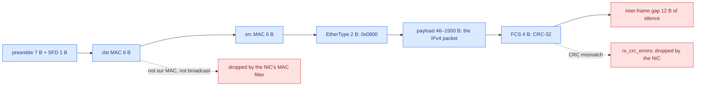
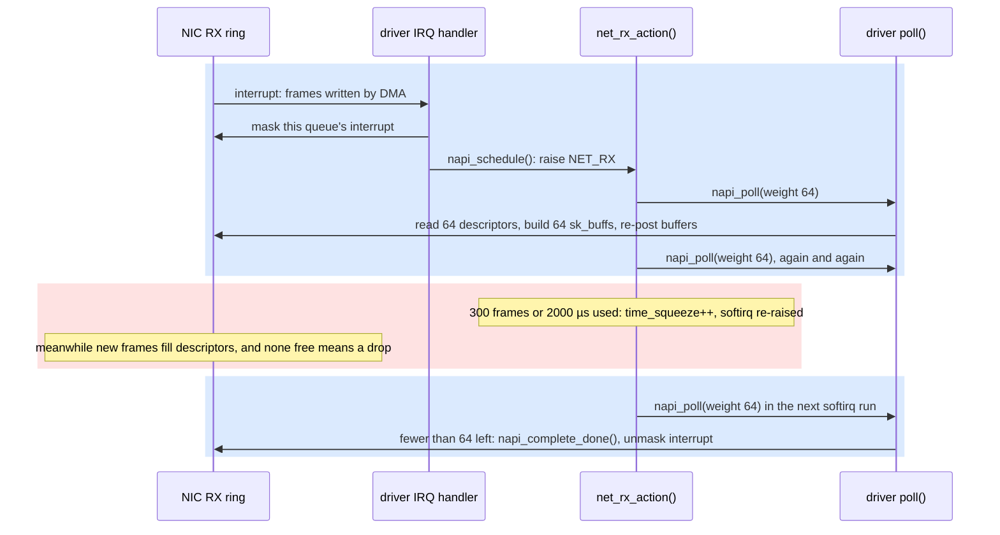
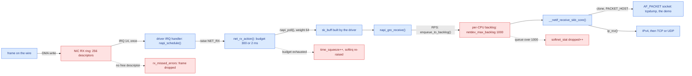
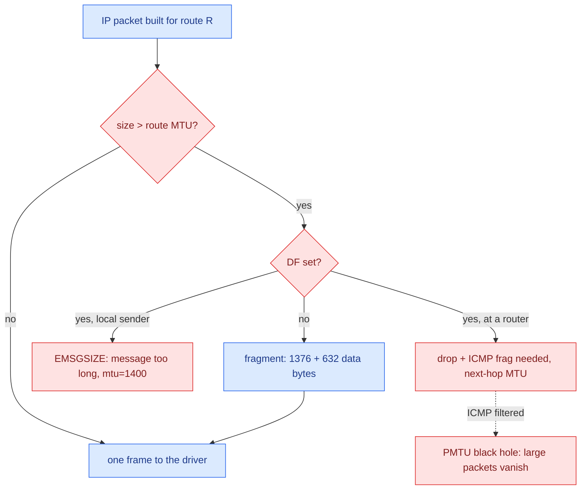

# Electrons to Frames

**Lesson 1 of 6: How Bytes Move**
**Ticketing Project**

---

## Table of Contents

1. [Why Start Below the Socket](#1-why-start-below-the-socket)
2. [From Signals to Ethernet Frames](#2-from-signals-to-ethernet-frames)
3. [The NIC, DMA Rings, Interrupts and NAPI](#3-the-nic-dma-rings-interrupts-and-napi)
4. [MTU: How Big a Frame May Be](#4-mtu-how-big-a-frame-may-be)
5. [Code: Python](#5-code-python)
6. [Code: Go](#6-code-go)
7. [Code: Rust](#7-code-rust)
8. [See It: Frames, Rings, Interrupts and the MTU](#8-see-it-frames-rings-interrupts-and-the-mtu)
9. [What People Miss](#what-people-miss)
10. [Key Files Summary](#key-files-summary)
11. [Summary](#summary)
12. [Checklist](#checklist-what-you-should-be-able-to-explain)

---

## Learning Objectives

After reading this document, you will understand:

- What an Ethernet frame is, byte by byte, and how a voltage or light pattern on a cable becomes one
- How a NIC moves frames into memory without the CPU (DMA descriptor rings), and how the kernel collects them (one interrupt, then NAPI polling inside the `NET_RX` softirq)
- Where the kernel builds the `sk_buff` that the rest of the stack, and every packet capture tool, works with
- Why the MTU is a property of a route as well as a link, what the DF bit does, and when the kernel refuses to send instead of fragmenting
- How Python, Go and Rust all reach the raw frames through the same `AF_PACKET` socket
- What breaks when a ring overflows or a path's MTU is smaller than you assumed, and which counters show it

Key mental models to internalize:

- **What makes it flow, what stops it**: at the bottom of the stack, the NIC's DMA engine and the `NET_RX` softirq make frames flow; the receive ring makes them stop. The ring is a fixed number of pre-allocated buffers. When the CPU does not drain it fast enough, the NIC has nowhere to write the next frame and drops it, silently, before any software you own has seen a byte.
- **Every layer is a buffer with a limit**: the RX ring (256 descriptors in the lab), the per-CPU backlog (`netdev_max_backlog`, 1000), the softirq's budget (300 packets or 2 ms per run). Each is a place where data waits, and each has a counter that increments when the limit is hit.
- **A packet tap sees what the kernel shows it, where the kernel shows it**: `tcpdump` and the demo read copies of `sk_buff`s handed to `AF_PACKET` sockets on transmit and on receive. That is why a loopback datagram is seen twice by the demo, and once by `tcpdump`.

Common misconceptions to avoid:

- "The kernel takes one interrupt per packet." Under load it takes one interrupt, masks further interrupts, and polls the ring in batches (NAPI). The lab's NIC delivered about three packets per interrupt over its lifetime.
- "MTU is 1500." It is 1500 on most Ethernet LANs. The lab's `eth0` has an MTU of 65535, its route caps packets at 65520 bytes, tunnels commonly use 1420 or 1450, and PPPoE uses 1492.
- "If tcpdump didn't see it, it never arrived." A frame dropped at the ring never reaches the point where `tcpdump`'s socket gets its copy. The NIC's counters are the only witness.

---

## 1. Why Start Below the Socket

When an HTTP server calls `read()` and gets the bytes `GET /events HTTP/1.1`, it is tempting to think the bytes came from "the network". They came from a buffer in kernel memory, which a softirq filled from another buffer, which a network card filled by writing into RAM on its own while the CPU was doing something else. Every one of those hand-offs is a place where data can be delayed, batched, copied or thrown away. An API developer meets them as symptoms: a p99 latency that jumps by exactly one second, a client that retransmits, a load test that "loses" requests the server never logged.

This course asks one question at every layer: **a network is a flow of data, so what makes it flow, and what makes it stop?** At the physical layer the answer is the most literal it will ever be.

- **Flow** is physics plus a DMA engine. A transmitter changes a voltage (copper) or a light level (fibre) at a fixed symbol rate. The receiver's PHY recovers the bits, finds the start of a frame, and the NIC writes the frame into a buffer the driver gave it in advance.
- **Stop** is a full buffer. The NIC can only write into buffers that the driver has posted. If the CPU does not hand the filled ones to the stack and replace them quickly enough, the next frame has nowhere to go.

Three facts make this layer matter for API work:

1. **Drops here are invisible upstream.** The application never sees a dropped frame. TCP notices the gap later and retransmits, so the symptom shows up as latency, not as an error. If the lost frame was a SYN, the client waits a full retransmission timeout (1 s on Linux) before trying again.
2. **The limits are small and fixed.** A receive ring holds a few hundred to a few thousand frames. At 10 Gb/s line rate with minimum-size frames, a NIC receives 14.88 million frames per second (IEEE 802.3: a 64-byte frame plus 8 bytes of preamble and SFD plus a 12-byte inter-frame gap is 84 bytes, or 672 bit times). A 256-entry ring fills in about 17 microseconds if nobody drains it.
3. **Bursts, not averages, overflow rings.** A server that averages 20% CPU can still drop frames during a 50-millisecond burst if the core that services the NIC is busy at that moment.

This lesson follows one frame from the cable to the `sk_buff`, the kernel structure that the rest of Module 0 keeps talking about, and shows every step with a counter or a capture in the lab.

```
TICKETING EXAMPLE: on-sale day, 10:00:00. 50,000 fans refresh
GET /events/42/seats at once. Each request is a SYN, then a ~150-byte frame
carrying the request. The api box's NIC receives a burst of 100,000 frames in
the first second, most of them inside the first 200 ms. If the core that owns
the NIC's interrupt is busy, the RX ring fills and the NIC drops frames.
Nothing is logged by `ticketing api`: the dropped SYNs simply come back one
second later as retransmits, and the dashboard shows a p99 of 1,000+ ms for
a handler that takes 4 ms.
```

---

## 2. From Signals to Ethernet Frames

### Symbols, bits and a frame boundary

A link is a pair of transceivers that agree on a **symbol rate** and a **line code**. On copper, a symbol is a voltage level held for a fixed time; on fibre, a light level. The line code maps groups of bits onto symbols so that the receiver can recover the transmitter's clock from the signal itself and so that the signal carries no DC bias. 100BASE-TX uses 4B/5B plus a three-level code, 1000BASE-T sends five-level symbols on all four pairs at once, and 10GBASE-R uses 64b/66b blocks. You do not need the details to build APIs. You need one consequence: **the PHY turns symbols back into a stream of bits, and something must say where a frame starts and ends.**

Ethernet answers that with a fixed preamble. Every frame on the wire starts with 7 bytes of alternating `10101010` (the preamble, which lets the receiver lock onto the clock) and one byte `10101011` (the start frame delimiter, SFD). After the frame, the transmitter must stay silent for at least 12 byte times (the inter-frame gap, IFG). These rules come from IEEE 802.3 and they are why a "1500-byte" frame occupies 1538 byte times on the wire.

### The frame itself

Between the SFD and the gap sits the frame the NIC hands to software:

| Field | Size | What it is |
|-------|------|------------|
| Destination MAC | 6 bytes | Which NIC on this link should keep the frame; `ff:ff:ff:ff:ff:ff` is broadcast |
| Source MAC | 6 bytes | The sending NIC's address |
| EtherType | 2 bytes | What the payload is: `0x0800` IPv4, `0x0806` ARP, `0x86dd` IPv6, `0x8100` an 802.1Q VLAN tag follows |
| Payload | 46–1500 bytes | The IP packet (padded up to 46 bytes if shorter) |
| FCS | 4 bytes | A CRC-32 over the frame; the receiving NIC checks it and drops the frame on mismatch |

The 14-byte header (destination, source, EtherType) is the "Ethernet II" format that RFC 894 uses for IP. EtherType values are 0x0600 or above; a smaller number in that position would be an 802.3 length field instead. The minimum frame is 64 bytes from destination MAC to FCS (so a 1-byte payload is padded), and the maximum without a VLAN tag is 1518 bytes, which is where the **1500-byte payload limit**, the classic MTU, comes from.



*Figure 1 — An Ethernet frame as it crosses the wire; the NIC can refuse it at two points before software ever sees it.*

### Wire time: how fast frames arrive

Because the symbol rate is fixed, the arrival rate of frames follows from their size. Count the bytes a frame really occupies on the wire (frame + 8 bytes of preamble and SFD + 12 bytes of gap) and divide the link speed by that:

| Link | Frame, dst MAC to FCS | Bytes on the wire | Frames per second at line rate | Time per frame |
|------|----------------------|-------------------|-------------------------------|----------------|
| 1 Gb/s | 64 (minimum) | 84 | 1,488,095 | 672 ns |
| 1 Gb/s | 1518 (maximum) | 1538 | 81,274 | 12.3 µs |
| 10 Gb/s | 64 | 84 | 14,880,952 | 67.2 ns |
| 10 Gb/s | 1518 | 1538 | 812,744 | 1.23 µs |
| 25 Gb/s | 64 | 84 | 37,202,381 | 26.9 ns |
| 25 Gb/s | 1518 | 1538 | 2,031,860 | 492 ns |

Hold on to the last column; it is the time budget the receiver has per frame. A ring of 256 receive buffers (the size the lab's NIC uses, section 3) holds 17 µs of minimum-size frames at 10 Gb/s, 315 µs of full-size frames at 10 Gb/s, and 3.15 ms of full-size frames at 1 Gb/s. If the CPU that drains it is busy elsewhere for longer than that during a burst, the ring overflows. Nothing about this depends on how fast your API handler is.

### MAC addresses

A MAC address is 48 bits, written as six hex bytes. Two bits of the first byte have meaning (IEEE 802): the lowest bit is the **I/G** bit (0 for one NIC, 1 for a group: multicast, or broadcast `ff:ff:ff:ff:ff:ff`), and the next bit is the **U/L** bit (0 for a globally unique address assigned by the manufacturer, 1 for a locally administered one). Every MAC in this lesson's captures is locally administered: `9e:62:20:99:17:2c` (`0x9e` = `1001 1110`), `5a:94:ef:e4:0c:dd` (`0x5a` = `0101 1010`) and the dummy NIC's random `6e:a8:45:a9:55:00` (`0x6e` = `0110 1110`) all have the second-lowest bit set. That is what virtual NICs look like: the hypervisor or the kernel invents the address, so it marks it as local.

### Two drops before the CPU

Two of those boxes are decisions the NIC makes in hardware. If the destination MAC is neither the NIC's own address, nor broadcast, nor a multicast group it was told to accept, the frame is dropped (unless the interface is in promiscuous mode, which is what a capture tool may request). If the CRC does not match, the frame is dropped and `rx_crc_errors` increments. Neither drop involves the CPU.

### What software actually sees

By the time a frame is in memory, the preamble, SFD and gap are gone, and most NICs strip the FCS too. That is why `tcpdump` reports **length 1514** for a full-size frame, not 1518: 14 bytes of header plus 1500 bytes of payload. The lab shows exactly that on `eth0`, captured with `timeout 3 tcpdump -i eth0 -e -nn -c 10` while Docker Desktop was streaming API responses to the host:

```text
21:34:00.647192 9e:62:20:99:17:2c > 5a:94:ef:e4:0c:dd, ethertype IPv4 (0x0800), length 1514: 192.168.65.7.2376 > 192.168.65.1.51604: Flags [.], seq 916757779:916759227, ack 4065269665, win 64, options [nop,nop,TS val 1305427573 ecr 2343215842], length 1448
21:34:00.647200 9e:62:20:99:17:2c > 5a:94:ef:e4:0c:dd, ethertype IPv4 (0x0800), length 1514: 192.168.65.7.2376 > 192.168.65.1.51604: Flags [.], seq 1448:2896, ack 1, win 64, options [nop,nop,TS val 1305427573 ecr 2343215842], length 1448
21:34:00.647202 9e:62:20:99:17:2c > 5a:94:ef:e4:0c:dd, ethertype IPv4 (0x0800), length 1266: 192.168.65.7.2376 > 192.168.65.1.51604: Flags [P.], seq 2896:4096, ack 1, win 64, options [nop,nop,TS val 1305427573 ecr 2343215842], length 1200
```

Read the first line from left to right: source MAC `9e:62:20:99:17:2c` (the VM's `eth0`), destination MAC `5a:94:ef:e4:0c:dd` (the VM's gateway), EtherType `0x0800`, a 1514-byte frame. Inside it: 20 bytes of IPv4 header, 32 bytes of TCP header (20 plus 12 bytes of timestamp option) and 1448 bytes of data, which add up to 1500. The three frames together carry 4096 bytes, one application write split into wire-sized pieces. Section 4 explains why these frames are 1514 bytes on an interface whose MTU is 65535.

MAC addresses only mean something on one link. When this frame reaches the gateway, the gateway strips the Ethernet header and builds a new one for its next hop; only the IP header inside survives end to end. Lesson 0.2 picks up there: how the sender found the gateway's MAC (ARP) and why it sent the frame to the gateway at all (the routing table).

```
TICKETING EXAMPLE: `curl http://127.0.0.1:8081/events` against Module 1's
`ticketing rawhttp` sends a 78-byte request. On a real LAN that request is one
frame: 14 (Ethernet) + 20 (IPv4) + 32 (TCP with timestamps) + 78 = 144 bytes
as tcpdump reports it, 148 with the FCS, 168 byte times on the wire with the
preamble and the gap. The 6 KB JSON list of events that comes back does not
fit one frame: at 1448 data bytes per segment it is five frames, four of
1514 bytes and one shorter.
```

---

## 3. The NIC, DMA Rings, Interrupts and NAPI

### Descriptor rings: memory the NIC may write without asking

A NIC that interrupted the CPU and waited for it to copy each frame would not survive a gigabit link. Instead, the driver gives the NIC a **receive ring**: an array of descriptors in RAM, each holding the physical address of an empty buffer. The NIC owns the descriptors the driver has posted. When a frame arrives and passes the MAC filter and the CRC check, the NIC writes it by **DMA** (direct memory access) into the next posted buffer, writes the frame's length and status into that descriptor, and moves on to the next one. The CPU is not involved at all.

The ring is circular and fixed-size. The driver has to keep re-posting fresh buffers behind the NIC. If the NIC catches up with the driver, every descriptor is full and the NIC has nowhere to put the next frame: it drops it and increments a hardware counter (`rx_missed_errors`, `rx_no_buffer_count` or `rx_fifo_errors`, depending on the driver). This is the first place in the course where data flow *stops*, and it stops by discarding, not by waiting.

`ethtool -g` shows the ring size. The lab's `eth0` is a `virtio_net` device in Docker Desktop's VM, where the "ring" is a virtqueue shared with the hypervisor, with 256 RX entries and a pre-set maximum of 256: it cannot be grown. Physical server NICs typically default to 256–1024 entries and allow 4096 or more (`ethtool -G eth0 rx 4096`). Transmit works the same way in reverse: the driver posts filled buffers on a TX ring, the NIC reads them by DMA and reports completion.

### One interrupt, then polling: NAPI

When the NIC has written frames, it raises an interrupt. Linux keeps the hard interrupt handler tiny: the driver masks further interrupts from that queue and calls `napi_schedule()`, which puts the device's `napi_struct` on the current CPU's poll list and raises the `NET_RX` softirq (`__napi_schedule()` in `net/core/dev.c`). That is the "New API", NAPI, documented in `Documentation/networking/napi.rst`.

The softirq handler is `net_rx_action()` in `net/core/dev.c`. It walks the poll list and calls each device's poll function through `napi_poll()` and `__napi_poll()`, which passes the driver a **weight** (64 frames by default). The driver's poll function reads completed descriptors, builds an `sk_buff` for each frame, hands it up the stack, and re-posts buffers. If the driver processed fewer frames than its weight, the ring is drained: it re-enables the interrupt and leaves the poll list. If it used the whole weight, there is more to do and it stays on the list.

`net_rx_action()` also has its own limits, and they are the reason the "packets per interrupt" ratio exceeds one under load:

```c
	int budget = READ_ONCE(net_hotdata.netdev_budget);
	...
		n = list_first_entry(&list, struct napi_struct, poll_list);
		budget -= napi_poll(n, &repoll);

		/* If softirq window is exhausted then punt.
		 * Allow this to run for 2 jiffies since which will allow
		 * an average latency of 1.5/HZ.
		 */
		if (unlikely(budget <= 0 ||
			     time_after_eq(jiffies, time_limit))) {
			/* Pairs with READ_ONCE() in softnet_seq_show() */
			WRITE_ONCE(sd->time_squeeze, sd->time_squeeze + 1);
			break;
		}
```

The budget is `net.core.netdev_budget` (300 frames) and the time limit is `net.core.netdev_budget_usecs` (2000 µs); both values are captured in the lab in section 8. When either runs out with work still pending, the kernel increments `time_squeeze` for that CPU, re-raises the softirq and lets other work run. A rising `time_squeeze` means the CPU could not keep up with the NIC in one go. It is the early warning before ring drops.

The timeline of one burst, from the NIC's interrupt to the ring being empty again, looks like this:



*Figure 2 — NAPI turns one interrupt into a series of polls; the red phase is where the CPU yields and the ring keeps filling.*

Two more knobs shape this timeline. **Interrupt coalescing** (`ethtool -c`) lets the NIC wait a few microseconds or a few frames before interrupting at all, trading latency for fewer interrupts. **ksoftirqd**: if softirqs keep being re-raised, the kernel stops running them on the way out of every interrupt and hands them to a per-CPU kernel thread, `ksoftirqd/N`, which the scheduler treats like any other thread. A busy `ksoftirqd` in `top` is the same signal as a rising `time_squeeze`.

### The sk_buff, GRO and RPS

For every frame the driver builds a `struct sk_buff` (`include/linux/skbuff.h`). The `sk_buff` is metadata that points into the buffer holding the frame: `head`, `data`, `tail` and `end` pointers, plus the device, the protocol, timestamps and offsets of the MAC, network and transport headers. As each layer parses its header, it moves the `data` pointer forward instead of copying bytes. The same `sk_buff` travels up through IP and TCP and finally sits in a socket's receive queue (lesson 0.4), until `read()` copies its payload into your buffer.

Two optimizations sit between the driver and IP:

- **GRO** (generic receive offload, `napi_gro_receive()`) merges consecutive TCP segments of the same flow into one large `sk_buff`, so the stack processes one 64 KB "super-packet" instead of 45 small ones. This is why a capture on a receiver can show TCP segments larger than the MTU.
- **RPS** (receive packet steering, `Documentation/networking/scaling.rst`) lets the CPU that took the interrupt hash each packet's flow and queue it on another CPU's backlog (`get_rps_cpu()` and `enqueue_to_backlog()` in `net/core/dev.c`). The lab's `eth0` has one queue and one interrupt line, both on `cpu0`, and `rps_cpus` set to `3ffe`, which is the bit mask for CPUs 1 to 13. The protocol work is spread across the other cores. Each per-CPU backlog has its own limit, `net.core.netdev_max_backlog` (1000 packets); `enqueue_to_backlog()` drops packets beyond it and counts them in the `dropped` column of `/proc/net/softnet_stat`.

### Where packet taps get their copies

`tcpdump` and this lesson's demo both open an `AF_PACKET` socket. Opening one with protocol `ETH_P_ALL` registers a handler on the kernel's `ptype_all` list, and the kernel delivers a clone of every matching `sk_buff` to it at two points:

- **Receive:** `__netif_receive_skb_core()` walks `ptype_all` before handing the packet to IPv4 (`ip_rcv()`), so a tap sees the frame after the driver and GRO, but before IP, netfilter or TCP have looked at it. The packet's type is `PACKET_HOST` (or broadcast, multicast, otherhost).
- **Transmit:** `dev_queue_xmit_nit()` clones each outgoing `sk_buff` just before the driver gets it and marks the clone `skb2->pkt_type = PACKET_OUTGOING`.

On the loopback device, the same packet passes both points: it is "transmitted" by `lo` and immediately "received" by `lo`. A raw `AF_PACKET` socket therefore receives every loopback packet twice. libpcap knows this and discards the outgoing copy on loopback in user space, which is why section 8 shows `tcpdump` reporting `6 packets received by filter` but `3 packets captured`, while the demo prints both copies.



*Figure 3 — A received frame flows from the wire to IP through two buffers (the RX ring and the per-CPU backlog); each has a limit and a counter that increments when the limit is hit.*

### The transmit side, briefly

Sending is the same picture in reverse, with one more buffer. A packet leaving IP is queued on the device's **qdisc** (queueing discipline): the lab's `eth0` uses `pfifo_fast` with a `qlen 1000`, both visible in the `ip -s link` output in section 8.3. The qdisc feeds the driver's TX ring; the NIC reads each buffer by DMA, puts the frame on the wire, and reports completion so that the driver can free the `sk_buff`. When the TX ring is full the driver stops the queue and packets wait in the qdisc; when the qdisc is full too, new packets are dropped and counted (`tc -s qdisc show dev eth0`). The transmit tap, `dev_queue_xmit_nit()`, sits between the qdisc and the driver, so `tcpdump` shows outgoing packets after they have left the qdisc, not when the application wrote them. Lessons 0.3 and 0.4 add the buffer above all of this, the socket's send buffer, which is where a slow network finally pushes back on `write()`.

### Where each stop is counted

| Stop point | What happened | Where it is counted | Command |
|------------|---------------|---------------------|---------|
| NIC MAC filter | Frame not addressed to this NIC | nowhere (by design) | `tcpdump -p` vs promiscuous capture |
| NIC CRC check | Frame corrupted on the wire | `rx_crc_errors` | `ethtool -S eth0`, `ip -s -s link` |
| RX ring full | No free descriptor for a new frame | `rx_missed_errors`, `rx_drops`, `rx_no_buffer_count` | `ip -s link` (`missed`), `ethtool -S eth0` |
| Softirq budget | 300 frames or 2 ms used, work left | `time_squeeze` (column 3) | `/proc/net/softnet_stat` |
| Per-CPU backlog full | More than `netdev_max_backlog` queued | `dropped` (column 2), `rx_dropped` | `/proc/net/softnet_stat`, `ip -s link` (`dropped`) |
| Qdisc full (transmit) | Driver queue stopped, qdisc at `qlen` | `dropped` in the qdisc stats | `tc -s qdisc show dev eth0` |

The first five rows are all below the IP layer: no firewall rule, no socket and no application sees these frames. When a load test "loses" requests that never appear in any server log, this table is the checklist.

```
TICKETING EXAMPLE: the api box in Module 7 serves POST /orders at 8,000
requests per second through one 10 GbE NIC queue whose interrupt lands on
cpu0. A burst of 3,000 frames arrives in 1 ms. NAPI drains 64 per poll and at
most 300 per softirq run, so it takes ten softirq runs to clear the burst;
time_squeeze on cpu0 rises by nine. With a 512-entry ring the NIC drops ~2,500
frames that it could not post, rx_missed_errors jumps, and those POSTs arrive
late as TCP retransmits. `ethtool -G eth0 rx 4096` and spreading the interrupt
over more queues (RSS) are the fixes, not a faster handler.
```

---

## 4. MTU: How Big a Frame May Be

### Link MTU and route MTU

The **MTU** (maximum transmission unit) is the largest IP packet a link will carry in one frame: the Ethernet payload limit, 1500 bytes on classic Ethernet. Linux keeps an MTU in two places:

- **On the device**, set with `ip link set dev eth0 mtu N`. The lab's `eth0` has an MTU of 65535 and `lo` has 65536.
- **On a route**, as a route attribute (`ip route add … mtu N`) or as a cached value learned from the network. The lab's route to `192.168.65.0/24` carries `mtu 65520`, and `ip route get` reports it as `cache mtu 65520`.

When IP builds a packet, the limit it enforces is the route's MTU if one is set, else the device's. In the lab that means packets to the gateway can be at most 65520 bytes, not 65535.

The values you will actually meet vary more than "1500" suggests:

| Link | Typical MTU | Where the number comes from |
|------|-------------|-----------------------------|
| Ethernet | 1500 | RFC 894: the maximum 802.3 payload |
| Ethernet with jumbo frames | 9000 (vendor-specific, often 9001 on cloud VMs) | Not in 802.3; every hop must agree |
| PPPoE (DSL) | 1492 | 8 bytes of PPPoE and PPP header inside a 1500-byte payload (RFC 2516) |
| VXLAN overlay | 1450 | 50 bytes of outer Ethernet, IP, UDP and VXLAN headers (RFC 7348) |
| WireGuard | 1420 | Its default: room for the outer IPv6, UDP and WireGuard headers |
| Linux loopback (`lo`) | 65536 | No wire; the kernel's default for `lo` |
| The lab's `eth0` / its route | 65535 / 65520 | Docker Desktop's VM settings, captured in section 8 |
| IPv6 minimum | 1280 | RFC 8200: every IPv6 link must carry at least this |
| IPv4 maximum packet | 65535 | RFC 791: the 16-bit Total Length field |

### DF: refuse, or fragment

IPv4 has a "Don't Fragment" flag in the header (RFC 791). What happens when a packet is larger than the MTU depends on it:

- **DF clear:** the sender (or a router on the path) splits the packet into **fragments**. Each fragment carries its own IP header; fragment payloads are multiples of 8 bytes, and only the receiving host reassembles them. Losing one fragment loses the whole packet.
- **DF set:** fragmentation is forbidden. A local sender gets `EMSGSIZE` from the kernel and `ping` prints `local error: message too long, mtu=…`. A router that cannot forward the packet drops it and sends back an ICMP "fragmentation needed" message carrying its next-hop MTU (RFC 1191). That is **Path MTU Discovery**: the sender lowers its cached route MTU and sends smaller packets.

Linux TCP sets DF on every segment by default (`net.ipv4.ip_no_pmtu_disc=0`), so it relies on those ICMP messages. If a firewall drops them, large packets vanish while small ones get through: the classic **PMTU black hole**. Packetization-layer PMTUD (RFC 8899, and RFC 4821 for TCP, enabled with `net.ipv4.tcp_mtu_probing`) avoids depending on ICMP by probing with progressively larger segments. IPv6 routers never fragment at all (RFC 8200), so the same logic applies with no fallback.



*Figure 4 — The MTU check: a packet that does not fit either becomes fragments or is refused; with DF set and ICMP filtered, it simply disappears.*

The section 8 capture walks this chart on a dummy interface set to MTU 1400. A 1373-byte ICMP payload is 1401 bytes of IP (8 bytes of ICMP header, 20 of IP), so with `-M do` the kernel refuses it. A 1372-byte payload is exactly 1400 bytes and leaves as one 1414-byte frame. A 2000-byte payload with `-M dont` is a 2028-byte packet; the kernel splits it into a 1396-byte fragment (20 bytes of header, 1376 of data, a multiple of 8) and a 652-byte one (20 + 632), which `tcpdump` shows as frames of 1410 and 666 bytes.

### MSS: how TCP avoids the question

TCP sidesteps fragmentation by never sending a segment that would not fit. In its SYN, each side announces a **maximum segment size** (MSS), normally its MTU minus 40 bytes of IPv4 and TCP header: 1460 for a 1500-byte MTU. The peer then never sends more data than that per segment (and 12 bytes less when TCP timestamps are on, hence the familiar 1448).

That explains the frames in section 2. The VM's `eth0` has an MTU of 65535, yet its segments to `192.168.65.1` carried 1448 data bytes in 1514-byte frames: the far end of that connection announced an MSS consistent with a 1500-byte MTU, and the VM honours the smaller of its own MTU and the peer's MSS. The link was capable of much bigger frames; the connection was not allowed to use them.

```
TICKETING EXAMPLE: in Module 7 the api in region A reads seat maps from a
Postgres replica in region B over a WireGuard tunnel whose MTU is 1420. A
health check (`SELECT 1`, a 60-byte reply) always works. A seat-map query
that returns 40 KB hangs: the replica's first 1500-byte DF segment is too big
for the tunnel, the router's ICMP "fragmentation needed" is filtered by a
cloud firewall, and nothing smaller is ever tried. `ping -M do -s 1393` (1421
bytes) fails where `-s 1392` (1420) works; clamping the MSS to 1380 on the
tunnel fixes the query without touching the application.
```

---

## 5. Code: Python

Module 0 has no app code: the ticketing service starts in Module 1. Each lesson in this module ships a demo instead, in Python, Go and Rust, with the same flags and the same output lines. This lesson's demo is [`demos/00/01/python/main.py`](../../demos/00/01/python/main.py), a sniffer built on an `AF_PACKET` socket. It is the smallest program that reads frames the way `tcpdump` does, and it only needs the standard library.

### Constants: the frame layout and the kernel's vocabulary

```python
ETH_P_ALL = 0x0003  # include/uapi/linux/if_ether.h: every protocol
ETH_HEADER = struct.Struct("!6s6sH")  # dst MAC, src MAC, EtherType (network byte order)
ETHERTYPES = {0x0800: "IPv4", 0x0806: "ARP", 0x86DD: "IPv6", 0x8100: "802.1Q"}
# sll_pkttype, include/uapi/linux/if_packet.h: who the frame was for
PKTTYPES = {0: "host", 1: "broadcast", 2: "multicast", 3: "otherhost", 4: "outgoing"}
IP_PROTOS = {1: "ICMP", 6: "TCP", 17: "UDP"}
SMOKE_PORT = 9001
SMOKE_PAYLOAD = b"m0 smoke"
```

`ETH_HEADER` is the 14-byte Ethernet II header from section 2, expressed as a `struct` format: `!` means network byte order (big-endian), `6s6s` are the two MAC addresses as raw bytes, and `H` is the 16-bit EtherType. `PKTTYPES` mirrors the kernel's `PACKET_*` constants: when the demo receives a frame, the kernel also says *why* this socket got it, and value 4, `PACKET_OUTGOING`, is the copy made by `dev_queue_xmit_nit()` on transmit.

### Opening the tap

```python
def open_sniffer(iface: str) -> socket.socket:
    # SOCK_RAW keeps the link-layer header; htons(ETH_P_ALL) asks for every EtherType.
    sock = socket.socket(socket.AF_PACKET, socket.SOCK_RAW, socket.htons(ETH_P_ALL))
    sock.bind((iface, ETH_P_ALL))  # one interface, not all of them
    return sock
```

Three choices are packed into these lines:

- **`AF_PACKET`** asks for link-layer frames instead of IP packets or TCP streams. The kernel registers the socket on `ptype_all` (section 3), so it receives clones from `__netif_receive_skb_core()` and `dev_queue_xmit_nit()`.
- **`SOCK_RAW`** keeps the 14-byte Ethernet header in what `recvfrom()` returns. `SOCK_DGRAM` would strip it and report the addresses separately.
- **The protocol is in network byte order in `socket()`** (hence `socket.htons`), because CPython passes the third argument straight to the `socket(2)` syscall. The `bind()` tuple takes the protocol in host order: CPython converts it with `htons()` when it builds the `sockaddr_ll` (`getsockaddrarg()` in `Modules/socketmodule.c`). Binding to one interface name restricts the socket to that device's `ifindex`; without the bind it would see every interface.

Opening an `AF_PACKET` socket needs `CAP_NET_RAW`. The lab runs as root; `run.sh` uses `sudo -n` on a Linux host, and on macOS (which has no `AF_PACKET`) it re-runs itself inside the lab container.

### Reading and decoding one frame

```python
def describe(frame: bytes, pkttype: int) -> tuple[str, int, int | None]:
    """Frame summary line, its EtherType, and the transport destination port (if any)."""
    dst, src, ethertype = ETH_HEADER.unpack_from(frame)
    payload = frame[ETH_HEADER.size :]
    line = (
        f"{mac(src)} > {mac(dst)} type 0x{ethertype:04x} {ETHERTYPES.get(ethertype, '?')} "
        f"len {len(frame)} {PKTTYPES.get(pkttype, pkttype)}"
    )
    dport = None
    if ethertype == 0x0800:
        summary, dport = describe_ipv4(payload)
        line += f" | {summary}"
    return line, ethertype, dport
```

The frame arrives as a `bytes` object that starts at the destination MAC: the preamble, SFD and FCS never reach software (section 2). `unpack_from` reads the first 14 bytes; everything after them is the payload, whose meaning the EtherType decides. `len(frame)` is the same number `tcpdump` prints as `length`. Only when the EtherType is `0x0800` does the demo look inside, with `describe_ipv4()`:

```python
    version, ihl = packet[0] >> 4, (packet[0] & 0x0F) * 4  # ihl: header length in 32-bit words
    if version != 4 or ihl < 20 or len(packet) < ihl:
        return "malformed IPv4 header", None
    proto = packet[9]
    src, dst = socket.inet_ntoa(packet[12:16]), socket.inet_ntoa(packet[16:20])
    name = IP_PROTOS.get(proto, f"proto {proto}")
    offset = (struct.unpack_from("!H", packet, 6)[0] & 0x1FFF) * 8  # fragment offset, bytes
    if offset:  # a later fragment carries payload bytes, not the TCP/UDP header
        return f"{name} {src} > {dst} fragment at byte {offset}", None
    if proto in (6, 17) and len(packet) >= ihl + 4:
        sport, dport = struct.unpack_from("!HH", packet, ihl)
        return f"{name} {src}:{sport} > {dst}:{dport}", dport
    return f"{name} {src} > {dst}", None
```

These offsets are RFC 791's IPv4 header: the high nibble of byte 0 is the version (4), the low nibble is the header length in 32-bit words (5, so 20 bytes, without options), bytes 6–7 hold the flags and the 13-bit fragment offset in units of 8 bytes, byte 9 is the protocol number, and bytes 12–15 and 16–19 are the addresses. TCP and UDP both start with two 16-bit ports, so one `unpack_from` at offset `ihl` reads either, but only in the first fragment: the 2000-byte ping in section 4 leaves as a 1410-byte frame and a second frame whose IP payload starts at byte 1376 of the original datagram, and the 4 bytes at its `ihl` are ICMP data, not ports. A sniffer that skipped the offset check would print invented port numbers for every later fragment. Lesson 0.2 builds a DNS packet with the same `struct` technique, in the other direction.

The receive loop itself is one call:

```python
            # addr = (ifname, protocol, pkttype, hatype, hwaddr): a sockaddr_ll
            frame, addr = sock.recvfrom(65535)
```

`recvfrom()` on an `AF_PACKET` socket returns the frame and a `sockaddr_ll` describing it. `addr[2]` is `sll_pkttype`, the field that tells the demo whether this copy came from the receive path (`host`) or the transmit path (`outgoing`).

### The smoke test: one datagram, two copies

```python
def send_smoke_datagrams() -> socket.socket:
    """Send a few UDP datagrams to 127.0.0.1:9001 with a receiver bound, so no ICMP error."""
    receiver = socket.socket(socket.AF_INET, socket.SOCK_DGRAM)
    receiver.bind(("127.0.0.1", SMOKE_PORT))
    with socket.socket(socket.AF_INET, socket.SOCK_DGRAM) as sender:
        for _ in range(3):
            sender.sendto(SMOKE_PAYLOAD, ("127.0.0.1", SMOKE_PORT))
    return receiver
```

`--smoke` binds the sniffer to `lo` first, then sends three 8-byte UDP datagrams to `127.0.0.1:9001`. A receiver is bound so that the kernel does not answer with an ICMP "port unreachable" (which would add frames to the capture). The test passes when the sniffer has seen a datagram to port 9001 with both `outgoing` and `host` packet types, which is the loopback double delivery from section 3. Each frame is 50 bytes: 14 (Ethernet) + 20 (IPv4) + 8 (UDP header) + 8 (`m0 smoke`).

```
TICKETING EXAMPLE: from Module 1 on, `ticketing rawhttp` listens on
127.0.0.1:8081. Run `python3 demos/00/01/python/main.py -n 20` in one lab
shell and `curl http://127.0.0.1:8081/events` in another: the sniffer prints
the handshake, the request and the response as frames with
`type 0x0800 IPv4 … | TCP 127.0.0.1:54321 > 127.0.0.1:8081`, each one twice
(outgoing, then host), with all-zero MACs because lo has no wire.
```

---

## 6. Code: Go

The Go port must print the same lines for the same flags (`--iface`, `-n`/`--count`, `--timeout`, `--smoke`) and use the raw syscalls rather than a capture library: `syscall.Socket(syscall.AF_PACKET, syscall.SOCK_RAW, int(htons(syscall.ETH_P_ALL)))`, `syscall.Bind` with a `*syscall.SockaddrLinklayer` carrying the interface index, and `syscall.Recvfrom`, whose returned `*syscall.SockaddrLinklayer` has the `Pkttype` field the output needs. What differs from Python is mostly byte order: Go has no `socket.htons`, so the port swaps the two bytes of `ETH_P_ALL` itself, and it decodes the header with `encoding/binary.BigEndian`.

The port is three files. `main.go` starts with `//go:build linux`; `main_other.go` (`//go:build !linux`) prints `sniff: AF_PACKET is Linux-only; run it in the lab: just demo 00/01 go` and exits 2; and a three-line `go.mod` makes the directory a package, because `go build main.go` with an explicit file list ignores build tags while `go build .` honours them. That is what lets `go vet` run on macOS. Opening the tap takes the same three steps as in Python, with errors returned as values instead of raised:

```go
// openSniffer opens the tap and binds it to one interface.
func openSniffer(iface string) (fd, ifindex int, err error) {
	// SOCK_RAW keeps the link-layer header; htons(ETH_P_ALL) asks for every EtherType.
	fd, err = syscall.Socket(syscall.AF_PACKET, syscall.SOCK_RAW, int(htons(syscall.ETH_P_ALL)))
	if err != nil {
		return -1, 0, err
	}
	ifi, err := net.InterfaceByName(iface)
	if err != nil {
		syscall.Close(fd)
		return -1, 0, syscall.ENODEV // what bind() reports for an unknown interface
	}
	// CPython's bind() tuple takes the protocol in host order and swaps it for
	// you; Go copies SockaddrLinklayer into the sockaddr_ll as is, so htons() again.
	sa := &syscall.SockaddrLinklayer{Protocol: htons(syscall.ETH_P_ALL), Ifindex: ifi.Index}
	if err := syscall.Bind(fd, sa); err != nil {
		syscall.Close(fd)
		return -1, 0, err
	}
	return fd, ifi.Index, nil
}
```

Two things CPython did implicitly are explicit here. `net.InterfaceByName` turns the name into the index that `syscall.Bind` needs (CPython does that lookup inside `bind()`), and `SockaddrLinklayer.Protocol` is copied into the `sockaddr_ll` unchanged, so it gets `htons()` too. `sniff()` then sorts the error into the same exit codes: `EPERM` or `EACCES` is 3, anything else prints `sniff: cannot bind to 'IFACE': …` and is 2. Go's errno text is lower-case (`no such device`), so a small `strerror()` capitalises it to read like the C library's.

The receive loop sets `SO_RCVTIMEO` (0.5 s) where Python calls `settimeout()`, which CPython implements with `poll()`:

```go
	for seen < count && time.Now().Before(deadline) {
		n, from, err := syscall.Recvfrom(fd, buf, 0)
		if err == syscall.EAGAIN || err == syscall.EINTR {
			continue // the 0.5 s timeout (or a runtime signal): check the deadline again
		}
		if err != nil {
			fmt.Println("sniff: recvfrom:", strerror(err))
			return 1
		}
		ll, ok := from.(*syscall.SockaddrLinklayer) // the sockaddr_ll the kernel filled in
		if !ok || n < ethHeaderLen {
			continue
		}
		seen++
		line, ethertype, dport := describe(buf[:n], ll.Pkttype)
		fmt.Printf("frame %d: %s\n", seen, line)
```

`EINTR` is retried along with `EAGAIN`: signal(7) says a receive on a socket with `SO_RCVTIMEO` is never restarted after a signal handler runs, and a Go process has handlers installed for every signal. The type assertion on `from` is where the direction comes from: `syscall.Recvfrom` decodes the `sockaddr_ll` into a `*syscall.SockaddrLinklayer`, and its `Pkttype` field is `sll_pkttype`. In the lab, `just demo 00/01 go --smoke` prints the same two 50-byte frames as the Python demo, `outgoing` then `host`.

```
TICKETING EXAMPLE: the Go port of `ticketing rawhttp` (Module 1) is observed
the same way: `go run demos/00/01/go/main.go -n 20` while curl requests
GET /events on 127.0.0.1:8081 shows the same 0x0800 frames, twice each.
```

---

## 7. Code: Rust

The Rust port must print the same lines for the same flags, through the `libc` crate (a minimal `Cargo.toml` beside `main.rs`): `libc::socket(libc::AF_PACKET, libc::SOCK_RAW, (libc::ETH_P_ALL as u16).to_be() as i32)`, `libc::bind` with a `libc::sockaddr_ll` whose `sll_ifindex` comes from `libc::if_nametoindex`, and `libc::recvfrom` into a buffer plus a `sockaddr_ll` whose `sll_pkttype` gives the direction. What differs from Python is that every call is `unsafe` and returns `-1` with `errno`, so the port wraps each one and turns failures into the same `sniff: …` messages and exit codes (2 for platform or bind errors, 3 for missing `CAP_NET_RAW`).

`rust/Cargo.toml` lists one dependency, `libc` with `default-features = false`. The socket code is marked `#[cfg(target_os = "linux")]`, and a second `sniff()` for every other platform prints the Linux-only message and exits 2, so `cargo clippy` also runs on macOS; the decoders (`describe()`, `describe_ipv4()`, `mac()`) are ordinary portable Rust. Opening the tap:

```rust
/// Open the tap and bind it to one interface; returns the socket and its ifindex.
#[cfg(target_os = "linux")]
fn open_sniffer(iface: &str) -> io::Result<(OwnedFd, u32)> {
    // SOCK_RAW keeps the link-layer header; htons(ETH_P_ALL) asks for every EtherType.
    let protocol = (libc::ETH_P_ALL as u16).to_be();
    let fd = unsafe { libc::socket(libc::AF_PACKET, libc::SOCK_RAW, protocol as i32) };
    if fd < 0 {
        return Err(io::Error::last_os_error());
    }
    let sock = unsafe { OwnedFd::from_raw_fd(fd) }; // closed on drop, on every path below
    let name = CString::new(iface).map_err(|_| io::Error::from_raw_os_error(libc::ENODEV))?;
    let ifindex = unsafe { libc::if_nametoindex(name.as_ptr()) };
    if ifindex == 0 {
        return Err(io::Error::last_os_error()); // ENODEV: no such interface
    }
    // One interface, not all of them. sll_protocol is in network byte order too.
    let mut addr: libc::sockaddr_ll = unsafe { mem::zeroed() };
    addr.sll_family = libc::AF_PACKET as u16;
    addr.sll_protocol = protocol;
    addr.sll_ifindex = ifindex as i32;
    let len = mem::size_of::<libc::sockaddr_ll>() as libc::socklen_t;
    let ret = unsafe { libc::bind(fd, (&addr as *const libc::sockaddr_ll).cast(), len) };
    if ret < 0 {
        return Err(io::Error::last_os_error());
    }
    Ok((sock, ifindex))
}
```

`OwnedFd::from_raw_fd` gives the integer an owner right after `socket()` returns, so every `return Err(…)` below it closes the socket on the way out. `(libc::ETH_P_ALL as u16).to_be()` is `htons()`: `to_be()` does nothing on a big-endian CPU and swaps the bytes on x86-64 and arm64. Errors come back as `io::Error::last_os_error()`; `sniff()` matches `raw_os_error()` against `EPERM` and `EACCES` for exit 3 and uses `libc::strerror` for the message, so it reads `No such device` rather than Rust's `No such device (os error 19)`.

`recvfrom()` writes the frame into the buffer and the `sockaddr_ll` into a struct passed by pointer, and `sll_pkttype` is read straight out of that struct:

```rust
/// One recvfrom(): the frame's length and the sll_pkttype of the sockaddr_ll beside it.
#[cfg(target_os = "linux")]
fn recv_frame(fd: RawFd, buf: &mut [u8]) -> io::Result<(usize, u8)> {
    let mut addr: libc::sockaddr_ll = unsafe { mem::zeroed() };
    let mut len = mem::size_of::<libc::sockaddr_ll>() as libc::socklen_t;
    let from = (&mut addr as *mut libc::sockaddr_ll).cast();
    let n = unsafe { libc::recvfrom(fd, buf.as_mut_ptr().cast(), buf.len(), 0, from, &mut len) };
    if n < 0 {
        return Err(io::Error::last_os_error());
    }
    Ok((n as usize, addr.sll_pkttype))
}
```

```
TICKETING EXAMPLE: the Rust port of `ticketing rawhttp` answers GET /events
on 127.0.0.1:8081 with the same bytes; the Rust sniffer shows its frames with
the same summary lines, so a diff of the two outputs differs only in ports
and timestamps.
```

---

## 8. See It: Frames, Rings, Interrupts and the MTU

Every command below runs in the lab (`just lab`, working directory `/work`). The captures come from kernel 7.0.14-linuxkit in Docker Desktop's VM on aarch64, whose `eth0` is a `virtio_net` device. The lab shares the VM's network namespace, so it has two useful interfaces: `lo` and the VM's `eth0`. Real NIC hardware counters (ring overflows, CRC errors) stay at zero on a virtual NIC; the commands are the same ones you would run on a bare-metal server.

### 8.1 The sniffer and tcpdump on lo — one datagram, two taps

```bash
timeout 4 tcpdump -l -i lo -e -nn udp port 9001 &
python3 demos/00/01/python/main.py --smoke
```

```text
sniff: AF_PACKET socket fd=3 bound to lo (ifindex 1)
frame 1: 00:00:00:00:00:00 > 00:00:00:00:00:00 type 0x0800 IPv4 len 50 outgoing | UDP 127.0.0.1:58314 > 127.0.0.1:9001
frame 2: 00:00:00:00:00:00 > 00:00:00:00:00:00 type 0x0800 IPv4 len 50 host | UDP 127.0.0.1:58314 > 127.0.0.1:9001
smoke: OK, the datagram to :9001 crossed lo twice (outgoing, host)
22:19:52.214314 00:00:00:00:00:00 > 00:00:00:00:00:00, ethertype IPv4 (0x0800), length 50: 127.0.0.1.58314 > 127.0.0.1.9001: UDP, length 8
…
3 packets captured
6 packets received by filter
0 packets dropped by kernel
```

Frames 1 and 2 are the same datagram (same source port `58314`): once as `outgoing`, the clone `dev_queue_xmit_nit()` makes on transmit, once as `host`, the delivery from `__netif_receive_skb_core()`. Both are 50 bytes, with an Ethernet header of zero MACs and EtherType `0x0800`: loopback has no wire, but the kernel still gives every packet a 14-byte Ethernet header so that taps see one layout. The last three lines are `tcpdump`'s statistics for the three datagrams: the kernel delivered six copies to its socket ("received by filter"), and libpcap kept three, because it drops the outgoing copy on loopback.

### 8.2 tcpdump -e and the sniffer on eth0 — real MAC addresses

```bash
timeout 5 tcpdump -l -i eth0 -e -nn -c 4 icmp &
ping -c 2 -i 0.3 -W 1 192.168.65.1
python3 demos/00/01/python/main.py --iface eth0 -n 3 --timeout 5
```

```text
22:19:56.202484 9e:62:20:99:17:2c > 5a:94:ef:e4:0c:dd, ethertype IPv4 (0x0800), length 98: 192.168.65.3 > 192.168.65.1: ICMP echo request, id 28807, seq 1, length 64
22:19:56.202657 5a:94:ef:e4:0c:dd > 9e:62:20:99:17:2c, ethertype IPv4 (0x0800), length 98: 192.168.65.1 > 192.168.65.3: ICMP echo reply, id 28807, seq 1, length 64
…
sniff: AF_PACKET socket fd=3 bound to eth0 (ifindex 4)
frame 1: 9e:62:20:99:17:2c > 5a:94:ef:e4:0c:dd type 0x0800 IPv4 len 455 outgoing | TCP 192.168.65.7:2376 > 192.168.65.1:46930
frame 2: 5a:94:ef:e4:0c:dd > 9e:62:20:99:17:2c type 0x0800 IPv4 len 66 host | TCP 192.168.65.1:46930 > 192.168.65.7:2376
```

`-e` makes `tcpdump` print the Ethernet header. The echo request leaves from `9e:62:20:99:17:2c` (the VM's `eth0`) to `5a:94:ef:e4:0c:dd` (the gateway); the reply swaps them. Each frame is 98 bytes: 14 + 20 (IP) + 8 (ICMP) + 56 bytes of ping data. The sniffer, bound to `eth0`, shows the same two MAC addresses on whatever traffic happens to be flowing (here Docker's API on port 2376), with the direction the kernel reported. Lesson 0.2 shows how the VM learned the gateway's MAC with ARP.

### 8.3 ip -s link and ethtool — the NIC's counters and ring size

```bash
ip -s link show eth0
ethtool -g eth0
ethtool -S eth0 | grep -E 'drop|miss|kicks' | head -n 6
```

```text
4: eth0: <BROADCAST,MULTICAST,UP,LOWER_UP> mtu 65535 qdisc pfifo_fast state UP mode DEFAULT group default qlen 1000
    link/ether 9e:62:20:99:17:2c brd ff:ff:ff:ff:ff:ff
    RX:   bytes  packets errors dropped  missed   mcast           
     4929639130 28154553      0       0       0       0 
Ring parameters for eth0:
Pre-set maximums:
RX:			256
…
Current hardware settings:
RX:			256
```

`ip -s link` is the kernel's per-device summary: 28 million frames received, and two columns that matter for this lesson. `missed` is `rx_missed_errors`, frames the NIC dropped because it had no free descriptor (the ring was full); `dropped` counts frames the kernel discarded after the driver handed them over (for example a full per-CPU backlog). Both are zero here. `ethtool -g` shows the RX ring at 256 descriptors with a pre-set maximum of 256, so this virtual NIC's ring cannot be grown; on a physical NIC the maximum is usually larger and `ethtool -G eth0 rx 4096` raises it. The driver-specific counters from `ethtool -S` (`rx_drops: 0`, `rx0_drops: 0` per queue) are where ring drops show up first on real hardware.

### 8.4 sysctl, rps_cpus, /sys/kernel/irq and softnet_stat — NAPI at work

NAPI's limits and the RPS mask (this section's captures come from a later `just see 00/01` run than 8.3, so the counters are slightly higher):

```bash
sysctl net.core.netdev_budget net.core.netdev_budget_usecs net.core.netdev_max_backlog
cat /sys/class/net/eth0/queues/rx-0/rps_cpus
```

```text
net.core.netdev_budget = 300
net.core.netdev_budget_usecs = 2000
net.core.netdev_max_backlog = 1000
3ffe
```

The first three lines are NAPI's limits from section 3: at most 300 frames or 2000 µs per `net_rx_action()` run, and 1000 packets per CPU backlog. `3ffe` is the RPS mask: CPUs 1–13 may do the protocol work for this queue.

`/proc/interrupts` is masked by the container runtime and reads as empty inside the lab (on a bare-metal host, `grep eth0 /proc/interrupts` shows the same counts). The kernel exposes each IRQ under `/sys/kernel/irq/<n>/` too: find the NIC's IRQ by its action name, read its per-CPU counts, total them, and divide the device's packet counters by the total:

```bash
grep -H -E '^(virtio0|eth0)' /sys/kernel/irq/*/actions
cat /sys/kernel/irq/14/per_cpu_count
tr , '\n' < /sys/kernel/irq/14/per_cpu_count | awk '{s += $1} END {print s}'
echo $(( ($(cat /sys/class/net/eth0/statistics/rx_packets) + $(cat /sys/class/net/eth0/statistics/tx_packets)) / $(tr , '\n' < /sys/kernel/irq/14/per_cpu_count | awk '{s += $1} END {print s}') ))
```

```text
/sys/kernel/irq/14/actions:virtio0
16098757,0,0,0,0,0,0,0,0,0,0,0,0,0
16098762
3
```

IRQ 14 belongs to `virtio0`, the device behind `eth0`. All of its 16.1 million interrupts landed on `cpu0` (the second line is one count per CPU; the total read a moment later is five higher). Dividing the 60-odd million packets the NIC has moved by those interrupts gives 3: on average three packets per interrupt, which is NAPI batching at work.

`/proc/net/softnet_stat` has one row of hexadecimal counters per CPU; column 1 is `processed`, column 2 `dropped`, column 3 `time_squeeze`, and column 13 the CPU number:

```bash
head -n 2 /proc/net/softnet_stat
head -n 4 /proc/net/softnet_stat | while read -r -a f; do echo "cpu$((16#${f[12]})) processed=$((16#${f[0]})) dropped=$((16#${f[1]})) time_squeeze=$((16#${f[2]}))"; done
```

```text
00a40441 00000000 00001585 00000000 00000000 00000000 00000000 00000000 00000000 00000000 00000000 00000000 00000000 00000000 00000000
00c47114 00000000 0000114b 00000000 00000000 00000000 00000000 00000000 00000000 00114915 00000000 00000000 00000001 00000000 00000000
cpu0 processed=10748993 dropped=0 time_squeeze=5509
cpu1 processed=12874004 dropped=0 time_squeeze=4427
cpu2 processed=12186459 dropped=0 time_squeeze=4453
cpu3 processed=11274837 dropped=0 time_squeeze=4393
```

Every interrupt landed on `cpu0`, yet cpu1, cpu2 and cpu3 each processed *more* packets than cpu0: that is RPS, with mask `3ffe` sending the protocol work to CPUs 1–13 (column 10 of cpu1's raw row, `00114915`, counts the RPS wake-ups it received). The `time_squeeze` values in the thousands mean `net_rx_action()` ran out of budget or time that many times on each CPU; `dropped=0` means no backlog ever overflowed.

### 8.5 ip route get and ping -M do — the route's MTU

```bash
ip route get 192.168.65.1
ping -M do -s 65493 -c 1 -W 1 192.168.65.1
```

```text
192.168.65.1 dev eth0 src 192.168.65.3 uid 0 
    cache mtu 65520 
PING 192.168.65.1 (192.168.65.1) 65493(65521) bytes of data.
ping: local error: message too long, mtu=65520
```

`eth0` itself allows 65535 bytes (section 8.3), but the route to the gateway carries `mtu 65520`, and the route wins. `-M do` sets DF; a 65493-byte payload makes a 65521-byte packet, one byte over, and the kernel refuses to send it: `local error: message too long` is `EMSGSIZE`, before anything reaches the driver. On this network the MTU is neither 1500 nor the link's 65535.

### 8.6 A dummy NIC at MTU 1400 — refused, sent, fragmented

```bash
ip link add m0mtu type dummy
ip link set m0mtu mtu 1400 up
ip addr add 198.51.100.254/24 dev m0mtu
timeout 6 tcpdump -l -i m0mtu -e -nn -c 3 &
ping -M do -s 1373 -c 1 -W 1 198.51.100.1
ping -M do -s 1372 -c 1 -W 1 198.51.100.1
ping -M dont -s 2000 -c 1 -W 1 198.51.100.1
ip link del m0mtu
```

```text
PING 198.51.100.1 (198.51.100.1) 1373(1401) bytes of data.
ping: local error: message too long, mtu=1400
…
PING 198.51.100.1 (198.51.100.1) 1372(1400) bytes of data.
…
PING 198.51.100.1 (198.51.100.1) 2000(2028) bytes of data.
…
22:19:59.881680 6e:a8:45:a9:55:00 > 6e:a8:45:a9:55:00, ethertype IPv4 (0x0800), length 1414: 198.51.100.254 > 198.51.100.1: ICMP echo request, id 29063, seq 1, length 1380
22:20:00.886293 6e:a8:45:a9:55:00 > 6e:a8:45:a9:55:00, ethertype IPv4 (0x0800), length 1410: 198.51.100.254 > 198.51.100.1: ICMP echo request, id 29068, seq 1, length 1376
22:20:00.886297 6e:a8:45:a9:55:00 > 6e:a8:45:a9:55:00, ethertype IPv4 (0x0800), length 666: 198.51.100.254 > 198.51.100.1: ip-proto-1
```

Shrinking `eth0`'s MTU would break the Docker VM, so `see.sh` creates a dummy interface: a NIC with no cable, reachable only through the TEST-NET-2 range (RFC 5737), deleted on exit. The three pings walk Figure 4. A 1401-byte packet with DF is refused (`mtu=1400`). A 1400-byte packet fits and leaves as a 1414-byte frame (1400 + 14 bytes of header); it is never answered, because nothing is on the other end. The 2028-byte packet without DF becomes two frames: 1410 bytes (a 1396-byte first fragment, whose 1376 data bytes `tcpdump` reports as `length 1376`) and 666 bytes (the second fragment, shown as `ip-proto-1` because only the first fragment carries the ICMP header). The MAC addresses are the dummy's own on both sides: a `NOARP` interface has no neighbour to resolve.

### Reproduce

```bash
just see 00/01
```

`demos/00/01/see.sh` replays all six observations (the dummy interface is removed on exit) and passes when a line matches `EXPECT='message too long, mtu=1400'`. The commands above are printed as the lab runs them, as root; outside the lab, prefix `tcpdump`, `ip link`/`ip addr` and the sniffer (`python3 demos/00/01/python/main.py`, which opens an `AF_PACKET` socket) with `sudo`. `see.sh` does that through `$SUDO`, which is empty as root and `sudo -n` otherwise.

---

## What People Miss

### Frames are dropped at the ring before any log line exists

> [!WARNING]
> **Reality check (ring-buffer-drops) —** When the RX ring is full the NIC drops the next frame in hardware: no `sk_buff` is built, `tcpdump` never gets a copy, and the application has nothing to log. The only evidence is a counter: `missed` in `ip -s link` (`rx_missed_errors`), a driver counter in `ethtool -S` (`rx_drops`, `rx_no_buffer_count`, `rx_fifo_errors`, `rxN_drops` per queue), and, one layer up, `dropped` and `time_squeeze` in `/proc/net/softnet_stat` when the softirq or the per-CPU backlog falls behind. It happens in bursts, so a once-a-minute metric averages it away; sample the counters every second and alert on the delta. The fixes are at this layer: a bigger ring (`ethtool -G eth0 rx 4096`, up to the pre-set maximum `ethtool -g` reports), more queues spread across cores (RSS, or RPS as in the lab's `rps_cpus 3ffe`), and keeping the core that takes the NIC's interrupt free of other heavy work. TCP will repair the loss, but a dropped SYN costs the client a full second (lesson 0.4 shows the 1 s SYN retransmit), so ring drops surface as p99 latency, not errors. Module 0 has no app code to change; Module 6 measures p99 under load and Module 7 puts this counter on the on-sale dashboard next to `TcpExtListenOverflows`.

### The path's MTU is whatever the smallest hop allows

> [!WARNING]
> **Reality check (mtu-is-not-1500) —** Code and configs that assume 1500 break in both directions. Smaller: PPPoE links carry 1492, VXLAN overlays typically 1450, WireGuard defaults to 1420, and IPsec less still; a 1500-byte DF segment into such a hop needs the router's ICMP "fragmentation needed", and when a firewall filters it, small requests work while large responses hang (a PMTU black hole). Larger: the lab's `eth0` reports an MTU of 65535 while its route caps packets at `mtu 65520` (section 8.5), and loopback allows 65536, so a test on localhost or inside a VM never exercises segmentation the way a real network does. Even on that 65535-byte link, TCP sent 1514-byte frames, consistent with a peer MSS of 1460: the MTU you configured is only an upper bound. Find the real value with `ip route get <dst>` (look for `mtu` or a cached `expires … mtu`), `ping -M do -s N` stepping down until it succeeds, or `tracepath <dst>`. The usual fixes are MSS clamping on the tunnel (`iptables -t mangle … -j TCPMSS --clamp-mss-to-pmtu`), `net.ipv4.tcp_mtu_probing=1` (RFC 4821 probing that does not rely on ICMP), and never filtering ICMP type 3 code 4. Module 0 has no app code; Module 5's nginx edge and Module 7's multi-region tunnel are where this lesson's checks are applied.

---

## Key Files Summary

| File | Role | Language |
|------|------|----------|
| `demos/00/01/python/main.py` | The `AF_PACKET` sniffer: opens the tap, decodes Ethernet and IPv4 headers, runs the loopback smoke test | Python |
| `demos/00/01/go/main.go` | The sniffer on the `syscall` package: `AF_PACKET` socket, `SockaddrLinklayer` bind, `Recvfrom` and its `Pkttype` | Go |
| `demos/00/01/go/main_other.go`, `demos/00/01/go/go.mod` | Non-Linux stub (prints the Linux-only line, exits 2) and the module file that makes `go build .` honour the build tags | Go |
| `demos/00/01/rust/main.rs` | The sniffer through the `libc` crate: `socket`, `bind` with a `sockaddr_ll`, `recvfrom` and its `sll_pkttype` | Rust |
| `demos/00/01/rust/Cargo.toml`, `demos/00/01/rust/Cargo.lock` | The `libc` dependency and the `demo-00-01` binary | TOML |
| `demos/00/01/run.sh` | `run.sh LANG [--smoke] [ARGS...]`; re-runs itself in the lab on macOS, uses `sudo -n` on a Linux host | Bash |
| `demos/00/01/see.sh` | Reproducible See It: sniffer and `tcpdump` on `lo` and `eth0`, NIC counters, ring size, NAPI limits, IRQ counts, `softnet_stat`, the MTU checks | Bash |
| `demos/00/01/README.md` | What the demo shows, its flags, what to look for | Markdown |
| `scripts/see/common.sh` | Helpers every `see.sh` sources: `see_run`, `see_log`, `expect_match`, `$SUDO` | Bash |
| `infra/lab/Dockerfile` | The lab image: `tcpdump`, `ethtool`, `iproute2`, `iputils-ping` and the three toolchains | Dockerfile |

---

## Summary

| Concept | Key Takeaway |
|---------|--------------|
| Ethernet frame | 14-byte header (dst MAC, src MAC, EtherType), 46–1500 bytes of payload, 4-byte FCS; preamble, SFD and the 12-byte gap exist only on the wire |
| MAC address | Names a NIC on one link; rewritten at every hop, unlike the IP addresses inside |
| RX ring | A fixed array of pre-posted buffers the NIC fills by DMA; when it is full, the NIC drops frames and counts them (`rx_missed_errors`) |
| NAPI | One interrupt schedules polling; `net_rx_action()` drains up to 300 frames or 2 ms per run, then counts a `time_squeeze` |
| `sk_buff` | The kernel's per-packet metadata, pointing into the DMA buffer; built by the driver, carried up the stack, read by taps |
| RPS | Steers protocol processing from the interrupt CPU to others; the lab's mask `3ffe` uses CPUs 1–13 |
| Packet taps | `AF_PACKET` sockets get clones on receive (`__netif_receive_skb_core()`) and transmit (`dev_queue_xmit_nit()`); loopback shows both |
| MTU | Enforced per route as well as per device; with DF set, an oversized packet is refused (`EMSGSIZE`) or dropped with an ICMP reply |
| MSS | TCP never sends a segment bigger than the peer announced, so frame size depends on the other end, not only your MTU |

---

## Checklist: What You Should Be Able to Explain

- [ ] The fields of an Ethernet frame, their sizes, and why `tcpdump` shows 1514 for a full frame
- [ ] How a frame gets from the wire into RAM without the CPU, and what happens when the ring has no free descriptor
- [ ] Why the kernel takes fewer interrupts than packets, and what `netdev_budget`, `netdev_budget_usecs` and `time_squeeze` mean
- [ ] Why the demo sees every loopback datagram twice and `tcpdump` once, in terms of `dev_queue_xmit_nit()`, `__netif_receive_skb_core()` and libpcap
- [ ] What each line of the section 8.4 output proves about NAPI and RPS in the lab
- [ ] The difference between link MTU and route MTU, and what DF changes when a packet does not fit
- [ ] How PMTU black holes happen and three ways to detect or avoid them
- [ ] How the Go and Rust ports reach the same `AF_PACKET` socket, and what they must do differently from Python (byte order, `unsafe`, errno)
- [ ] Which counters you would graph to catch ring drops on on-sale day, and at what sampling interval

---

**Next:** [02-ADDRESSING-AND-ROUTING.md](./02-ADDRESSING-AND-ROUTING.md) · **Previous:** [00-OVERVIEW.md](./00-OVERVIEW.md) · **Module Overview:** [00-OVERVIEW.md](./00-OVERVIEW.md)
