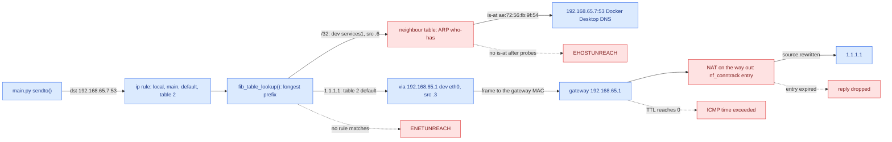
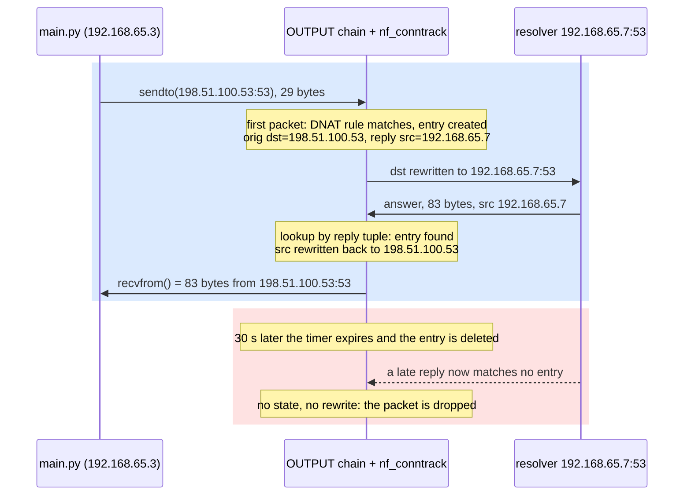
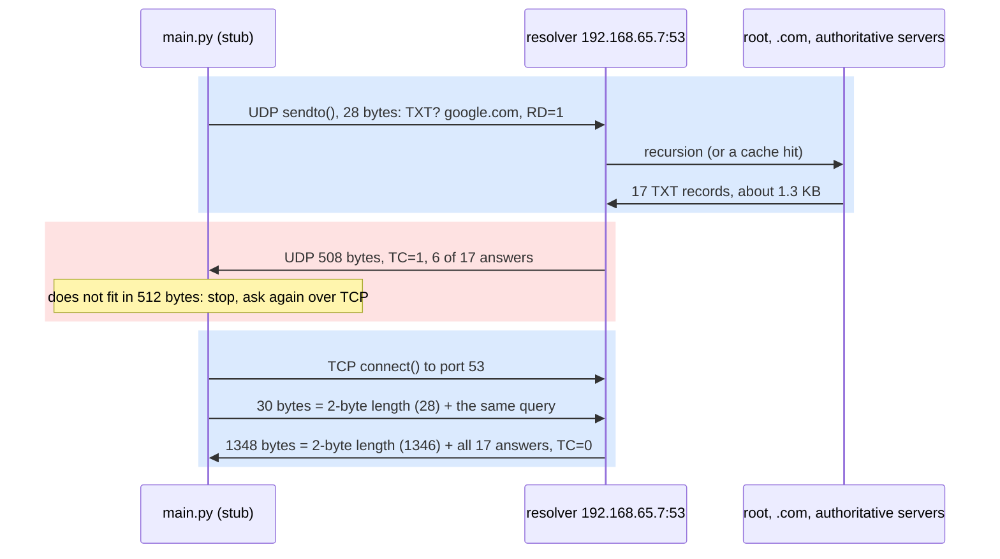

# Addressing and Routing

**Lesson 2 of 6: How Bytes Move**
**Ticketing Project**

---

## Table of Contents

1. [Why a Frame Is Not Enough](#1-why-a-frame-is-not-enough)
2. [IP Addresses, the Routing Decision and ARP](#2-ip-addresses-the-routing-decision-and-arp)
3. [NAT: an Address Rewrite That Lives in a Table](#3-nat-an-address-rewrite-that-lives-in-a-table)
4. [UDP and DNS: Names Over Datagrams](#4-udp-and-dns-names-over-datagrams)
5. [Code: Python](#5-code-python)
6. [Code: Go](#6-code-go)
7. [Code: Rust](#7-code-rust)
8. [See It: One Query's Route, Bytes and NAT Entry](#8-see-it-one-querys-route-bytes-and-nat-entry)
9. [What People Miss](#what-people-miss)
10. [Key Files Summary](#key-files-summary)
11. [Summary](#summary)
12. [Checklist](#checklist-what-you-should-be-able-to-explain)

---

## Learning Objectives

After reading this document, you will understand:

- What an IP address, a route, a neighbour entry, a NAT mapping and a DNS answer each contribute to getting one datagram from your process to a server you only know by name
- How the kernel decides where a packet goes: policy rules, longest-prefix match in a routing table, a next hop, and an ARP exchange that turns the next hop's IP into a MAC
- Why NAT is not a property of a packet but an entry in a connection-tracking table, with a timer, and what happens to replies when that entry is gone
- How a DNS query is laid out byte by byte (RFC 1035), why it rides on UDP, and why it falls back to TCP when the answer does not fit
- How Python, Go and Rust send the same hand-built query, and how you would watch it with `ip route get`, `tcpdump -X`, `strace` and `conntrack -L`

Key mental models to internalize:

- **Addresses and routes direct the flow; a failed lookup stops it.** A packet moves because every hop finds a route and a next hop, and because every link can turn that next hop into a MAC address. It stops when no route matches (`ENETUNREACH`), when ARP gets no answer (`EHOSTUNREACH`), when TTL reaches zero, or when a reply arrives at a NAT whose entry has already expired: the bytes are fine, but there is no state left that says where they belong.
- **Every hop decides again.** IP routing is hop by hop. Your host only picks the first hop; it never chooses the path.
- **NAT is state.** The rewrite is decided once, on the first packet, and stored as a pair of tuples in `nf_conntrack`. Every later packet is rewritten by looking that entry up.
- **UDP preserves message boundaries; TCP does not.** One `sendto()` is one datagram is one `recvfrom()`. That is why DNS over UDP needs no length field, and DNS over TCP needs a 2-byte one.

Common misconceptions to avoid:

- "My host knows the path to the server". It knows one thing: the next hop. Every router after it makes its own decision.
- "The source address is my IP". A host has one address per interface, and the route lookup picks which one a socket uses. In the lab the same process leaves from `192.168.65.6` or `192.168.65.3` depending on the destination.
- "NAT rewrites packets, so replies just work". Replies work only while the conntrack entry exists. A DNS exchange gets 30 seconds of state.
- "DNS is UDP". DNS is UDP until an answer is bigger than 512 bytes (or the EDNS(0) size you advertised); then it is TCP, and a firewall that blocks TCP port 53 breaks name resolution for large answers only.

---

## 1. Why a Frame Is Not Enough

[Lesson 0.1](./01-ELECTRONS-TO-FRAMES.md) ended with an Ethernet frame on one link: a destination MAC, a source MAC, an EtherType and a payload. A MAC address means something only on the link where it was learned. The frame that leaves your laptop's Wi-Fi card is addressed to your home router's MAC, not to the server you want; the router strips that frame off, decides where the packet goes next, and builds a brand-new frame for the next link. Nothing at layer 2 knows anything beyond one hop.

To reach a server across the internet, four more things have to exist, and this lesson takes them one at a time:

1. **An address that means something everywhere.** An IPv4 address (RFC 791) is 32 bits that identify an interface, structured so that a prefix (`192.168.65.0/24`) can stand for a whole network. Routers store prefixes, not hosts, which is what makes a routing table of a million entries possible for an internet of billions of interfaces.
2. **A routing decision at every hop.** Each host and router holds a table that maps prefixes to next hops. For every packet it asks one question: "of the prefixes that contain this destination, which is the most specific, and where does it send me next?"
3. **A way to reach the next hop on this link.** The routing table yields an IP address for the next hop, but Ethernet needs a MAC. ARP (RFC 826) asks the link "who has 192.168.65.7?" and caches the answer in the neighbour table.
4. **A name for the server.** Addresses change; names do not. DNS (RFC 1035) turns `example.com` into addresses by sending a small UDP datagram to a resolver.

Each kind of address answers a different question and travels a different distance:

| Address | Example from the lab | Identifies | Valid across |
|---------|----------------------|------------|--------------|
| MAC | `ae:72:56:fb:9f:54` | One interface on one link | One link: rewritten at every router |
| IPv4 | `192.168.65.7` | One interface, inside a routable prefix | End to end, unless a NAT rewrites it |
| Port | `53`, `62665` | One socket on one host | End to end, unless a NAT rewrites it |
| Name | `example.com` | A service, wherever it currently lives | Everywhere, for as long as its TTL says |

Reading the table from top to bottom is reading this lesson: a name becomes an address (DNS), an address becomes a next hop (routing), a next hop becomes a MAC (ARP), and at the border an address and port can become someone else's (NAT).

And one thing that should not exist but does almost everywhere: **NAT**. Your laptop's address (`192.168.x.y`, from the private ranges of RFC 1918) is not routable on the internet, so a box on the way out rewrites it to a public address and remembers the rewrite so that replies can be rewritten back. That memory is a table with timers, and this lesson's second reality check is about what happens when the timer wins.

Each of these is also a place where the flow can stop. The demo in this lesson is a DNS client written with nothing but a UDP socket, because a DNS query exercises all of them at once: it needs a name server's address from `/etc/resolv.conf`, a route to it, an ARP entry for the next hop, possibly a NAT on the way, and a datagram format you can read byte by byte.

```
TICKETING EXAMPLE: when `ticketing api` starts inside docker compose (Module 2),
its connection pool dials `postgres:5432`. Before the first byte of the
Postgres startup message can flow, the container's libc asks Docker's
embedded resolver for the name `postgres` (a UDP datagram, section 4), the
kernel looks up a route for the answer (172.x.0.y, an RFC 1918 address on the
compose bridge: a directly connected /16, so no gateway), and ARPs for
postgres's MAC on that bridge (section 2). Only then does the TCP SYN of
lesson 0.3 leave. If any of those lookups fails, `GET /events` fails with a
connection error that has nothing to do with HTTP.
```

---

## 2. IP Addresses, the Routing Decision and ARP

### The IPv4 header: what a router reads

Every IPv4 packet starts with a header of at least 20 bytes (RFC 791, section 3.1). Here are the first 20 bytes of the DNS query this lesson's demo sends, exactly as `tcpdump -X` captured them in the lab (section 8.3):

```text
4500 0039 a0a1 4000 4011 96b4 c0a8 4106 c0a8 4107
```

| Bytes | Field | Value | Meaning |
|-------|-------|-------|---------|
| `45` | Version, IHL | 4, 5 words | IPv4, 20-byte header (no options) |
| `00` | DSCP/ECN | 0 | Best effort |
| `0039` | Total length | 57 | 20 (IP) + 8 (UDP) + 29 (DNS) |
| `a0a1` | Identification | 41121 | Groups the fragments of one packet, if it is ever fragmented |
| `4000` | Flags, fragment offset | DF=1, 0 | "Don't fragment": lesson 0.1's path-MTU discovery bit |
| `40` | TTL | 64 | Linux's default (`net.ipv4.ip_default_ttl`); every router decrements it |
| `11` | Protocol | 17 | UDP (6 would be TCP, 1 ICMP) |
| `96b4` | Header checksum | | Recomputed at every hop, because TTL changes |
| `c0a8 4106` | Source | 192.168.65.6 | Chosen by the route lookup, not by the program |
| `c0a8 4107` | Destination | 192.168.65.7 | The resolver from `/etc/resolv.conf` |

Two fields carry this lesson. **TTL** is the reason a routing loop does not circulate a packet forever: a router that decrements it to zero drops the packet and sends ICMP "time exceeded" back, which is exactly how `traceroute` discovers each hop. The **source address** is the less obvious one: the demo never chose `192.168.65.6`. The kernel picked it during the route lookup, as the preferred source of the route that matched.

### The routing decision

When a socket sends to an address, the kernel resolves a route before it builds a single header. On Linux that lookup has two stages.

**Stage 1: policy rules.** `ip rule` lists rules in priority order; each says "for packets matching this, consult table N". Most machines have only the three defaults (`local` at 0, `main` at 32766, `default` at 32767). The lab's Docker Desktop VM has two more, which makes it a good teacher:

```text
0:	from all lookup local
32766:	from all lookup main
32767:	from all lookup default
32866:	from all to 192.168.65.254 lookup 2
33066:	from all lookup 2
```

The kernel walks the rules (`fib_rules_lookup()` in `net/core/fib_rules.c`) and stops at the first table that produces a match. The `local` table holds the machine's own addresses (`127.0.0.1`, `192.168.65.3`, …); if the destination is one of them the packet never touches a NIC. Then `main`, then `default`, then the VM's table 2, which holds its default route.

**Stage 2: longest-prefix match inside a table.** Within a table, the kernel finds every prefix that contains the destination and picks the longest one: a `/32` beats a `/24`, which beats the `/0` default route. On Linux this is `fib_table_lookup()` in `net/ipv4/fib_trie.c`, a level-compressed trie (an LC-trie) that answers in a handful of memory reads however many routes there are. The lab's `main` table has two routes that both contain the resolver's address:

```text
192.168.65.0/24 dev eth0 scope link mtu 65520
192.168.65.7 dev services1 scope link
```

The `/32` wins, so traffic to the resolver leaves through `services1`, not `eth0`, and `ip route get 192.168.65.7` reports the source address `services1` owns, `192.168.65.6`. A destination like `1.1.1.1` matches nothing in `local`, `main` or `default`, so it falls through to rule 33066, table 2, whose default route says "via 192.168.65.1 dev eth0", with source `192.168.65.3`. One process, two destinations, two interfaces, two source addresses: that is what "the route picks the source address" means in practice.

A route lookup produces three things: an **output device**, a **next hop** (the gateway after `via`, or the destination itself if the network is directly connected, `scope link`), and a **preferred source address**. If no rule produces a match, `sendto()` fails with `ENETUNREACH` before any packet exists.

### The next hop and ARP

The route lookup says "send it to 192.168.65.7 out of `services1`", but `services1` is an Ethernet-like device: the frame needs a destination MAC. The kernel keeps a **neighbour table** (`ip neigh`; `net/core/neighbour.c`) that maps next-hop IPs to MACs, one entry per neighbour, each with a state:

| State | Meaning |
|-------|---------|
| `INCOMPLETE` | An ARP request is out; no answer yet. Packets for this neighbour wait in a small queue on the entry |
| `REACHABLE` | Confirmed recently (for a randomized 15–45 s around `base_reachable_time_ms`, 30 s by default) |
| `STALE` | Not confirmed for a while; still used, but the next packet starts a re-check |
| `DELAY`, `PROBE` | Re-checking: a few unicast probes to the cached MAC |
| `FAILED` | No answer after the probes: queued packets are dropped and senders see `EHOSTUNREACH` |

When there is no entry, the kernel queues the packet on a new `INCOMPLETE` entry and broadcasts an ARP request (`arp_solicit()` in `net/ipv4/arp.c`). ARP's packet is 28 bytes for IPv4 over Ethernet (RFC 826): hardware type 1 (Ethernet), protocol type `0x0800` (IPv4), address lengths 6 and 4, an opcode (1 request, 2 reply), then the sender's MAC and IP and the target's MAC and IP. The owner of the target IP answers with a unicast reply (`is-at`), `arp_process()` fills in the entry, and the queued packet finally leaves. In section 8.2 you will delete the resolver's entry and watch exactly this: a `who-has 192.168.65.7 tell 192.168.65.6`, an `is-at ae:72:56:fb:9f:54` microseconds later, and then the DNS query.

IPv6 does the same job with Neighbor Discovery (ICMPv6 neighbor solicitation and advertisement, RFC 4861) instead of ARP; the neighbour table and its states are shared. The demos in this module use IPv4.



*Figure 1 — The path a packet takes out of the lab: a rule picks a table, the longest prefix picks a device and a source, ARP turns the next hop into a MAC, and NAT rewrites the source on the way out; every lookup is also a place where the flow stops.*

```
TICKETING EXAMPLE: inside compose, the api container's table has two routes:
the compose bridge (say 172.20.0.0/16, scope link) and a default route via
172.20.0.1. `postgres` and `redis` resolve to addresses inside the /16, so
their frames go straight to their MACs after one ARP each. The payment
provider's webhook endpoint (lesson 3.5) resolves to a public address, matches
only the default route, and leaves through the bridge gateway and the host's
NAT. When a misconfigured network (lesson 8.2's pods, a VPN client on a
laptop) removes that default route, POST /orders fails at
`connect()` with ENETUNREACH while reads from postgres keep working.
```

---

## 3. NAT: an Address Rewrite That Lives in a Table

### Why NAT exists

The private ranges of RFC 1918 (`10.0.0.0/8`, `172.16.0.0/12`, `192.168.0.0/16`) can be used by anyone, so no internet router will route them. Everything in the lab is in them: `192.168.65.0/24` for the VM, `172.17.0.0/16` through `172.24.0.0/16` for Docker's bridges. For a packet from one of these addresses to get an answer from the internet, some box on the way out must replace the private source with a public one, and replace it back in the reply. That is **source NAT** (SNAT; masquerading when the public address is whatever the outgoing interface has). Its mirror, **destination NAT** (DNAT), rewrites where a packet goes: `docker run -p 8080:8080` and Kubernetes Services (lesson 8.2) are DNAT. RFC 3022 describes traditional NAT; RFC 4787 (UDP) and RFC 5382 (TCP) say how NATs should behave so that applications survive them. Mobile carriers stack another layer, carrier-grade NAT, in `100.64.0.0/10` (RFC 6598), so that thousands of phones share one public address.

### How Linux does it: conntrack first, NAT on top

Linux implements NAT on top of **connection tracking** (`nf_conntrack`). The first packet of every flow creates an entry (`struct nf_conn`) holding two tuples:

- the **original** tuple: the packet as the sender sent it (`src=192.168.65.3 dst=198.51.100.53 sport=62591 dport=53`)
- the **reply** tuple: what a reply is expected to look like (`src=192.168.65.7 dst=192.168.65.3 sport=53 dport=62591`)

Without NAT, the reply tuple is just the original reversed. A NAT rule changes it: here a DNAT rule rewrote the destination `198.51.100.53` to `192.168.65.7`, so the reply is expected *from* `192.168.65.7`. The rule is consulted once, for the first packet. Every later packet in either direction is matched against the tuples by a hash lookup and rewritten to fit. When the resolver's answer arrives from `192.168.65.7`, conntrack finds the entry by its reply tuple and rewrites the source back to `198.51.100.53`, so the program that asked `198.51.100.53` gets an answer from `198.51.100.53` and never learns the difference.

### Where the rewrite happens

Netfilter runs NAT at fixed hooks in the packet's path through the kernel, and which hook decides what can be rewritten:

| Hook | Packets seen | NAT done here | Typical rule |
|------|--------------|---------------|--------------|
| `PREROUTING` | Arriving from a NIC, before the route lookup | DNAT | `docker run -p 8080:8080`: the host's port to a container |
| `OUTPUT` | Generated by a local process, after its first route lookup | DNAT | The lab's `198.51.100.53` rule (section 8.5); Docker's `-j DOCKER` jump |
| `POSTROUTING` | Leaving through a NIC, after routing | SNAT, MASQUERADE | Containers on a bridge reaching the internet |
| `INPUT` | Delivered to a local socket | SNAT (rare) | |

The lab's own `OUTPUT` chain shows both kinds side by side in section 8.5: Docker Desktop's `-m addrtype --dst-type LOCAL -j DOCKER`, which sends traffic for the VM's own addresses to Docker's port-publishing rules, and this lesson's temporary DNAT. Because `OUTPUT` runs *after* the route lookup that chose the source address, a DNAT there changes where the packet goes but not the source it carries; the kernel re-routes the packet to its new destination and keeps the source. That detail shows up in the conntrack entry.

### The entry is the only memory

That makes the entry the only thing that knows where a reply belongs. It has a **timer**, refreshed by traffic. For UDP, `net/netfilter/nf_conntrack_proto_udp.c` uses two values (`udp_timeouts[]`): 30 seconds (`UDP_CT_UNREPLIED`, sysctl `net.netfilter.nf_conntrack_udp_timeout`) for a flow that has not been answered, or that was answered but is not still active two seconds after it started, and 120 seconds (`UDP_CT_REPLIED`, `nf_conntrack_udp_timeout_stream`) once a flow is still exchanging packets after those two seconds, at which point it is also marked `[ASSURED]`. A DNS query and its answer take milliseconds, so the entry you will see in section 8.5 counts down from 30. TCP entries follow TCP's states; an `ESTABLISHED` connection gets 5 days (`tcp_timeouts[TCP_CONNTRACK_ESTABLISHED] = 5 DAYS` in `nf_conntrack_proto_tcp.c`). A home router or a cloud NAT gateway has its own table and its own, usually much shorter, timers.

When the timer expires, the entry is deleted. A reply that arrives afterwards matches nothing: for SNAT it is addressed to the NAT box's public port, which no longer maps to anyone, and it is dropped. The table also has a size (`net.netfilter.nf_conntrack_max`); when it is full, new flows are dropped and the kernel logs `nf_conntrack: table full, dropping packet`.



*Figure 2 — NAT as the lab's `see.sh` sets it up: the rewrite is decided once and stored as two tuples; the reply finds its way back only through that entry, and only while its timer runs.*

```
TICKETING EXAMPLE: on on-sale day, fans on one mobile carrier reach
POST /orders from a handful of carrier-grade NAT addresses in public space,
each shared by thousands of phones. Two consequences land in later lessons:
a rate limit keyed on the client IP (lesson 5.5) throttles a whole city at
once, and an idle keep-alive connection from a phone (or from our api to the
payment provider through a cloud NAT gateway) can die silently when some NAT
on the path expires its entry, so the next request on that socket hangs until
a timeout instead of failing fast.
```

---

## 4. UDP and DNS: Names Over Datagrams

### UDP: 8 bytes and no promises

UDP (RFC 768) adds exactly 8 bytes to IP: source port, destination port, length, checksum. Nothing else. No connection, no handshake, no retransmission, no ordering, no flow control. What it does keep is **message boundaries**: one `sendto()` produces one datagram, and one `recvfrom()` returns one whole datagram (or nothing). For a protocol whose exchanges are one small question and one small answer, that is ideal: the query costs one packet each way, and the application can retry on its own timer if the answer never comes.

The UDP header of the demo's query, the 8 bytes after the IP header above:

```text
f4c9 0035 0025 0395
```

Source port `0xf4c9` (62665, an ephemeral port the kernel picked), destination port `0x0035` (53), length `0x0025` (37 = 8 + 29), checksum `0x0395`. That checksum is worth a second look in section 8.3: it is the same in every capture of this query, whatever its ID and port, because it is not finished yet.

### The DNS message

A DNS message (RFC 1035, section 4.1) is a 12-byte header followed by four sections: questions, answers, authority records and additional records.

| Offset | Field | Query value | Meaning |
|--------|-------|-------------|---------|
| 0–1 | ID | `72 81` | Chosen by the client; the reply must carry the same ID |
| 2–3 | Flags | `01 00` | QR=0 (query), OPCODE=0, RD=1 ("recursion desired") |
| 4–5 | QDCOUNT | `00 01` | One question |
| 6–7 | ANCOUNT | `00 00` | No answers in a query |
| 8–9 | NSCOUNT | `00 00` | |
| 10–11 | ARCOUNT | `00 00` | No additional records (so no EDNS(0) OPT record) |
| 12–24 | QNAME | `07 example 03 com 00` | Length-prefixed labels, ended by a zero-length root label |
| 25–26 | QTYPE | `00 01` | A (IPv4 address) |
| 27–28 | QCLASS | `00 01` | IN (internet) |

That is the whole query: 29 bytes. The flags word in a reply sets QR (bit 15), and carries AA (authoritative, bit 10), **TC (truncated, bit 9)**, RD (bit 8, echoed), RA (recursion available, bit 7) and a 4-bit RCODE (0 `NOERROR`, 3 `NXDOMAIN`, …). The answer section holds resource records: a name, TYPE, CLASS, a 32-bit TTL in seconds, RDLENGTH and RDATA (4 bytes for an A record).

**Name compression** (RFC 1035, section 4.1.4) keeps answers small. A name in a message may end with a 2-byte **pointer** instead of a zero label: the top two bits are `11`, the other 14 are an offset from the start of the message. Since the question's name always starts at offset 12, `c0 0c` means "the same name as the question". A server may compress or not; the Docker Desktop resolver in the lab spells `example.com` out in full in its A answers, and a parser must handle both.

### The answer, byte by byte

Here is the resolver's 83-byte answer to the `example.com A` query, from the same `tcpdump -X` capture as the query (section 8.2). The first line still holds the end of the IP header and the UDP header (`0035 f4c9 005b 03cb`); the DNS message starts at `7281`, offset `0x1c`:

```text
	0x0010:  c0a8 4106 0035 f4c9 005b 03cb 7281 8180  ..A..5...[..r...
	0x0020:  0001 0002 0000 0000 0765 7861 6d70 6c65  .........example
	0x0030:  0363 6f6d 0000 0100 0107 6578 616d 706c  .com......exampl
	0x0040:  6503 636f 6d00 0001 0001 0000 0179 0004  e.com........y..
	0x0050:  6814 179a 0765 7861 6d70 6c65 0363 6f6d  h....example.com
	0x0060:  0000 0100 0100 0001 7900 04ac 4293 f3    ........y...B..
```

| Bytes | Field | Value |
|-------|-------|-------|
| `7281` | ID | Same as the query: this is our answer |
| `8180` | Flags | QR=1, RD=1 (echoed), RA=1, TC=0, RCODE=0 (`NOERROR`) |
| `0001 0002 0000 0000` | Counts | 1 question (echoed back), 2 answers |
| `07 example 03 com 00 0001 0001` | Question | The query's question, repeated |
| `07 example 03 com 00` | Answer 1 name | Spelled out in full: this server does not compress |
| `0001 0001` | TYPE, CLASS | A, IN |
| `0000 0179` | TTL | 377 seconds |
| `0004 6814 179a` | RDLENGTH, RDATA | 4 bytes: 104.20.23.154 |
| `… 0000 0179 0004 ac42 93f3` | Answer 2 | Same shape: 172.66.147.243 |

The UDP length `005b` is 91: 8 bytes of UDP header plus the 83 bytes the demo's `recvfrom()` returned. Nothing in the answer says "end of message"; UDP's datagram boundary is the end. Each A record is 27 bytes: 13 bytes of name, 10 bytes of TYPE, CLASS, TTL and RDLENGTH, and 4 bytes of address. With a 2-byte `c0 0c` pointer in place of the name, each would have been 11 bytes shorter.

### Who answers: stub, recursive, authoritative

The demo is a **stub resolver**: it sends one query with RD=1 to the resolver in `/etc/resolv.conf` and expects a final answer. That resolver (in the lab, Docker Desktop's DNS server at `192.168.65.7`, which resolves names on the Mac's behalf) does the actual work: a **recursive resolver** starts at a root server, which refers it to the `.com` servers, which refer it to `example.com`'s authoritative servers, which answer. Each answer carries a TTL, and the resolver caches it for that long, which is why a second query for the same name costs no recursion at all. `dig +trace` performs that walk itself, so you can see each referral (section 8.6).

### When 512 bytes is not enough

Over UDP, a DNS message without extensions is limited to **512 bytes** (RFC 1035, sections 2.3.4 and 4.2.1). A server whose answer does not fit sends what fits (or just the header) and sets **TC=1**. The client must then repeat the query over **TCP** (section 4.2.2), and since TCP is a byte stream with no message boundaries, every DNS message on TCP is preceded by a 2-byte length. RFC 7766 (2016) made TCP support mandatory for every DNS implementation, because answers keep growing: DNSSEC signatures, many TXT records, long CNAME chains.

The other way out is EDNS(0) (RFC 6891): the client adds an OPT pseudo-record to the additional section that advertises a larger UDP buffer. Very large values cause IP fragmentation (lesson 0.1), and fragments are often dropped, so the operators' DNS Flag Day 2020 recommended an EDNS buffer of 1232 bytes. The demo sends no OPT record on purpose, so you can watch the 512-byte rule and the TCP fallback happen.



*Figure 3 — DNS is UDP until it isn't: an answer bigger than 512 bytes comes back truncated over UDP, and the same query, now length-prefixed, is repeated over TCP.*

```
TICKETING EXAMPLE: the api resolves `postgres` when its pool opens connections
(lesson 2.5), and the answer carries a TTL. If on-sale day forces a failover
and `postgres` starts resolving to a new address, a pool that resolved the name
once at startup keeps dialing the old one until it is restarted; lesson 7.2
(dns-ttl-is-a-suggestion) watches the re-resolution in tcpdump. And if the
payment provider's domain ever publishes enough records to exceed 512 bytes,
an egress firewall that allows only UDP/53 breaks the webhook client's name
lookups and nothing else.
```

---

## 5. Code: Python

Module 0 has no app code, so this section walks through the demo only: [`demos/00/02/python/main.py`](../../demos/00/02/python/main.py), a DNS client built from `socket` and `struct` and nothing else. Run it in the lab (or on macOS; it uses only portable sockets):

```bash
just demo 00/02 python                          # A record for example.com
just demo 00/02 python --type TXT google.com    # TC=1 over UDP, then TCP
```

### Building the query

```python
def encode_name(name: str) -> bytes:
    """example.com -> 07 'example' 03 'com' 00: length-prefixed labels."""
    out = b""
    for label in name.rstrip(".").split("."):
        if label:  # the root name "." has no labels: it is just the final 00
            out += bytes([len(label)]) + label.encode("ascii")
    return out + b"\x00"


def build_query(query_id: int, name: str, qtype: int) -> bytes:
    flags = 0x0100  # QR=0 (query), OPCODE=0, RD=1: please recurse for me
    header = HEADER.pack(query_id, flags, 1, 0, 0, 0)  # one question, nothing else
    return header + encode_name(name) + struct.pack("!HH", qtype, CLASS_IN)
```

`HEADER`, defined at the top of the file as `struct.Struct("!HHHHHH")`, is the 12-byte header: `!` means network byte order (big-endian), and each `H` is an unsigned 16-bit field. `flags = 0x0100` sets only bit 8, RD. `encode_name()` is the label encoding from the table in section 4: each label's length as one byte, then its ASCII bytes, then the zero byte of the root label. The root itself (`--type NS .`) has no labels, so it encodes as that single `00`. Nothing here knows about sockets; a DNS query is a byte string you could write by hand, and the demo prints it in hex so you can compare it with `tcpdump` byte for byte.

### Reading names, pointers included

```python
def decode_name(msg: bytes, offset: int) -> tuple[str, int]:
    """Read a (possibly compressed) name at offset; return it and the offset after it."""
    labels, end, jumps = [], None, 0
    while True:
        length = msg[offset]
        if length & 0xC0 == 0xC0:  # pointer: the rest of the name lives elsewhere
            if end is None:
                end = offset + 2
            offset = ((length & 0x3F) << 8) | msg[offset + 1]
            jumps += 1
            if jumps > 20:
                raise ValueError("compression loop")
            continue
        if length == 0:
            return ".".join(labels) or ".", end if end is not None else offset + 1
        labels.append(msg[offset + 1 : offset + 1 + length].decode("ascii", "replace"))
        offset += 1 + length
```

A length byte whose top two bits are `11` is not a length but the first half of a pointer. The parser jumps to the 14-bit offset and keeps reading labels there, but it must remember where the name *ended in the original position* (`end`, two bytes after the first pointer): that is where the next field of the record starts. The `jumps` counter exists because the message comes from the network: a malicious answer can contain a pointer that points to itself, and a parser without a bound loops forever. Every DNS library has had this bug at some point.

### One datagram out, one datagram in

```python
def ask_udp(server: str, port: int, query: bytes) -> bytes:
    with socket.socket(socket.AF_INET, socket.SOCK_DGRAM) as sock:
        sock.settimeout(3.0)
        sent = sock.sendto(query, (server, port))  # one datagram, no connection
        print(f"sendto() {sent} bytes -> {server}:{port} (UDP)")
        reply, peer = sock.recvfrom(4096)
        print(f"recvfrom() {len(reply)} bytes <- {peer[0]}:{peer[1]}")
        return reply
```

This is all of UDP. `SOCK_DGRAM` with no `connect()`: `sendto()` names the destination on every call, the kernel does the route lookup and ARP of section 2 and sends one IP packet, and `recvfrom()` returns one whole datagram plus the address it came from. No handshake happens; if the resolver is down, nothing tells you except the 3-second timeout. In `strace` the two calls are literally `sendto(3, …, 28, …) = 28` and `recvfrom(3, …) = 508` (section 8.4).

### TCP needs a length

```python
def ask_tcp(server: str, port: int, query: bytes) -> bytes:
    with socket.create_connection((server, port), timeout=3.0) as sock:
        framed = struct.pack("!H", len(query)) + query  # TCP is a stream: add a length
        sock.sendall(framed)
        print(f"send() {len(framed)} bytes -> {server}:{port} (TCP, 2-byte length + query)")
        reply = b""
        while len(reply) < 2 or len(reply) < 2 + struct.unpack_from("!H", reply)[0]:
            chunk = sock.recv(65535)
            if not chunk:
                raise ConnectionError("server closed before the full answer arrived")
            reply += chunk
        print(f"recv() {len(reply)} bytes <- {server}:{port} (length prefix says {len(reply) - 2})")
        return reply[2:]
```

The same query bytes, framed. TCP delivers a stream, so the receiver needs to know where the message ends: RFC 1035 section 4.2.2 prepends a 2-byte length. The read loop is the first appearance of a pattern Module 1 lives on: **`recv()` returns whatever has arrived, not a message**, so you keep reading until the framing says you have the whole thing. A 1348-byte answer usually arrives in one `recv()` on a fast link; the loop is what makes the code correct when it does not. `create_connection(…, timeout=3.0)` makes the socket non-blocking under the hood, which is why `strace` shows `connect() = -1 EINPROGRESS` (section 8.4; lesson 0.5 explains it).

### The fallback

```python
    reply = ask_tcp(server, port, query) if force_tcp else ask_udp(server, port, query)
    header, answers = parse_response(reply)
    if header["id"] != query_id:
        raise ValueError(f"reply id 0x{header['id']:04x} does not match query")
    show(header, answers)
    if header["tc"] and not force_tcp:
        print(f"truncated: the answer did not fit in {UDP_LIMIT} bytes of UDP; retrying over TCP")
        header, answers = parse_response(ask_tcp(server, port, query))
        show(header, answers)
    return header, answers
```

Two checks every real resolver makes. The **ID check** is the only thing tying an answer to its question over UDP (with a random source port, it is also the main defense against forged answers). The **TC check** is the reality check of this lesson: a truncated answer must never be used as if it were complete, even when, as in the lab, it already contains some of the records.

The parsed reply for an A query looks like this (captured in the lab, section 8.3):

```text
dns: resolver 192.168.65.7:53
query: example.com A id=0x7281, 29 bytes
  0000  72 81 01 00 00 01 00 00 00 00 00 00 07 65 78 61  r............exa
  0010  6d 70 6c 65 03 63 6f 6d 00 00 01 00 01           mple.com.....
sendto() 29 bytes -> 192.168.65.7:53 (UDP)
recvfrom() 83 bytes <- 192.168.65.7:53
header: id=0x7281 qr=1 tc=0 rd=1 ra=1 rcode=NOERROR questions=1 answers=2
answer: example.com A 104.20.23.154 ttl=377
answer: example.com A 172.66.147.243 ttl=377
```

```
TICKETING EXAMPLE: the ticketing service never builds DNS packets itself:
Python's socket.getaddrinfo() (used by asyncpg, redis-py and every HTTP
client) calls glibc, whose resolver reads /etc/resolv.conf and sends this same
12-byte header and question over UDP, with the same TC fallback. When the api
logs "Temporary failure in name resolution" for `postgres`, this demo pointed
at the same resolver (`--server 127.0.0.11` inside the container) tells you in
one line whether the datagram got an answer, an NXDOMAIN, or nothing.
```

---

## 6. Code: Go

The Go port, `demos/00/02/go/main.go`, must accept the same arguments (`NAME`, `--type`, `--server`, `--port`, `--tcp`, `--smoke`) and print the same lines in the same format, hex dump included. It packs the header with `encoding/binary.BigEndian`, sends the datagram with a UDP socket from the `net` package (`net.ListenUDP` with `WriteTo`/`ReadFrom`, or `net.Dial("udp", …)` with `Write`/`Read`), and on TC=1 repeats the query with `net.Dial("tcp", …)` and a 2-byte length prefix read back with `io.ReadFull`. What it should point out is how much of this the Go standard library also does for you: the pure-Go resolver in `net/dnsclient_unix.go` builds these same bytes, and lesson 7.2 watches it with `GODEBUG=netdns=go+2`.

What differs from Python is mostly error handling. Python raises `IndexError` for free when a malformed reply is shorter than a field it reads; a Go slice expression past the end panics instead, so `decodeName()` and `parseResponse()` check every offset against `len(msg)` and return `errShort`. Errors are values all the way up to `run()`, which prints `dns: FAIL, …`; an `os.ErrDeadlineExceeded` from the 3-second `SetDeadline` is reported as `timed out`, as Python reports its `TimeoutError`. Two smaller differences: `flag` stops parsing at the first positional argument, so `main()` parses once more after `NAME` (argparse accepts `example.com --type TXT`), and A and AAAA values are formatted with `netip.AddrFromSlice`, which prints addresses the way `inet_ntop()` does.

The UDP exchange is one `WriteTo` and one `ReadFrom` on an unconnected socket, the `sendto()` and `recvfrom()` of the Python version:

```go
func askUDP(server string, port int, query []byte) ([]byte, error) {
	addr, err := net.ResolveUDPAddr("udp4", net.JoinHostPort(server, strconv.Itoa(port)))
	if err != nil {
		return nil, err
	}
	conn, err := net.ListenPacket("udp4", ":0") // unconnected, like Python's socket
	if err != nil {
		return nil, err
	}
	defer conn.Close()
	conn.SetDeadline(time.Now().Add(3 * time.Second))
	sent, err := conn.WriteTo(query, addr) // sendto(): one datagram, no connection
	if err != nil {
		return nil, err
	}
	fmt.Printf("sendto() %d bytes -> %s:%d (UDP)\n", sent, server, port)
	reply := make([]byte, 4096)
	n, peer, err := conn.ReadFrom(reply) // recvfrom(): one whole datagram, or nothing
	if err != nil {
		return nil, err
	}
	from := peer.(*net.UDPAddr)
	fmt.Printf("recvfrom() %d bytes <- %s:%d\n", n, from.IP, from.Port)
	return reply[:n], nil
}
```

The TCP fallback reads with `io.ReadFull` twice, first the 2-byte prefix and then exactly that many bytes, where Python loops on `recv()` until the total arrives:

```go
func askTCP(server string, port int, query []byte) ([]byte, error) {
	conn, err := net.DialTimeout("tcp", net.JoinHostPort(server, strconv.Itoa(port)), 3*time.Second)
	if err != nil {
		return nil, err
	}
	defer conn.Close()
	conn.SetDeadline(time.Now().Add(3 * time.Second))
	framed := binary.BigEndian.AppendUint16(nil, uint16(len(query))) // TCP is a stream: add a length
	framed = append(framed, query...)
	if _, err := conn.Write(framed); err != nil { // Write loops until all is sent, like sendall()
		return nil, err
	}
	fmt.Printf("send() %d bytes -> %s:%d (TCP, 2-byte length + query)\n", len(framed), server, port)
	prefix := make([]byte, 2)
	if _, err := io.ReadFull(conn, prefix); err != nil {
		return nil, closedEarly(err)
	}
	reply := make([]byte, binary.BigEndian.Uint16(prefix))
	if _, err := io.ReadFull(conn, reply); err != nil { // as many reads as it takes
		return nil, closedEarly(err)
	}
	fmt.Printf("recv() %d bytes <- %s:%d (length prefix says %d)\n", 2+len(reply), server, port, len(reply))
	return reply, nil
}
```

```
TICKETING EXAMPLE: the Go api (apps/go) resolves `postgres` through net's
resolver, which on Linux usually uses its own pure-Go DNS client rather
than glibc. That client sends the same 12-byte header and question, so a
`tcpdump -X 'udp port 53'` taken while the Go port starts shows the same query
layout as the Python port, with a different ID and source port.
```

---

## 7. Code: Rust

The Rust port, `demos/00/02/rust/main.rs`, must behave identically: same arguments, same output lines, same hex dump format. It uses `std::net::UdpSocket` (`bind("0.0.0.0:0")`, `send_to`, `recv_from` with a read timeout) and `std::net::TcpStream` for the fallback, building the header with `u16::to_be_bytes` and parsing with `u16::from_be_bytes`, std only. What it should point out is ownership of the parse: `decode_name` takes `&[u8]` and an offset and returns an owned `String` plus the next offset, and the compression-loop bound is as necessary in Rust as in Python, because it is a logic bug, not a memory bug.

The file is std only and builds with `rustc --edition 2021 -O main.rs`, without Cargo. Errors are explicit: every parser returns `Result<_, String>`, and slice access goes through `msg.get(range)` with `.ok_or(SHORT)?`, which turns a short reply into an `Err` where Python raises `IndexError` and plain indexing would panic. Socket errors are `io::Error`s, mapped by `io_message()` so that a timeout prints `timed out`. The query id comes from std's `RandomState`, which is seeded from the OS for every process, because std has no random-number API.

```rust
/// Read a (possibly compressed) name at `offset`. Borrows the message, returns
/// an owned String plus the offset just after the name where it started.
fn decode_name(msg: &[u8], mut offset: usize) -> Result<(String, usize), String> {
    let (mut labels, mut end, mut jumps) = (Vec::new(), None, 0);
    loop {
        let length = usize::from(*msg.get(offset).ok_or(SHORT)?);
        if length & 0xc0 == 0xc0 {
            // A pointer: the rest of the name lives elsewhere. Bounding the jumps
            // is not about memory safety; a looping pointer is a logic bug in any language.
            let low = usize::from(*msg.get(offset + 1).ok_or(SHORT)?);
            end.get_or_insert(offset + 2);
            offset = ((length & 0x3f) << 8) | low;
            jumps += 1;
            if jumps > 20 {
                return Err("compression loop".into());
            }
            continue;
        }
        if length == 0 {
            let name = if labels.is_empty() {
                ".".to_string()
            } else {
                labels.join(".")
            };
            return Ok((name, end.unwrap_or(offset + 1)));
        }
        let label = msg.get(offset + 1..offset + 1 + length).ok_or(SHORT)?;
        labels.push(String::from_utf8_lossy(label).into_owned());
        offset += 1 + length;
    }
}
```

`end.get_or_insert(offset + 2)` records where the name ended in its original position only on the first jump, exactly like Python's `if end is None`. The UDP side is the std wrapper around the same two syscalls:

```rust
fn ask_udp(server: &str, port: u16, query: &[u8]) -> io::Result<Vec<u8>> {
    let sock = UdpSocket::bind((Ipv4Addr::UNSPECIFIED, 0))?;
    sock.set_read_timeout(Some(TIMEOUT))?;
    let sent = sock.send_to(query, (server, port))?; // one datagram, no connection
    println!("sendto() {sent} bytes -> {server}:{port} (UDP)");
    let mut reply = vec![0u8; 4096];
    let (n, peer) = sock.recv_from(&mut reply)?; // one whole datagram, or nothing
    println!("recvfrom() {n} bytes <- {}:{}", peer.ip(), peer.port());
    reply.truncate(n);
    Ok(reply)
}
```

```
TICKETING EXAMPLE: the Rust api (apps/rust) resolves `postgres` through
std's ToSocketAddrs, which calls the system's getaddrinfo(), so its DNS traffic
looks exactly like the Python port's glibc queries. A resolver crate that
speaks DNS itself would send these same bytes from Rust, and could be watched
with the same tcpdump filter.
```

---

## 8. See It: One Query's Route, Bytes and NAT Entry

Everything below was captured in the lab (`just lab`, working directory `/work`) on kernel 7.0.14-linuxkit, Docker Desktop's VM on an aarch64 Mac, where `/etc/resolv.conf` names Docker Desktop's DNS at `192.168.65.7`. This is the one Module 0 lesson that needs the internet: the resolver must reach real name servers. (`run.sh --smoke` skips itself when `CI_OFFLINE=1`.)

### 8.1 ip rule and ip route — which table, interface and source address

```bash
ip rule
ip route show match 192.168.65.7
ip route get 192.168.65.7
ip route get 1.1.1.1
```

```text
$ ip route show match 192.168.65.7
192.168.65.0/24 dev eth0 scope link mtu 65520
192.168.65.7 dev services1 scope link
$ ip route get 192.168.65.7
192.168.65.7 dev services1 src 192.168.65.6 uid 0
    cache
$ ip route get 1.1.1.1
1.1.1.1 via 192.168.65.1 dev eth0 table 2 src 192.168.65.3 uid 0
    cache
```

`ip rule` printed the five rules shown in section 2. `ip route show match` lists every route in `main` that contains the resolver's address: the `/24` on `eth0` and the `/32` on `services1`. `ip route get` asks the kernel to do the real lookup, and the `/32` wins: device `services1`, no gateway (it is directly reachable), source `192.168.65.6`. For `1.1.1.1` nothing in `local`, `main` or `default` matches, so the lookup falls through to rule 33066 and table 2: next hop `192.168.65.1` on `eth0`, source `192.168.65.3`. These source addresses are what the demo's packets will carry, although the demo never asked for them.

### 8.2 ip neigh and tcpdump — ARP before the first byte

```bash
ip neigh show | grep -v FAILED | head -n 5
ip neigh del 192.168.65.7 dev services1       # then send a query; in a second lab shell:
tcpdump -i any -nn -X '(arp and host 192.168.65.7) or udp port 53'
```

```text
192.168.65.7 dev services1 lladdr ae:72:56:fb:9f:54 REACHABLE
…
22:17:30.700500 services1 Out ARP, Request who-has 192.168.65.7 tell 192.168.65.6, length 28
	0x0000:  0001 0800 0604 0001 be38 ca32 048f c0a8  .........8.2....
	0x0010:  4106 0000 0000 0000 c0a8 4107            A.........A.
22:17:30.700504 services1 In  ARP, Reply 192.168.65.7 is-at ae:72:56:fb:9f:54, length 28
	0x0000:  0001 0800 0604 0002 ae72 56fb 9f54 c0a8  .........rV..T..
	0x0010:  4107 be38 ca32 048f c0a8 4106            A..8.2....A.
22:17:30.716242 services1 Out IP 192.168.65.6.62665 > 192.168.65.7.53: 29313+ A? example.com. (29)
```

The neighbour table already knew the resolver's MAC (`REACHABLE`). After `ip neigh del`, the next packet to `192.168.65.7` cannot leave until ARP answers, and the capture shows the whole exchange: the 28-byte request (hardware type `0001`, protocol `0800`, lengths `06 04`, opcode `0001`, sender `be:38:ca:32:04:8f` = `192.168.65.6`, target MAC unknown, target `192.168.65.7`), the reply 4 µs later with opcode `0002` and the answer `ae:72:56:fb:9f:54`, and only then, 16 ms later, the DNS query. The query waited in the neighbour entry's queue in the meantime: the first stop on its path.

### 8.3 tcpdump -X — the 29 bytes the demo built

```bash
python3 demos/00/02/python/main.py example.com
```

```text
query: example.com A id=0x7281, 29 bytes
  0000  72 81 01 00 00 01 00 00 00 00 00 00 07 65 78 61  r............exa
  0010  6d 70 6c 65 03 63 6f 6d 00 00 01 00 01           mple.com.....
sendto() 29 bytes -> 192.168.65.7:53 (UDP)
```

And the same packet in the `tcpdump -X` capture from 8.2:

```text
22:17:30.716242 services1 Out IP 192.168.65.6.62665 > 192.168.65.7.53: 29313+ A? example.com. (29)
	0x0000:  4500 0039 a0a1 4000 4011 96b4 c0a8 4106  E..9..@.@.....A.
	0x0010:  c0a8 4107 f4c9 0035 0025 0395 7281 0100  ..A....5.%..r...
	0x0020:  0001 0000 0000 0000 0765 7861 6d70 6c65  .........example
	0x0030:  0363 6f6d 0000 0100 01                   .com.....
```

Skip the 20-byte IP header (`4500 … c0a8 4107`, decoded in section 2) and the 8-byte UDP header (`f4c9 0035 0025 0395`), and the remaining 29 bytes, from `7281 0100` at offset `0x1c` to the final `01`, are the demo's hex dump byte for byte. tcpdump's summary decodes them too: `29313+` is the ID `0x7281` in decimal with `+` for RD, and `A? example.com.` is the question.

The UDP checksum `0395` is the detail most people never notice. It appeared in every capture of this query, with different IDs and different source ports, which a real checksum could not do. It is the pseudo-header sum only (source and destination address, protocol 17 and UDP length 37: `c0a8 + 4106 + c0a8 + 4107 + 0011 + 0025 = 0x20393`, folded to `0x0395`). The kernel left the checksum for the (virtual) NIC to finish, checksum offload, and tcpdump sees the packet before that happens. With `-vv`, tcpdump would call it a bad checksum; it is not.

### 8.4 strace — DNS is UDP until it isn't

```bash
strace -f -s 16 -e trace=socket,connect,sendto,recvfrom python3 demos/00/02/python/main.py --type TXT google.com 2>&1 \
  | grep -E '^(socket|connect|sendto|recvfrom|header|truncated)'
```

```text
socket(AF_INET, SOCK_DGRAM|SOCK_CLOEXEC, IPPROTO_IP) = 3
sendto(3, "\3705\1\0\0\1\0\0\0\0\0\0\6goo"..., 28, 0, {sa_family=AF_INET, sin_port=htons(53), sin_addr=inet_addr("192.168.65.7")}, 16) = 28
recvfrom(3, "\3705\203\200\0\1\0\6\0\0\0\0\6goo"..., 4096, 0, {sa_family=AF_INET, sin_port=htons(53), sin_addr=inet_addr("192.168.65.7")}, [16]) = 508
socket(AF_INET, SOCK_STREAM|SOCK_CLOEXEC, IPPROTO_TCP) = 3
connect(3, {sa_family=AF_INET, sin_port=htons(53), sin_addr=inet_addr("192.168.65.7")}, 16) = -1 EINPROGRESS (Operation now in progress)
sendto(3, "\0\34\3705\1\0\0\1\0\0\0\0\0\0\6g"..., 30, 0, NULL, 0) = 30
recvfrom(3, "\5B\3705\201\200\0\1\0\21\0\0\0\0\6g"..., 65535, 0, NULL, NULL) = 1348
…
header: id=0xf835 qr=1 tc=1 rd=1 ra=1 rcode=NOERROR questions=1 answers=6
header: id=0xf835 qr=1 tc=0 rd=1 ra=1 rcode=NOERROR questions=1 answers=17
```

Read the strings as bytes (strace prints them as C escapes, in octal). The UDP query starts with the ID `\370 5` (`0xf8 0x35`) and the flags `\1\0` (RD). The UDP reply's flags are `\203\200` = `0x8380`: QR, **TC**, RD, RA. Its ANCOUNT is `\0\6`: six answers in 508 bytes, a partial answer that the server marked as incomplete (another run in the same lab got 8 answers in 495 bytes; the server fits as many records as it can under 512). Then the TCP retry: a new `SOCK_STREAM` socket, `connect()` returning `EINPROGRESS` because `create_connection()` with a timeout uses a non-blocking socket, and a 30-byte `sendto()` whose first two bytes `\0\34` are the length prefix, 28. The reply's prefix `\5B` is `0x0542` = 1346, its flags `\201\200` = `0x8180` have no TC, and its ANCOUNT `\0\21` is 17: the complete answer.

### 8.5 iptables and conntrack — NAT is a table entry with a countdown

```bash
iptables -t nat -A OUTPUT -p udp -d 198.51.100.53 --dport 53 -j DNAT --to-destination 192.168.65.7:53
python3 demos/00/02/python/main.py --server 198.51.100.53 example.com | grep -E '^(dns|sendto|recvfrom|header)'
conntrack -L -p udp --orig-dst 198.51.100.53
```

```text
dns: resolver 198.51.100.53:53
sendto() 29 bytes -> 198.51.100.53:53 (UDP)
recvfrom() 83 bytes <- 198.51.100.53:53
header: id=0xdbf8 qr=1 tc=0 rd=1 ra=1 rcode=NOERROR questions=1 answers=2
conntrack v1.4.8 (conntrack-tools): 1 flow entries have been shown.
udp      17 29 src=192.168.65.3 dst=198.51.100.53 sport=62591 dport=53 src=192.168.65.7 dst=192.168.65.3 sport=53 dport=62591 mark=0 use=1
```

`198.51.100.53` is in TEST-NET-2 (RFC 5737), an address range that exists only for documentation: nothing on the internet answers there. The DNAT rule sends the query to the real resolver instead, and the demo, which asked `198.51.100.53`, receives an answer from `198.51.100.53`. The conntrack line is why. `udp 17` is the protocol name and number; `29` is the seconds left on the entry (30 s for a flow that was answered within two seconds, `nf_conntrack_udp_timeout`, as section 3 read from the kernel source). The first `src=… dst=… sport=… dport=…` group is the original tuple, the packet as the demo sent it; the second group is the reply tuple, what conntrack expects back: from `192.168.65.7`, not from `198.51.100.53`. That difference is the NAT. The answer was rewritten back only because this entry matched it, and 29 seconds from now nothing would. Notice also the source, `192.168.65.3`: the route lookup for `198.51.100.53` happened before the rewrite and chose table 2's `eth0` address, and NAT changed only the destination. (`see.sh` deletes the rule on exit.)

### 8.6 dig +trace — the referral chain a resolver walks

```bash
timeout 20 dig +trace example.com | grep -E '^;; Received' | head -n 5
```

```text
;; Received 420 bytes from 192.168.65.7#53(192.168.65.7) in 1 ms
;; Received 1171 bytes from 198.41.0.4#53(a.root-servers.net) in 21 ms
;; Received 506 bytes from 192.12.94.30#53(e.gtld-servers.net) in 7 ms
;; Received 179 bytes from 108.162.195.228#53(elliott.ns.cloudflare.com) in 7 ms
```

The recursion that `192.168.65.7` hides from the demo, done by hand. `dig` first asks the local resolver for the root servers' names (420 bytes), then asks a root server about `example.com` and gets a referral to the `.com` servers (1171 bytes, more than 512: `dig` sends EDNS(0) by default and advertises a bigger buffer), then asks a `.com` server and gets a referral to Cloudflare's name servers, which give the final answer. Four round trips, which every recursive resolver makes on a cold cache and then avoids for the length of each answer's TTL.

### Reproduce

```bash
just see 00/02
```

`demos/00/02/see.sh` replays all six observations (it needs network) and passes when a line matches `EXPECT='dst=198\.51\.100\.53 sport=[0-9]+ dport=53 src='`: the conntrack entry whose original destination is the TEST-NET address and whose reply comes from somewhere else.

---

## What People Miss

### A truncated answer is an incomplete answer, even when it contains records

> [!WARNING]
> **Reality check (dns-is-udp-until-it-isnt) —** RFC 1035 caps a DNS message over UDP at 512 bytes (sections 2.3.4 and 4.2.1) unless the client advertises more with EDNS(0) (RFC 6891). A bigger answer comes back with TC=1, and section 8.4 shows that it is not necessarily empty: Docker Desktop's resolver returned 6 of 17 TXT records in 508 bytes (8 in 495 bytes on another run). A client that ignores TC silently works with a partial record set, which for SPF, DKIM or DNSSEC data means wrong answers rather than errors. The rule is the demo's: TC=1 means "ask again over TCP", with a 2-byte length prefix (section 4.2.2), and RFC 7766 makes TCP support mandatory for every DNS implementation. Two production failures follow. First, firewalls and security groups written as "allow UDP 53" break exactly the large answers and nothing else, so the outage looks random. Second, raising the EDNS buffer to avoid TCP brings back IP fragmentation, which middleboxes drop; DNS Flag Day 2020 settled on 1232 bytes for that reason. You see it with `strace -e trace=socket,connect,sendto,recvfrom` (a UDP exchange followed by a TCP one) or `tcpdump 'port 53'` (a `|` after the ID in tcpdump's summary marks TC). Module 0 has no app code; the app relies on getaddrinfo() and its resolver library doing the fallback, and lesson 7.2 is where name resolution becomes the app's own problem (TTLs and re-resolution).

### NAT is not a rewrite rule but a table of timers

> [!WARNING]
> **Reality check (nat-is-state) —** A NAT rule is consulted once, for the first packet of a flow; after that, the only thing that knows how to rewrite replies is the conntrack entry, and section 8.5 shows it counting down from 30 seconds for a DNS exchange. In Linux's own conntrack, an answered-but-short UDP flow gets 30 s (`nf_conntrack_udp_timeout`), a UDP flow still active after two seconds gets 120 s (`nf_conntrack_udp_timeout_stream`), and an established TCP connection gets 5 days (`nf_conntrack_proto_tcp.c`); home routers, carrier-grade NATs (RFC 6598) and cloud NAT gateways keep their own tables with much shorter idle timers than RFC 4787 (at least 2 minutes for UDP) or RFC 5382 (at least 2 hours 4 minutes for established TCP) ask for. Three things go wrong. An idle TCP connection through a NAT dies silently when its entry expires: neither end is told, and the next write disappears into a mapping that no longer exists, so the request hangs until a timeout. Enabling TCP keepalives shorter than the NAT's idle timer (Linux's default `tcp_keepalive_time` is 7200 s, far too long) or recycling idle pooled connections keeps the entry alive or avoids it. A full table (`nf_conntrack_max`) drops new flows with `nf_conntrack: table full, dropping packet` in the kernel log, which on a busy host looks like random connection timeouts. And behind carrier-grade NAT, thousands of users share one public address, so anything keyed on the client IP, from rate limits to fraud scores, treats a city as one client (lesson 5.5, per-ip-is-wrong-behind-nat). You see it with `conntrack -L` (the entry, its tuples, its countdown) and `conntrack -C` (how full the table is). Module 0 has no app code; lesson 6.3 sizes the connection pools and their idle limits, and lesson 5.5 keys the rate limiter on an identity rather than an address.

---

## Key Files Summary

| File | Role | Language |
|------|------|----------|
| `demos/00/02/python/main.py` | Hand-built DNS client: header and question with `struct`, one `sendto()`/`recvfrom()`, compression-aware parser, TC=1 fallback to TCP | Python |
| `demos/00/02/go/main.go` | The same DNS client with `encoding/binary`, `ListenPacket` `WriteTo`/`ReadFrom`, bounds-checked parsing and the TCP fallback | Go |
| `demos/00/02/rust/main.rs` | The same DNS client, std only (`UdpSocket`, `TcpStream`, `to_be_bytes`), built with `rustc` | Rust |
| `demos/00/02/run.sh` | `run.sh LANG [--smoke] [ARGS...]`; skips `--smoke` when `CI_OFFLINE=1` | Bash |
| `demos/00/02/see.sh` | Reproducible See It: `ip rule`/`ip route`, ARP in `tcpdump`, `tcpdump -X`, `strace`, DNAT + `conntrack -L`, `dig +trace` | Bash |
| `demos/00/02/README.md` | How to run the demo and what to look for | Markdown |
| `scripts/see/common.sh` | `see_run`, `see_log`, `expect_match` used by `see.sh` | Bash |

---

## Summary

| Concept | Key Takeaway |
|---------|--------------|
| IPv4 header | 20 bytes that every router reads: TTL stops loops, the protocol field says what follows, DF controls fragmentation |
| Policy rules | `ip rule` picks which routing table to consult; the lab sends internet traffic through table 2 |
| Longest-prefix match | The most specific route wins (`fib_table_lookup()`); the lab's `/32` to the resolver beats its `/24` |
| Source address | Chosen by the route lookup, per destination; one process left from `.6` and `.3` |
| ARP | Turns the next hop's IP into a MAC; packets wait in the neighbour entry until the `is-at` arrives |
| NAT | A conntrack entry with an original and a reply tuple; replies are rewritten only while it lives |
| UDP | 8 bytes, no connection, message boundaries preserved: one `sendto()`, one datagram, one `recvfrom()` |
| DNS message | A 12-byte header, length-prefixed labels, compression pointers (`c0 0c`), TTLs on every record |
| Truncation | Over 512 bytes without EDNS(0) the answer comes back with TC=1 and must be retried over TCP with a 2-byte length |
| Checksum offload | The UDP checksum tcpdump shows on the sender can be only the pseudo-header sum; the NIC finishes it |
| NAT hooks | DNAT happens in `PREROUTING` or `OUTPUT`, SNAT in `POSTROUTING`; a DNAT in `OUTPUT` keeps the source the route lookup chose |
| Address scope | A MAC lasts one link, an IP and port last until a NAT, a name lasts as long as its TTL |

---

## Checklist: What You Should Be Able to Explain

- [ ] Trace a DNS query from `sendto()` to the resolver: the rule, the table, the longest prefix, the source address, the ARP exchange, the frame
- [ ] Decode the 20-byte IPv4 header and the 8-byte UDP header of the captured query, field by field
- [ ] Decode the 29-byte DNS query by hand, and explain what `c0 0c` means in an answer
- [ ] Explain why the lab's process uses two different source addresses, using `ip rule` and `ip route get`
- [ ] Explain what the two tuples in a `conntrack -L` line mean, why the DNAT works, and what happens to a reply after the 30-second timer runs out
- [ ] Explain why a 508-byte UDP answer with six records is not an answer, and what the client must do next
- [ ] Explain why the UDP checksum in the capture is the same for every query
- [ ] Name two production failures caused by NAT timers and two caused by blocking TCP port 53, and the tool you would use to see each

---

**Next:** [03-TCP-FLOW-AND-CONGESTION.md](./03-TCP-FLOW-AND-CONGESTION.md) · **Previous:** [01-ELECTRONS-TO-FRAMES.md](./01-ELECTRONS-TO-FRAMES.md) · **Module Overview:** [00-OVERVIEW.md](./00-OVERVIEW.md)
