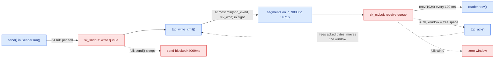
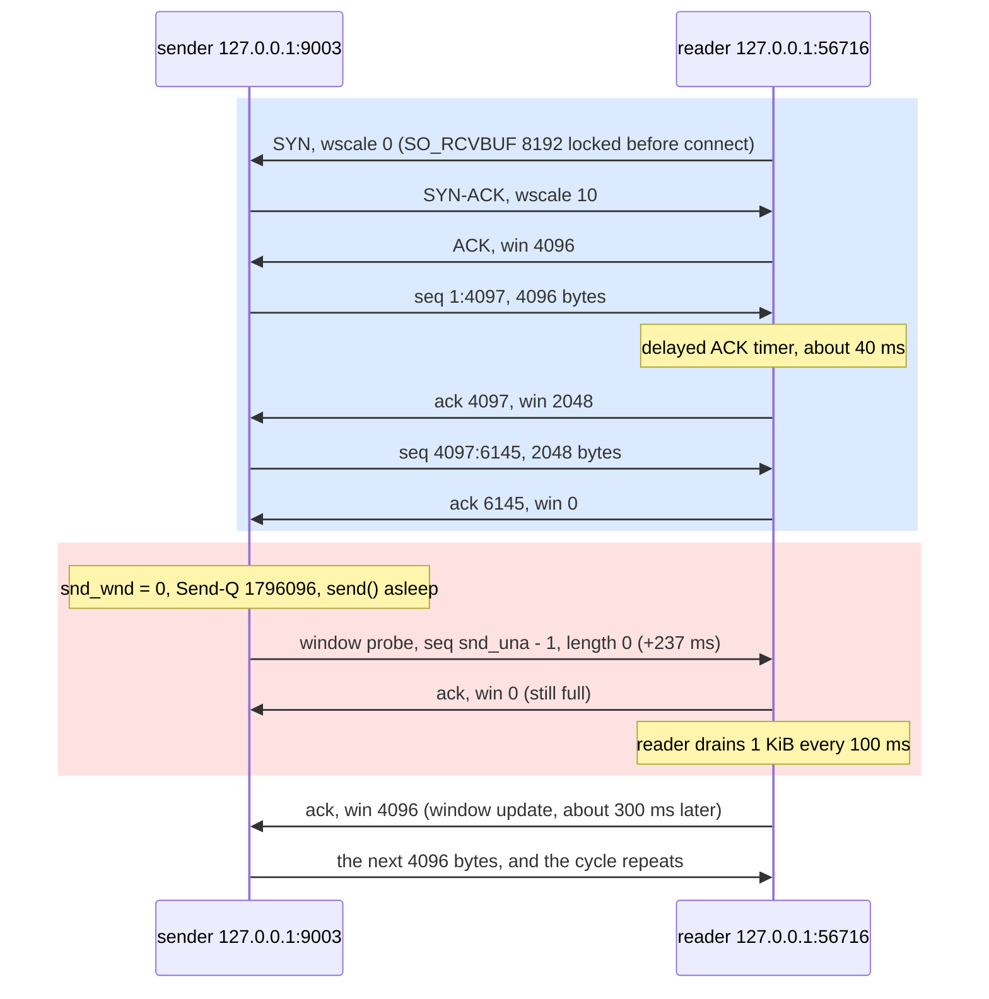
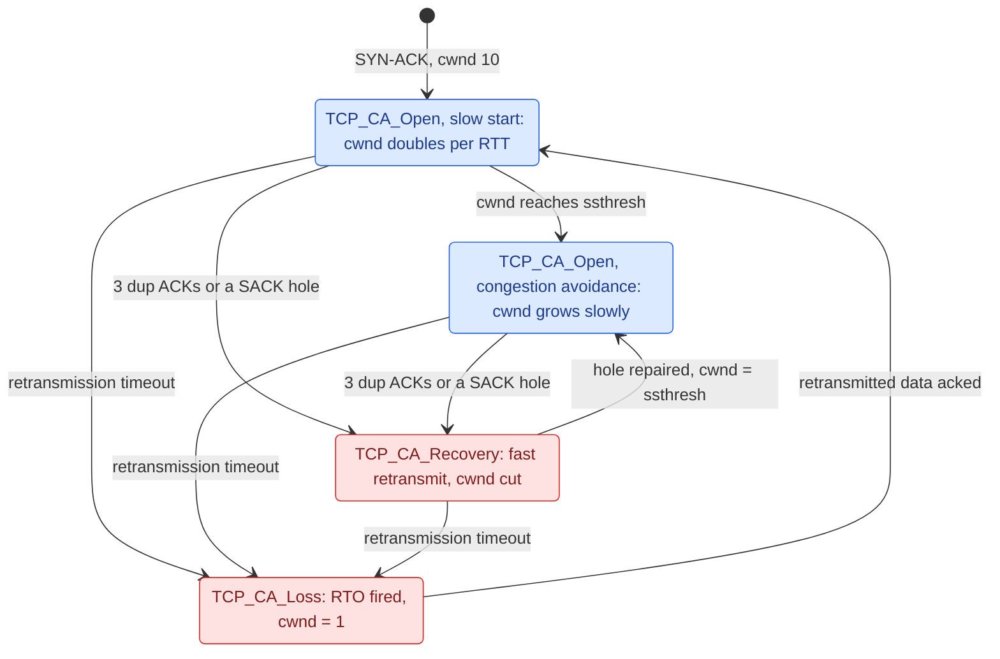

# TCP Flow and Congestion

**Lesson 3 of 6: How Bytes Move**
**Ticketing Project**

---

## Table of Contents

1. [Why TCP Has to Pace Two Things](#1-why-tcp-has-to-pace-two-things)
2. [A Byte Stream Built from Segments](#2-a-byte-stream-built-from-segments)
3. [Flow Control: the Receiver Says How Much](#3-flow-control-the-receiver-says-how-much)
4. [Congestion Control: the Network Says How Much](#4-congestion-control-the-network-says-how-much)
5. [Code: Python](#5-code-python)
6. [Code: Go](#6-code-go)
7. [Code: Rust](#7-code-rust)
8. [See It: the Window Closes, Then RTT and Loss Pace the Flow](#8-see-it-the-window-closes-then-rtt-and-loss-pace-the-flow)
9. [What People Miss](#what-people-miss)
10. [Key Files Summary](#key-files-summary)
11. [Summary](#summary)
12. [Checklist](#checklist-what-you-should-be-able-to-explain)

---

## Learning Objectives

After reading this document, you will understand:

- How TCP turns a sequence of independent IP packets into one reliable, ordered byte stream, and what the sequence and acknowledgment numbers in every segment actually count
- How the **receive window** lets a slow reader stop a fast writer without losing a byte: the window shrinks, closes to zero, gets probed and reopens, and the sender's `send()` blocks in between
- How the **congestion window** (`cwnd`) paces the sender against the network instead of the receiver, why it starts small, grows, and gets cut on loss, and how CUBIC and BBR differ
- Why throughput can never exceed window ÷ round-trip time, and how a well-meant `SO_RCVBUF` caps it
- How the three runtimes reach the same socket options, and what each one sets by default
- How to watch all of this with `tcpdump`, `ss -tni`, `nstat` and `tc netem`

Key mental models to internalize:

- **What makes data flow here, and what makes it stop**: two windows pace every TCP sender. The receive window (`rcv_wnd`) is how much free buffer the reader has; the congestion window (`snd_cwnd`) is how much the sender believes the network can hold. The sender may have at most the smaller of the two in flight. A receive window that closes to zero stops the flow from the reader's side; a `cwnd` cut after loss slows it from the network's side. Neither one drops data: the bytes wait in the sender's send buffer, and `send()` blocks.
- **TCP counts bytes, not packets**: a sequence number names a byte in the stream, an ACK names the next byte the receiver wants, and a window is a byte range the receiver is willing to accept. Segments are just how bytes travel.
- **The window is a promise about buffer space**: every ACK carries "I have room for N more bytes". The reader's application controls N, by reading or not.
- **Bandwidth × delay is a volume**: to keep a 1 Gbit/s path with an 80 ms round trip busy, 10 MB must be in flight at all times. Any window smaller than that is the bottleneck, whatever the link speed.

Common misconceptions to avoid:

- "A slow client makes the server drop data". It makes the server's `send()` block, or return `EAGAIN` on a non-blocking socket. TCP never discards bytes the application handed it; it stops accepting new ones.
- "Bigger buffers are always faster". A buffer you set by hand is a hard ceiling: setting `SO_RCVBUF` turns off the kernel's receive-buffer autotuning for that socket.
- "TCP is slow because of the handshake". On a long-lived connection the handshake is noise. What limits throughput is the window, the RTT and loss.
- "Congestion control and flow control are the same thing". Flow control protects the receiver and is advertised by it in every ACK; congestion control protects the network and lives entirely inside the sender.

---

## 1. Why TCP Has to Pace Two Things

IP, as lesson 0.2 showed, delivers datagrams one at a time with no promises. A packet can be dropped by a full NIC ring (lesson 0.1), by a router queue, or by a NAT entry that expired. Two packets can take different paths and arrive out of order. A retransmitted packet can arrive twice. Applications do not want any of that. An HTTP server wants to call `read()` and get the next bytes of the request, in order, exactly once.

TCP (RFC 9293, which consolidated RFC 793 and its updates in 2022) is the layer that turns "some datagrams, maybe" into "a byte stream, definitely". To do that it numbers every byte, keeps a copy of everything it sent until the peer acknowledges it, and retransmits what was not acknowledged in time. That much is reliability, and it would be enough if both ends ran at the same speed over an infinitely fast network.

They do not, so TCP must answer two pacing questions on every send:

1. **Can the receiver take more?** The reading application may be slow: a phone on a train, a Python process stuck in a 300 ms garbage collection, a worker that only reads when it has finished processing the last message. Every byte the sender pushes must sit somewhere until that application calls `read()`. The somewhere is the receiver's kernel buffer, and it is finite. This is **flow control**, and the receiver answers it in every ACK with the **receive window**.
2. **Can the network take more?** Between the two hosts are links and router queues shared with everyone else. Push too much and the queues overflow; packets are dropped; everyone retransmits; the path collapses. That happened to the early internet in October 1986, when throughput between LBL and UC Berkeley fell from 32 kbit/s to 40 bit/s, and Van Jacobson's 1988 paper "Congestion Avoidance and Control" introduced the fix. This is **congestion control**, and nobody tells the sender the answer: it has to infer it from ACKs, delay and loss, and keep the result in the **congestion window**.

The sender may have at most `min(rcv_wnd, snd_cwnd)` bytes in flight (sent but not yet acknowledged). Everything else waits in its send buffer. When the send buffer is full, `send()` blocks. That chain, from a reader that stops reading to a writer that stops writing, is the backpressure every later module leans on: lesson 1.5's slowloris stall, lesson 3.3's HTTP/2 flow-control windows (the same idea, one layer up), lesson 6.3's pool exhaustion and lesson 7.4's load shedding.

This lesson builds a deliberately mismatched pair, a fast sender and a slow reader with a tiny receive buffer, and watches TCP stop the flow without losing a byte. Then it adds 40 ms of round-trip delay and some loss, and watches the congestion window take over.

```
TICKETING EXAMPLE: a phone on a weak 3G link opens the seat map for event 42,
GET /events/42/seats, a 1.8 MB JSON document with every seat's status. The
api writes the whole body with one write(). The phone reads maybe 40 KB/s.
Nothing is dropped and nothing is resent: the phone's receive window closes,
the api's socket send buffer fills, and the handler's write() stalls until
the phone catches up. Whether that stall freezes one goroutine, one asyncio
task or a whole worker thread is lesson 1.5's question; that it happens at
all is this lesson's.
```

---

## 2. A Byte Stream Built from Segments

### Segments, sequence numbers and ACKs

A TCP **segment** is a 20-byte header (more with options) plus a slice of the byte stream. The header fields that carry this lesson are:

| Field | Size | Meaning |
|-------|------|---------|
| Sequence number | 32 bits | The stream offset of the first payload byte in this segment, plus the connection's initial sequence number (ISN) |
| Acknowledgment number | 32 bits | The next byte the sender of this segment expects to receive: "I have everything before this" |
| Window | 16 bits | How many bytes past the acknowledgment number the sender of this segment is willing to accept, shifted left by the negotiated window scale |
| Flags | 9 bits | SYN, ACK, FIN, RST, PSH and friends |

Both directions of a connection are independent streams with their own sequence space, so every segment from A to B carries A's sequence number for its own payload and A's acknowledgment of B's stream. A segment with no payload, only an ACK and a window, is how a receiver says "got it, and here is how much room I have" without sending data. In this lesson's captures the reader never sends a single payload byte; every packet it emits is a pure ACK, and those ACKs are where the flow control happens.

The ISN is chosen per connection (RFC 9293 §3.4.1, RFC 6528 for the hashing scheme) so that a stray segment from an old connection on the same ports is unlikely to land in the new connection's window. `tcpdump` hides this by printing sequence numbers relative to the first one it saw on the connection: the `ack 1` and `seq 1:4097` in section 8 are relative offsets, which is why the first line of a capture that starts mid-connection shows a raw number like `ack 198037243`.

### The handshake and the options that matter

A connection opens with three segments: SYN, SYN-ACK, ACK (RFC 9293 §3.5). Each SYN carries the side's ISN and the options it supports. Four options decide how the rest of the connection behaves:

| Option | RFC | What it decides |
|--------|-----|-----------------|
| MSS | RFC 9293 §3.7.1 | The largest payload this side is willing to receive in one segment (65483 on loopback, whose MTU is 65536; 1460 on a 1500-byte Ethernet) |
| Window scale | RFC 7323 §2 | A shift count, 0 to 14, applied to every later 16-bit window field. Without it a window can never exceed 65535 bytes |
| SACK permitted | RFC 2018 | Selective acknowledgments: the receiver can report "I have bytes 10000–20000 but not 5000–10000", so the sender retransmits only the hole |
| Timestamps | RFC 7323 §3 | Per-segment timestamps for RTT measurement and protection against wrapped sequence numbers (the `TS val … ecr …` in every captured line) |

Window scaling is the one to remember. It is negotiated **only in the SYN** and fixed for the life of the connection. Each side picks its scale from the largest receive buffer it might ever use. In the Linux kernel that choice is `tcp_select_initial_window()` in `net/ipv4/tcp_output.c`: it takes the larger of the socket's buffer, `net.ipv4.tcp_rmem[2]` and `net.core.rmem_max`, clamps it to `window_clamp`, and uses `ilog2(space) - 15`. In the lab `tcp_rmem[2]` is 33554432 (2^25), so a normal socket advertises scale 10: every window value on the wire is multiplied by 1024. If an application locked its receive buffer to 8 KiB before `connect()`, `tcp_connect_init()` first lowers `window_clamp` to that buffer, the computed scale is 0, and the window can never exceed what fits in 16 bits unscaled. Section 8's `ss` output shows exactly that pair: `wscale:0,10`.

### The pipeline from `send()` to `recv()`

Put the pieces together and one direction of a connection is a pipeline with two kernel buffers and a feedback path:



*Figure 1 — One direction of a TCP connection: data flows left to right through two bounded kernel buffers, permission to send flows back in every ACK, and each full buffer is a place where the flow stops.*

Read the figure as the course's question, answered for TCP:

- **What makes data flow:** the application handing bytes to `send()`, `tcp_write_xmit()` cutting them into segments while the windows allow it, and ACKs coming back that free acknowledged bytes from the send queue and slide the window forward.
- **What makes it stop:** a full receive buffer (the reader is not reading), which the receiver reports as a zero window; a small `cwnd` (the sender suspects the network is full); and, upstream of both, a full send buffer, where the writing thread goes to sleep inside `send()`.

`tcp_write_xmit()` makes the send decision segment by segment. Before each one it asks two questions: `tcp_cwnd_test()` (how many segments does `cwnd` still allow in flight?) and `tcp_snd_wnd_test()` (does this segment end inside the peer's advertised window, `snd_una + snd_wnd`?). If either says no, the segment stays queued. Nothing is thrown away; the decision is simply "not yet".

```
TICKETING EXAMPLE: from lesson 2.5 on, the api talks to Postgres over one
long-lived TCP connection per pool slot. A query that returns 40,000 seat
rows is a few megabytes flowing from Postgres to the api. If the api's code
iterates the rows slowly (say, it builds JSON row by row in Python), the api's
receive buffer fills, it advertises a zero window, and the Postgres backend
blocks in its own send(): the "slow query" in pg_stat_activity is really a
slow reader on the other end of the socket.
```

---

## 3. Flow Control: the Receiver Says How Much

### The receive window is free buffer space

The receiver's kernel holds arriving bytes in the socket's receive queue until the application reads them. The queue is bounded by `sk_rcvbuf`, and every ACK the receiver sends carries the window: roughly, how much of that buffer is free. "Roughly" because the buffer pays for kernel bookkeeping too. Every arriving segment is held in an `sk_buff` whose memory (`truesize`) is larger than its payload, so the kernel advertises only a fraction of the free space. In current kernels that fraction is the per-socket `scaling_ratio` used by `tcp_win_from_space()` in `include/net/tcp.h`: it starts at 50% (`TCP_DEFAULT_SCALING_RATIO`) and is adjusted from the payload-to-truesize ratio the socket actually observes.

This is also why the kernel **doubles** the value you pass to `SO_RCVBUF`. `__sock_set_rcvbuf()` in `net/core/sock.c` stores `max(val * 2, SOCK_MIN_RCVBUF)`, with a comment that applications expect the number they set to be usable payload, not payload plus overhead. The same function sets `SOCK_RCVBUF_LOCK` in `sk_userlocks`, which tells `tcp_rcv_space_adjust()` in `net/ipv4/tcp_input.c` not to grow this buffer automatically any more. Section 8's demo asks for 4096 and the kernel reports 8192; with a 50% ratio, the window it advertises is 4096.

### Zero window, the persist timer and window probes

When the reader stops reading, the free space shrinks with every segment that arrives. Eventually the receiver ACKs with `win 0`: "I have everything up to here, and I have no room for anything else". The sender must stop sending data.

That creates a deadlock risk. Once the reader drains some bytes, the receiver sends a window update, a pure ACK with a non-zero window. Pure ACKs are not retransmitted; if that one segment is lost, the sender waits for a window update that never comes, and the receiver waits for data that never comes. RFC 9293 §3.8.6.1 therefore requires the sender to **probe** a zero window. Linux arms the persist timer (`ICSK_TIME_PROBE0`) when the peer's window closes, starting from the current RTO (`tcp_probe0_base()` in `include/net/tcp.h` is `max(icsk_rto, TCP_RTO_MIN)`) and backing off exponentially. When it fires, `tcp_probe_timer()` in `net/ipv4/tcp_timer.c` calls `tcp_send_probe0()`, which ends up in `tcp_xmit_probe_skb()` in `net/ipv4/tcp_output.c`: a segment with no payload and a sequence number of `snd_una - 1`, one byte the receiver has already acknowledged. The receiver must answer an out-of-window segment with an ACK, and that ACK carries its current window. In section 8 the probe leaves 237 ms after the zero window, next to the connection's `rto:233`.

### Silly window syndrome

If the reader drains one byte at a time and the receiver advertised every byte as soon as it was free, the sender would respond with one-byte segments, each paying 40+ bytes of headers. That is **silly window syndrome** (David Clark, RFC 813, 1982). Both ends defend against it (RFC 9293 §3.8.6.2): the receiver does not reopen a closed window until it can offer a meaningful amount (at least one MSS, or half its buffer, whichever is smaller), and the sender avoids sending small segments while a full one cannot be sent yet. In section 8 the reader drains 1 KiB every 100 ms but advertises nothing until it can offer 4096 bytes, then 2048, then zero again.

The sender has a matching rule for tiny windows: `tcp_bound_to_half_wnd()` in `include/net/tcp.h` caps the segment size at half the largest window the peer has ever advertised. A peer whose window never exceeds 4096 bytes gets 2048-byte segments, which is why the sender's `ss` line in section 8 says `mss:2048` on a loopback interface whose normal MSS is 65483.

### The sender's side: a full send buffer and a blocking `send()`

Back on the sender, `send()` copies bytes from the application into the socket's write queue, bounded by `sk_sndbuf`. The queue holds two kinds of bytes: sent but not yet acknowledged (kept for retransmission), and not yet sent at all (`notsent` in `ss -i`). When the peer's window is zero, nothing moves from "not sent" to "sent", nothing gets acknowledged, and the queue fills. A blocking `send()` then puts the calling thread to sleep in `sk_stream_wait_memory()` until ACKs free space; a non-blocking socket returns `EAGAIN` instead (lesson 0.5). The send buffer autotunes upward from `net.ipv4.tcp_wmem[1]` (16384 in the lab) to `tcp_wmem[2]` (4194304), so a writer can park 1.8 MB in the kernel before it blocks, as the demo shows.

The whole exchange, with the values from section 8's capture:



*Figure 2 — A zero window is a conversation, not a silence: the sender probes on its retransmission clock, and the receiver reopens the window only when it can offer a useful amount.*

### Small writes: Nagle's algorithm and delayed ACKs

Two more rules shape *when* segments and ACKs leave, and both trade latency for fewer packets.

**Nagle's algorithm** (John Nagle, RFC 896, 1984) applies to the sender: while earlier data is unacknowledged, do not send a segment smaller than the MSS; keep appending to it until either a full segment is ready or the outstanding data is acknowledged. A telnet user typing one character per keystroke then produces one segment per round trip instead of one per key. Linux implements the Minshall variant in `tcp_nagle_check()` (`net/ipv4/tcp_output.c`): a small segment is held only while an earlier *small* segment is still unacknowledged, and the rule is skipped entirely when the socket has `TCP_NODELAY` set and is not corked. `TCP_CORK` goes the other way: hold every partial segment until the application uncorks or the segment fills.

**Delayed ACKs** (RFC 1122 §4.2.3.2) apply to the receiver: do not ACK every segment at once; wait a little in case there is data to send back that the ACK can ride on, but never longer than 500 ms, and ACK at least every second full-sized segment. Linux starts a connection in "quick ACK" mode (up to `TCP_MAX_QUICKACKS`, 16, immediate ACKs) so that slow start is not throttled, then switches to delaying: `__tcp_ack_snd_check()` in `net/ipv4/tcp_input.c` decides between an immediate ACK and `tcp_send_delayed_ack()`, whose timer runs between 40 ms and 200 ms (`TCP_DELACK_MIN` and `TCP_DELACK_MAX`, `HZ/25` and `HZ/5` in `include/net/tcp.h`) and adapts to the observed traffic pattern (the `ato` field in `ss -i`).

Each rule is reasonable alone. Together they can make both ends wait for a timer, which is the first reality check at the end of this lesson. In this lesson's demo the reader never sends data, so every ACK it emits is a delayed one: section 8.1 shows them leaving about 41 ms after the data they acknowledge.

```
TICKETING EXAMPLE: the weekly sales report, GET /reports/sales.csv, streams
50 MB from the api to an analyst's laptop on hotel Wi-Fi. When the laptop's
download stalls, the api's ss -tni line for that socket shows Send-Q growing
to a few MB and rwnd_limited climbing toward 100%: the report is not slow to
generate, the reader is slow to read. Nothing in the api's logs says so; only
the socket does.
```

---

## 4. Congestion Control: the Network Says How Much

### `cwnd`: the sender's private estimate

The receive window says nothing about the path. A receiver with a 32 MB buffer would happily accept 32 MB at once, and a sender that blasted it onto a shared 10 Mbit/s link would overflow the first router's queue. The **congestion window** (`snd_cwnd`, in segments in Linux) is the sender's estimate of how much it can have in flight without causing that. It is never advertised; you only see it with `ss -i` (`cwnd:10`) on the sender.

RFC 5681 defines the classic algorithm in four parts:

| Phase | Rule | Why |
|-------|------|-----|
| Initial window | Start with a small `cwnd`: 10 segments since RFC 6928 (2013); `TCP_INIT_CWND 10` in `include/net/tcp.h` | Nobody knows the path's capacity yet |
| Slow start | Grow `cwnd` by one segment for every segment acknowledged, so it doubles every RTT, until it reaches `ssthresh` | Find the capacity quickly, exponentially |
| Congestion avoidance | Above `ssthresh`, grow by about one segment per RTT | Probe gently once near the limit |
| Loss reaction | On three duplicate ACKs (or a SACK-reported hole): retransmit, set `ssthresh` to a fraction of `cwnd`, enter fast recovery. On a retransmission timeout (RTO): set `cwnd` to 1 segment and slow-start again | Loss is the signal that a queue somewhere overflowed |

The RTO itself comes from RFC 6298: a smoothed RTT plus four times its variance, with an initial value of 1 second (`TCP_TIMEOUT_INIT` in `include/net/tcp.h`) and, in Linux, a floor of 200 ms (`TCP_RTO_MIN`), which is why a loopback connection with microsecond RTTs still shows `rto:201`.

Linux tracks these phases as the connection's congestion-avoidance state, `enum tcp_ca_state` in `include/uapi/linux/tcp.h`:



*Figure 3 — The congestion window's life: it grows while ACKs flow and is cut whenever loss says a queue overflowed; a timeout is the hardest stop, back to one segment.*

### Slow start in numbers: why new connections are slow

The initial window is a deliberate stop at the start of every connection. With IW10 and a 1460-byte MSS, the first round trip carries at most 14.6 KB. Slow start doubles that every round trip: 29 KB, 58 KB, 117 KB, 234 KB, and so on. To reach the 10 MB bandwidth-delay product of a 1 Gbit/s, 80 ms path takes log2(10 MB ÷ 14.6 KB) ≈ 9.4, so about 10 round trips, 800 ms, before the connection runs at link speed, assuming no loss on the way. A 200 KB API response finishes in about 4 round trips and never gets there: on a fresh connection it costs the handshake plus roughly 4 RTTs, whatever the bandwidth.

That arithmetic is the strongest argument for reusing connections. Keep-alive (lesson 1.3), HTTP/2's one connection for many streams (lesson 3.3) and connection pools (lesson 6.3) all exist partly so that requests run on a connection whose `cwnd` has already grown. Linux helps a little by caching per-destination metrics (`ip tcp_metrics show`), but by default it restarts slow start after an idle period (`net.ipv4.tcp_slow_start_after_idle = 1`, RFC 5681 §4.1), so a pooled connection that sat idle for longer than its RTO starts small again.

### CUBIC and BBR

The table above is "Reno". Linux has defaulted to **CUBIC** since 2.6.19 (2006), standardized as RFC 9438 in 2023. CUBIC changes two things. On loss it multiplies `cwnd` by β = 0.7 instead of halving it (`beta = 717` out of `BICTCP_BETA_SCALE 1024` in `net/ipv4/tcp_cubic.c`). And it grows `cwnd` as a cubic function of the time since the last loss, W(t) = C·(t − K)³ + W_max: fast when far below the window where loss last happened, flat near it, fast again beyond it. Because growth depends on time rather than on ACK arrivals, long-RTT flows are not starved by short-RTT ones as badly as under Reno.

Both Reno and CUBIC are **loss-based**: they increase until a queue overflows, then back off. On paths with deep buffers that means the queue is kept full, which adds latency ("bufferbloat"); on paths with random, non-congestive loss (Wi-Fi, long-haul links) it means needless cuts. **BBR** (Cardwell, Cheng, Gunn, Yeganeh and Jacobson, "BBR: Congestion-Based Congestion Control", ACM Queue, 2016; now `draft-ietf-ccwg-bbr`) takes a different approach: it continuously estimates the bottleneck bandwidth and the minimum RTT, paces packets out at the estimated bandwidth, and keeps about one bandwidth-delay product in flight. Loss is not its primary signal.

You choose per host with `net.ipv4.tcp_congestion_control` and per socket with the `TCP_CONGESTION` option. The lab's kernel offers only `reno cubic` (`net.ipv4.tcp_available_congestion_control` in section 8), so BBR is described here, not measured; on a Linux host with the `tcp_bbr` module you can rerun section 8.5 with `sysctl -w net.ipv4.tcp_congestion_control=bbr` and compare.

### The bandwidth-delay product

Whatever paces the sender, one inequality bounds it. A sender can have at most one window of unacknowledged bytes in flight, and each byte takes one round trip to be acknowledged, so:

```text
throughput ≤ window ÷ RTT          (window = min(rcv_wnd, cwnd × MSS))
window needed = bandwidth × RTT     (the bandwidth-delay product, BDP)
```

A 1 Gbit/s path with an 80 ms RTT has a BDP of 125 MB/s × 0.08 s = 10 MB. A 64 KiB window over the same path tops out at 64 KiB ÷ 0.08 s ≈ 800 KB/s, under 1% of the link, no matter how fast the link is. This is why window scaling exists (65535 bytes was a ceiling on every long path), why the kernel autotunes the receive buffer upward toward `tcp_rmem[2]` as `tcp_rcv_space_adjust()` sees the reader keeping up, and why section 8.4 measures 2.1 MB/s with a fixed buffer on a link that does 8 GB/s without delay.

### Which limit is it? Reading `ss -i`

On a real server you rarely know in advance which of the stops is active. The kernel keeps the answer in `struct tcp_info` (the `TCP_INFO` socket option), and `ss -tni` prints it. These are the fields this lesson uses, and the stop each one points at:

| Field (sender side) | Meaning | If it is large, the stopper is |
|---------------------|---------|--------------------------------|
| `Send-Q` | Bytes in the write queue: unacknowledged plus not yet sent | Anything downstream: the peer, the network, or both |
| `notsent:N` | The part of Send-Q never transmitted | A window (receive or congestion), not the network's delay |
| `unacked:N` | Segments in flight, compare with `cwnd` | `cwnd`, when `unacked` equals `cwnd` |
| `rwnd_limited:Tms(P%)` | Time the sender had data but no receive window | The reader (flow control) |
| `sndbuf_limited:Tms(P%)` | Time the sender was limited by its own send buffer | A small `SO_SNDBUF` |
| `app_limited` | The application is not offering data fast enough | Your code, not TCP |
| `cwnd`, `ssthresh` | The congestion window and its slow-start threshold, in segments | The network, after loss |
| `retrans:A/B` | Retransmitted segments now outstanding / in total | Loss on the path |
| `rtt:S/V`, `minrtt` | Smoothed RTT and its variance, and the smallest RTT seen, in ms | The D in BDP |

| Field (receiver side) | Meaning |
|-----------------------|---------|
| `Recv-Q` | Bytes received and not yet read by the application |
| `rcv_space` | The receive space autotuning has reached (or the locked size) |
| `ato` | The current delayed-ACK timeout, in ms |
| `wscale:A,B` | The peer's window scale, then this side's |

`busy`, `rwnd_limited` and `sndbuf_limited` are "chrono" timers that the kernel has exported since Linux 4.10 (`tcpi_busy_time`, `tcpi_rwnd_limited` and `tcpi_sndbuf_limited` in `include/uapi/linux/tcp.h`, in microseconds); on older kernels you have to infer the stopper from `Send-Q` and `cwnd` alone. Section 8 reads every one of them off a live connection.

```
TICKETING EXAMPLE: on-sale day in Module 7 puts an api replica in us-east and
its Postgres primary in eu-west, about 80 ms apart. A seat-map query that
returns 3 MB over a connection whose receive window is stuck at 64 KiB needs
3 MB / 64 KiB = 47 round trips: almost 4 seconds of pure waiting, on a
10 Gbit/s link. The fix is not a faster link; it is a window as large as the
BDP (leave autotuning on) or moving the query next to the data.
```

---

## 5. Code: Python

The demo is `demos/00/03/python/main.py`, about 130 lines of stdlib Python: one process, one listening socket on `127.0.0.1:9003`, a sender thread and a slow reader. It exists to make the two windows visible, so every number it prints maps onto a kernel counter you can check in section 8.

### The sender: count what the kernel accepts, time how long `send()` sleeps

```python
class Sender:
    """Accept one connection and push bytes until the peer goes away."""

    def __init__(self, listener: socket.socket) -> None:
        self.listener = listener
        self.sent = 0  # bytes the kernel accepted into the send buffer
        self.longest_block = 0.0  # the longest send() call so far, in seconds
        self.send_started: float | None = None  # set while a send() call is in progress

    def blocked_for(self) -> float:
        """How long the current send() call has been waiting (0 if none is)."""
        started = self.send_started
        return 0.0 if started is None else time.monotonic() - started

    def run(self) -> None:
        conn, _ = self.listener.accept()
        with conn:
            while True:
                self.send_started = time.monotonic()
                try:
                    accepted = conn.send(CHUNK)  # blocks while the send buffer is full
                except OSError:
                    return  # the reader closed: EPIPE or ECONNRESET
                self.longest_block = max(self.longest_block, self.blocked_for())
                self.send_started = None
                self.sent += accepted
```

Three details carry the lesson:

- **`conn.send(CHUNK)` offers 64 KiB and returns how many bytes the kernel took.** On a blocking socket it returns as soon as *some* bytes fit, so `accepted` can be less than 65536. `self.sent` is therefore not "bytes on the wire" or "bytes the reader got"; it is "bytes copied into the sender's socket buffer". That distinction is the whole point of the `in-kernel` column below.
- **`send_started` is set before the call and cleared after it.** A `send()` that never returns would never update `longest_block`, so the main thread reads `blocked_for()` while the call is still in progress. That is how the demo can print `send-blocked=4069ms` for a call that is still sleeping.
- **`except OSError: return`.** When the reader closes, a sender with unsent bytes gets `EPIPE` or `ECONNRESET`. CPython ignores `SIGPIPE` at startup, so this is an exception, not a dead process; in C (and in Rust, which sends with `MSG_NOSIGNAL`, as lesson 0.6's strace shows) you have to arrange that yourself.

The thread holds the GIL only while it runs Python bytecode. Inside `conn.send()` CPython releases it (lesson 0.6 shows `Py_BEGIN_ALLOW_THREADS` around the syscall), so the reader thread keeps running while the sender sleeps in the kernel.

### The reader: shrink the buffer before `connect()`

```python
def connect_reader(port: int, rcvbuf: int) -> socket.socket:
    reader = socket.socket(socket.AF_INET, socket.SOCK_STREAM)
    if rcvbuf > 0:
        # Before connect(): the SYN carries the window scale chosen from this buffer,
        # and setting it also turns off receive-buffer autotuning for this socket.
        reader.setsockopt(socket.SOL_SOCKET, socket.SO_RCVBUF, rcvbuf)
        granted = reader.getsockopt(socket.SOL_SOCKET, socket.SO_RCVBUF)
        print(f"slowreader: reader SO_RCVBUF asked {rcvbuf}, kernel set {granted}", flush=True)
    else:
        granted = reader.getsockopt(socket.SOL_SOCKET, socket.SO_RCVBUF)
        print(f"slowreader: reader SO_RCVBUF left to autotuning, starts at {granted}", flush=True)
    reader.connect(("127.0.0.1", port))
    return reader
```

The order of `setsockopt()` and `connect()` is the mechanism, not a style choice. Section 2 explained why: the window scale is computed once, in `tcp_connect_init()`, from the buffer the socket has *at that moment*. Set `SO_RCVBUF` after `connect()` and the connection already negotiated scale 10; the kernel will still cap the buffer, but the window field can describe up to 64 MB. Set it before and the reader's SYN says scale 0, so the window can never describe more than 65535 bytes for the rest of the connection.

`getsockopt()` reads back what the kernel actually stored. On Linux it prints `8192` for a request of `4096` (`__sock_set_rcvbuf()` doubled it); on macOS the same program prints `4096`, because XNU does not double. With `--rcvbuf 0` the demo skips `setsockopt()` entirely and reports the starting size autotuning will grow from: `131072`, which is `tcp_rmem[1]`.

### The reader loop and the `in-kernel` arithmetic

```python
    read_total, started, next_report = 0, time.monotonic(), 1.0
    while (elapsed := time.monotonic() - started) < seconds:
        read_total += len(reader.recv(read_size))
        if elapsed >= next_report:
            in_kernel = sender.sent - read_total  # sender's Send-Q + reader's Recv-Q
            rate = read_total / elapsed / 1024
            print(
                f"t={next_report:.0f}s sent={sender.sent} read={read_total} "
                f"in-kernel={in_kernel} read-rate={rate:.1f} KiB/s "
                f"send-blocked={sender.blocked_for() * 1000:.0f}ms",
                flush=True,
            )
            next_report += 1.0
        if interval:
            time.sleep(interval)
```

`sender.sent - read_total` is the number of bytes the sender's kernel accepted but the reader's application has not yet read. On loopback there is no link to hold bytes "in flight", so they can only be in two places: the sender's write queue (`Send-Q` in `ss`) or the reader's receive queue (`Recv-Q`). The demo cannot see those kernel queues; `ss` can. Section 8.3 checks that the demo's arithmetic and the kernel's counters agree.

The defaults (`--rcvbuf 4096 --read-size 1024 --interval 0.1`) make the reader consume about 10 KiB/s. The fast-reader runs in section 8.4 use `--read-size 65536 --interval 0`, so the application drains the socket as fast as it can and only TCP's windows limit the flow.

`--smoke` runs the defaults for 3 seconds and passes if any `send()` call blocked for at least 200 ms: flow control stopped the sender. `run.sh` uses it, and `just demo-smoke` runs it in CI.

```
TICKETING EXAMPLE: this is the shape of every streaming response the ticketing
api will send: the CSV report in Module 2, the seat-status stream in lesson 3.4
and the SSE feed behind the on-sale countdown. The handler writes, the kernel
accepts until the client's window and the socket's send buffer are full, and
then the handler waits. Counting "bytes written" in the handler, as
Sender.sent does, measures what the kernel took, not what the customer
received.
```

---

## 6. Code: Go

The Go port, `demos/00/03/go/main.go`, must accept the same flags (`--port`, `--rcvbuf`, `--read-size`, `--interval`, `--seconds`, `--smoke`) and print the same lines, so `see.sh` can observe it unchanged. What differs is how Go reaches the socket before it connects. `net.Dial` creates, configures and connects the socket in one call, and `TCPConn.SetReadBuffer` only exists after the connection is up, which is too late for the window scale. The port must use a `net.Dialer` with a `Control` function that calls `syscall.SetsockoptInt(fd, syscall.SOL_SOCKET, syscall.SO_RCVBUF, n)` on the raw fd before `connect()`, then read the granted size back with `syscall.GetsockoptInt`. The sender runs in a goroutine, so its counters (`sent`, the send start time, the longest block) must be `sync/atomic` values that the reader loop reads. With `--rcvbuf 0` the hook only reads the starting size. Note one default that differs from Python: Go enables `TCP_NODELAY` on every TCP connection it creates (`newTCPConn()` in `net/tcpsock.go` calls `setNoDelay(fd, true)`); it does not change this demo's numbers, but it matters for the reality check below.

Here is the hook. `raw.Control` runs the function with the fd that `net` has created and not yet connected; the setsockopt error is carried out of the closure in a variable, because the error `Control` itself returns only says whether the fd was available:

```go
func connectReader(port, rcvbuf int) (net.Conn, error) {
	var granted int
	dialer := net.Dialer{
		// Control runs after socket() and before connect(): the SYN carries the
		// window scale chosen from this buffer, and setting it also turns off
		// receive-buffer autotuning for this socket.
		Control: func(network, address string, raw syscall.RawConn) error {
			var opErr error
			err := raw.Control(func(fd uintptr) {
				if rcvbuf > 0 {
					opErr = syscall.SetsockoptInt(int(fd), syscall.SOL_SOCKET, syscall.SO_RCVBUF, rcvbuf)
				}
				if opErr == nil {
					granted, opErr = syscall.GetsockoptInt(int(fd), syscall.SOL_SOCKET, syscall.SO_RCVBUF)
				}
			})
			if err != nil {
				return err
			}
			return opErr
		},
	}
	conn, err := dialer.Dial("tcp4", fmt.Sprintf("127.0.0.1:%d", port))
	if err != nil {
		return nil, err
	}
	if rcvbuf > 0 {
		fmt.Printf("slowreader: reader SO_RCVBUF asked %d, kernel set %d\n", rcvbuf, granted)
	} else {
		fmt.Printf("slowreader: reader SO_RCVBUF left to autotuning, starts at %d\n", granted)
	}
	return conn, nil
}
```

The sender is a goroutine, and its counters are the three `sync/atomic` fields of a `sender` struct. `conn.Write` is not a single `send()`: it calls `write()` until all 64 KiB are in the send buffer and parks the goroutine on each `EAGAIN` (lesson 0.6), so `send-blocked` measures the whole call, which is what Python's blocking `send()` does in practice:

```go
func (s *sender) run(listener net.Listener) {
	conn, err := listener.Accept()
	if err != nil {
		return
	}
	defer conn.Close()
	for {
		s.sendStarted.Store(time.Now().UnixNano())
		// Write parks this goroutine while the send buffer is full: the same
		// wait as Python's blocking send(), on a non-blocking fd plus the netpoller.
		n, err := conn.Write(chunk)
		s.noteBlock(s.blockedFor())
		s.sendStarted.Store(0)
		s.sent.Add(int64(n))
		if err != nil {
			return // the reader closed: EPIPE or ECONNRESET
		}
	}
}
```

`net.Listen` sets `SO_REUSEADDR` on its own; its backlog is `somaxconn` instead of Python's 1, which changes nothing for a single connection. In the lab the Go port prints the same numbers as Python (`kernel set 8192`, `sent=1769472` at `t=1s`), and `ss -tni` on the sender shows `wscale:0,10`, the proof that the buffer was set before the SYN.

```
TICKETING EXAMPLE: the Go port of the api writes the seat map with
w.Write(body) inside a net/http handler. When the phone's window closes, that
goroutine parks in the netpoller instead of blocking a thread; the same
backpressure, a cheaper waiter. The Dialer.Control pattern used here is the
same one the Go port will use in lesson 6.3 to set socket options on its
Postgres pool connections.
```

---

## 7. Code: Rust

The Rust port, `demos/00/03/rust/main.rs`, prints the same lines from the same flags. Rust's standard library has no pre-connect hook at all: `TcpStream::connect` does `socket()` and `connect()` together, and `std::net` exposes no receive-buffer setter. The port must create the socket itself, either with the `libc` crate (`socket(AF_INET, SOCK_STREAM, 0)`, `setsockopt(SOL_SOCKET, SO_RCVBUF)`, `getsockopt` to read the granted size, `connect()`) and then wrap the fd with `TcpStream::from_raw_fd`, or with the `socket2` crate's `Socket::set_recv_buffer_size` followed by `connect` and `into()`. Either way it needs a minimal `rust/Cargo.toml`. The sender is a `std::thread` sharing `Arc<AtomicU64>` counters with the reader loop; a blocked `write()` on a blocking `TcpStream` sleeps in the kernel exactly like Python's `send()`.

The reader socket is three libc calls and one conversion. `check()` turns libc's -1 into `io::Error::last_os_error()`, `OwnedFd` closes the socket if any step fails, and `TcpStream::from(sock)` hands the connected fd to std, after which it is an ordinary blocking `TcpStream`:

```rust
fn connect_reader(port: u16, rcvbuf: libc::c_int) -> io::Result<TcpStream> {
    let fd = check(unsafe { libc::socket(libc::AF_INET, libc::SOCK_STREAM, 0) })?;
    let sock = unsafe { OwnedFd::from_raw_fd(fd) }; // closed on drop if anything below fails
    if rcvbuf > 0 {
        // Before connect(): the SYN carries the window scale chosen from this buffer,
        // and setting it also turns off receive-buffer autotuning for this socket.
        let opt = (&rcvbuf as *const libc::c_int).cast();
        let len = mem::size_of::<libc::c_int>() as libc::socklen_t;
        check(unsafe { libc::setsockopt(fd, libc::SOL_SOCKET, libc::SO_RCVBUF, opt, len) })?;
        let granted = rcvbuf_of(&sock)?;
        println!("slowreader: reader SO_RCVBUF asked {rcvbuf}, kernel set {granted}");
    } else {
        let granted = rcvbuf_of(&sock)?;
        println!("slowreader: reader SO_RCVBUF left to autotuning, starts at {granted}");
    }
    let mut addr: libc::sockaddr_in = unsafe { mem::zeroed() };
    addr.sin_family = libc::AF_INET as libc::sa_family_t;
    addr.sin_port = port.to_be(); // network byte order
    addr.sin_addr.s_addr = u32::from(Ipv4Addr::LOCALHOST).to_be();
    let len = mem::size_of::<libc::sockaddr_in>() as libc::socklen_t;
    check(unsafe { libc::connect(fd, (&addr as *const libc::sockaddr_in).cast(), len) })?;
    Ok(TcpStream::from(sock)) // from here on it is an ordinary blocking std socket
}
```

The sender is a `std::thread` sharing an `Arc<Sender>` with the reader loop. Its counters are `AtomicU64`s, and `longest_block` is updated with `fetch_max`, so both threads can fold a block into it without a lock. `conn.write(&CHUNK)` is one `send()` (with `MSG_NOSIGNAL` on Linux) and returns how many bytes the kernel accepted, like Python's `send()`. The listener comes from `TcpListener::bind`, which sets `SO_REUSEADDR` and a backlog of 128; as in Go, the backlog does not matter for one connection. In the lab the Rust port prints the same numbers as the other two (`kernel set 8192`, `sent=1769472` at `t=1s`, `wscale:0,10`).

```
TICKETING EXAMPLE: in the Rust port the seat-map response body is written by
hyper through tokio's TcpStream. When the window closes, the write future
returns Pending and the task is parked until the I/O driver reports the socket
writable again. Same stop, same kernel counters in ss -tni; only the waiting
is different.
```

---

## 8. See It: the Window Closes, Then RTT and Loss Pace the Flow

Every capture below comes from one run of `demos/00/03/see.sh` in the lab: kernel `7.0.14-linuxkit` (Docker Desktop's VM), aarch64, congestion control `cubic`. Run the commands in `just lab` from `/work`; the server and the reader are the same process on loopback, so nothing leaves the VM.

```text
$ sysctl net.ipv4.tcp_congestion_control net.ipv4.tcp_available_congestion_control net.ipv4.tcp_rmem net.ipv4.tcp_wmem net.core.rmem_max
net.ipv4.tcp_congestion_control = cubic
net.ipv4.tcp_available_congestion_control = reno cubic
net.ipv4.tcp_rmem = 4096	131072	33554432
net.ipv4.tcp_wmem = 4096	16384	4194304
net.core.rmem_max = 4194304
```

These are the limits the rest of the section runs into: autotuned receive buffers may grow to 32 MiB, send buffers to 4 MiB, and an explicit `SO_RCVBUF` is capped at `rmem_max` (4 MiB) before doubling.

The commands below run the Python demo. Because all three ports print the same lines and use the same port, you can observe the Go or Rust port with the same `tcpdump`, `ss` and `nstat` commands by starting it through `run.sh` instead, for example:

```bash
bash demos/00/03/run.sh go --seconds 5 &
```

### 8.1 tcpdump — `win 0`, the probe and the window update

Start the slow reader (4 KiB `SO_RCVBUF`, 1 KiB every 100 ms) for 5 seconds, and watch its port two seconds in:

```bash
python3 demos/00/03/python/main.py --seconds 5 &
sleep 2
timeout 2 tcpdump -l -i lo -nn 'tcp port 9003' | head -n 8
```

```text
22:19:42.840150 IP 127.0.0.1.9003 > 127.0.0.1.56716: Flags [.], ack 198037243, win 64, options [nop,nop,TS val 4057999724 ecr 3892569257], length 0
22:19:42.840179 IP 127.0.0.1.56716 > 127.0.0.1.9003: Flags [.], ack 1, win 0, options [nop,nop,TS val 3892569491 ecr 4057999449], length 0
22:19:43.136775 IP 127.0.0.1.56716 > 127.0.0.1.9003: Flags [.], ack 1, win 4096, options [nop,nop,TS val 3892569788 ecr 4057999449], length 0
22:19:43.136823 IP 127.0.0.1.9003 > 127.0.0.1.56716: Flags [P.], seq 1:4097, ack 1, win 64, options [nop,nop,TS val 4058000021 ecr 3892569788], length 4096
22:19:43.177707 IP 127.0.0.1.56716 > 127.0.0.1.9003: Flags [.], ack 4097, win 2048, options [nop,nop,TS val 3892569829 ecr 4058000021], length 0
22:19:43.177757 IP 127.0.0.1.9003 > 127.0.0.1.56716: Flags [.], seq 4097:6145, ack 1, win 64, options [nop,nop,TS val 4058000062 ecr 3892569829], length 2048
22:19:43.219134 IP 127.0.0.1.56716 > 127.0.0.1.9003: Flags [.], ack 6145, win 0, options [nop,nop,TS val 3892569870 ecr 4058000062], length 0
22:19:43.456860 IP 127.0.0.1.9003 > 127.0.0.1.56716: Flags [.], ack 1, win 64, options [nop,nop,TS val 4058000341 ecr 3892569870], length 0
```

Port 9003 is the sender, port 56716 the reader. Read it as Figure 2, line by line:

- **Line 1** is a zero-window probe from the sender: no payload (`length 0`), only an ACK. Its `win 64` is the *sender's* window for the reader's (empty) direction, scaled by 1024: 64 KiB.
- **Line 2** is the reader's answer: `ack 1, win 0`. Still full.
- **Line 3**, 297 ms later, is the window update: the reader has drained enough to offer `win 4096`, and the window is unscaled because the reader negotiated scale 0. It never offered 1024 or 2048 bytes as they freed up: that is silly-window avoidance on the receive side.
- **Line 4**: the sender immediately fills the window, `seq 1:4097`, exactly 4096 bytes.
- **Line 5**: 40.9 ms later the reader ACKs with `win 2048`. The gap is the delayed-ACK timer (`TCP_DELACK_MIN`, `HZ/25` = 40 ms in `include/net/tcp.h`); hold on to it for the reality check.
- **Lines 6–7**: 2048 more bytes, then `win 0` again, 41.4 ms later.
- **Line 8**: the next probe, 237.7 ms after the zero window: the persist timer, started from the connection's RTO.

`see.sh` passes when a line matches `win 0,`.

### 8.2 ss -tni — the sender's queue and why it is stuck

While the reader runs, ask the kernel for both sockets' TCP internals:

```bash
ss -tni '( sport = :9003 or dport = :9003 )'
```

```text
State Recv-Q Send-Q  Local Address:Port  Peer Address:Port Process
ESTAB 6144   0           127.0.0.1:56716    127.0.0.1:9003
	 cubic wscale:10,0 rto:201 rtt:0.033/0.016 ato:141 mss:32768 … rcv_rtt:1 rcv_space:4096 rcv_ssthresh:4096 minrtt:0.033 snd_wnd:65536
ESTAB 0      1796096     127.0.0.1:9003     127.0.0.1:56716
	 cubic wscale:0,10 rto:233 rtt:32.304/14.396 mss:2048 … busy:3220ms rwnd_limited:3220ms(100.0%) unacked:1 retrans:0/2 dsack_dups:2 … notsent:1794048 minrtt:0.014 snd_wnd:2048
```

The second socket is the sender. Each field is one claim from sections 2 and 3, confirmed by the kernel:

- **`Send-Q 1796096`** and **`notsent:1794048`**: 1.8 MB is sitting in the sender's write queue, and all but one segment of it has never been transmitted. This is where the writer's bytes go when the reader stops.
- **`rwnd_limited:3220ms(100.0%)`**: for the entire 3.2 s life of the connection (`busy:3220ms`), the sender was limited by the receiver's window, not by `cwnd` (still the initial `cwnd:10`) and not by the application. The kernel itself names the stopper.
- **`wscale:0,10`**: the reader (the peer) advertised scale 0, the sender scale 10. That is the pre-`connect()` `SO_RCVBUF` from section 5, frozen into the connection.
- **`mss:2048`**: the segment size capped at half the peer's largest window, `tcp_bound_to_half_wnd()`.
- **`snd_wnd:2048`**: the sender's current view of the reader's window.
- **`rtt:32.304`** against `minrtt:0.014`: on loopback the true RTT is 14 µs; the smoothed 32 ms is the delayed ACKs of section 8.1 inflating every measurement. **`retrans:0/2 dsack_dups:2`**: the sender's retransmission timer fired twice while it waited for those slow ACKs, and the reader's D-SACK reports (RFC 2883) told it both retransmissions were duplicates.

The first socket is the reader: **`Recv-Q 6144`** bytes received and not yet read by the application, **`rcv_space:4096`** (the receive space it will not autotune beyond), and **`ato:141`**: the current delayed-ACK timeout in milliseconds, which Linux keeps between `TCP_ATO_MIN` (40 ms) and `TCP_DELACK_MAX` (200 ms).

### 8.3 slowreader and nstat — `send()` blocks, and nothing is lost

The demo's own output for the same run, then the kernel's zero-window counters for the run (`nstat -n` before the run remembers a baseline, so the second `nstat` prints only what changed):

```bash
nstat -n
python3 demos/00/03/python/main.py --seconds 5
nstat TcpExtTCPToZeroWindowAdv TcpExtTCPFromZeroWindowAdv TcpExtTCPWinProbe
```

```text
slowreader: reader SO_RCVBUF asked 4096, kernel set 8192
slowreader: reading 1024 bytes every 0.100 s for 5 s
t=1s sent=1769472 read=11264 in-kernel=1758208 read-rate=10.8 KiB/s send-blocked=1014ms
t=2s sent=1769472 read=21504 in-kernel=1747968 read-rate=10.3 KiB/s send-blocked=2029ms
t=3s sent=1769472 read=31744 in-kernel=1737728 read-rate=10.2 KiB/s send-blocked=3048ms
t=4s sent=1769472 read=41984 in-kernel=1727488 read-rate=10.1 KiB/s send-blocked=4069ms
summary: sent=1769472 read=51200 longest send() block=5096 ms
```

```text
#kernel
TcpExtTCPFromZeroWindowAdv      10                 0.0
TcpExtTCPToZeroWindowAdv        10                 0.0
TcpExtTCPWinProbe               8                  0.0
```

The sender's kernel accepted 1,769,472 bytes (27 full 64 KiB chunks) in the first instant, and then one `send()` call slept for the remaining 5.1 seconds: `send-blocked` grows by a second per second while `sent` never moves. The reader got its 10 KiB/s throughout. `in-kernel` at `t=3s`, 1,737,728 bytes, is the same order as `ss`'s Send-Q (1,796,096) plus Recv-Q (6,144) in section 8.2; the two were sampled at different instants by different processes, so they agree in magnitude, not to the byte. Nothing in either output is a drop or an error.

The counters tell the same story from inside the stack: the reader's socket went to a zero window 10 times (`TCPToZeroWindowAdv`) and back 10 times (`TCPFromZeroWindowAdv`), and the sender sent 8 window probes (`TCPWinProbe`, incremented in `tcp_xmit_probe_skb()`).

### 8.4 tc netem — the bandwidth-delay product

Now give port 9003, and only port 9003, a 20 ms delay in each direction (40 ms RTT). A `prio` qdisc with two `u32` filters sends just this port's packets through `netem`; other loopback traffic in the VM is untouched. Then run a *fast* reader twice: once with a fixed 64 KiB buffer, once with autotuning:

```bash
tc qdisc add dev lo root handle 1: prio
tc qdisc add dev lo parent 1:3 handle 30: netem delay 20ms
tc filter add dev lo parent 1:0 protocol ip u32 match ip sport 9003 0xffff flowid 1:3
tc filter add dev lo parent 1:0 protocol ip u32 match ip dport 9003 0xffff flowid 1:3
tc qdisc show dev lo
python3 demos/00/03/python/main.py --rcvbuf 65536 --read-size 65536 --interval 0 --seconds 3 | grep -E '^(slowreader: reader|t=2s)'
python3 demos/00/03/python/main.py --rcvbuf 0 --read-size 65536 --interval 0 --seconds 3 | grep -E '^(slowreader: reader|t=2s)'
```

```text
qdisc prio 1: root refcnt 2 bands 3 priomap 1 2 2 2 1 2 0 0 1 1 1 1 1 1 1 1
qdisc netem 30: parent 1:3 limit 1000 delay 20ms
slowreader: reader SO_RCVBUF asked 65536, kernel set 131072
t=2s sent=6291456 read=4391892 in-kernel=1899564 read-rate=2122.6 KiB/s send-blocked=276ms
slowreader: reader SO_RCVBUF left to autotuning, starts at 131072
t=2s sent=119930880 read=115929792 in-kernel=4001088 read-rate=55774.9 KiB/s send-blocked=21ms
```

Same reader code, same link, same delay; the only difference is who sizes the receive buffer:

- **Fixed buffer: 2122.6 KiB/s** (about 2.2 MB/s). The buffer is 131072 bytes, and the window the kernel advertises from it is a fraction of that (`tcp_win_from_space()`). With an RTT just over 40 ms (`minrtt:40` in section 8.5), 2.2 MB/s × 0.040–0.045 s is 87–98 KB in flight: two thirds to three quarters of the buffer. Throughput = window ÷ RTT, exactly as section 4 predicted. Without the delay, the same fast reader moved about 8.5 GB/s over loopback in an interactive run in the lab; the buffer is not the problem until the RTT is.
- **Autotuned: 55774.9 KiB/s** (about 57 MB/s), 26 times faster, on the same path. `tcp_rcv_space_adjust()` saw the application draining the socket every round trip and grew the buffer toward `tcp_rmem[2]`.

The autotuned figure is not a constant. In another run of the same `see.sh` this line read `7760.4 KiB/s`, and in an earlier interactive run `71876.9 KiB/s`. Autotuning grows the window over the connection's life, a step per round trip once the reader proves it keeps up, so a 3-second test at 40 ms RTT (75 round trips) catches it at whatever size it has reached, and anything that slows the first round trips (the Python reader thread sharing the GIL with the sender thread, scheduling in the VM) shifts the curve. The fixed-buffer figure, in contrast, is the same in every run: 2110.8, 2122.6. A hard ceiling is very reproducible.

### 8.5 ss -tni and nstat under loss — `cwnd` takes over

Keep the delay, add 2% random loss, and look at the sender while an autotuned fast reader runs:

```bash
tc qdisc change dev lo parent 1:3 handle 30: netem delay 20ms loss 2%
nstat -n
python3 demos/00/03/python/main.py --rcvbuf 0 --read-size 65536 --interval 0 --seconds 3 &
sleep 2.5
ss -tni 'sport = :9003'
nstat TcpRetransSegs TcpExtTCPFastRetrans
tc qdisc del dev lo root
```

```text
State Recv-Q Send-Q  Local Address:Port Peer Address:Port Process
ESTAB 0      3405116     127.0.0.1:9003    127.0.0.1:59082
	 cubic wscale:10,10 rto:250 rtt:49.76/10.005 mss:65483 … cwnd:6 ssthresh:2 bytes_sent:9562691 bytes_retrans:458487 … rwnd_limited:305ms(21.6%) unacked:6 retrans:0/9 … minrtt:40 snd_wnd:8950784
t=2s sent=18350080 read=14866814 in-kernel=3483266 read-rate=7103.8 KiB/s send-blocked=21ms
```

```text
#kernel
TcpRetransSegs                  15                 0.0
TcpExtTCPFastRetrans            13                 0.0
```

With autotuning on, the receiver is no longer the limit: `snd_wnd:8950784` says the reader offers almost 9 MB, and the window is `rwnd_limited` only 21.6% of the time. The limit is now the congestion window: **`cwnd:6 ssthresh:2`**. Each loss cut `cwnd` (CUBIC's ×0.7 per event, repeatedly), and `ssthresh` records where congestion avoidance takes over. `cwnd:6` × `mss:65483` is about 390 KB in flight per 50 ms round trip, which bounds this connection near 7–8 MB/s, and the reader's `read-rate=7103.8 KiB/s` is right there: an eighth of the lossless run in 8.4, with the window wide open. `retrans:0/9` and `bytes_retrans:458487` count this socket's retransmissions; `nstat` counts 15 retransmitted segments on the host during the run, 13 of them fast retransmits triggered by duplicate ACKs or SACK holes rather than timeouts (`TCP_CA_Recovery` rather than `TCP_CA_Loss` in Figure 3).

The last command removes the qdisc; `see.sh` also does it on exit.

### Reproduce

```bash
just see 00/03
```

`demos/00/03/see.sh` replays every command in this section, cleans up the `tc` qdisc on exit, and passes when an output line matches `EXPECT='win 0,'`.

---

## What People Miss

### Nagle's algorithm and delayed ACKs wait for each other

> [!WARNING]
> **Reality check (nagle-and-delayed-ack) —** Two independently sensible optimizations deadlock for tens of milliseconds when combined. Nagle's algorithm (RFC 896, 1984; implemented in Linux's `tcp_nagle_check()` in `net/ipv4/tcp_output.c`) holds back a small segment while any earlier data is unacknowledged, to avoid flooding the network with tiny packets. Delayed ACKs (RFC 1122 §4.2.3.2: at most 500 ms, and an ACK for at least every second full segment) let the receiver wait for data to piggyback its ACK on. Now write a request in two pieces (headers, then a small body) and wait for the reply: the first piece goes out, Nagle holds the second until the first is ACKed, and the receiver delays that ACK hoping to send it with a response it cannot produce until the second piece arrives. Both sides wait for the delayed-ACK timer. On Linux that timer is between 40 ms (`TCP_DELACK_MIN`) and 200 ms (`TCP_DELACK_MAX`); section 8.1 shows the reader's ACKs leaving 40.9 and 41.4 ms after the data, and section 8.2's `ato:141` is the current timeout estimate. You see the stall as a regular 40 ms (or 200 ms) gap in `tcpdump` between a small segment and its ACK, and as p50 latency of "exactly 40 ms" on requests that should take one. The fixes are, in order of preference: write each message with one `write()` (build the bytes first), set `TCP_NODELAY` on latency-sensitive sockets, and use `TCP_CORK` (or `MSG_MORE`) when you deliberately want coalescing; `TCP_QUICKACK` only disables delayed ACKs temporarily and is reset by the kernel. Runtimes disagree on defaults: Go sets `TCP_NODELAY` on every TCP connection (`newTCPConn()` in `net/tcpsock.go`), while CPython and Rust's `std::net` leave Nagle on unless you ask. The ticketing service's raw HTTP server in Module 1 writes each response with one buffer, and lesson 1.2 checks for `TCP_NODELAY` in `ss -tni` before and after setting it.

### A fixed buffer is a speed limit at distance

> [!WARNING]
> **Reality check (bandwidth-delay-product) —** Throughput can never exceed window ÷ RTT, and the window can never exceed the receive buffer. Section 8.4 measured it: a 64 KiB request (131072 bytes after doubling) gave 2.1 MB/s at 40 ms RTT, run after run, while the same code with autotuning reached 7.8 to 57 MB/s on the same path. The trap is that "tuning" usually means setting `SO_RCVBUF`, and setting it is what turns autotuning off: `__sock_set_rcvbuf()` in `net/core/sock.c` sets `SOCK_RCVBUF_LOCK`, and `tcp_rcv_space_adjust()` never grows a locked buffer. Set it before `connect()` and you also freeze a small window scale for the connection's life (`wscale:0` in section 8.2). Old blog posts recommending `SO_RCVBUF=65536` were written for kernels without autotuning; on a modern kernel they cap a 10 Gbit/s, 80 ms path at under 1 MB/s. You see the trap in `ss -tni` as `rwnd_limited` near 100% with a small `rcv_space` on the receiver while the link is idle, and fix it by deleting the `setsockopt()` (or raising `net.ipv4.tcp_rmem[2]` and `net.core.rmem_max` for genuinely huge BDPs). The ticketing service never sets socket buffer sizes in any port; when Module 7 splits api and Postgres across regions, the BDP is the first number lesson 7.3 computes.

---

## Key Files Summary

| File | Role | Language |
|------|------|----------|
| `demos/00/03/python/main.py` | slowreader: sender thread, slow reader with pre-connect `SO_RCVBUF`, per-second accounting | Python |
| `demos/00/03/go/main.go` | slowreader with a sender goroutine, `sync/atomic` counters and `SO_RCVBUF` set in a `net.Dialer` `Control` hook | Go |
| `demos/00/03/rust/main.rs` | slowreader with a sender thread, `AtomicU64` counters and a reader socket built with libc, then handed to std | Rust |
| `demos/00/03/rust/Cargo.toml`, `demos/00/03/rust/Cargo.lock` | The `libc` dependency and the `demo-00-03` binary | TOML |
| `demos/00/03/run.sh` | `run.sh LANG [--smoke] [ARGS...]`; runs natively on macOS and Linux | Bash |
| `demos/00/03/see.sh` | Reproducible See It: `tcpdump`, `ss -tni`, `nstat`, port-scoped `tc netem` delay and loss | Bash |
| `demos/00/03/README.md` | Flags, expected output and what to look for | Markdown |
| `scripts/see/common.sh` | `see_run`, `start_bg`, `expect_match` helpers used by every `see.sh` | Bash |
| `scripts/capture/ss-watch.sh` | Repeated `ss -tnip` snapshots for watching Send-Q, cwnd and rtt change over time | Bash |

---

## Summary

| Concept | Key Takeaway |
|---------|--------------|
| Byte stream | Sequence numbers name bytes, ACKs name the next byte wanted, and windows are byte ranges; segments are only transport |
| Window scale | Negotiated once, in the SYN, from the buffer the socket has at `connect()` time; `wscale:0` caps the window at 64 KiB forever |
| Receive window | Free receive-buffer space (times `scaling_ratio`), advertised in every ACK; the reader's application controls it by reading |
| Zero window | The receiver is full; the sender stops, probes on its persist timer (RTO-based, backing off), and resumes on a window update |
| Send buffer | Where unsent bytes wait; when it is full a blocking `send()` sleeps and a non-blocking one returns `EAGAIN`; nothing is dropped |
| `SO_RCVBUF` | Doubled by the kernel, and setting it disables autotuning for that socket |
| Congestion window | The sender's private estimate of network capacity: starts at 10 segments, doubles per RTT in slow start, is cut on loss |
| CUBIC vs BBR | CUBIC (Linux default) is loss-based with cubic growth and β = 0.7; BBR models bandwidth and min RTT and paces to them |
| BDP | throughput ≤ window ÷ RTT; a 64 KiB window gave 2.1 MB/s at 40 ms RTT on a multi-GB/s link |
| Nagle + delayed ACK | Small write, write, read patterns stall for the 40–200 ms delayed-ACK timer; send each message with one write or set `TCP_NODELAY` |

---

## Checklist: What You Should Be Able to Explain

- [ ] Why TCP needs both a receive window and a congestion window, who sets each one, and which one limits a given connection (and which `ss -i` field tells you)
- [ ] What the sequence number, acknowledgment number and window in a captured segment mean, and why `tcpdump` shows small relative numbers
- [ ] Why `SO_RCVBUF` must be set before `connect()` to change the window scale, why the kernel reports double what you asked for, and what setting it does to autotuning
- [ ] Each line of the section 8.1 capture: the probe, the zero window, the window update, the 40 ms ACK gaps
- [ ] What `Send-Q`, `notsent`, `rwnd_limited`, `wscale`, `mss:2048` and `ato` mean in section 8.2, and why `in-kernel` ≈ `Send-Q` + `Recv-Q`
- [ ] How the persist timer and window probes prevent a lost window update from deadlocking a connection
- [ ] Slow start, congestion avoidance, fast recovery and RTO, and how CUBIC and BBR differ from Reno
- [ ] The bandwidth-delay product, computed for an 80 ms, 1 Gbit/s path, and why section 8.4's fixed buffer stopped at 2.1 MB/s
- [ ] The Nagle and delayed-ACK stall: the write pattern that triggers it, how it looks in `tcpdump`, and the three fixes
- [ ] How the Go and Rust ports must set the receive buffer before connecting, and which TCP default Go changes

---

**Next:** [04-KERNEL-STACK-AND-BUFFERS.md](./04-KERNEL-STACK-AND-BUFFERS.md) · **Previous:** [02-ADDRESSING-AND-ROUTING.md](./02-ADDRESSING-AND-ROUTING.md) · **Module Overview:** [00-OVERVIEW.md](./00-OVERVIEW.md)
