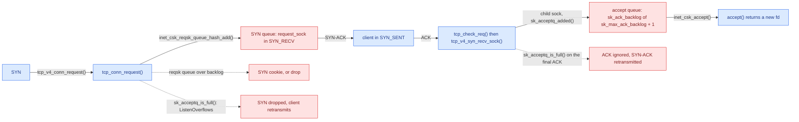
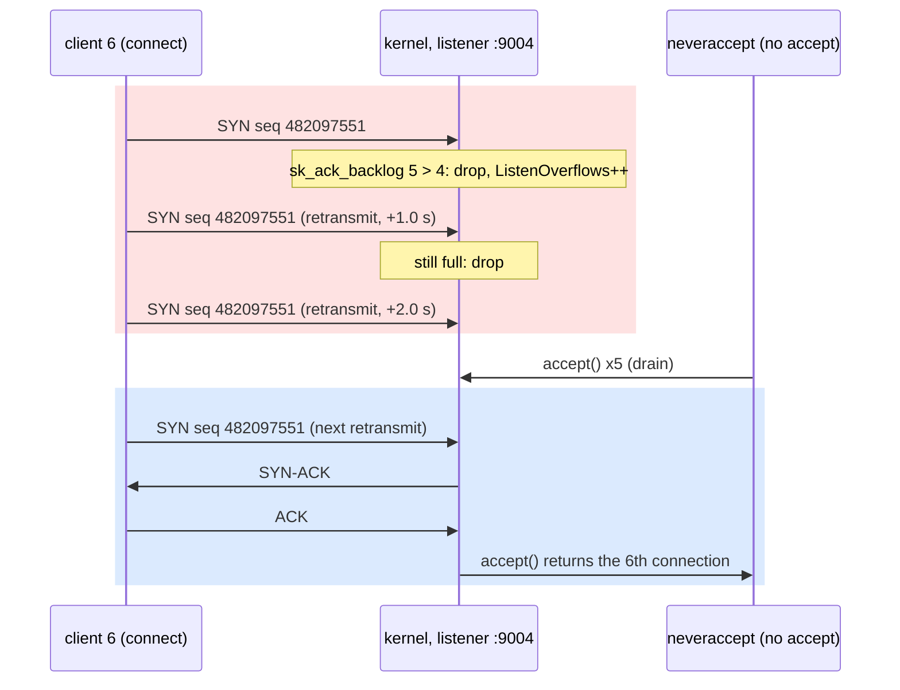
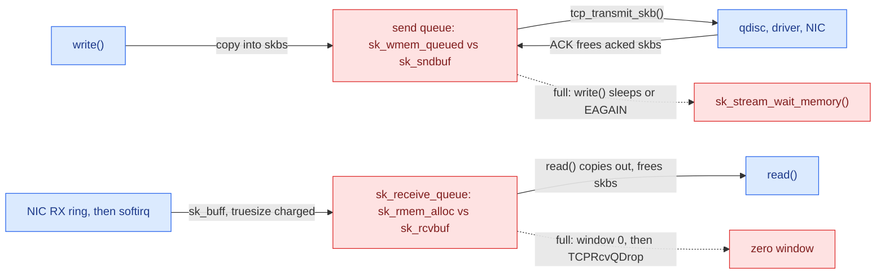
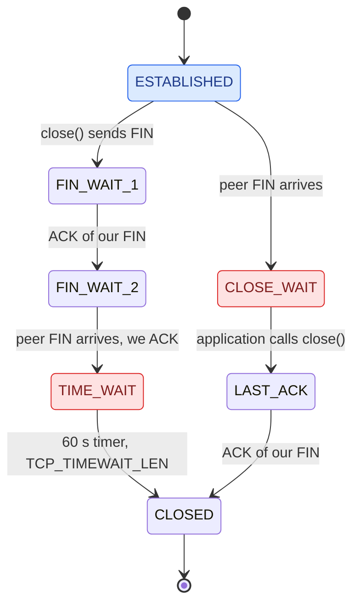

# Kernel Stack and Buffers

**Lesson 4 of 6: How Bytes Move**
**Ticketing Project**

---

## Table of Contents

1. [Why: The Kernel Works Before Your Code Does](#1-why-the-kernel-works-before-your-code-does)
2. [The Two Queues Behind listen()](#2-the-two-queues-behind-listen)
3. [sk_buff and the Socket Buffers](#3-sk_buff-and-the-socket-buffers)
4. [Closing: FIN, TIME_WAIT and Ephemeral Ports](#4-closing-fin-time_wait-and-ephemeral-ports)
5. [Code: Python](#5-code-python)
6. [Code: Go](#6-code-go)
7. [Code: Rust](#7-code-rust)
8. [See It: Queues That Fill While Nobody Calls accept()](#8-see-it-queues-that-fill-while-nobody-calls-accept)
9. [What People Miss](#what-people-miss)
10. [Key Files Summary](#key-files-summary)
11. [Summary](#summary)
12. [Checklist](#checklist-what-you-should-be-able-to-explain)

---

## Learning Objectives

After reading this document, you will understand:

- What the kernel does with a TCP connection **before** your process calls `accept()`, and **after** it calls `close()`
- How a listening socket really has **two queues** (half-open handshakes and finished connections), which limit applies to each, and what the kernel does when either is full
- What an `sk_buff` is, how socket send and receive buffers are accounted, and where autotuning sets their sizes
- Why `TIME_WAIT` exists, who ends up holding it, and how it turns into ephemeral port exhaustion
- How Python, Go and Rust choose a `listen()` backlog for you, and why the ports of this lesson's demo cannot use their defaults
- How to see every one of these queues with `ss`, `/proc/net/tcp`, `tcpdump` and `nstat`, without guessing

Key mental models to internalize:

- **Kernel queues let connections and bytes flow without the process; a full queue stops them.** The kernel answers SYNs, finishes handshakes, accepts data and holds closed connections while your process is busy, asleep or not even running. Each of those jobs parks something in a queue with a limit. When the accept queue is full, the next SYN is silently dropped: this lesson's flow stops at the accept queue that overflows.
- **A drop is not an error.** The kernel does not refuse a connection when a queue is full; it ignores the packet and lets TCP's retransmission try again later. The client sees seconds of latency, never a message saying why.
- **The process only ever sees the end of the pipeline.** `accept()` takes from a queue the kernel filled; `read()` takes from a buffer the kernel filled; `write()` puts into a buffer the kernel drains. Your code's speed decides how full those queues get, not whether the network keeps moving.
- **TIME_WAIT is a timer on a 4-tuple, not a leaked socket.** Whoever closes first holds it for 60 seconds on Linux, and the only resource it really costs is the right to reuse that exact 4-tuple.

Common misconceptions to avoid:

- "The `listen()` backlog is how many connections can be waiting." It sizes the queue of *finished* connections, Linux lets it hold one more than you asked for, and the half-open handshakes live somewhere else with their own rules.
- "If the server is overloaded, clients get connection refused." `ECONNREFUSED` means nothing listens on the port. An overloaded listener drops SYNs, and clients wait.
- "A connection exists once `accept()` returns it." The connection was established, buffered and possibly already carrying data before `accept()`; `accept()` only gives it a file descriptor.
- "Thousands of `TIME_WAIT` sockets mean a leak." They mean a lot of connections closed recently, on this side first. They expire on their own.

---

## 1. Why: The Kernel Works Before Your Code Does

Lesson 0.3 ended with bytes piling up in two kernel buffers while a slow reader took its time. That was the first hint of the shape of this lesson: the network does not wait for your process. A SYN arrives whether or not your server is currently scheduled on a CPU. A data segment arrives whether or not your code has called `read()`. A peer's FIN arrives in the middle of your garbage collector's pause. TCP has deadlines measured in round trips (the peer's retransmission timer starts at one second, RFC 6298 §2.1), and a user-space process can be descheduled, paused or busy for longer than that.

So the kernel does the time-critical work itself and leaves the rest in queues. When your server calls `listen()`, it is not saying "tell me when someone knocks". It is saying "handle the knocking for me, and keep the finished connections somewhere until I ask". The same is true on every other edge of a connection's life:

| Queue | What fills it | What drains it | Limit | When it is full | How you see it |
|-------|---------------|----------------|-------|-----------------|----------------|
| SYN queue (half-open, `SYN_RECV`) | Incoming SYNs | The client's final ACK | The listen backlog (and `tcp_max_syn_backlog` without cookies) | SYN cookies, or drop | `ss -tn state syn-recv` |
| Accept queue (finished, `ESTABLISHED`) | Completed handshakes | `accept()` | backlog + 1, capped by `somaxconn` | New SYNs dropped | `ss -lnt` Recv-Q / Send-Q, `nstat TcpExtListenOverflows` |
| Receive queue | Data segments | `read()`/`recv()` | `sk_rcvbuf` | Window closes to zero, then drops | `ss -tn` Recv-Q, `ss -tm` `r`/`rb` |
| Send queue | `write()`/`send()` | ACKs from the peer | `sk_sndbuf` | `write()` blocks or returns `EAGAIN` | `ss -tn` Send-Q, `ss -tm` `w`/`tb` |
| TIME_WAIT table | `close()` on the side that closes first | A 60 s timer | `tcp_max_tw_buckets` | Sockets skip TIME_WAIT | `ss -tan state time-wait` |
| Ephemeral ports | Outgoing `connect()` | `close()` plus TIME_WAIT | `ip_local_port_range` | `connect()` fails with `EADDRNOTAVAIL` | `ss -tan` counts per destination |

Every row is a place where data keeps flowing without your process, and every row has a number at which it stops. Lesson 0.1 showed the same pattern one layer down (the NIC ring), and lesson 0.3 showed it for bytes in flight (the window). This lesson covers the rows a server author meets first: the listener's two queues, the socket buffers, and the cost of closing.

Why bounded queues at all, rather than "as big as memory allows"? Because an unbounded queue does not remove overload, it converts it into latency. A connection that waits ten seconds in an accept queue before the server notices it is worse than one that was never accepted: the client has probably given up, and the server will now spend effort answering nobody. A bounded queue turns overload into a visible, countable event (a drop, a blocked write) that pushes back on the sender. That is backpressure, and lessons 1.5, 6.3 and 7.4 build on exactly this idea.

```
TICKETING EXAMPLE: On-sale day opens at 10:00:00. In the first second, 50,000
browsers open TCP connections to `ticketing api` on port 8080. Before the
handler for `GET /events/42/seats` runs a single line, the kernel has answered
every SYN it had room for, finished those handshakes, and parked the results in
the listener's accept queue. Whether a browser waits 20 ms or 1,020 ms for its
first byte is decided by that queue's limit and by how fast the accept loop
drains it, not by the handler's code.
```

---

## 2. The Two Queues Behind listen()

`listen(fd, backlog)` turns a bound socket into a listener. The name "backlog" comes from 4.2BSD, where it counted every connection that was not yet accepted, half-open or not. Linux splits that into two separate structures with different lifetimes, and `backlog` means something narrower than the man page's first sentence suggests.

### The path of one connection

When a SYN reaches a listening socket, `tcp_v4_conn_request()` hands it to `tcp_conn_request()` (net/ipv4/tcp_input.c). That function makes three decisions in a fixed order:

1. **Is the SYN queue full?** `inet_csk_reqsk_queue_is_full()` compares the number of half-open requests with the listener's `sk_max_ack_backlog`, the same number that limits the accept queue. If it is over (or `tcp_syncookies = 2` forces it), `tcp_syn_flood_action()` decides: with SYN cookies enabled it counts `TcpExtTCPReqQFullDoCookies` and answers statelessly, otherwise it counts `TcpExtTCPReqQFullDrop` and drops the SYN.
2. **Is the accept queue full?** `if (sk_acceptq_is_full(sk))` increments `LINUX_MIB_LISTENOVERFLOWS` and jumps to `drop`, which also increments `LINUX_MIB_LISTENDROPS` (`tcp_listendrop()`, include/net/tcp.h). This check comes **after** the cookie decision, so SYN cookies cannot save a server whose accept queue is full.
3. **Otherwise**, it allocates a `request_sock`: a small mini-socket that remembers the handshake (addresses, ports, initial sequence numbers, negotiated options), not a full `struct sock`. `inet_csk_reqsk_queue_hash_add()` (net/ipv4/inet_connection_sock.c) inserts it into the established-connections hash table and bumps the listener's request counter. This is the "SYN queue": since Linux 4.4 it is not a separate list but a count plus entries in the main hash, which is why `ss` can list them as `SYN-RECV`. The kernel sends the SYN-ACK and arms a timer to retransmit it.

When the client's final ACK arrives, `tcp_check_req()` (net/ipv4/tcp_minisocks.c) finds the `request_sock`, and `tcp_v4_syn_recv_sock()` (net/ipv4/tcp_ipv4.c) creates the real child socket: a full `struct sock` with its own receive and send buffers, in state `ESTABLISHED`. Before it does, it checks `sk_acceptq_is_full()` once more; on overflow it counts `ListenOverflows` and returns nothing. With `net.ipv4.tcp_abort_on_overflow = 0` (the default), `tcp_check_req()` then marks the request as acked and ignores the ACK, so the client believes it is connected while the server keeps the request and retransmits its SYN-ACK; with `1` the server sends a RST instead. If the check passes, `inet_csk_reqsk_queue_add()` links the child onto the listener's accept list and `sk_acceptq_added()` increments `sk_ack_backlog`.

Finally, your process calls `accept()`. `inet_csk_accept()` takes the oldest child off the list with `reqsk_queue_remove()`, decrements `sk_ack_backlog`, and the socket layer wraps the child in a file and returns a new descriptor. Nothing about the TCP connection changes at that moment. It was established, it had buffers, and if the client had sent data, that data was already sitting in the child's receive queue (lesson 0.5's blocking echo server shows exactly this: client B's `hello from B` was waiting before `accept4()` returned).



*Figure 1 — A listener is two queues in series: half-open `request_sock`s waiting for an ACK, then finished child sockets waiting for `accept()`. Each has a limit, and each overflow is a silent drop.*

### Why the accept queue holds backlog + 1

`sk_acceptq_is_full()` in include/net/sock.h is one line:

```c
static inline bool sk_acceptq_is_full(const struct sock *sk)
{
	return READ_ONCE(sk->sk_ack_backlog) > READ_ONCE(sk->sk_max_ack_backlog);
}
```

The comparison is `>`, not `>=`. With `listen(fd, 4)`, `sk_max_ack_backlog` is 4, and the queue is "full" only once `sk_ack_backlog` reaches 5. The comment above the function points to the kernel commit that reverted an attempt to make it `>=`; the off-by-one is long-standing Linux behaviour, and the See It below shows five connections queued for a backlog of four.

Two more numbers bound the backlog you ask for:

- **`net.core.somaxconn`** caps it: `__sys_listen_socket()` in net/socket.c replaces any larger `backlog` with `somaxconn` without telling you. The lab's value is 4096 (the default since Linux 5.4; it was 128 before), so a `listen(fd, 65535)` quietly becomes 4096.
- **`net.ipv4.tcp_max_syn_backlog`** (512 in the lab) only matters when SYN cookies are off. Then `tcp_conn_request()` reserves the last quarter of it for peers the kernel has already talked to ("proven to be alive"). With cookies on (`tcp_syncookies = 1`, the default and the lab's setting), the SYN queue's limit is the listen backlog, and anything beyond it gets a cookie.

### SYN cookies, briefly

A SYN cookie (RFC 4987 §3.6) is a way to answer a SYN without storing anything. The server encodes the connection's essentials (a hash of the 4-tuple and a time counter, plus a few bits for the MSS) into the initial sequence number of its SYN-ACK. If a valid ACK comes back, the ACK number minus one is the cookie, and the server can rebuild the connection from it. The price is that options which did not fit in the encoding (window scale and SACK, unless TCP timestamps carry them) may be lost for that connection. Cookies defend the SYN queue against floods of spoofed SYNs; they do nothing for an accept queue that your own process is not draining.

### What the client experiences

A dropped SYN produces no response at all, so the client's TCP does what it always does with silence: it retransmits. The first retransmission fires after `TCP_TIMEOUT_INIT`, one second (include/net/tcp.h, "RFC6298 2.1 initial RTO value"). Classic Linux then doubled the timeout each time (1, 2, 4, 8 s gaps). Kernels with `net.ipv4.tcp_syn_linear_timeouts` keep the first few retries at a fixed interval: in `tcp_retransmit_timer()` (net/ipv4/tcp_timer.c) the exponential backoff applies only once a `SYN_SENT` socket's retransmission count exceeds that sysctl, which is 4 in the lab. Either way, `connect()` does not fail; it simply takes a second or more longer, until a retransmitted SYN finds room or `tcp_syn_retries` runs out and it returns `ETIMEDOUT`.



*Figure 2 — From the client's side, a full accept queue looks like a slow network: the same SYN, sent again every second, until there is room.*

### Sizing the accept queue

The accept queue exists to absorb the gap between when handshakes finish and when your accept loop gets to them. A useful estimate of the depth you need is the connection arrival rate multiplied by the longest time the accept loop can be away:

| Arrival rate | Longest accept stall | Connections that finish during the stall | Backlog that absorbs it |
|--------------|----------------------|------------------------------------------|-------------------------|
| 2,000 / s | 5 ms (a busy event loop tick) | 10 | the defaults are fine |
| 20,000 / s | 5 ms | 100 | asyncio's 100 is at the edge |
| 20,000 / s | 300 ms (a GC pause, a blocking call) | 6,000 | more than `somaxconn` (4096) allows |

Three things follow. First, the defaults are sized for quiet servers; a service that expects bursts should pass its backlog explicitly and raise `net.core.somaxconn` to match, since the kernel clamps silently. Second, a bigger queue only helps with **bursts** shorter than a client's patience. Under sustained overload, a deep queue just means every accepted connection has already waited, and the server spends its time answering clients who have gone; at that point the right tool is to shed load early (lesson 7.4), not to queue more. Third, the queue belongs to one listening socket. If several worker processes each open their own listener on the same port with `SO_REUSEPORT`, the kernel spreads incoming connections across them by a hash of the 4-tuple, and each listener has its own accept queue and its own backlog; a slow worker then overflows its own queue while its siblings sit idle.

To watch it in production you need only two numbers: the listener's Recv-Q against its Send-Q in `ss -lnt` (how close the queue is to full right now) and the rate of change of `TcpExtListenOverflows` (whether it has been full). The first is a gauge, the second a counter; together they say whether the stall is happening and how often.

```
TICKETING EXAMPLE: `ticketing api` on asyncio gets backlog 100 by default
(asyncio's create_server signature says backlog=100). If the event loop stalls
for 300 ms (a synchronous JSON dump of a 5 MB seat map, lesson 1.5) while
20,000 SYNs per second arrive, about 6,000 handshakes finish during the stall,
101 of them fit, and the rest of the SYNs are dropped. Those browsers retry one
second later, which is why the p99 of "time to first byte" on on-sale day jumps
by almost exactly 1,000 ms, and why nothing in the application logs explains it.
```

---

## 3. sk_buff and the Socket Buffers

Once a connection is established, the bytes that flow through it live in two more queues per socket: the receive queue and the send queue. Both are lists of `sk_buff`s, and both are limited by a byte budget.

### The sk_buff

`struct sk_buff` (include/linux/skbuff.h) is the kernel's packet: a metadata structure plus a separate data buffer. Four fields describe the buffer:

- `head` points at the start of the allocated data buffer, and `end` at its end.
- `data` points at the first byte of the current layer's packet, and `tail` at the last byte of data.

Protocol layers add and remove headers by moving pointers instead of copying bytes. On transmit, TCP reserves headroom, `skb_put()` extends `tail` as payload is copied in, and each layer below calls `skb_push()` to move `data` backwards and write its header in front (TCP, then IP, then Ethernet). On receive, `skb_pull()` moves `data` forward past each header as the packet climbs from the driver to the socket. The same buffer the NIC filled by DMA (lesson 0.1) is the one TCP queues on your socket; tcpdump and lesson 0.1's `AF_PACKET` sniffer receive clones that share it.

For one outgoing segment, the pointer moves look like this (header sizes without options):

| Step | Call | `data` points at | Bytes added in front |
|------|------|------------------|----------------------|
| TCP allocates the skb with headroom for every header | `alloc_skb()` + `skb_reserve()` | empty payload area | none yet |
| `write()` bytes are copied in | `skb_put()` moves `tail` forward | the payload | payload after `data` |
| TCP builds its header | `skb_push()` | the TCP header | 20 |
| IP builds its header | `skb_push()` | the IP header | 20 |
| The neighbour layer adds the link header | `skb_push()` | the Ethernet header | 14 |

Nothing was copied after the payload went in, which is why the headroom is reserved up front. Receive runs the table backwards with `skb_pull()`, and by the time the skb reaches `sk_receive_queue`, `data` points at the first byte your `read()` will return.

The other field that matters here is `truesize`: the memory this packet really costs, the structure plus the whole allocated buffer, which is often much larger than the payload. The helper macro `SKB_TRUESIZE(X)` spells out the overheads: the payload size plus the cache-aligned sizes of `struct sk_buff` and `struct skb_shared_info`. Socket buffer limits are enforced in truesize, not in payload bytes.

### Receive and send budgets

Each socket has two budgets, `sk_rcvbuf` and `sk_sndbuf`, and two meters:

- **Receive.** Every skb queued on `sk_receive_queue` adds its truesize to `sk_rmem_alloc`. The window TCP advertises is computed from the free part of `sk_rcvbuf` (`tcp_win_from_space()`, scaled by the per-connection `scaling_ratio`, lesson 0.3). If the application stops reading, the window shrinks to zero; if a peer sends anyway and memory is exhausted, the kernel tries to collapse and prune the queue and then drops the segment (`TcpExtTCPRcvQDrop`, `TcpExtTCPZeroWindowDrop` in tcp_input.c).
- **Send.** `write()` copies your bytes into skbs on the send queue and adds them to `sk_wmem_queued`. They stay there until the peer ACKs them, because TCP may have to retransmit them. When `sk_wmem_queued` reaches `sk_sndbuf`, a blocking `write()` sleeps in `sk_stream_wait_memory()` and a non-blocking one returns `EAGAIN` (lesson 0.5). That is exactly the `send-blocked=5063ms` of lesson 0.3's slowreader.

Where do the sizes come from? A new TCP socket starts with `sk_rcvbuf` set to the middle value of `net.ipv4.tcp_rmem` and `sk_sndbuf` to the middle of `net.ipv4.tcp_wmem` (lesson 0.3's See It prints both triples). Then autotuning takes over unless you set the option yourself:

- `tcp_sndbuf_expand()` (net/ipv4/tcp_input.c) runs when a connection is established and raises `sk_sndbuf` to `2 × nr_segs × per_mss`, where `nr_segs` is at least the initial congestion window (10) and `per_mss` is the MSS plus maximum header room, rounded up to a power of two, plus the aligned size of a `struct sk_buff`. The factor 2 is a cushion for fast recovery (RFC 5681 §3.2). The result is capped by the third value of `tcp_wmem`.
- `tcp_rcv_space_adjust()` grows `sk_rcvbuf` as the application proves it reads quickly, up to the third value of `tcp_rmem`.
- `setsockopt(SO_RCVBUF)` or `SO_SNDBUF` turns autotuning off for that buffer (`SOCK_RCVBUF_LOCK`, `SOCK_SNDBUF_LOCK`) and stores **double** the value you passed. `__sock_set_rcvbuf()` in net/core/sock.c explains why: "We double it on the way in to account for 'struct sk_buff' etc. overhead." Lesson 0.3 saw this as `SO_RCVBUF asked 4096, kernel set 8192`.

The See It reads these meters directly. `ss -tm` prints a `skmem:(r…,rb…,t…,tb…,f…,w…,o…,bl…,d…)` block per socket (the field names are documented in `man ss`):

| Field | Kernel value | What it tells you |
|-------|--------------|-------------------|
| `r` | `sk_rmem_alloc` | truesize of skbs waiting in the receive queue for `read()` |
| `rb` | `sk_rcvbuf` | the receive budget `r` is compared against |
| `t` | `sk_wmem_alloc` | truesize of skbs handed to the IP layer and not yet freed by the driver |
| `tb` | `sk_sndbuf` | the send budget |
| `f` | `sk_forward_alloc` | memory pre-charged to the socket but not yet used |
| `w` | `sk_wmem_queued` | truesize of everything on the send queue, sent-but-unacked included |
| `o` | `sk_omem_alloc` | option memory (filters, multicast lists) |
| `bl` | backlog length | skbs that arrived while a syscall held the socket lock |
| `d` | `sk_drops` | packets dropped for this socket |

`r` close to `rb` means the application is not reading; `w` close to `tb` means the peer (or the network) is not taking bytes. For a child socket still waiting in the accept queue, the lab shows `rb131072` (the middle `tcp_rmem` value) and `tb2626560`. That second number is `tcp_sndbuf_expand()`'s formula at work: loopback's MSS is 65483, rounding MSS plus headers up gives 131072, adding 256 bytes for the aligned `struct sk_buff` gives a `per_mss` of 131328, and `2 × 10 × 131328 = 2626560`. A connection nobody has accepted yet already owns a 2.5 MB send budget.



*Figure 3 — Each established socket is two byte budgets. Bytes flow while there is room; the send queue also keeps every byte until the peer ACKs it.*

```
TICKETING EXAMPLE: `GET /events` for a festival with 40,000 seats returns a
2 MB JSON body. The handler's write() returns almost at once because the
kernel copied the body into a send buffer that autotuning made big enough;
the handler is done long before the bytes are. A phone on a bad network then
drains that buffer at 100 KB/s for 20 seconds, while `ss -tn` on the server
shows the body sitting in Send-Q. Paginating `/events` (lesson 2.2) shrinks
the buffer each request pins, not just the JSON encoding time.
```

---

## 4. Closing: FIN, TIME_WAIT and Ephemeral Ports

A TCP connection carries two independent byte streams, so closing it takes two FINs, one per direction (RFC 9293 §3.6). The side that calls `close()` (or `shutdown(SHUT_WR)`) first is the **active closer**; the other side is the **passive closer**.

- The active closer sends FIN and moves to `FIN_WAIT_1`, then to `FIN_WAIT_2` when that FIN is ACKed. When the peer's FIN arrives, it ACKs it and enters `TIME_WAIT`.
- The passive closer receives the FIN, ACKs it and enters `CLOSE_WAIT`. It stays there until its application calls `close()` too, then sends its own FIN (`LAST_ACK`) and is done when that is ACKed. A pile of `CLOSE_WAIT` sockets always means an application that forgot to close; the kernel cannot do it for you.



*Figure 4 — The active closer ends in TIME_WAIT on a timer; the passive closer waits in CLOSE_WAIT for its own application.*

### Why TIME_WAIT exists

TIME_WAIT keeps the 4-tuple (source IP, source port, destination IP, destination port) reserved after the connection is gone, for two reasons from RFC 9293:

1. **The last ACK can be lost.** If the active closer's final ACK never arrives, the passive closer retransmits its FIN. A socket in TIME_WAIT can answer that FIN with another ACK; a socket that had already vanished would answer with a RST, and the peer would see an error on a connection that closed cleanly.
2. **Old segments can arrive late.** A segment delayed somewhere in the network could arrive after the connection closed. If a new connection had already reused the same 4-tuple, that old segment could be accepted into the new byte stream if its sequence number happened to fit. Waiting long enough for every old segment to expire prevents that (RFC 1337 describes what goes wrong when TIME_WAIT is cut short).

The RFC asks for twice the maximum segment lifetime (2 MSL). Linux does not compute it: `TCP_TIMEWAIT_LEN` in include/net/tcp.h is a constant `(60*HZ)`, and `tcp_time_wait()` in net/ipv4/tcp_minisocks.c converts the closing socket into a small `tcp_timewait_sock` (it no longer has buffers or a file descriptor) and arms that timer. There is no sysctl for it; `tcp_fin_timeout` controls `FIN_WAIT_2`, not TIME_WAIT. The See It shows a fresh entry as `timer:(timewait,59sec,0)`.

`net.ipv4.tcp_max_tw_buckets` (32768 in the lab) caps how many exist; beyond it, the kernel skips TIME_WAIT for new closes and logs an overflow warning, trading safety for memory.

### Ephemeral ports: where TIME_WAIT really costs something

A server's TIME_WAIT sockets all share its listening port, and each is distinguished by the client's address and port, so they cost a few hundred bytes of memory each and nothing else. The client side is different. Every outgoing `connect()` without an explicit `bind()` gets a source port from `net.ipv4.ip_local_port_range`, chosen with a per-destination offset (the RFC 6056 approach). The 4-tuple must be unique, and a port whose last connection to that destination is still in TIME_WAIT is not reusable for 60 seconds unless `tcp_tw_reuse` allows it.

The lab's range is `55000 65535`: 10,536 ports. That is Docker Desktop's setting, narrower than Linux's default of 32768–60999. If a client closes first and opens new connections to the same server address and port, it can sustain at most about 10,536 / 60 ≈ 175 new connections per second before `connect()` fails with `EADDRNOTAVAIL` ("Cannot assign requested address"). `net.ipv4.tcp_tw_reuse` is 2 in the lab, which means "allow reuse of TIME_WAIT ports, but only for loopback traffic"; 1 allows it everywhere for connections that use TCP timestamps; 0 forbids it.

Note the shape of that limit: it is per destination `ip:port`, not global. The same client can hold 10,536 connections to each of many servers, because each destination makes a different 4-tuple. That is why the usual fixes are "talk to more addresses" (several upstream IPs, or several local source IPs) and, far better, "open fewer connections".

### Who should close first

Since TIME_WAIT lands on the active closer, protocols choose who closes. HTTP/1.1 servers usually close idle keep-alive connections themselves, so busy servers accumulate TIME_WAIT on their listening port, which is cheap. HTTP clients that close after every request, load generators that open a fresh connection per request, and proxies without upstream keep-alive put TIME_WAIT on the client side, which is where ports run out. There is a way to skip TIME_WAIT entirely: `SO_LINGER` with a zero timeout makes `close()` send a RST instead of a FIN, and the socket disappears at once. It also discards any unsent data and gives up both protections above, so it is a last resort for code that knows the peer is gone, not a tuning knob.

TIME_WAIT has a sibling worth recognising: `FIN_WAIT_2` is the active closer waiting for the peer's FIN after its own was ACKed. If the peer never closes its half, `net.ipv4.tcp_fin_timeout` (60 s by default) bounds that wait for orphaned sockets. Like `CLOSE_WAIT` on the other side, a crowd of `FIN_WAIT_2` sockets points at a peer application that is not closing.

```
TICKETING EXAMPLE: In Module 5, nginx sits in front of `ticketing api`. If its
upstream block has no `keepalive`, nginx opens a new connection to
127.0.0.1:8080 for every request and closes it afterwards, so nginx is the
active closer and every upstream connection leaves a TIME_WAIT entry holding
one of 10,536 ephemeral ports for 60 s. Past roughly 175 requests per second
to that one upstream, nginx's connect() starts failing with EADDRNOTAVAIL and
clients see 502s, while the API is idle. The fix is reuse, not a sysctl:
upstream keep-alive (lessons 1.3 and 5.6) and connection pools (lesson 6.3).
```

---

## 5. Code: Python

The demo is [`demos/00/04/python/main.py`](../../demos/00/04/python/main.py): a listener that never calls `accept()`, plus clients in the same process. Module 0 has no app code, so the demo is the whole story. Four functions matter.

**The listener.** Everything interesting about `listen()` is in its one argument:

```python
def listen(port: int, backlog: int) -> socket.socket:
    listener = socket.socket(socket.AF_INET, socket.SOCK_STREAM)
    # TIME_WAIT sockets from a previous --drain still hold the port; allow rebinding.
    listener.setsockopt(socket.SOL_SOCKET, socket.SO_REUSEADDR, 1)
    listener.bind(("127.0.0.1", port))
    listener.listen(backlog)  # the accept queue's limit (capped by net.core.somaxconn)
    return listener
```

`listener.listen(backlog)` is a direct `listen(2)`: CPython passes the number through (and `listen()` with no argument uses `min(SOMAXCONN, 128)`). `SO_REUSEADDR` is here because of section 4: after a `--drain` run, the server-side TIME_WAIT entries still name 127.0.0.1:9004, and without the option `bind()` would fail with `EADDRINUSE` for the next 60 seconds. On Linux, `SO_REUSEADDR` allows binding a listening port that only has TIME_WAIT sockets on it; it does not allow two live listeners on one port.

**The clients.** They connect without blocking, so one thread can start eight handshakes at once:

```python
def start_clients(port: int, count: int) -> list[socket.socket]:
    clients = []
    for _ in range(count):
        client = socket.socket(socket.AF_INET, socket.SOCK_STREAM)
        client.setblocking(False)  # connect() returns at once; the handshake goes on
        code = client.connect_ex(("127.0.0.1", port))
        if code not in (0, errno.EINPROGRESS):
            raise OSError(code, f"connect: {errno.errorcode.get(code, code)}")
        clients.append(client)
    return clients
```

A non-blocking `connect()` sends the SYN and returns `EINPROGRESS` immediately; `connect_ex()` returns that errno instead of raising it. On loopback the whole handshake happens in the kernel within microseconds of the SYN being sent, so by the time the loop moves on, clients 1 to 5 are already established and sitting in the server's accept queue, and clients 6 to 8 have had their SYNs dropped.

**Asking whether a connect finished.** A pending connect becomes writable when it completes, with the outcome in `SO_ERROR`:

```python
def connected(client: socket.socket) -> bool:
    """A non-blocking connect has finished when the socket is writable with SO_ERROR 0."""
    poller = select.poll()
    poller.register(client, select.POLLOUT)
    if not poller.poll(0):
        return False
    return client.getsockopt(socket.SOL_SOCKET, socket.SO_ERROR) == 0
```

`poll(0)` does not wait; it reports the state right now. A socket whose SYN was dropped is not writable (it is still in `SYN_SENT`), so it counts as pending. This is the readiness pattern lesson 0.5 builds an entire server on.

**Draining.** `--drain` finally takes the connections, and closes each one from the server side first:

```python
def drain(listener: socket.socket, expected: int, seconds: float) -> int:
    """Accept for up to `seconds`, closing each connection server-side first."""
    listener.setblocking(False)
    accepted, started = 0, time.monotonic()
    while accepted < expected and (elapsed := time.monotonic() - started) < seconds:
        try:
            conn, peer = listener.accept()
        except BlockingIOError:
            time.sleep(0.05)  # queue empty; a retransmitted SYN may still arrive
            continue
        accepted += 1
        print(f"drain: accept() -> fd {conn.fileno()} from port {peer[1]} at +{elapsed:.1f} s")
        conn.close()  # the server closes first, so the server side goes to TIME_WAIT
    print(f"drain: accepted {accepted}; closed first, so they sit in TIME_WAIT (60 s)")
    return accepted
```

The first five `accept()` calls return at once: those connections have been waiting all along. The queue is then empty, and the next three appear only when the clients' retransmitted SYNs arrive and find room, about a second after their first attempt. Because `conn.close()` runs before the client closes its end, the server is the active closer and the TIME_WAIT entries land on the server's side of each 4-tuple. Every accepted fd gets the same number (12 in the capture) because each one is closed before the next `accept()`, and the kernel always hands out the lowest free descriptor.

**Tying it together.** `run()` is the timeline the See It observes:

```python
def run(port: int, backlog: int, count: int, hold: float, do_drain: bool) -> tuple[int, int]:
    listener = listen(port, backlog)
    print(f"neveraccept: listening on 127.0.0.1:{port}, backlog {backlog}; accept() is not called")
    clients = start_clients(port, count)
    time.sleep(0.5)  # let the handshakes that can complete, complete
    done = report(clients, backlog)
    if hold > 0:
        print(f"holding {hold:g} s: try  ss -lnt 'sport = :{port}'", flush=True)
        time.sleep(hold)
    drained = drain(listener, count, seconds=4.0) if do_drain else 0
    for client in clients:
        client.close()
    listener.close()
    return done, drained
```

The half-second sleep matters only for readability: on loopback every handshake that can complete has completed long before it ends. The `--hold` window is when `ss`, `/proc/net/tcp` and `tcpdump` look at the queue; nothing in the process runs during it, which is the point. When the process finally exits, `listener.close()` also discards any connections still in the accept queue: `inet_csk_listen_stop()` walks the queue and `inet_child_forget()` disconnects each child, which sends the client a RST, because nobody will ever accept it. A server restart therefore resets every connection that was waiting, which is one reason graceful shutdown (lesson 8.3) stops accepting before it closes the listener. The `--smoke` mode asserts the Linux numbers (5 connected, 8 drained), which is why `run.sh` re-runs itself in the lab on macOS.

```
TICKETING EXAMPLE: neveraccept is `ticketing rawhttp` (Module 1) with its accept
loop stuck: a handler that blocks the only thread, or a Python process paused
by the OOM killer's neighbour. The kernel keeps finishing handshakes for
backlog+1 clients and then starts dropping SYNs, so the first clients connect
"instantly" and hang waiting for a response, and the next ones see connect()
take seconds. Both groups look like "the API is slow" from the browser.
```

---

## 6. Code: Go

The Go port (`demos/00/04/go/main.go`) must print the same lines for the same flags (`--port`, `--backlog`, `--clients`, `--hold`, `--drain`, `--smoke`) and pass the same smoke assertions. It cannot use `net.Listen`: Go always passes its own backlog, read once from `/proc/sys/net/core/somaxconn` by `maxListenerBacklog()` in net/sock_linux.go (4096 in the lab), so `--backlog 4` would be impossible. The port therefore calls `syscall.Socket`, `syscall.Bind` and `syscall.Listen(fd, backlog)` directly, starts each client with `syscall.SetNonblock` and a `syscall.Connect` that returns `EINPROGRESS`, and decides "connected or pending" with a readiness check such as `poll(2)` plus `SO_ERROR`. What it shows that Python does not: how much the standard library's `net` package chooses for you.

As in lesson 0.1, the port is `main.go` (`//go:build linux`), a `main_other.go` stub that prints the Linux-only line and exits 2, and a `go.mod` so that the build tags apply. Errors are wrapped with `os.NewSyscallError`, so a failure names the call and the errno together (`neveraccept: bind: address already in use`). The listener is four syscalls, and the second argument of the last one is the point of the lesson:

```go
func listen(port, backlog int) (int, error) {
	fd, err := syscall.Socket(syscall.AF_INET, syscall.SOCK_STREAM|syscall.SOCK_CLOEXEC, 0)
	if err != nil {
		return -1, os.NewSyscallError("socket", err)
	}
	// TIME_WAIT sockets from a previous --drain still hold the port; allow rebinding.
	if err := syscall.SetsockoptInt(fd, syscall.SOL_SOCKET, syscall.SO_REUSEADDR, 1); err != nil {
		syscall.Close(fd)
		return -1, os.NewSyscallError("setsockopt", err)
	}
	if err := syscall.Bind(fd, &syscall.SockaddrInet4{Port: port, Addr: loopback}); err != nil {
		syscall.Close(fd)
		return -1, os.NewSyscallError("bind", err)
	}
	// The accept queue's limit, exactly as given (capped by net.core.somaxconn).
	if err := syscall.Listen(fd, backlog); err != nil {
		syscall.Close(fd)
		return -1, os.NewSyscallError("listen", err)
	}
	return fd, nil
}
```

The readiness check needs a call the `syscall` package does not wrap: there is no `syscall.Poll`, and linux/arm64 has no `poll(2)` syscall at all, only `ppoll(2)`, which is what glibc's `poll()` calls there. So the port declares `struct pollfd` itself and makes the call with `syscall.Syscall6`:

```go
// pollFd is struct pollfd from <poll.h>; the syscall package has no poll wrapper.
type pollFd struct {
	fd      int32
	events  int16
	revents int16
}

const pollOut = 0x4 // POLLOUT

// connected reports whether a non-blocking connect has finished: the socket is
// writable and SO_ERROR is 0. ppoll() with a zero timeout looks without
// waiting; it is the syscall every libc poll() uses on arm64, which has no poll(2).
func connected(fd int) bool {
	pfd := pollFd{fd: int32(fd), events: pollOut}
	var zero syscall.Timespec
	ready, _, errno := syscall.Syscall6(syscall.SYS_PPOLL,
		uintptr(unsafe.Pointer(&pfd)), 1, uintptr(unsafe.Pointer(&zero)), 0, 0, 0)
	if errno != 0 || ready == 0 {
		return false
	}
	soError, err := syscall.GetsockoptInt(fd, syscall.SOL_SOCKET, syscall.SO_ERROR)
	return err == nil && soError == 0
}
```

In the lab, `ss -lnt` shows `LISTEN 5 4` for the Go port as it does for Python, and the smoke prints the same `5 connected, 3 pending`. One visible difference: the `drain:` lines show `fd 14` where Python shows `fd 12`. The first `time.Sleep` starts the Go runtime's netpoller, which opens an `eventpoll` and an `eventfd` (fds 12 and 13 in `/proc/<pid>/fd`), even though this program never touches `net`. Lesson 0.6 is about that netpoller.

```
TICKETING EXAMPLE: The Go port of `ticketing api` (Module 2, net/http) listens
through net.Listen, so its accept queue is as large as somaxconn allows: 4096
in the lab. Combined with a goroutine per accepted connection, a Go server
rarely overflows its accept queue; it moves the queueing into the scheduler
and the heap instead, which lesson 0.6 measures.
```

---

## 7. Code: Rust

The Rust port (`demos/00/04/rust/main.rs`, with the `libc` crate) must print the same lines for the same flags. `std::net::TcpListener::bind` hard-codes its backlog: the standard library's socket code (library/std/src/sys/net/connection/socket/mod.rs) calls `listen(fd, 128)` on every platform except two niche targets that cannot take that many. So the port builds the listener itself with `libc::socket`, `libc::bind` and `libc::listen(fd, backlog)`, connects the clients with a non-blocking `libc::connect` that returns `EINPROGRESS`, and checks completion with `libc::poll` and `SO_ERROR`. What it shows that Python does not: the raw `libc` calls behind every `std::net` convenience, and the explicit unsafe boundary around them.

Every libc call goes through `check()`, which turns -1 into `io::Error::last_os_error()`, and every fd is an `OwnedFd`, so the clients and the listener are closed when they are dropped (at the end of `run()`: the clients first, then the listener, as in Python). The listener:

```rust
fn listen(port: u16, backlog: i32) -> io::Result<OwnedFd> {
    let listener = tcp_socket()?;
    let fd = listener.as_raw_fd();
    // TIME_WAIT sockets from a previous --drain still hold the port; allow rebinding.
    let one: libc::c_int = 1;
    let (opt, len) = (
        (&one as *const libc::c_int).cast(),
        mem::size_of::<libc::c_int>() as libc::socklen_t,
    );
    check(unsafe { libc::setsockopt(fd, libc::SOL_SOCKET, libc::SO_REUSEADDR, opt, len) })?;
    let addr = loopback(port);
    check(unsafe { libc::bind(fd, (&addr as *const libc::sockaddr_in).cast(), ADDR_LEN) })?;
    // The accept queue's limit, exactly as given (capped by net.core.somaxconn).
    check(unsafe { libc::listen(fd, backlog) })?;
    Ok(listener)
}
```

`libc::poll` exists on every Unix target (glibc implements it with `ppoll()` on arm64), so the readiness check is a direct translation of Python's `select.poll()`:

```rust
/// A non-blocking connect has finished when the socket is writable with SO_ERROR 0.
fn connected(fd: RawFd) -> bool {
    let mut pfd = libc::pollfd {
        fd,
        events: libc::POLLOUT,
        revents: 0,
    };
    if unsafe { libc::poll(&mut pfd, 1, 0) } <= 0 {
        return false; // timeout 0: look, do not wait
    }
    let (mut so_error, mut len) = (
        0 as libc::c_int,
        mem::size_of::<libc::c_int>() as libc::socklen_t,
    );
    let out = (&mut so_error as *mut libc::c_int).cast();
    let ret = unsafe { libc::getsockopt(fd, libc::SOL_SOCKET, libc::SO_ERROR, out, &mut len) };
    ret == 0 && so_error == 0
}
```

None of these calls is Linux-specific, so the file also compiles on macOS, and the platform check is a runtime `if !cfg!(target_os = "linux")` in `main()`, in the same place Python tests `sys.platform`. In the lab the drain lines show `fd 12`, as in Python: Rust's std opens no fds of its own.

```
TICKETING EXAMPLE: The Rust port of `ticketing api` (Module 2, axum on tokio)
gets its listener from tokio. Lesson 0.6 measures that listener's backlog at
128 in the lab, close to asyncio's 100 and far below Go's 4096, so on on-sale
day the Rust and Python ports overflow their accept queues at a load the Go
port absorbs. The fix is the same one line in all three: pass a larger
backlog explicitly, and raise somaxconn if needed.
```

---

## 8. See It: Queues That Fill While Nobody Calls accept()

Every capture below comes from one run of `just see 00/04` in the lab, on kernel 7.0.14-linuxkit (Docker Desktop's VM, aarch64). Inside the lab you are root in `/work`, so the commands work as shown. Run the demo in the background (or in a second `just lab` shell) and look at it from the kernel's side.

### 8.1 sysctl — the limits this lesson is about

```bash
sysctl net.core.somaxconn net.ipv4.tcp_max_syn_backlog net.ipv4.tcp_syncookies \
  net.ipv4.tcp_syn_linear_timeouts net.ipv4.tcp_abort_on_overflow \
  net.ipv4.ip_local_port_range net.ipv4.tcp_tw_reuse net.ipv4.tcp_max_tw_buckets
```

```text
net.core.somaxconn = 4096
net.ipv4.tcp_max_syn_backlog = 512
net.ipv4.tcp_syncookies = 1
net.ipv4.tcp_syn_linear_timeouts = 4
net.ipv4.tcp_abort_on_overflow = 0
net.ipv4.ip_local_port_range = 55000	65535
net.ipv4.tcp_tw_reuse = 2
net.ipv4.tcp_max_tw_buckets = 32768
```

Every number in sections 2 and 4 is here: `somaxconn` caps any backlog at 4096, SYN cookies are on (so `tcp_max_syn_backlog` is dormant), an overflow on the final ACK is ignored rather than reset, SYN retries stay linear for four attempts, and clients have only 10,536 ephemeral ports. `/proc/sys` is read-only inside the lab container, so you can read these but not change them there.

### 8.2 ss -lnt — the accept queue's depth and limit

Start neveraccept (backlog 4, eight clients) and look at its listener:

```bash
nstat -n                                     # remember the counters; the next nstat prints the change
timeout 4 tcpdump -l -i lo -nn 'tcp dst port 9004 and tcp[tcpflags] == tcp-syn' &
python3 demos/00/04/python/main.py --hold 4 &
sleep 1.5
ss -lnt 'sport = :9004'
```

```text
client 5: connected from port 64228 (waiting in the accept queue)
client 6: pending from port 64230 (SYN_SENT: no SYN-ACK yet)
…
result: 5 connected, 3 pending; the accept queue holds backlog+1 = 5
…
State  Recv-Q Send-Q Local Address:Port Peer Address:PortProcess
LISTEN 5      4          127.0.0.1:9004      0.0.0.0:*
```

For a socket in `LISTEN`, `ss` repurposes its two queue columns: Recv-Q is `sk_ack_backlog` (connections waiting for `accept()`) and Send-Q is `sk_max_ack_backlog` (the backlog you asked for), as `tcp_diag_get_info()` in net/ipv4/tcp_diag.c fills them in. `5` over `4` is the `>` in `sk_acceptq_is_full()`, measured: the queue holds backlog + 1, and the demo's own report agrees.

### 8.3 ss -tn and ss -tm — the dropped and the queued

```bash
ss -tn state syn-sent 'dport = :9004'
ss -tmn state established 'sport = :9004' | head -n 5
```

```text
Recv-Q Send-Q Local Address:Port  Peer Address:PortProcess
0      1          127.0.0.1:64230    127.0.0.1:9004
0      1          127.0.0.1:64232    127.0.0.1:9004
0      1          127.0.0.1:64240    127.0.0.1:9004
Recv-Q Send-Q Local Address:Port Peer Address:Port Process
0      0          127.0.0.1:9004    127.0.0.1:64192
	 skmem:(r0,rb131072,t0,tb2626560,f0,w0,o0,bl0,d0)
0      0          127.0.0.1:9004    127.0.0.1:64204
	 skmem:(r0,rb131072,t0,tb2626560,f0,w0,o0,bl0,d0)
```

The first block is the client side of clients 6, 7 and 8, still in `SYN-SENT`; Send-Q 1 is the SYN itself, unacknowledged. The second block is the server side of two of the five queued connections. They are full sockets already, in `ESTABLISHED`, with the buffer budgets of section 3: `rb131072` is the middle value of `tcp_rmem`, and `tb2626560` is `tcp_sndbuf_expand()`'s `2 × 10 × 131328`. None of them has been accepted.

### 8.4 /proc/net/tcp — the same sockets, raw

```bash
head -n 1 /proc/net/tcp; grep -i ':232C ' /proc/net/tcp | head -n 4
```

```text
  sl  local_address rem_address   st tx_queue rx_queue tr tm->when retrnsmt   uid  timeout inode
   9: 0100007F:232C 00000000:0000 0A 00000000:00000005 00:00000000 00000000     0        0 39446178 6 00000000576518b7 100 0 0 10 0
  11: 0100007F:232C 0100007F:FAC0 01 00000000:00000000 00:00000000 00000000     0        0 0 1 00000000db313efe 20 0 0 10 -1
  12: 0100007F:FABA 0100007F:232C 01 00000000:00000000 00:00000000 00000000     0        0 39446179 1 000000005cd992c2 20 0 0 10 -1
  13: 0100007F:FAC0 0100007F:232C 01 00000000:00000000 00:00000000 00000000     0        0 39446180 1 0000000084d38f24 20 0 0 10 -1
```

This is the table `ss` decodes, in hexadecimal. `0100007F:232C` is 127.0.0.1 (little-endian bytes) port 0x232C = 9004. `st` is the TCP state: `0A` is `LISTEN`, `01` is `ESTABLISHED`. For the listener, `get_tcp4_sock()` in net/ipv4/tcp_ipv4.c puts `sk_ack_backlog` in the `rx_queue` field, so `00000005` is the same 5 that `ss` showed. Now compare rows 11 and 13: they are the two ends of one connection (port 0xFAC0 = 64192). The client end (row 13) has inode 39446180, a real socket file. The server end (row 11) has inode **0**: it is a complete TCP connection with no file and no descriptor yet. That file is exactly what `accept()` creates.

### 8.5 tcpdump — the dropped SYNs, every second

```bash
timeout 4 tcpdump -l -i lo -nn 'tcp dst port 9004 and tcp[tcpflags] == tcp-syn'
```

```text
22:22:58.933223 IP 127.0.0.1.64228 > 127.0.0.1.9004: Flags [S], seq 1510307649, win 65495, options [mss 65495,sackOK,TS val 2206942276 ecr 0,nop,wscale 10], length 0
22:22:58.933234 IP 127.0.0.1.64230 > 127.0.0.1.9004: Flags [S], seq 482097551, win 65495, options [mss 65495,sackOK,TS val 3923590835 ecr 0,nop,wscale 10], length 0
…
22:22:59.946366 IP 127.0.0.1.64230 > 127.0.0.1.9004: Flags [S], seq 482097551, win 65495, options [mss 65495,sackOK,TS val 3923591848 ecr 0,nop,wscale 10], length 0
22:23:00.968552 IP 127.0.0.1.64230 > 127.0.0.1.9004: Flags [S], seq 482097551, win 65495, options [mss 65495,sackOK,TS val 3923592870 ecr 0,nop,wscale 10], length 0
…
22:23:01.992711 IP 127.0.0.1.64230 > 127.0.0.1.9004: Flags [S], seq 482097551, win 65495, options [mss 65495,sackOK,TS val 3923593894 ecr 0,nop,wscale 10], length 0
```

The filter keeps only pure SYNs to port 9004. Client 5 (port 64228) sends one SYN and is done: its handshake fit. Client 6 (port 64230) sends the same SYN, `seq 482097551`, four times, at 58.933, 59.946, 00.968 and 01.992: gaps of about 1.02 s, not 1, 2, 4. That is `tcp_syn_linear_timeouts = 4` keeping the retransmission timer at its initial one second. The SYN-ACKs never appear because the server never sent any: the kernel dropped these SYNs on arrival.

### 8.6 nstat — the kernel counts every drop

```bash
nstat TcpExtListenOverflows TcpExtListenDrops
```

```text
#kernel
TcpExtListenOverflows           12                 0.0
TcpExtListenDrops               12                 0.0
```

`nstat -n` before the run saved the counters, so this is the change: 12 overflows, exactly three pending clients times four SYNs each in the capture window. `ListenDrops` moves with it because the `drop:` path of `tcp_conn_request()` calls `tcp_listendrop()` after `ListenOverflows` is counted. On a production server, a non-zero rate of `TcpExtListenOverflows` is the one number that says "the accept queue was full"; nothing in your application's logs will.

### 8.7 iptables + ss — the other queue, on its own

To fill the SYN queue instead, make handshakes stay half-open: drop the server's SYN-ACKs before the clients see them.

```bash
iptables -I INPUT -p tcp --sport 9004 --tcp-flags SYN,ACK SYN,ACK -j DROP
python3 demos/00/04/python/main.py --clients 3 --hold 3 &
sleep 1.5
ss -lnt 'sport = :9004'
ss -tn state syn-recv 'sport = :9004'
iptables -D INPUT -p tcp --sport 9004 --tcp-flags SYN,ACK SYN,ACK -j DROP
```

```text
State  Recv-Q Send-Q Local Address:Port Peer Address:PortProcess
LISTEN 0      4          127.0.0.1:9004      0.0.0.0:*
Recv-Q Send-Q Local Address:Port Peer Address:Port Process
0      0          127.0.0.1:9004    127.0.0.1:61622
0      0          127.0.0.1:9004    127.0.0.1:61632
0      0          127.0.0.1:9004    127.0.0.1:61640
```

Three `request_sock`s sit in `SYN-RECV`, each waiting for an ACK that cannot come, while the listener's accept queue is **empty** (Recv-Q 0). These connections exist in the kernel, they count against the same backlog of 4 for the SYN-queue check, and `ss -lnt` cannot see them. That is the whole point of `(backlog-is-two-queues)` below. The server keeps retransmitting its SYN-ACKs (`net.ipv4.tcp_synack_retries` times) before giving up on each one.

### 8.8 --drain and ss -o — accept, close first, TIME_WAIT

```bash
python3 demos/00/04/python/main.py --hold 0 --drain | grep -E '^(result|drain)'
ss -tano state time-wait 'sport = :9004' | head -n 4
```

```text
drain: accept() -> fd 12 from port 61680 at +0.0 s
drain: accept() -> fd 12 from port 61704 at +0.6 s
drain: accept() -> fd 12 from port 61698 at +0.6 s
drain: accept() -> fd 12 from port 61682 at +0.6 s
drain: accepted 8; closed first, so they sit in TIME_WAIT (60 s)
Recv-Q Send-Q Local Address:Port Peer Address:Port Process
0      0          127.0.0.1:9004    127.0.0.1:61704 timer:(timewait,59sec,0)
0      0          127.0.0.1:9004    127.0.0.1:61654 timer:(timewait,59sec,0)
```

The five queued connections come out at `+0.0 s`. The other three arrive at `+0.6 s`: the drain started 0.5 s after their first SYN, and their retransmission fired about a second after that SYN, found room and completed. Because the server closed each connection first, the TIME_WAIT entries are on the server's side (`127.0.0.1:9004` as the local address), each with a countdown of 59 s left of `TCP_TIMEWAIT_LEN`. Run `ss -tano state time-wait` again a minute later and they are gone; nothing had to clean them up.

### Reproduce

```bash
just see 00/04
```

`demos/00/04/see.sh` replays every observation above (sysctl, the demo, `ss -lnt`, `ss -tn`, `ss -tm`, `/proc/net/tcp`, `tcpdump`, `nstat`, the iptables SYN-ACK drop, the drain and `ss -tano`) and passes when a line matches `EXPECT='^LISTEN +5 +4 '`. The iptables rule is removed on exit even if the script fails.

---

## What People Miss

### The backlog is not "the number of pending connections"

> [!WARNING]
> **Reality check (backlog-is-two-queues) —** `listen(fd, n)` sizes the accept queue of *finished* connections, Linux lets it hold `n + 1` (`sk_acceptq_is_full()` uses `>`), and the kernel silently clamps `n` to `net.core.somaxconn` (4096 in the lab). Half-open handshakes live in a second structure, the `SYN-RECV` request socks, which `ss -lnt` does not show: the See It had three of them while the listener reported Recv-Q 0. The SYN queue is checked against the same backlog, and with `tcp_syncookies = 1` overflow there turns into stateless SYN cookies; `tcp_max_syn_backlog` only matters with cookies off. Overflowing either queue is a **drop, not a refusal**: no RST, no error, just a SYN that is never answered, so the client retransmits after 1 s (then 1 s, 1 s, 1 s with linear timeouts, or 2 s, 4 s on older kernels) and your users see connect latency in whole seconds. You detect it with `nstat TcpExtListenOverflows TcpExtListenDrops` (12 in the See It) and by watching `ss -lnt` Recv-Q approach Send-Q, never in application logs. Remember that each runtime picks a backlog for you: asyncio's `create_server` defaults to 100, Go's `net.Listen` uses `somaxconn`, Rust's `std::net::TcpListener` uses 128, and lesson 0.6 measures them side by side. The live code makes the number visible: neveraccept takes `--backlog` explicitly, and later modules' `ticketing api` sets its listen backlog deliberately rather than inheriting a framework default.

### TIME_WAIT is a timer you asked for by closing first

> [!WARNING]
> **Reality check (time-wait-is-not-a-leak) —** A socket in `TIME_WAIT` is not an unclosed resource. It is a small `tcp_timewait_sock` with no buffers and no file descriptor, kept for `TCP_TIMEWAIT_LEN` (a fixed 60 s on Linux, no sysctl) by the side that closed first, so that a lost final ACK can be re-ACKed and delayed segments from the old connection cannot corrupt a new one with the same 4-tuple (RFC 9293, RFC 1337). The See It's server closed first and got eight of them, each showing `timer:(timewait,59sec,0)`, and they expire by themselves. Server-side TIME_WAIT is nearly free: every entry shares the listening port. Client-side TIME_WAIT is what hurts, because it pins an ephemeral port per destination: with the lab's `ip_local_port_range` of 55000–65535 (10,536 ports), a client that closes first can open only about 175 new connections per second to one `ip:port` before `connect()` returns `EADDRNOTAVAIL`. Watch for it with `ss -tan state time-wait | wc -l` grouped by destination. The fixes are architectural: reuse connections (HTTP keep-alive, lesson 1.3; nginx upstream `keepalive`, lesson 5.6; connection pools, lesson 6.3), spread load over more destination addresses, and use `SO_REUSEADDR` on listeners so a restart can rebind (the demo does). `tcp_tw_reuse` (2 here: loopback only) helps clients that use TCP timestamps; never reach for `tcp_tw_recycle`, which broke clients behind NAT and was removed in Linux 4.12. And if you see thousands of `CLOSE_WAIT` instead, that one *is* a leak: your application received a FIN and never called `close()`.

---

## Key Files Summary

| File | Role | Language |
|------|------|----------|
| `demos/00/04/python/main.py` | neveraccept: a `listen(4)` socket that never calls `accept()`, eight non-blocking clients, `--drain` to accept and close server-side first | Python |
| `demos/00/04/go/main.go` | neveraccept on the `syscall` package: `Listen(fd, backlog)`, non-blocking `Connect`, a hand-made `ppoll()` check, `Accept` for the drain | Go |
| `demos/00/04/go/main_other.go`, `demos/00/04/go/go.mod` | Non-Linux stub (prints the Linux-only line, exits 2) and the module file that makes `go build .` honour the build tags | Go |
| `demos/00/04/rust/main.rs` | neveraccept through the `libc` crate: `listen(fd, backlog)`, non-blocking `connect`, `poll` + `SO_ERROR`, `accept` | Rust |
| `demos/00/04/rust/Cargo.toml`, `demos/00/04/rust/Cargo.lock` | The `libc` dependency and the `demo-00-04` binary | TOML |
| `demos/00/04/run.sh` | `run.sh LANG [--smoke] [ARGS...]`; re-runs itself in the lab on macOS because the backlog+1 rule is Linux's | Bash |
| `demos/00/04/see.sh` | Reproducible See It: sysctl, `ss -lnt`/`-tn`/`-tm`/`-tano`, `/proc/net/tcp`, `tcpdump`, `nstat`, the iptables SYN-ACK drop | Bash |
| `demos/00/04/README.md` | What the demo shows, its flags, what to look for | Markdown |
| `scripts/see/common.sh` | `see_run`, `start_bg`, `expect_match` and the other helpers every `see.sh` uses | Bash |

---

## Summary

| Concept | Key Takeaway |
|---------|--------------|
| Kernel queues | The kernel answers SYNs, finishes handshakes, buffers bytes and holds closed connections without your process; each job is a bounded queue |
| SYN queue | Half-open `request_sock`s in `SYN-RECV`, checked against the listen backlog; overflow becomes SYN cookies (or drops without cookies) |
| Accept queue | Finished child sockets waiting for `accept()`; holds backlog + 1, capped by `somaxconn`; overflow drops new SYNs and counts `ListenOverflows` |
| Drops vs refusals | A full queue never sends RST by default; clients retransmit after 1 s and see latency, not errors |
| `accept()` | Creates the file descriptor for a connection that already exists (inode 0 in `/proc/net/tcp` until then) |
| `sk_buff` | Metadata plus a data buffer; layers move `data`/`tail` instead of copying; sockets are charged `truesize` |
| Socket buffers | `sk_rcvbuf`/`sk_sndbuf` are byte budgets; autotuning sizes them unless `SO_RCVBUF`/`SO_SNDBUF` locks (and doubles) them |
| TIME_WAIT | The active closer keeps the 4-tuple for 60 s (`TCP_TIMEWAIT_LEN`) to absorb late segments and re-ACK a lost FIN |
| Ephemeral ports | Client-side TIME_WAIT pins ports per destination; 10,536 ports / 60 s ≈ 175 new connections per second in the lab |
| Runtime defaults | asyncio backlog 100, Go `somaxconn`, Rust std 128: choose the number yourself |

---

## Checklist: What You Should Be Able to Explain

- [ ] The path of one connection from SYN to `accept()`, naming `tcp_conn_request()`, the `request_sock`, `tcp_v4_syn_recv_sock()` and `inet_csk_accept()`
- [ ] Why `ss -lnt` showed `LISTEN 5 4` for `listen(fd, 4)`, and what the two columns mean for a listener
- [ ] Why clients 6 to 8 retransmitted the same SYN every ~1 s, and what `nstat TcpExtListenOverflows` counted
- [ ] How the iptables experiment produced `SYN-RECV` entries while the accept queue stayed at 0, and what that proves
- [ ] Why the server-side row in `/proc/net/tcp` had inode 0 before `accept()`
- [ ] Where `rb131072` and `tb2626560` in `ss -tm` come from
- [ ] Why the side that closes first ends in TIME_WAIT, why it lasts 60 s, and why it is harmless on a server but can exhaust ports on a client
- [ ] Which backlog Python, Go and Rust choose by default, and how this lesson's Go and Rust ports avoid those defaults

---

**Next:** [05-SOCKET-SYSCALLS.md](./05-SOCKET-SYSCALLS.md) · **Previous:** [03-TCP-FLOW-AND-CONGESTION.md](./03-TCP-FLOW-AND-CONGESTION.md) · **Module Overview:** [00-OVERVIEW.md](./00-OVERVIEW.md)
