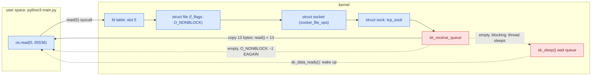
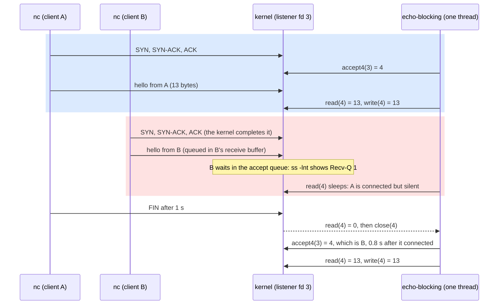
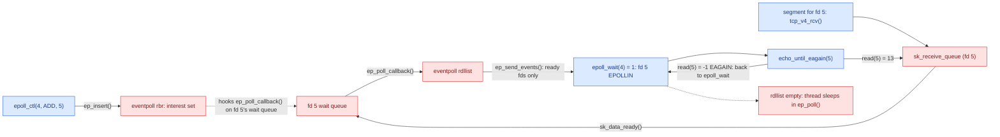

# Socket Syscalls

**Lesson 5 of 6: How Bytes Move**
**Ticketing Project**

---

## Table of Contents

1. [Why: The Kernel Only Talks Through Syscalls](#1-why-the-kernel-only-talks-through-syscalls)
2. [File Descriptors and the Socket Lifecycle](#2-file-descriptors-and-the-socket-lifecycle)
3. [Blocking, O_NONBLOCK and EAGAIN](#3-blocking-o_nonblock-and-eagain)
4. [Readiness: select, poll, epoll and kqueue](#4-readiness-select-poll-epoll-and-kqueue)
5. [Code: Python](#5-code-python)
6. [Code: Go](#6-code-go)
7. [Code: Rust](#7-code-rust)
8. [See It: The Syscall Boundary of Two Echo Servers](#8-see-it-the-syscall-boundary-of-two-echo-servers)
9. [What People Miss](#what-people-miss)
10. [Key Files Summary](#key-files-summary)
11. [Summary](#summary)
12. [Checklist](#checklist-what-you-should-be-able-to-explain)

---

## Learning Objectives

After reading this document, you will understand:

- What a file descriptor is, and how `socket()`, `bind()`, `listen()`, `accept4()`, `read()`, `write()` and `close()` move a connection and its bytes across the user/kernel boundary
- What "blocking" means inside the kernel (a thread asleep on a socket's wait queue), what `O_NONBLOCK` changes, and why `EAGAIN` is a message rather than an error
- How readiness multiplexing works below the API: why `select()` and `poll()` cost O(n) per call, and how epoll's interest tree, ready list and `ep_poll_callback()` make the cost O(ready)
- How CPython exposes these calls (`os.set_blocking()` is `ioctl(FIONBIO)`, `socket.accept()` is `accept4(…, SOCK_CLOEXEC)`, `select.epoll.poll()` asks for 1023 events), and what the Go and Rust ports must show instead
- What breaks when the model is misused, and how to see it: a slow client holding a blocking server hostage, a level-triggered loop spinning on `EMFILE`, a "non-blocking" server stalled on a disk read

Key mental models to internalize:

- **What makes data flow, and what makes it stop, at the syscall boundary**: bytes cross between your process and the kernel only through syscalls. `read()` copies them out of a socket's receive queue and `write()` copies them into its send queue. When there is nothing to copy, a blocking call parks the thread on the socket's wait queue until the kernel wakes it, and a non-blocking call returns `-1 EAGAIN`: the kernel telling the socket to come back later.
- **A file descriptor is an index, not an object**: `fd 5` is a slot in your process's fd table that points at a `struct file`, which points at a `struct socket`, which points at the `struct sock` from lesson 0.4. Everything you do to a socket is a syscall on that integer.
- **Readiness is a separate question from I/O**: epoll answers "which fds would not block right now?". It moves no bytes. `read()` and `write()` still do all the copying, one fd at a time.
- **The concurrency model is a choice about where waiting happens**: in a blocking server, waiting happens in `read()`, so you need one thread per connection. In an event loop, all waiting happens in one `epoll_wait()`, so one thread can hold thousands of connections.

Common misconceptions to avoid:

- "Non-blocking means asynchronous". Non-blocking only means a call returns `EAGAIN` instead of sleeping. Something still has to tell you when to try again, and something has to remember where each connection was.
- "epoll does the I/O for you". epoll reports readiness. The bytes still move in `read()` and `write()`, and with edge-triggered epoll, forgetting to drain a socket until `EAGAIN` loses wake-ups.
- "The server accepts a connection when the client connects". The kernel completes the handshake and queues the connection by itself (lesson 0.4). `accept()` only hands an already-established connection to the process, possibly much later.
- "`read()` returning 0 is an error". It is end-of-file: the peer sent FIN. Errors are `-1` with `errno` set.

---

## 1. Why: The Kernel Only Talks Through Syscalls

The first four lessons of this module happened entirely inside the kernel. A frame landed in a NIC ring (0.1), was routed (0.2), was acknowledged and paced by TCP (0.3), and came to rest in a socket's receive queue or in a listener's accept queue (0.4). None of that involved your program. Your program cannot reach into the kernel's memory and pick up an `sk_buff`; the CPU does not allow it. User space and kernel space are separate address spaces with separate privileges, and the only door between them is the system call: a deliberate trap into the kernel with a number in one register and arguments in the others.

So every byte your API ever serves crosses this door at least twice, once in and once out, and everything you know about a connection, you know because a syscall told you. There are surprisingly few of them for networking. A server needs `socket()` to get a handle, `bind()` to claim an address, `listen()` to turn the handle into a listener with an accept queue, `accept4()` to take a finished connection off that queue, `read()` and `write()` to move bytes, and `close()` to let go. The [socket(2)](https://man7.org/linux/man-pages/man2/socket.2.html), [bind(2)](https://man7.org/linux/man-pages/man2/bind.2.html), [listen(2)](https://man7.org/linux/man-pages/man2/listen.2.html), [accept(2)](https://man7.org/linux/man-pages/man2/accept.2.html), [read(2)](https://man7.org/linux/man-pages/man2/read.2.html), [write(2)](https://man7.org/linux/man-pages/man2/write.2.html) and [close(2)](https://man7.org/linux/man-pages/man2/close.2.html) man pages are the whole contract.

What those calls do when they have something to work with is easy: copy bytes, return a count. The interesting question, and the one that shapes every server architecture in this course, is what they do when they **don't**. `accept4()` on an empty accept queue, `read()` on an empty receive queue, `write()` on a full send buffer (lesson 0.3's slow reader): each has three possible answers.

1. **Wait.** The call puts the thread to sleep until there is something to do. This is the default, "blocking" behaviour, and it is wonderfully simple to program: the code reads top to bottom. Its price is that a sleeping thread can do nothing else, so a server that wants to talk to 1,000 clients at once needs 1,000 threads.
2. **Refuse.** With `O_NONBLOCK` set, the call returns immediately with `-1` and `errno = EAGAIN`: nothing to do right now, come back later. The thread stays free, but now it needs to know *when* to come back.
3. **Ask first.** A readiness call (`select()`, `poll()`, epoll, kqueue) waits on *many* descriptors at once and returns the ones that would not block. One thread can then serve every connection, calling `read()` only on sockets that have data.

The history of server software is largely a history of moving from answer 1 to answer 3. In 1999 Dan Kegel's ["The C10K problem"](http://www.kegel.com/c10k.html) asked how a single machine could serve ten thousand clients at once; thread-per-connection servers ran out of memory and scheduler headroom long before the network ran out of bandwidth. Linux's answer was epoll, introduced in kernel 2.5.44 ([epoll(7)](https://man7.org/linux/man-pages/man7/epoll.7.html)). Every runtime in lesson 0.6 (asyncio, Go's netpoller, tokio) is built on it.

This lesson builds the same echo server twice, once with each model, and watches the syscall boundary of both with `strace`.

```
TICKETING EXAMPLE: In lesson 1.3, `ticketing rawhttp` gets an accept loop on
127.0.0.1:8081, and lesson 1.5 runs it three ways (threads, an event loop,
goroutines/tasks). Every one of those models is built from the seven syscalls
above. On on-sale day the difference is concrete: a blocking loop with one
thread serves the first buyer's `GET /events/42/seats` and makes the second
buyer wait for the first one's slow phone; an epoll loop serves both and
waits for whichever sends bytes first.
```

---

## 2. File Descriptors and the Socket Lifecycle

A **file descriptor** is a small non-negative integer that a process uses to name an open kernel object. It is an index into the process's fd table (`struct files_struct`), and each slot points at a `struct file`: the kernel's record of one open "file", with its flags (`O_NONBLOCK` lives here, in `f_flags`) and a table of operations. For a socket, those operations are `socket_file_ops` in [`net/socket.c`](https://github.com/torvalds/linux/blob/master/net/socket.c), and the file's private data is a `struct socket`, whose `sk` field is the `struct sock` you met in lesson 0.4: the receive queue (`sk_receive_queue`), the send queue, the buffer limits and the wait queue that sleeping threads hang on.

That chain is why "everything is a file" holds for sockets. `read(5, buf, 65536)` looks up slot 5, finds a `struct file` whose `read_iter` is `sock_read_iter()`, and ends up in `tcp_recvmsg()`, which copies bytes out of `sk_receive_queue` into your buffer. The integer is the only thing your process holds; the state is all in the kernel.



*Figure 1 — One `read()` crosses the user/kernel boundary through the fd table; when the receive queue is empty, the call either sleeps on the socket's wait queue or returns `EAGAIN`.*

### The lifecycle, one syscall at a time

A TCP server walks every socket through the same sequence. The table names what each call does inside the kernel and when it can make the caller wait.

| Syscall | What the kernel does | Can it wait? |
|---------|----------------------|--------------|
| `socket(AF_INET, SOCK_STREAM, 0)` | Allocates a `struct socket` + `struct sock`, installs a `struct file` in the lowest free fd slot, returns that fd | No |
| `bind(fd, 127.0.0.1:9005)` | Claims the local address and port (`EADDRINUSE` if taken; `SO_REUSEADDR` allows rebinding over `TIME_WAIT`, lesson 0.4) | No |
| `listen(fd, 16)` | Moves the socket to `LISTEN`, creating the accept queue; the backlog is capped at `net.core.somaxconn` in `__sys_listen_socket()` | No |
| `accept4(fd, &peer, &len, flags)` | Takes the oldest *established* connection off the accept queue and returns a **new** fd for it; the listening fd stays as it was | Yes: until the accept queue is non-empty |
| `read(fd, buf, n)` | Copies up to `n` bytes from `sk_receive_queue`; returns `0` once the peer's FIN has been consumed | Yes: until at least one byte or FIN is queued |
| `write(fd, buf, n)` | Copies bytes into the send queue for TCP to segment and pace (lesson 0.3); may accept fewer than `n` | Yes: until there is room in the send buffer |
| `close(fd)` | Drops the fd slot; when the last reference goes, TCP sends FIN (or RST if unread data remains) | Rarely (`SO_LINGER`) |

Three details in that table matter later.

- **`accept4()` returns a new descriptor.** The listener keeps listening; each connection gets its own fd, and its own slot counts against the process's open-file limit (`RLIMIT_NOFILE`, [getrlimit(2)](https://man7.org/linux/man-pages/man2/getrlimit.2.html)). When the table is full, `accept4()` fails with `EMFILE` and the connection stays in the accept queue. Section 8.5 watches that happen.
- **`accept4()` exists because `accept()` was racy.** It takes a `flags` argument, so the new fd can be born with `SOCK_CLOEXEC` (close it on `exec()`) or `SOCK_NONBLOCK` set atomically, instead of a separate `fcntl()` call afterwards. In the kernel, `accept4` and `accept` both funnel into `__sys_accept4()` → `do_accept()` → the protocol's `inet_accept()` ([`net/ipv4/af_inet.c`](https://github.com/torvalds/linux/blob/master/net/ipv4/af_inet.c)), which dequeues the child socket that the handshake created in lesson 0.4. CPython always calls `accept4(…, SOCK_CLOEXEC)` (`sock_accept_impl()` in [`Modules/socketmodule.c`](https://github.com/python/cpython/blob/3.12/Modules/socketmodule.c)), which is why strace never shows a plain `accept()` from Python.
- **`read()` returning 0 means end-of-file.** It is how a TCP peer's FIN surfaces in user space: no more bytes will ever arrive. An error is `-1` with `errno` set, never `0`.

### The same lifecycle in C

Every language's socket API is a wrapper around these C calls, and the Go and Rust ports of this lesson call them almost directly. Stripped of error handling, a blocking echo server is this:

```c
int lfd = socket(AF_INET, SOCK_STREAM, 0);             /* fd 3 */
struct sockaddr_in addr = { .sin_family = AF_INET,
                            .sin_port = htons(9005),
                            .sin_addr.s_addr = htonl(INADDR_LOOPBACK) };
bind(lfd, (struct sockaddr *)&addr, sizeof addr);
listen(lfd, 16);                                       /* accept queue limit */
for (;;) {
    int cfd = accept4(lfd, NULL, NULL, SOCK_CLOEXEC);  /* sleeps if the queue is empty */
    char buf[65536];
    ssize_t n;
    while ((n = read(cfd, buf, sizeof buf)) > 0)       /* sleeps until bytes or FIN */
        write(cfd, buf, n);                            /* sleeps if the send buffer is full */
    close(cfd);                                        /* n == 0: the peer sent FIN */
}
```

Three of these calls can put the thread to sleep, and they are the three comments that say so. The rest of this lesson is about those three lines.

```
TICKETING EXAMPLE: Every open connection costs one fd. Lesson 3.4's live seat
map keeps a WebSocket open per browser, so 10,000 fans watching one event's
seat map are 10,000 fds in the `ticketing api` process, plus Postgres and
Redis connections. Many container runtimes still start processes with
`ulimit -n 1024`. The 1,025th fan does not get an error page: their
connection completes in the kernel and then waits in the accept queue,
because `accept4()` keeps failing with EMFILE.
```

---

## 3. Blocking, O_NONBLOCK and EAGAIN

"Blocking" sounds like a property of the call. It is really a property of the thread: the kernel takes it off the CPU.

When `read()` finds `sk_receive_queue` empty on a blocking socket, the TCP code puts the calling thread on the socket's wait queue (`sk_sleep(sk)`), marks it as sleeping (`TASK_INTERRUPTIBLE`) and calls the scheduler, which runs some other thread. The sleeping thread costs no CPU at all. When a segment for this socket later arrives and is queued (lesson 0.1's softirq, lesson 0.3's TCP input), TCP calls `sk->sk_data_ready()`, which wakes everything on that wait queue; the thread becomes runnable, `read()` resumes where it stopped, copies the bytes and returns. The same pattern covers `accept4()` (sleep until the accept queue is non-empty), `write()` (sleep until the send buffer drains below its limit, which is exactly what lesson 0.3's slow reader did to its sender), and `connect()` (sleep until the handshake finishes).

Blocking is cheap per wait. Its cost is structural: **one thread can wait for only one thing at a time**. A blocking echo server with one thread serves one client, start to finish, before it calls `accept4()` again. Every other client that connects meanwhile has a perfectly good, fully established TCP connection (the kernel did the handshake) that sits in the accept queue, its first bytes already in its receive buffer, waiting for the server to get around to it. That is head-of-line blocking at the syscall level, and section 8.1 measures it: client B waits 0.8 s for client A to finish.

### O_NONBLOCK: refuse instead of sleep

`O_NONBLOCK` is a flag on the open file description (`f_flags` in Figure 1). With it set, every call that would have slept returns at once with `-1` and `errno` set to `EAGAIN` (Linux defines `EWOULDBLOCK` as the same value). The man pages state it call by call: [accept(2)](https://man7.org/linux/man-pages/man2/accept.2.html) "the socket is marked nonblocking and no connections are present to be accepted", [read(2)](https://man7.org/linux/man-pages/man2/read.2.html) "the file descriptor refers to a socket and has been marked nonblocking, and the read would block".

There are three ways to set the flag, and runtimes differ in which they use:

| How | Call | Who uses it |
|-----|------|-------------|
| At creation | `socket(…, SOCK_STREAM \| SOCK_NONBLOCK, …)` or `accept4(…, SOCK_NONBLOCK)` | Go and tokio (lesson 0.6's strace shows `accept4(…, SOCK_CLOEXEC\|SOCK_NONBLOCK)`) |
| Afterwards, generic | `fcntl(fd, F_SETFL, flags \| O_NONBLOCK)` ([fcntl(2)](https://man7.org/linux/man-pages/man2/fcntl.2.html)) | Go's `syscall.SetNonblock()` |
| Afterwards, ioctl | `ioctl(fd, FIONBIO, &1)` (handled for every file by `ioctl_fionbio()` in [`fs/ioctl.c`](https://github.com/torvalds/linux/blob/master/fs/ioctl.c)) | CPython's `os.set_blocking()` and `socket.setblocking()` |

The last row surprises people. CPython's `_Py_set_blocking()` in [`Python/fileutils.c`](https://github.com/python/cpython/blob/3.12/Python/fileutils.c) uses `ioctl(fd, FIONBIO, &arg)` whenever `<sys/ioctl.h>` defines `FIONBIO`, and falls back to `fcntl()` only where it does not. Both set the same bit; section 8.3's strace shows `ioctl(3, FIONBIO, [1]) = 0` where you might have expected `fcntl`.

Non-blocking calls change the programming model in three ways.

1. **`EAGAIN` is a normal return.** It means "drained" (for `read()`), "empty" (for `accept4()`) or "full" (for `write()`). Code that treats it as a failure and closes the connection has a bug that only shows under load.
2. **Writes can be partial.** A non-blocking `write()` of 1 MB may return 65,536: that much fit in the send buffer, and the rest is still yours. The program has to remember the remainder and retry when the socket becomes writable. Lesson 1.5 builds exactly that bookkeeping; this lesson's echoes are 13 bytes and always fit.
3. **You need to know when to come back.** Retrying in a loop ("busy polling") burns a core and still adds latency. What you want is to sleep until *any* of your sockets is ready, which is the next section.

### The returns you will meet

A socket syscall returns a count, `0`, or `-1` with `errno`. These are the values a server has to tell apart; the ones marked "normal" are not failures at all.

| Return | From | Meaning | What a server does |
|--------|------|---------|--------------------|
| `n > 0` | `read`, `write` | `n` bytes copied (a `write` may copy fewer than asked) | Process them; keep the unwritten remainder |
| `0` | `read` | End-of-file: the peer sent FIN | Finish replying, then `close()` |
| `-1 EAGAIN` | any, non-blocking | Would block: drained, empty or full (normal) | Return to the readiness call |
| `-1 EINTR` | any blocking call | A signal interrupted the wait (normal) | Retry the call |
| `-1 ECONNRESET` | `read`, `write` | The peer sent RST | `close()` the fd |
| `-1 EPIPE` | `write` | Writing after the peer closed (also raises `SIGPIPE` unless `MSG_NOSIGNAL` or the signal is ignored) | `close()` the fd |
| `-1 EMFILE` | `accept4`, `socket` | This process has no free fd (`RLIMIT_NOFILE`) | Back off; the connection stays queued |
| `-1 ENFILE` | `accept4`, `socket` | The whole system has hit its file limit | Back off |

CPython maps these to exceptions: `EAGAIN` becomes `BlockingIOError`, `ECONNRESET` becomes `ConnectionResetError`, `EPIPE` becomes `BrokenPipeError`, and `EINTR` is retried for you (PEP 475). Go returns them as `syscall.Errno` values, and Rust as `std::io::Error` with an `ErrorKind` (`WouldBlock`, `ConnectionReset`, …).



*Figure 2 — A blocking server with one thread: B's connection is complete in the kernel, but no syscall reaches it until A hangs up.*

```
TICKETING EXAMPLE: During on-sale, one buyer on a train opens a connection to
`ticketing rawhttp`, sends half a request head and loses signal. A blocking
single-threaded server sits in read() on that fd. Every other buyer's
`POST /orders` is a complete TCP connection with its request bytes already in
the kernel, and none of them is served until the train leaves the tunnel or
lesson 1.3's idle timeout closes the fd.
```

---

## 4. Readiness: select, poll, epoll and kqueue

Non-blocking sockets need a way to sleep until *something* is ready, across many descriptors at once. Unix grew four generations of answers.

**`select()`** ([select(2)](https://man7.org/linux/man-pages/man2/select.2.html), 4.2BSD) takes three bitmaps (`fd_set`) of descriptors to watch for reading, writing and exceptions, and sleeps until at least one is ready. It has two built-in limits. The bitmaps are fixed-size: `select()` "can monitor only file descriptor numbers that are less than `FD_SETSIZE` (1024)", so fd 1024 cannot be watched at all. And the interface is stateless: every call copies the whole set into the kernel, the kernel polls every descriptor in it, and it copies the whole set back, overwritten with the results. The program then scans all of it to find the ready ones. Cost per call: O(n) in the number of watched fds, whether one of them is ready or all of them are.

**`poll()`** ([poll(2)](https://man7.org/linux/man-pages/man2/poll.2.html)) replaces the bitmaps with an array of `struct pollfd {fd, events, revents}`. That removes the 1024 limit and stops clobbering the input, but it is still stateless: n structs in, n structs polled, n structs out, every call. With 10,000 mostly idle connections, each wake-up for one ready socket costs 10,000 checks.

**epoll** ([epoll(7)](https://man7.org/linux/man-pages/man7/epoll.7.html), Linux 2.5.44) makes the interest set **stateful and kernel-resident**, which turns the cost per wake-up from O(watched) into O(ready). It has three calls:

- `epoll_create1(EPOLL_CLOEXEC)` creates an epoll instance and returns an fd for it (an anonymous inode named `[eventpoll]`; section 8.4 finds it in `/proc/<pid>/fd`).
- `epoll_ctl(epfd, EPOLL_CTL_ADD, fd, &event)` ([epoll_ctl(2)](https://man7.org/linux/man-pages/man2/epoll_ctl.2.html)) adds one descriptor to the interest set, once, with the events you care about (`EPOLLIN`, `EPOLLOUT`, …) and a 64-bit `data` word the kernel hands back verbatim.
- `epoll_wait(epfd, events, maxevents, timeout)` ([epoll_wait(2)](https://man7.org/linux/man-pages/man2/epoll_wait.2.html)) sleeps until at least one watched fd is ready and copies out **only the ready ones**, up to `maxevents`.

Inside [`fs/eventpoll.c`](https://github.com/torvalds/linux/blob/master/fs/eventpoll.c), each epoll instance is a `struct eventpoll` with two central structures: `rbr`, a red-black tree of `struct epitem` (one per watched fd, the interest set), and `rdllist`, the "list of ready file descriptors". `ep_insert()`, called from `epoll_ctl(ADD)`, puts the epitem into the tree and, crucially, hooks a callback, `ep_poll_callback()`, into the watched socket's wait queue: the same wait queue a blocking `read()` would sleep on. From then on, when TCP queues data and calls `sk_data_ready()`, the wake-up runs `ep_poll_callback()`, which links that epitem onto `rdllist` and wakes any thread sleeping in `epoll_wait()`. `epoll_wait()` is `do_epoll_wait()` → `ep_poll()`, which sleeps on the instance's own wait queue while `rdllist` is empty and, once it is not, calls `ep_send_events()` to copy the ready entries to user space.

The work happens when readiness *changes*, in softirq context, not when you ask. Asking is cheap: an `epoll_wait()` call with 10,000 idle sockets and one ready one copies one event.

### The shape of every event loop

Put non-blocking fds and epoll together and you get the loop that every runtime in lesson 0.6 is built around. In pseudo-code:

```text
epfd = epoll_create1()
epoll_ctl(epfd, ADD, listener, EPOLLIN)
forever:
    ready = epoll_wait(epfd, timeout=until the next timer)    # the only place the thread sleeps
    for fd in ready:
        if fd is listener: accept4() until EAGAIN, epoll_ctl(ADD) each new fd
        else:              read() until EAGAIN, feed the bytes to that connection's state,
                           write() what fits, ask for EPOLLOUT if something is left over
    run any timers that are due
```

asyncio's `BaseEventLoop._run_once()`, Go's `netpoll()` inside the scheduler, and tokio's I/O driver are this loop with different answers to one question: when `epoll_wait()` says fd 5 is ready, *who* gets to run? A callback, a parked goroutine, or a woken task. This lesson writes the loop by hand so the next one can recognise it inside each runtime.



*Figure 3 — epoll does its work when readiness changes: `ep_poll_callback()` moves a ready fd onto `rdllist`, and `epoll_wait()` only copies that list out.*

### Level-triggered and edge-triggered

By default epoll is **level-triggered**: `epoll_wait()` reports an fd as long as it *is* readable. If you read half the data and go back to `epoll_wait()`, it reports the fd again immediately. That is forgiving, and it is what this lesson's demo uses (`epoll.register(fd, select.EPOLLIN)`, no `EPOLLET`).

With `EPOLLET`, epoll is **edge-triggered**: it reports an fd when it *becomes* readable, that is, when new data arrives. If you read half and stop, epoll will not mention the fd again until more bytes arrive, which may be never, because the client is waiting for your reply to the bytes you did not read. The rule for edge-triggered epoll in [epoll(7)](https://man7.org/linux/man-pages/man7/epoll.7.html) is to use non-blocking fds and to keep calling `read()` until it returns `EAGAIN`. The demo's `echo_until_eagain()` follows that rule even in level-triggered mode, which costs one extra `read()` per wake-up (section 8.3 shows it) and makes it safe either way.

Two more flags matter for servers. `EPOLLONESHOT` disarms an fd after one report, so in a multi-threaded loop only one thread handles a given readiness event until the fd is re-armed with `EPOLL_CTL_MOD`. `EPOLLEXCLUSIVE` (Linux 4.5) addresses the thundering herd when several threads or processes each have their own epoll instance watching the same listening socket: one incoming connection wakes one of them instead of all.

### kqueue, IOCP and io_uring

The BSDs and macOS have **kqueue** ([kqueue(2)](https://man.freebsd.org/cgi/man.cgi?query=kqueue&sektion=2)): the same idea (a kernel-resident interest set, `kevent()` to change it and to collect ready events), generalised to timers, signals, process exit and file changes. That is why lesson 0.6's asyncio server reports `KqueueSelector` when it runs natively on a Mac and `EpollSelector` in the lab. Windows' IOCP and Linux's newer **io_uring** take the other road: *completion* instead of readiness. You submit "read 64 KiB from fd 5 into this buffer" and later collect "done, 13 bytes", so the kernel does the copy without a separate `read()` syscall. io_uring is the next step beyond epoll for high-throughput servers and for disk I/O, and it is named here, not taught.

| Mechanism | Interest set lives | Cost per wake-up | Limit | Platform |
|-----------|--------------------|------------------|-------|----------|
| `select()` | Copied in on every call | O(watched) | fds < 1024 | Everywhere |
| `poll()` | Copied in on every call | O(watched) | `RLIMIT_NOFILE` | Everywhere POSIX |
| epoll | In the kernel (`rbr`) | O(ready) | `RLIMIT_NOFILE` | Linux |
| kqueue | In the kernel | O(ready) | `RLIMIT_NOFILE` | BSD, macOS |
| io_uring | Submission/completion rings | O(completed) | ring size | Linux 5.1+ |

```
TICKETING EXAMPLE: Of 10,000 fans holding lesson 3.4's seat-map WebSocket
open, perhaps 50 send or need a message in any given 10 ms while seats sell.
With poll(), each loop iteration hands the kernel 10,000 pollfds to find
those 50. With epoll, the loop asks once and gets the 50; the other 9,950
connections cost nothing until a seat-status push or a ping makes one of
them ready.
```

---

## 5. Code: Python

The demo is [`demos/00/05/python/main.py`](../../demos/00/05/python/main.py): one echo server on `127.0.0.1:9005`, two modes, standard library only. Module 0 has no app code, so there is no `apps/` change in this lesson. Every line the server prints names the syscall it just made, so its output can be read side by side with `strace`.

### The listener

```python
def make_listener(port: int, nonblocking: bool) -> socket.socket:
    listener = socket.socket(socket.AF_INET, socket.SOCK_STREAM)  # socket()
    listener.setsockopt(socket.SOL_SOCKET, socket.SO_REUSEADDR, 1)
    listener.bind(("127.0.0.1", port))  # bind()
    listener.listen(BACKLOG)  # listen()
    if nonblocking:
        os.set_blocking(listener.fileno(), False)  # O_NONBLOCK (CPython: ioctl FIONBIO)
    return listener
```

Four syscalls in four lines: `socket()` (fd 3, the lowest free slot after stdin, stdout and stderr), `setsockopt(SO_REUSEADDR)` so a restart can rebind while old connections sit in `TIME_WAIT`, `bind()`, and `listen(16)`. In epoll mode the listener also gets `O_NONBLOCK`, because the event loop must never sleep anywhere except `epoll_wait()`: a blocking `accept4()` on a listener that epoll said was ready can still sleep if another process got the connection first. `os.set_blocking()` is `_Py_set_blocking()` in `Python/fileutils.c`, which issues `ioctl(fd, FIONBIO, …)`.

### The blocking server

```python
    while max_clients == 0 or served < max_clients:
        conn, peer = listener.accept()  # blocks until the accept queue is non-empty
        fd = conn.fileno()
        print(f"accept() = fd {fd} from port {peer[1]}", flush=True)
        while True:
            data = os.read(fd, 65536)  # blocks until bytes arrive or the peer closes
            print(f"read({fd}) = {len(data)}", flush=True)
            if not data:
                break
            sent = 0
            while sent < len(data):  # write() may take fewer bytes than asked: send the rest
                n = os.write(fd, data[sent:])  # blocks while the send buffer is full
                print(f"write({fd}) = {n}", flush=True)
                sent += n
        conn.close()
        print(f"close({fd})", flush=True)
        served += 1
```

This is the whole blocking model. `listener.accept()` is `accept4(3, …, SOCK_CLOEXEC)`; it sleeps while the accept queue is empty and returns a new fd, which is 4 every time because `close(4)` frees the slot before the next accept. The inner loop calls `read()` until it returns 0 (the peer's FIN), echoing each chunk with `write()`. The demo uses `os.read()` and `os.write()` on the raw fd rather than `conn.recv()` and `conn.send()`, so strace shows `read` and `write`; `socket.recv()` would appear as `recvfrom`, which is what asyncio uses in lesson 0.6.

`write()` returns how many bytes the kernel took, and that can be fewer than you asked for: a signal can interrupt a blocking write part-way, and on a non-blocking socket it is routine (next section). So the echo keeps calling `write()` on the remainder until every byte it read has gone back, and it prints each call's real count. For a 13-byte echo that is always one `write(4) = 13`; an 8 MiB echo in the lab took the same path without losing a byte.

The structural problem is visible in the indentation: while the inner loop runs, nothing calls `accept()`. A second client cannot be served until the first one hangs up.

### The epoll server

```python
def serve_epoll(listener: socket.socket, max_clients: int) -> None:
    epoll = select.epoll()  # epoll_create1(EPOLL_CLOEXEC)
    lfd = listener.fileno()
    epoll.register(lfd, select.EPOLLIN)  # epoll_ctl(EPOLL_CTL_ADD)
    …
    conns: dict[int, socket.socket] = {}  # keep the socket objects alive
    pending: dict[int, bytes] = {}  # bytes read but not yet written back: the loop owes them
    served = 0
    try:
        while max_clients == 0 or served < max_clients:
            events = epoll.poll()  # epoll_wait(): sleep until some fd is ready
            ready = ", ".join(f"fd {fd}" for fd, _ in events)
            print(f"epoll_wait() = {len(events)} ready: {ready}", flush=True)
            for fd, _ in events:
                if fd == lfd:
                    accept_all(listener, epoll, conns)
                    continue
                try:
                    if fd in pending:  # it watches EPOLLOUT until we have written what we owe
                        closed = flush_pending(fd, pending, epoll)
                    else:
                        closed = echo_until_eagain(fd, pending, epoll)
                except (ConnectionResetError, BrokenPipeError) as err:
                    name = errno.errorcode.get(err.errno or 0, err.errno)
                    print(f"fd {fd}: {name} ({err.strerror}); closing", flush=True)
                    closed = True
                if closed:
                    epoll.unregister(fd)
                    pending.pop(fd, None)
                    conns.pop(fd).close()
                    print(f"close({fd})", flush=True)
                    served += 1
    finally:
        for conn in conns.values():  # a client still connected when the loop ends
            conn.close()
        epoll.close()
```

`select.epoll()` is `epoll_create1(EPOLL_CLOEXEC)` and returns fd 4. `epoll.register(lfd, EPOLLIN)` is `epoll_ctl(4, EPOLL_CTL_ADD, 3, …)`: "tell me when the listener is readable", which for a listening socket means "the accept queue is non-empty". From then on the thread sleeps in exactly one place, `epoll.poll()`, and everything else is a reaction to what it returns. `epoll.poll()` with no arguments blocks forever (`timeout -1`) and asks for up to `FD_SETSIZE - 1 = 1023` events (`select_epoll_poll_impl()` in [`Modules/selectmodule.c`](https://github.com/python/cpython/blob/3.12/Modules/selectmodule.c)); both numbers are visible in section 8.3. The `conns` dict keeps the Python socket objects alive (if one were garbage-collected, CPython would close its fd behind the loop's back), and the `finally` closes any client still connected when the loop ends. The `pending` dict is the loop's debt: bytes it has read from a client and not yet managed to write back, explained under "Reading until EAGAIN" below. A peer that resets the connection (`ECONNRESET`, or `EPIPE` on a write) is closed like one that hung up, instead of crashing the server.

### Accepting until EAGAIN, and surviving EMFILE

```python
def accept_all(listener: socket.socket, epoll: select.epoll, conns: dict) -> None:
    while True:
        try:
            conn, peer = listener.accept()
        except BlockingIOError:
            print("accept() = EAGAIN (accept queue empty)", flush=True)
            return
        except OSError as err:
            if err.errno != errno.EMFILE:
                raise
            # No fd left: the connection stays queued, the listener stays readable,
            # and level-triggered epoll would wake us again at once. Back off.
            print("accept() = EMFILE (no free fd; the connection stays queued)", flush=True)
            time.sleep(1.0)
            return
        fd = conn.fileno()
        try:
            os.set_blocking(fd, False)
            epoll.register(fd, select.EPOLLIN)
        except OSError:
            conn.close()  # never leak an accepted fd we failed to set up
            raise
        conns[fd] = conn
        print(f"accept() = fd {fd} from port {peer[1]}, O_NONBLOCK, added to epoll", flush=True)
```

One readiness event on the listener may stand for several queued connections, so the loop accepts until the queue is empty. Python turns `EAGAIN` into `BlockingIOError`, and here it is the normal exit. Each new connection becomes non-blocking and joins the interest set; if either step fails, the accepted socket is closed before the error propagates, so a setup failure never leaks an fd.

The `EMFILE` branch is there because of a nasty interaction between level-triggered epoll and a full fd table. When `accept4()` fails with `EMFILE`, the connection stays in the accept queue, so the listener stays readable, so the very next `epoll_wait()` returns it again, and the loop spins at 100% CPU accepting nothing. Real servers handle this by backing off, by pausing interest in the listener, or by keeping a spare fd to close-accept-close the excess connection. The demo backs off for a second; section 8.5 triggers it with `ulimit -n 8`.

### Reading until EAGAIN, and writing what you owe

```python
def echo_until_eagain(fd: int, pending: dict[int, bytes], epoll: select.epoll) -> bool:
    """Echo everything readable on fd; True when the peer has closed."""
    while True:
        try:
            data = os.read(fd, 65536)
        except BlockingIOError:
            print(f"read({fd}) = EAGAIN (drained; back to epoll_wait)", flush=True)
            return False
        print(f"read({fd}) = {len(data)}", flush=True)
        if not data:
            return True
        if not write_or_keep(fd, data, pending, epoll):
            return False  # the send buffer is full: stop reading until EPOLLOUT
```

Drain, then go back. `read()` returning bytes means "echo and keep going", `read()` returning `b""` means the peer closed, and `BlockingIOError` (`EAGAIN`) means "nothing more right now: return to `epoll_wait()`". This is the heart of an event loop: a function that does as much as it can without sleeping and then hands control back.

```python
def write_or_keep(fd: int, data: bytes, pending: dict[int, bytes], epoll: select.epoll) -> bool:
    """Write data; keep what the send buffer refuses in pending[fd]. True if all of it went."""
    try:
        sent = os.write(fd, data)  # may take only part of data, or nothing (EAGAIN)
    except BlockingIOError:
        sent = 0
    if sent == len(data):
        print(f"write({fd}) = {sent}", flush=True)
        return True
    pending[fd] = data[sent:]
    # Watch EPOLLOUT instead of EPOLLIN: wake when the send buffer has room, and read
    # nothing more from this client until it has taken what we already owe it.
    epoll.modify(fd, select.EPOLLOUT)
    result = f"{sent} (short write" if sent else "EAGAIN (send buffer full"
    print(
        f"write({fd}) = {result}: {len(pending[fd])} bytes pending, waiting for EPOLLOUT)",
        flush=True,
    )
    return False


def flush_pending(fd: int, pending: dict[int, bytes], epoll: select.epoll) -> bool:
    """EPOLLOUT fired: write what we owe; once it is all gone, read the client again."""
    if write_or_keep(fd, pending.pop(fd), pending, epoll):
        epoll.modify(fd, select.EPOLLIN)
        print(f"epoll_ctl(MOD, fd {fd}, EPOLLIN): output drained, reading again", flush=True)
    return False
```

Writing is the same contract in the other direction. On a non-blocking socket, `write()` takes only what fits in the send buffer: all of it, part of it (`write(5) = 49510` for a 65,536-byte chunk), or nothing (`EAGAIN`). Once the loop has read bytes from a client it owes them back, so `write_or_keep()` keeps the unwritten remainder in `pending[fd]`, switches the fd's interest from `EPOLLIN` to `EPOLLOUT` with `epoll_ctl(MOD)`, and stops reading that client. Reading on while the client is not draining its replies would only pile up more debt in the server's memory; letting the client's own send buffer fill instead pushes the backpressure back to it. When `epoll_wait()` reports the fd writable, `flush_pending()` writes the debt, and once it is paid the interest goes back to `EPOLLIN`. In the lab, an 8 MiB echo to a client that waited half a second before reading printed `write(5) = 49510 (short write: 16026 bytes pending, waiting for EPOLLOUT)` and, after the client caught up, `epoll_ctl(MOD, fd 5, EPOLLIN): output drained, reading again`; the write counts summed to exactly 8,388,608. Lesson 1.5's event-loop HTTP server is this same debt-and-`EPOLLOUT` loop, with an HTTP response as the debt. A 13-byte echo never leaves the fast path, so the See It's traces show only `write(5) = 13`.

Run it in the lab (`epoll` is Linux-only; on macOS `run.sh` re-runs itself in the lab container):

```bash
just demo 00/05 python --mode blocking     # then, from a second `just lab` shell:
nc 127.0.0.1 9005                          # type a line, see it come back
just demo 00/05 python --mode epoll
just demo 00/05 python --smoke             # both modes, two clients each, self-checking
```

The smoke test runs both modes with two clients and asserts the difference: in blocking mode client B is echoed only after A hangs up, in epoll mode B is echoed while A is still connected.

```
TICKETING EXAMPLE: Lesson 1.5's `ticketing rawhttp --model loop` is
serve_epoll() grown up: the same epoll_wait() at the centre, with
echo_until_eagain() replaced by "feed bytes to parse_request_head() until it
says NeedMore", and pending[fd] holding the unsent part of a large
`GET /events` response while a slow client's send buffer is full.
```

---

## 6. Code: Go

The Go port must show the same two servers with **raw syscalls, not the runtime**. That means `syscall.Socket`, `syscall.Bind`, `syscall.Listen`, `syscall.Accept4`, `syscall.Read`, `syscall.Write` and `syscall.Close` on integer fds, `syscall.SetNonblock` to set `O_NONBLOCK` (which Go implements with `fcntl(F_GETFL)` + `fcntl(F_SETFL)`, a visible contrast with CPython's `ioctl(FIONBIO)` in strace), and `syscall.EpollCreate1`, `syscall.EpollCtl` and `syscall.EpollWait` directly. It must not use `net.Listen`: the whole point of lesson 0.6 is that `net.Listen` already hides an epoll loop (the netpoller), and this lesson is about writing that loop by hand. Same flags (`--mode`, `--port`, `--max-clients`, `--smoke`), same port 9005, same output lines (`accept() = fd 5 from port …`, `read(5) = EAGAIN (drained; back to epoll_wait)`, `write(5) = … (short write: … bytes pending, waiting for EPOLLOUT)`), so `see.sh` and the reader's eye can compare the three.

The structure is Python's, call for call, on integer fds. Errors are `syscall.Errno` values compared directly (`err == syscall.EAGAIN`) where Python catches `BlockingIOError`; `describe()` formats any other error as `EADDRINUSE (Address already in use)`, from a small name table because the `syscall` package has no `errno.errorcode`. `syscall.EpollEvent` carries the fd in its `Fd` field, which is the 64-bit `data` the kernel hands back. And `EpollWait` can return `EINTR`, which the loop skips: `epoll_wait()` is never restarted after a signal handler, while Python's `epoll.poll()` retries for you (PEP 475). Ownership is explicit: accepted fds live in an `open` map that a `defer` closes when `serveEpoll` returns, and `acceptAll` closes a new fd itself if making it non-blocking or registering it fails. Accepting until `EAGAIN`, and surviving `EMFILE`:

```go
func acceptAll(lfd, epfd int, open map[int]bool) error {
	for {
		fd, peer, err := syscall.Accept4(lfd, syscall.SOCK_CLOEXEC)
		if err == syscall.EAGAIN {
			fmt.Println("accept() = EAGAIN (accept queue empty)")
			return nil
		}
		if err == syscall.EMFILE {
			// No fd left: the connection stays queued, the listener stays readable,
			// and level-triggered epoll would wake us again at once. Back off.
			fmt.Println("accept() = EMFILE (no free fd; the connection stays queued)")
			// A raw nanosleep, not time.Sleep: the first Go timer starts the
			// runtime's own netpoller, which needs an epoll fd, and none are left.
			pause := syscall.NsecToTimespec(int64(time.Second))
			syscall.Nanosleep(&pause, nil)
			return nil
		}
		if err != nil {
			return os.NewSyscallError("accept4", err)
		}
		if err := syscall.SetNonblock(fd, true); err != nil {
			syscall.Close(fd) // never leak an accepted fd we failed to set up
			return os.NewSyscallError("fcntl", err)
		}
		if err := interest(epfd, syscall.EPOLL_CTL_ADD, fd, syscall.EPOLLIN); err != nil {
			syscall.Close(fd)
			return err
		}
		open[fd] = true
		fmt.Printf("accept() = fd %d from port %d, O_NONBLOCK, added to epoll\n", fd, port(peer))
	}
}
```

The `EMFILE` branch shows a cost of the runtime that this lesson otherwise avoids. With `time.Sleep(time.Second)` in that branch, the `ulimit -n 8` run from section 8.5 crashed the Go port with `runtime: epollcreate failed with 24` and `fatal error: runtime: netpollinit failed`: the first Go timer starts the runtime's own netpoller, which needs an epoll fd, and none were left. A raw `syscall.Nanosleep` sleeps without it, and the port then behaves like Python: `accept() = EMFILE` about once a second while `ss -lnt` shows the connections waiting (`LISTEN 2 16`). Writing what the loop owes:

```go
// writeOrKeep writes data and keeps what the send buffer refuses in pending[fd];
// it returns true if all of data went.
func writeOrKeep(fd, epfd int, data []byte, pending map[int][]byte) (bool, error) {
	sent, err := syscall.Write(fd, data) // may take only part of data, or nothing (EAGAIN)
	if err == syscall.EAGAIN {
		sent = 0
	} else if err != nil {
		return false, os.NewSyscallError("write", err)
	}
	if sent == len(data) {
		fmt.Printf("write(%d) = %d\n", fd, sent)
		return true, nil
	}
	pending[fd] = append([]byte(nil), data[sent:]...)
	// Watch EPOLLOUT instead of EPOLLIN: wake when the send buffer has room, and read
	// nothing more from this client until it has taken what we already owe it.
	if err := interest(epfd, syscall.EPOLL_CTL_MOD, fd, syscall.EPOLLOUT); err != nil {
		return false, err
	}
	result := fmt.Sprintf("%d (short write", sent)
	if sent == 0 {
		result = "EAGAIN (send buffer full"
	}
	fmt.Printf("write(%d) = %s: %d bytes pending, waiting for EPOLLOUT)\n", fd, result, len(pending[fd]))
	return false, nil
}
```

One Go-specific detail: `echoUntilEagain` reads into a single buffer that the next `read()` overwrites, so `writeOrKeep` copies the unwritten tail (`append([]byte(nil), data[sent:]...)`) instead of keeping a slice of it. Python's `data[sent:]` and Rust's `extend_from_slice` copy too; in Go a plain `data[sent:]` would alias the buffer and the debt would silently change under the loop.

Run on its own, the epoll server prints the same lines with the same fd numbers as the Python one (`listening fd 3`, `epoll fd 4`, `accept() = fd 5`). Under `--smoke` the numbers shift, because the smoke clients use `net.Dial` in the same process, and `net` starts the netpoller with epoll and eventfd fds of its own.

```
TICKETING EXAMPLE: Go's `ticketing rawhttp` in lesson 1.5 never calls
EpollWait itself: its goroutine-per-connection model gets the same loop for
free from the runtime. Writing it once by hand here is what makes
GODEBUG=schedtrace and the netpoller strace in lesson 0.6 readable.
```

---

## 7. Code: Rust

The Rust port must show the same two servers through the `libc` crate, with a minimal `Cargo.toml` (`libc` as the only dependency): `libc::socket`, `libc::bind`, `libc::listen`, `libc::accept4`, `libc::read`, `libc::write`, `libc::close` and `libc::fcntl` for `O_NONBLOCK`, and `libc::epoll_create1`, `libc::epoll_ctl` and `libc::epoll_wait` for the event loop. It must not use `std::net::TcpListener` or mio: both would hide exactly the calls this lesson is about. Errors come back as `-1` plus `errno` (`std::io::Error::last_os_error()`), and the port should match on `EAGAIN` and `EMFILE` the way the Python demo catches `BlockingIOError` and `OSError`. Same flags, port and output lines as the Python demo.

`check()` and `check_len()` turn libc's -1 into `io::Error::last_os_error()`; the code then matches `e.kind() == io::ErrorKind::WouldBlock` for `EAGAIN` and `e.raw_os_error() == Some(libc::EMFILE)`, the two cases Python catches as `BlockingIOError` and `OSError`. The socket setup, `accept4()` and epoll functions are `#[cfg(target_os = "linux")]`, and a non-Linux `run()` prints the Linux-only line and exits 2. The body of the event loop, once `epoll_wait()` has returned the ready fds:

```rust
        for fd in ready {
            if fd == lfd {
                accept_all(lfd, epfd, &mut clients)?;
                continue;
            }
            let Some(client) = clients.get_mut(&fd) else {
                continue;
            };
            // A client with pending output watches EPOLLOUT until we have written what we owe.
            let result = if client.pending.is_empty() {
                echo_until_eagain(fd, epfd, &mut buf, &mut client.pending)
            } else {
                flush_pending(fd, epfd, &mut client.pending)
            };
            let closed = match result {
                Ok(closed) => closed,
                Err(e) if matches!(e.raw_os_error(), Some(libc::ECONNRESET | libc::EPIPE)) => {
                    println!("fd {fd}: {}; closing", describe(&e));
                    true
                }
                Err(e) => return Err(e),
            };
            if closed {
                check(unsafe {
                    libc::epoll_ctl(epfd, libc::EPOLL_CTL_DEL, fd, std::ptr::null_mut())
                })?;
                clients.remove(&fd); // drops the OwnedFd: close()
                println!("close({fd})");
                served += 1;
            }
        }
```

Two details are Rust-specific. On x86-64, `libc::epoll_event` is `#[repr(packed)]` (the kernel's layout), and Rust refuses to take a reference to a field of a packed struct, so the loop copies each `u64` into a `Vec<RawFd>` before formatting it. And every fd is owned: the epoll fd and each accepted client's fd are `OwnedFd`s, the clients live in a `HashMap<RawFd, Client>` next to their pending bytes, and `clients.remove(&fd)` is the `close(5)` the lesson shows. However `serve_epoll` returns, including through `?`, dropping the map closes every client still connected. `thread::sleep` in the `EMFILE` branch is a plain `nanosleep()`, so the Rust port survives `ulimit -n 8` the way Python does.

```rust
fn accept_all(lfd: RawFd, epfd: RawFd, clients: &mut HashMap<RawFd, Client>) -> io::Result<()> {
    loop {
        let (fd, port) = match accept(lfd) {
            Ok(accepted) => accepted,
            Err(e) if e.kind() == io::ErrorKind::WouldBlock => {
                println!("accept() = EAGAIN (accept queue empty)");
                return Ok(());
            }
            Err(e) if e.raw_os_error() == Some(libc::EMFILE) => {
                // No fd left: the connection stays queued, the listener stays readable,
                // and level-triggered epoll would wake us again at once. Back off.
                println!("accept() = EMFILE (no free fd; the connection stays queued)");
                thread::sleep(Duration::from_secs(1));
                return Ok(());
            }
            Err(e) => return Err(e),
        };
        // Owned from here on: if a setup step fails, `?` drops it and the fd is closed.
        let owned = unsafe { OwnedFd::from_raw_fd(fd) };
        set_nonblocking(fd)?;
        interest(epfd, libc::EPOLL_CTL_ADD, fd, libc::EPOLLIN)?;
        let client = Client {
            _fd: owned,
            pending: Vec::new(),
        };
        clients.insert(fd, client);
        println!("accept() = fd {fd} from port {port}, O_NONBLOCK, added to epoll");
    }
}
```

```
TICKETING EXAMPLE: The Rust `ticketing rawhttp` in lesson 1.5 sits on tokio,
whose I/O driver is this epoll loop wrapped in mio (lesson 0.6). The `unsafe`
blocks a libc epoll server needs are a fair measure of what tokio is
guaranteeing for you on every accepted connection.
```

---

## 8. See It: The Syscall Boundary of Two Echo Servers

Two tools carry this lesson: `strace` shows every syscall each server makes and when, and `ss` shows the kernel's queues filling while the program is not looking. `/proc/<pid>/fd` and `lsof` confirm that sockets and epoll instances are just entries in the fd table. Everything below was captured in the lab on kernel `7.0.14-linuxkit` (Docker Desktop's VM, aarch64) with strace 6.8. Each block starts its server in the background, waits for the listener, and runs the clients from the same `just lab` shell, as `see.sh` does.

One arm64 detail first. arm64 has no `epoll_wait` syscall at all: its syscall table (`include/uapi/asm-generic/unistd.h`) defines `epoll_create1`, `epoll_ctl` and `epoll_pwait`, and glibc implements `epoll_wait()` as `epoll_pwait()` with a `NULL` signal mask. So on this lab strace prints `epoll_pwait(4, …, 1023, -1, NULL, 8)` where an x86_64 machine such as the CI runner prints `epoll_wait(4, …, 1023, -1)`. Same call, same kernel path (`do_epoll_wait()`). The strace filter `/^epoll` (a regex) matches both.

### 8.1 strace -tt — the blocking server serves one client at a time

Start the blocking server under strace, with the trace going to a file, and wait for its listener. Then start two clients: A sends a line and holds its connection open for a second, and B connects 0.2 s after A, sends a line and hangs up. `wait` returns when the server exits after its second client, and the last line prints the trace from the first `accept4()`:

```bash
strace -f -tt -o /tmp/blocking.strace -e trace=accept4,read,write,close \
  python3 demos/00/05/python/main.py --mode blocking --max-clients 2 >/dev/null &
until ss -lnt 'sport = :9005' | grep -q LISTEN; do sleep 0.1; done
(printf 'hello from A\n'; sleep 1) | nc -N 127.0.0.1 9005 >/dev/null &
sleep 0.2
printf 'hello from B\n' | nc -N 127.0.0.1 9005 >/dev/null &
sleep 0.3
ss -tan 'sport = :9005'      # section 8.2: B waits while A is still connected
wait                         # the server exits after its two clients
sed -n '/accept4/,$p' /tmp/blocking.strace | grep -v -E 'write\(1,|resumed|exited' | head -n 12
```

The `ss` table this prints first is section 8.2. The first eight lines of the trace:

```text
12409 01:29:30.616194 accept4(3, {sa_family=AF_INET, sin_port=htons(57842), sin_addr=inet_addr("127.0.0.1")}, [16], SOCK_CLOEXEC) = 4
12409 01:29:30.650414 read(4, "hello from A\n", 65536) = 13
12409 01:29:30.650584 write(4, "hello from A\n", 13) = 13
12409 01:29:30.650719 read(4, "", 65536) = 0
12409 01:29:31.651265 close(4)          = 0
12409 01:29:31.651753 accept4(3, {sa_family=AF_INET, sin_port=htons(57854), sin_addr=inet_addr("127.0.0.1")}, [16], SOCK_CLOEXEC) = 4
12409 01:29:31.652283 read(4, "hello from B\n", 65536) = 13
12409 01:29:31.652531 write(4, "hello from B\n", 13) = 13
```

Read the timestamps carefully: `strace -tt` prints the time a syscall **started**. The fourth line, `read(4, "", 65536) = 0`, started at `30.650719` and did not return until A's FIN arrived; the next line, `close(4)` at `31.651265`, marks when it did. For that whole second the only thread sat inside one `read()`. B connected at about `30.85` (0.2 s after A), yet its `accept4()` starts at `31.651753`, 0.8 s later and half a millisecond after A's `close(4)`. Then B is served in under 1.5 ms: its bytes had been waiting in its receive buffer all along. Add `-T` to the strace command to print each call's duration and see the one-second `read()` directly.

### 8.2 ss -tan — B waits in the accept queue

The `ss -tan` line in the 8.1 block runs 0.5 s after A connected, while A still holds its connection open. It lists every TCP socket on port 9005, the listener included:

```text
State      Recv-Q Send-Q Local Address:Port Peer Address:Port Process
LISTEN     1      16         127.0.0.1:9005      0.0.0.0:*
ESTAB      0      0          127.0.0.1:9005    127.0.0.1:57842
CLOSE-WAIT 14     0          127.0.0.1:9005    127.0.0.1:57854
```

On a listening socket, `Recv-Q` is the number of established connections in the accept queue and `Send-Q` is its limit, the `16` passed to `listen()` (lesson 0.4). `Recv-Q 1` is client B. The other two rows are the connections themselves. `ESTAB … 57842` is A, accepted as fd 4, the one the server is blocked in `read()` on. `CLOSE-WAIT 14 … 57854` is B, and it shows how much happened without the process: the handshake completed, B's 13 bytes arrived, and so did its FIN (B's `nc -N` hung up right after sending), which moved the socket to `CLOSE-WAIT` and counts as one more unit in `Recv-Q`, 13 + 1 = 14. All of that sits in kernel memory, owned by no fd. This is the kernel's half of Figure 2. Nothing in the server's output mentions B yet, because no syscall has touched it.

### 8.3 strace — the epoll server: O_NONBLOCK, readiness, EAGAIN

Now the epoll server with the same two clients, except that B also holds its connection for 0.8 s, so both are open at once. Again the trace goes to a file and is printed once the server exits:

```bash
strace -f -o /tmp/epoll.strace -e trace=listen,accept4,read,write,close,ioctl,/^epoll \
  python3 demos/00/05/python/main.py --mode epoll --max-clients 2 >/dev/null &
until ss -lnt 'sport = :9005' | grep -q LISTEN; do sleep 0.1; done
(printf 'hello from A\n'; sleep 1) | nc -N 127.0.0.1 9005 >/dev/null &
sleep 0.2
(printf 'hello from B\n'; sleep 0.8) | nc -N 127.0.0.1 9005 >/dev/null &
wait
sed -n '/listen(/,$p' /tmp/epoll.strace | grep -v -E 'write\(1,|resumed|exited' | head -n 22
```

The setup and client A:

```text
12429 listen(3, 16)                     = 0
12429 ioctl(3, FIONBIO, [1])            = 0
12429 epoll_create1(EPOLL_CLOEXEC)      = 4
12429 epoll_ctl(4, EPOLL_CTL_ADD, 3, {events=EPOLLIN, data={u32=3, u64=3940649673949187}}) = 0
12429 epoll_pwait(4, [{events=EPOLLIN, data={u32=3, u64=3940649673949187}}], 1023, -1, NULL, 8) = 1
12429 accept4(3, {sa_family=AF_INET, sin_port=htons(55772), sin_addr=inet_addr("127.0.0.1")}, [16], SOCK_CLOEXEC) = 5
12429 ioctl(5, FIONBIO, [1])            = 0
12429 epoll_ctl(4, EPOLL_CTL_ADD, 5, {events=EPOLLIN, data={u32=5, u64=3940649673949189}}) = 0
12429 accept4(3, 0xffffcb1641d8, [16], SOCK_CLOEXEC) = -1 EAGAIN (Resource temporarily unavailable)
```

Every idea from sections 3 and 4 is on screen. `ioctl(3, FIONBIO, [1])` is `os.set_blocking()` making the listener non-blocking. `epoll_create1` returns fd 4, and `epoll_ctl(…, ADD, 3, …)` puts the listener in the interest set. `epoll_pwait(4, …, 1023, -1, …) = 1` is the loop's only sleep: 1023 is CPython's `maxevents`, `-1` means no timeout, and it returns one ready fd, the listener. Only `u32` in `data` matters: CPython stores the fd in `data.fd` (`pyepoll_internal_ctl()` in `Modules/selectmodule.c`) and leaves the other half of the union as leftover stack, which is why the `u64` value changes from run to run. `accept4() = 5` takes A, which is made non-blocking and registered, and the second `accept4()` returns `-1 EAGAIN`: the accept queue is empty, so `accept_all()` returns.

Client A's bytes, then client B, while A is still connected:

```text
12429 epoll_pwait(4, [{events=EPOLLIN, data={u32=5, u64=3940649673949189}}], 1023, -1, NULL, 8) = 1
12429 read(5, "hello from A\n", 65536)  = 13
12429 write(5, "hello from A\n", 13)    = 13
12429 read(5, 0x3ad8ea70, 65536)        = -1 EAGAIN (Resource temporarily unavailable)
12429 epoll_pwait(4, [{events=EPOLLIN, data={u32=3, u64=3940649673949187}}], 1023, -1, NULL, 8) = 1
12429 accept4(3, {sa_family=AF_INET, sin_port=htons(55774), sin_addr=inet_addr("127.0.0.1")}, [16], SOCK_CLOEXEC) = 6
…
12429 read(6, "hello from B\n", 65536)  = 13
12429 write(6, "hello from B\n", 13)    = 13
```

`epoll_pwait` reports fd 5 readable, `read(5)` returns 13 bytes, `write(5)` echoes them, and the next `read(5)` returns `-1 EAGAIN`: drained, back to `epoll_wait()`. That `EAGAIN` is the line `see.sh` asserts. Then the listener becomes readable again, B is accepted as fd 6 and echoed, all while A's connection is still open. Compare with 8.1: there, B waited 0.8 s for A; here, B is served the moment its bytes arrive, by the same single thread.

### 8.4 /proc/<pid>/fd and lsof — sockets and epoll are just fds

While both clients are connected, list the epoll server's fd table. This block starts the server itself, so `$!` is its pid, and runs the same two clients as 8.3:

```bash
set -o pipefail
python3 demos/00/05/python/main.py --mode epoll --max-clients 2 >/dev/null &
pid=$!
until ss -lnt 'sport = :9005' | grep -q LISTEN; do sleep 0.1; done
(printf 'hello from A\n'; sleep 1) | nc -N 127.0.0.1 9005 >/dev/null &
sleep 0.2
(printf 'hello from B\n'; sleep 0.8) | nc -N 127.0.0.1 9005 >/dev/null &
sleep 0.3                    # both clients are connected now
find /proc/$pid/fd -mindepth 1 -printf '%f -> %l\n' | sort -n
lsof -nP -a -p $pid -d 3-20 | awk '{print $4, $5, $8, $9}'
wait
```

The fd table:

```text
0 -> /dev/null
1 -> /dev/null
2 -> pipe:[41174394]
3 -> socket:[41176455]
4 -> anon_inode:[eventpoll]
5 -> socket:[41176456]
6 -> socket:[41176462]
```

lsof's view of fds 3 to 20:

```text
FD TYPE NODE NAME
3u IPv4 TCP 127.0.0.1:9005
4u a_inode 1053 [eventpoll:3,5,6]
5u IPv4 TCP 127.0.0.1:9005->127.0.0.1:63654
6u IPv4 TCP 127.0.0.1:9005->127.0.0.1:63668
```

`/proc/<pid>/fd` is the fd table itself: each entry is a symlink to what the slot holds. Sockets appear as `socket:[inode]`, and the epoll instance as `anon_inode:[eventpoll]`, a file with no name on any filesystem. `lsof` decodes the rest: fd 3 is the listener, fds 5 and 6 are the two connections with their peer ports (this is a fresh run, so the ports are not the ones in 8.3), and `[eventpoll:3,5,6]` is the epoll instance's interest set: the listener and both connections. lsof reads it from `/proc/<pid>/fdinfo/4`, whose `tfd:` lines the kernel prints by walking `rbr` (`ep_show_fdinfo()` in `fs/eventpoll.c`).

### 8.5 ulimit -n 8 — accept() meets EMFILE

Cap the server at 8 open files and send it five clients that each stay connected for 3 s. The block waits until two connections sit in the accept queue (the listener's `Recv-Q`), then 1.5 s more, long enough for the fourth `accept()` to fail and fail again after the demo's 1 s back-off:

```bash
bash -c 'ulimit -n 8; exec python3 demos/00/05/python/main.py --mode epoll' >/tmp/emfile.log &
server=$!
until ss -lnt 'sport = :9005' | grep -q LISTEN; do sleep 0.1; done
for _ in 1 2 3 4 5; do (sleep 3 | nc 127.0.0.1 9005 >/dev/null &); done
until [ "$(ss -lntH 'sport = :9005' | awk '{print $2}')" -ge 2 ]; do sleep 0.1; done
sleep 1.5                    # the fourth accept() fails, and fails again after the 1 s back-off
ss -tan 'sport = :9005'
grep 'accept()' /tmp/emfile.log | tail -n 4
kill $server
```

```text
State  Recv-Q Send-Q Local Address:Port Peer Address:Port Process
LISTEN 2      16         127.0.0.1:9005      0.0.0.0:*
ESTAB  0      0          127.0.0.1:9005    127.0.0.1:63714
ESTAB  0      0          127.0.0.1:9005    127.0.0.1:63674
ESTAB  0      0          127.0.0.1:9005    127.0.0.1:63690
ESTAB  0      0          127.0.0.1:9005    127.0.0.1:63702
ESTAB  0      0          127.0.0.1:9005    127.0.0.1:63716
```

The server's last lines of output, from the same run:

```text
accept() = EAGAIN (accept queue empty)
accept() = fd 7 from port 63702, O_NONBLOCK, added to epoll
accept() = EMFILE (no free fd; the connection stays queued)
accept() = EMFILE (no free fd; the connection stays queued)
```

Eight slots: 0, 1 and 2 are stdio, 3 is the listener and 4 is the epoll instance, which leaves 5, 6 and 7 for clients. The fourth `accept4()` fails with `EMFILE`, and `ss` shows the two connections that could not get an fd still sitting in the accept queue (`Recv-Q 2`): five `ESTAB` rows on the server side, three of them owned by fds 5–7 and two by nobody yet. From those clients' side nothing is wrong: their `connect()` succeeded and their bytes were accepted by the kernel. The `EMFILE` line repeats once per second because the demo backs off; without the `time.sleep(1.0)` in `accept_all()`, level-triggered epoll would report the listener readable on every iteration, and the loop would spin at full speed.

### Reproduce

```bash
just see 00/05
```

`demos/00/05/see.sh` replays all five observations (the blocking strace and `ss`, the epoll strace, `/proc/<pid>/fd` and `lsof`, and the `ulimit -n 8` run) and passes when a line matches `EXPECT='read\(.*= -1 EAGAIN'`: the non-blocking `read()` returning `EAGAIN` in 8.3.

---

## What People Miss

### O_NONBLOCK gives you EAGAIN, not concurrency

> [!WARNING]
> **Reality check (nonblocking-is-not-async) —** Setting `O_NONBLOCK` changes exactly one thing: a call that would have slept returns `-1 EAGAIN` instead. It does not tell you when to try again (you need a readiness source: epoll, kqueue, or a runtime that wraps one), and it does not remember where each connection was (you need a per-connection state machine: the half-parsed request head, the unsent remainder of a partial `write()`). Worse, it silently does nothing for some descriptors. [open(2)](https://man7.org/linux/man-pages/man2/open.2.html) says the flag "has no effect for regular files and block devices": a `read()` from a log file or a template on a slow disk always "succeeds", after blocking the thread, so an event loop that reads files inline stalls every connection it owns. DNS is the same story from libc: `getaddrinfo()` is a blocking call with no fd to poll, which is why asyncio runs it in a thread pool and why io_uring and thread pools exist for disk I/O. You would see this in production as `py-spy dump` showing the event-loop thread inside a file `read()` or `getaddrinfo()` instead of `select (selectors.py)`, and as p99 latency spikes across unrelated connections. This lesson's demo shows the first two obligations in miniature: `epoll.poll()` is the readiness source and `echo_until_eagain()` is a one-state state machine; lesson 1.5's event-loop server adds the parser state and output buffers a real one needs.

### epoll reports readiness; read() and write() still do the work

> [!WARNING]
> **Reality check (epoll-is-not-io) —** epoll never moves a byte. `epoll_wait()` returns "fd 5 would not block for `EPOLLIN` right now", and the data is copied only when you call `read(5)`, one fd and one syscall at a time; section 8.3 shows the pattern as `epoll_pwait` → `read` → `write` → `read = -1 EAGAIN`. Three things follow. First, with edge-triggered `EPOLLET`, epoll reports a change, not a state: read half of what arrived and go back to `epoll_wait()`, and epoll stays silent until *new* bytes arrive, so the connection hangs; the rule is to drain until `EAGAIN`, as `echo_until_eagain()` does. Second, level-triggered epoll keeps reporting a ready fd you cannot service: a listener whose `accept4()` fails with `EMFILE` is readable forever, and the loop spins at 100% CPU (section 8.5 shows the demo's one-second back-off instead). Third, sharing readiness across threads needs care: without `EPOLLONESHOT`, two threads can be woken for the same fd and race on `read()`, and without `EPOLLEXCLUSIVE` (Linux 4.5) one new connection on a shared listener wakes every waiting process. On macOS the same caveats apply to kqueue's `EV_CLEAR`. Lesson 0.6 shows how asyncio, Go's netpoller and tokio each turn "ready" into "resume this coroutine, goroutine or task", and each one still issues the `read()` itself.

---

## Key Files Summary

| File | Role | Language |
|------|------|----------|
| `demos/00/05/python/main.py` | Blocking and raw-epoll echo servers, plus the smoke test | Python |
| `demos/00/05/go/main.go` | The blocking and raw-epoll servers on the `syscall` package: `Accept4`, `Read`, `Write`, `SetNonblock`, `EpollCreate1`/`EpollCtl`/`EpollWait` | Go |
| `demos/00/05/go/main_other.go`, `demos/00/05/go/go.mod` | Non-Linux stub (prints the Linux-only line, exits 2) and the module file that makes `go build .` honour the build tags | Go |
| `demos/00/05/rust/main.rs` | The blocking and raw-epoll servers through the `libc` crate: `accept4`, `read`, `write`, `fcntl`, `epoll_create1`/`epoll_ctl`/`epoll_wait` | Rust |
| `demos/00/05/rust/Cargo.toml`, `demos/00/05/rust/Cargo.lock` | The `libc` dependency and the `demo-00-05` binary | TOML |
| `demos/00/05/run.sh` | `run.sh LANG [--smoke] [ARGS...]`; re-runs in the lab on macOS | Bash |
| `demos/00/05/see.sh` | Reproducible See It: strace of both modes, `ss -tan`, `/proc/<pid>/fd`, `lsof`, `ulimit -n 8` | Bash |
| `demos/00/05/README.md` | What the demo shows, its flags and what to look for | Markdown |
| `scripts/see/common.sh` | `see_run`, `see_log`, `expect_match` used by `see.sh` | Bash |
| `scripts/capture/strace.sh` | Timed strace capture wrapper for any process (`-p PID`) | Bash |

---

## Summary

| Concept | Key Takeaway |
|---------|--------------|
| File descriptor | An index into the process's fd table: `fd → struct file → struct socket → struct sock`; the state is all in the kernel |
| Socket lifecycle | `socket`, `bind`, `listen`, then `accept4` returns a *new* fd per connection; `read() = 0` is the peer's FIN |
| Blocking | The thread sleeps on the socket's wait queue until `sk_data_ready()` wakes it; one thread waits for one thing |
| `O_NONBLOCK` | Calls return `-1 EAGAIN` instead of sleeping; set via `SOCK_NONBLOCK`, `fcntl(F_SETFL)` or `ioctl(FIONBIO)` (CPython) |
| `EAGAIN` | "Drained", "empty" or "full": a normal return that sends an event loop back to `epoll_wait()` |
| `select` / `poll` | Stateless: the whole interest set crosses the boundary and is scanned on every call, O(watched); `select` stops at fd 1024 |
| epoll | Interest set in the kernel (`rbr`); `ep_poll_callback()` moves ready fds to `rdllist`; `epoll_wait()` copies only those, O(ready) |
| Level vs edge | Level-triggered re-reports a ready fd; edge-triggered reports changes, so you must drain until `EAGAIN` |
| `EMFILE` | Out of fds: connections wait in the accept queue, and level-triggered epoll spins unless you back off |
| arm64 strace | `epoll_wait()` appears as `epoll_pwait(…, NULL, 8)`: arm64 has no `epoll_wait` syscall |

---

## Checklist: What You Should Be Able to Explain

- [ ] What happens, from the fd table to `sk_receive_queue`, when a program calls `read(5, buf, 65536)` on an empty blocking socket, and what wakes it up
- [ ] Why `accept4()` returns a new fd, and why a connection can be fully established before any process calls it
- [ ] In section 8.1's strace, why `read(4, "", 65536) = 0` has a timestamp a second earlier than the `close(4)` that follows it, and how long client B waited
- [ ] What `Recv-Q 1` and `Send-Q 16` mean on a listening socket
- [ ] The three ways to set `O_NONBLOCK`, which one CPython uses, and how you would see it in strace
- [ ] Why `select()` and `poll()` cost O(watched) per call and epoll costs O(ready), naming `rbr`, `rdllist` and `ep_poll_callback()`
- [ ] Every line of section 8.3's epoll strace, including why the call is `epoll_pwait` with `1023` and `-1`
- [ ] Why a level-triggered loop spins on `EMFILE`, and what edge-triggered epoll requires of every read loop
- [ ] Why setting `O_NONBLOCK` on a file descriptor for a regular file does not keep an event loop from stalling

---

**Next:** [06-HOW-RUNTIMES-WRAP-SYSCALLS.md](./06-HOW-RUNTIMES-WRAP-SYSCALLS.md) · **Previous:** [04-KERNEL-STACK-AND-BUFFERS.md](./04-KERNEL-STACK-AND-BUFFERS.md) · **Module Overview:** [00-OVERVIEW.md](./00-OVERVIEW.md)
