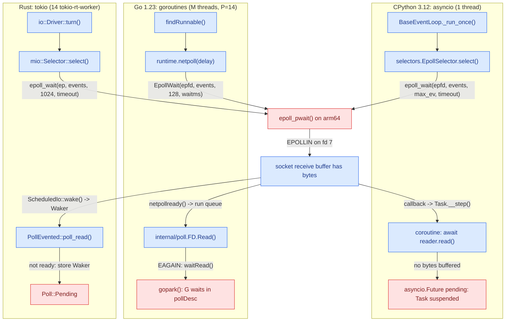
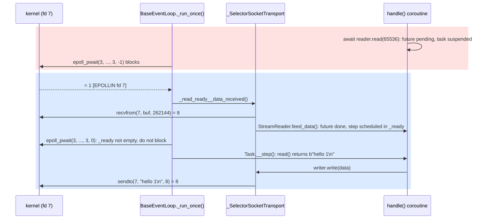
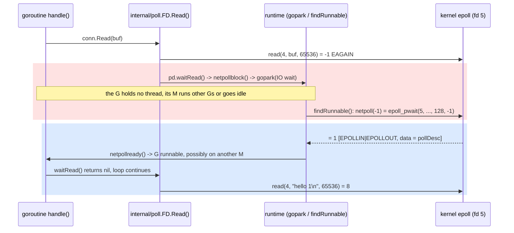

# How Runtimes Wrap Syscalls

**Lesson 6 of 6: How Bytes Move**
**Ticketing Project**

---

## Table of Contents

1. [Why the Runtime Owns the Loop](#1-why-the-runtime-owns-the-loop)
2. [CPython: the GIL, selectors and asyncio](#2-cpython-the-gil-selectors-and-asyncio)
3. [Go: internal/poll, the Netpoller and the Scheduler](#3-go-internalpoll-the-netpoller-and-the-scheduler)
4. [Rust: Futures, Wakers, mio and the tokio I/O Driver](#4-rust-futures-wakers-mio-and-the-tokio-io-driver)
5. [Code: Python](#5-code-python)
6. [Code: Go](#6-code-go)
7. [Code: Rust](#7-code-rust)
8. [See It: three runtimes over one epoll](#8-see-it-three-runtimes-over-one-epoll)
9. [What People Miss](#what-people-miss)
10. [Key Files Summary](#key-files-summary)
11. [Summary](#summary)
12. [Checklist](#checklist-what-you-should-be-able-to-explain)

---

## Learning Objectives

After reading this document, you will understand:

- How each runtime turns `epoll_wait()` readiness into resumed code: a ready callback that steps a coroutine in asyncio, a goroutine handed back to the scheduler by the netpoller in Go, a task woken through its `Waker` in tokio
- Where CPython releases the GIL around a blocking socket call (`sock_call_ex()` in `Modules/socketmodule.c`), and why that helps I/O-bound threads but not CPU-bound ones
- How Go's `internal/poll` turns a non-blocking `read()` that returns `EAGAIN` into a parked goroutine, and how `findRunnable()` ends up blocked in `epoll_pwait()` when no goroutine is runnable
- How mio and the tokio I/O driver map epoll events onto `ScheduledIo` readiness and wake tasks on a pool of worker threads
- What each runtime's defaults cost you before you write a line of handler code: OS threads, RSS per idle connection, the `listen()` backlog
- How to see all of it from outside the process with `strace -f`, `py-spy dump`, `GODEBUG=schedtrace` and `/proc/<pid>/task`

Key mental models to internalize:

- **Inside a runtime, data flows when kernel readiness becomes a resumed waiter, and stops wherever a waiter is parked, the GIL is held, or a worker never returns to its loop**: `epoll_wait()` reports an fd readable; asyncio's `_run_once()`, Go's netpoller and tokio's I/O driver each turn that report into a coroutine, goroutine or task that runs again and calls `read()`. The bytes wait in the socket's receive buffer (lesson 0.4) until that happens. A coroutine parked on a future, a goroutine in `gopark()`, a task that returned `Poll::Pending`, a thread waiting for the GIL, a CPU-bound handler hogging the only event-loop thread: those are the stops.
- **A runtime is lesson 0.5's epoll loop plus a scheduler.** All three wait the same way: a waiter (coroutine, goroutine, task) is attached to an fd and parked, one thread blocks in `epoll_wait()`, and readiness on that fd resumes the waiter. Who calls `read()`, and when, differs. Go's `conn.Read` tries `read()` first and parks only if it returns `EAGAIN`. asyncio's `await reader.read()` never touches the socket: the transport calls `recvfrom()` from a loop callback once epoll reports the fd readable, and the bytes it gets complete the coroutine's future. tokio's `stream.read().await` first checks the readiness the I/O driver has cached for the fd, calls `read()` only when that says ready, and returns `Pending` (clearing the readiness on `EAGAIN`) until the driver sets it again.
- **Parked costs memory, not threads.** An idle connection is a few kilobytes of heap and stack in every runtime, not an OS thread. A few kilobytes times a hundred thousand connections is still gigabytes.
- **Threads are a pool sized by the runtime, not a mapping from connections.** asyncio runs on one thread, Go runs GOMAXPROCS processors on a handful of OS threads, tokio starts one worker per CPU.

Common misconceptions to avoid:

- "Async I/O means the kernel reads in the background and hands me the bytes." With epoll it does not: epoll only says when `read()` will not block, and the runtime still calls `read()` (or `recvfrom()`) itself. Completion-based I/O (io_uring) is a different model and is not covered here.
- "Goroutines are free, so one per connection costs nothing." In this lab the goroutine and its runtime bookkeeping cost about 8 KB of RSS per idle connection, and the 64 KiB read buffer the demo hands each one costs several times that (section 8.6). Cheap, not free.
- "The GIL makes Python threads useless for servers." CPython drops the GIL around every blocking socket call, so threads overlap their waiting. Only CPU-bound Python code serializes.
- "asyncio uses a thread pool underneath." The demo server runs on exactly one thread (`Threads: 1`); only `run_in_executor()` and DNS lookups through `getaddrinfo()` use threads.

---

## 1. Why the Runtime Owns the Loop

Lesson 0.5 ended with an echo server that called `epoll_create1()`, registered every fd, looped on `epoll_wait()`, drained each socket until `read()` returned `EAGAIN`, and backed off when `accept()` ran out of file descriptors. About a hundred lines, and every line was a decision: how big a read buffer, when to stop draining, what to do with a partial `write()`, how long to sleep on `EMFILE`.

Nobody writes a production server that way. In lesson 2.4 the ticketing service gets uvicorn (on asyncio), Go's `net/http` and Rust's hyper/axum (on tokio). All three still run lesson 0.5's loop. You just did not write it, which means you did not choose its decisions either:

| Decision | asyncio (CPython 3.12) | Go 1.23 | tokio 1.x |
|----------|------------------------|---------|-----------|
| Who calls `epoll_wait()` | `BaseEventLoop._run_once()` via `selectors.EpollSelector.select()` | `runtime.netpoll()`, called from `findRunnable()` and `sysmon` | `io::Driver::turn()` via `mio::Selector::select()`, on whichever worker is parked |
| How your code waits | `await` on a future; the coroutine is suspended | an ordinary blocking-looking call; the goroutine is parked with `gopark()` | `.await` on a future that returned `Poll::Pending` and stored a `Waker` |
| OS threads | one event-loop thread | M threads for GOMAXPROCS processors (14 here) | one worker per CPU (14 here), plus the main thread |
| What blocks everyone | any CPU work or blocking call on the loop thread | only the goroutine; the runtime adds threads for blocking syscalls | the worker it runs on; other workers steal its tasks |
| Default `listen()` backlog (measured, section 8.6) | 100 | `net.core.somaxconn` (4096 here) | 128 |

The table's last row is the first hint that the runtime's choices leak into behaviour you can measure. Lesson 0.4 showed what a full accept queue does on on-sale day; asyncio asks for a queue of 100 by default (`backlog=100` in `BaseEventLoop.create_server()`, `Lib/asyncio/base_events.py`), Go asks for whatever `/proc/sys/net/core/somaxconn` says (`maxListenerBacklog()` in `src/net/sock_linux.go`), and the tokio demo got 128. Same kernel, same code shape, three different stopping points.

The rest of this lesson opens each runtime at the layer just above the syscall: where the loop lives, how a waiter parks, how readiness wakes it, and what each choice costs in threads and memory. The code is lesson 0.5's echo server again, written the way each runtime wants it written, so that every difference you see in `strace` comes from the runtime and not from the program.

```
TICKETING EXAMPLE: in lesson 2.4 the same GET /events request is served by
uvicorn, net/http and axum. strace of all three shows the same accept4(),
read()/recvfrom() and epoll_pwait() lines you will see in section 8. What
differs is around them: one thread or fourteen, a 100-deep accept queue or a
4096-deep one, a few KB or a few tens of KB per idle connection. On on-sale
day those differences decide which port sheds load first.
```

---

## 2. CPython: the GIL, selectors and asyncio

Before the details of any one runtime, here is the shape all three share. Each has its own name for the waiter and its own thread model, and all three arrive at the same syscall.



*Figure 1 — Three runtimes over one epoll: each parks its waiter (red), blocks in the same `epoll_pwait()`, and resumes the waiter when the kernel reports the fd readable.*

Python is the odd one out because it has two concurrency stories, and they meet at the same function in C. Threads with blocking sockets are the old story; asyncio is the new one. Both depend on what CPython does with the GIL around a socket call.

### 2.1 A blocking socket call releases the GIL

The GIL (global interpreter lock) is the mutex that lets only one thread at a time execute Python bytecode. If `sock.recv()` held it while the kernel waited for bytes, a thread-per-connection server would serve exactly one connection at a time. It does not, because every socket method in CPython funnels through one helper that drops the GIL around the syscall.

`sock.recv(n)` is `sock_recv()` in `Modules/socketmodule.c`. It calls `sock_recv_guts()`, which fills a small context struct and calls `sock_call(s, 0, sock_recv_impl, &ctx)`. `sock_recv_impl()` is the actual `recv(s->sock_fd, ctx->cbuf, ctx->len, ctx->flags)`. The interesting part is in `sock_call_ex()`, the function `sock_call()` wraps (CPython 3.12, `Modules/socketmodule.c`, around line 975):

```c
        /* inner loop to retry sock_func() when sock_func() is interrupted
           by a signal */
        while (1) {
            Py_BEGIN_ALLOW_THREADS
            res = sock_func(s, data);
            Py_END_ALLOW_THREADS
```

`Py_BEGIN_ALLOW_THREADS` saves the current thread state and releases the GIL; `Py_END_ALLOW_THREADS` takes it back. Between them runs `sock_recv_impl()`, so while one thread sleeps inside `recvfrom()` in the kernel, any other thread can run Python code. Two details matter:

- **Timeouts are a `poll()` first.** Only when the socket has a positive timeout, or the call is a `connect()` waiting to complete, does `sock_call_ex()` first call `internal_select()`, which is a `poll()` on that one fd, and only then `sock_func` (`int has_timeout = (timeout > 0);` and `if (has_timeout || connect)` in CPython 3.12.3). A Python socket with `settimeout(1.0)` is a non-blocking fd plus a `poll()` per call, not a kernel timer on the socket. `setblocking(False)` is a timeout of 0: no `poll()`, the syscall runs at once, and `EAGAIN` comes straight back.
- **`EAGAIN` becomes an exception.** On a non-blocking socket with no timeout, `recv()` returning `-1 EAGAIN` surfaces as `BlockingIOError`. That is what lesson 0.5's epoll server caught, and what asyncio's transports catch.

Section 8.7 measures the effect: a thread spinning in Python gets about twice as many iterations while the main thread is blocked in `recv()` as it does while the main thread is also running Python.

### 2.2 selectors: one API over epoll, kqueue, poll and select

`Lib/selectors.py` wraps the readiness syscalls behind one interface: `register(fileobj, events, data)` and `select(timeout)`. `DefaultSelector` is chosen at import time in this order: kqueue, epoll, devpoll, poll, select. That is why the demo prints `KqueueSelector` on macOS and `EpollSelector` in the lab.

`EpollSelector.select()` does three small things before the syscall, each visible in `strace`:

```python
        def select(self, timeout=None):
            if timeout is None:
                timeout = -1
            elif timeout <= 0:
                timeout = 0
            else:
                # epoll_wait() has a resolution of 1 millisecond, round away
                # from zero to wait *at least* timeout seconds.
                timeout = math.ceil(timeout * 1e3) * 1e-3

            # epoll_wait() expects `maxevents` to be greater than zero;
            # we want to make sure that `select()` can be called when no
            # FD is registered.
            max_ev = max(len(self._fd_to_key), 1)

            ready = []
            try:
                fd_event_list = self._selector.poll(timeout, max_ev)
```

`timeout=None` becomes `-1` (block until something is ready), and `maxevents` is the number of registered fds. In section 8.1 the strace shows `epoll_pwait(3, [], 2, 0, …)` before the client connects and `epoll_pwait(3, …, 3, -1, …)` after: two registered fds, then three, and a blocking wait once the loop has nothing else to do. `self._selector.poll()` is `select.epoll.poll()`, which calls libc's `epoll_wait()`; on arm64 the kernel has no `epoll_wait` syscall, so libc issues `epoll_pwait` with a null signal mask, which is the name strace prints.

### 2.3 The asyncio loop: one iteration at a time

asyncio's event loop is `BaseEventLoop.run_forever()` calling `_run_once()` until stopped (`Lib/asyncio/base_events.py`). One iteration, in order:

1. **Pick a timeout.** If `self._ready` (callbacks due now) is non-empty, the timeout is `0`: poll without blocking. Otherwise it is the time until the next `call_later()` timer, or `None` (block forever) if there are no timers.
2. **Ask the selector.** `event_list = self._selector.select(timeout)`.
3. **Turn events into callbacks.** `_process_events()` (in `Lib/asyncio/selector_events.py`) looks up each ready key and appends its reader or writer `Handle` to `_ready`.
4. **Run everything in `_ready`.** Each callback runs to completion on this one thread.

There is no preemption anywhere in that list. A coroutine gives the thread back only at an `await` that actually suspends; between two such points, nothing else on the loop runs.

Two more pieces explain the strace lines:

- **The self-pipe.** At startup the loop creates a `socketpair()` and registers one end (`_make_self_pipe()` in `selector_events.py`), so that `call_soon_threadsafe()` from another thread can wake a blocked `epoll_wait()` by writing a byte. It is the second of the two fds in `epoll_pwait(3, [], 2, …)`; the first is the listening socket.
- **Transports and protocols.** Each accepted connection becomes a `_SelectorSocketTransport`. When epoll reports its fd readable, the transport's reader callback `_read_ready__data_received()` runs `data = self._sock.recv(self.max_size)`, where `max_size = 256 * 1024` (inherited from `_SelectorTransport`). That is the `recvfrom(7, "hello 1\n", 262144, …)` in section 8.1: asyncio always asks the kernel for up to 256 KiB, whatever your coroutine asked for. The bytes go to the protocol's `data_received()`, which for streams is `StreamReader.feed_data()`, which completes the future your coroutine is awaiting. Completing a future does not run the coroutine; it schedules the task's next step as a callback in `_ready`. That is why the next `epoll_pwait()` in the trace has a timeout of `0`.

Writing goes the other way and usually skips the loop entirely. `transport.write(data)` (`_SelectorSocketTransport.write()`) first tries `self._sock.send(data)` on the spot; only what the kernel's send buffer does not take is kept in a user-space buffer and handed to a writer callback. `await writer.drain()` suspends only while that buffer is above its high-water mark, 64 KiB by default (`_FlowControlMixin._set_write_buffer_limits()` in `Lib/asyncio/transports.py`). The slow reader from lesson 0.3 shows up here, one layer up, as a `drain()` that does not return.



*Figure 2 — One echo on asyncio: the coroutine waits on a future, the loop waits in `epoll_pwait()`, and the `recvfrom()`/`sendto()` pair is split across two loop iterations.*

```
TICKETING EXAMPLE: in lesson 3.4 the seat map for a 40,000-seat arena is
serialized to JSON on every change. If json.dumps() of that map takes 150 ms
inside an asyncio handler, the event loop thread is busy for 150 ms: no
_run_once(), no epoll_pwait(), no recvfrom() for any other connection. Every
GET /events in that window waits in a receive buffer. PYTHONASYNCIODEBUG=1
logs it, because 150 ms is over the loop's slow_callback_duration of 0.1 s.
```

---

## 3. Go: internal/poll, the Netpoller and the Scheduler

Go hides the loop more thoroughly than asyncio. There is no `await` and no event-loop object: a handler calls `conn.Read(buf)` and the call looks blocking. Underneath, the fd is non-blocking, and each `Read` is one attempt at lesson 0.5's non-blocking `read()`, with the runtime's scheduler in place of the `epoll_wait()` loop: it returns as soon as a `read()` returns bytes, and parks the goroutine only when its `read()` says `EAGAIN`.

### 3.1 Every net fd is non-blocking and edge-triggered

`net.Listen` creates the listening socket with `SOCK_NONBLOCK`, and `Accept` calls `accept4(…, SOCK_CLOEXEC|SOCK_NONBLOCK)`. Section 8.4's strace shows exactly that flag pair on every accepted fd, so Go never needs a separate `fcntl()` (CPython, by contrast, sets `O_NONBLOCK` with `ioctl(FIONBIO)`, as lesson 0.5's strace showed).

Each new fd is registered once with the runtime's epoll instance by `netpollopen()` (`src/runtime/netpoll_epoll.go`):

```go
func netpollopen(fd uintptr, pd *pollDesc) uintptr {
	var ev syscall.EpollEvent
	ev.Events = syscall.EPOLLIN | syscall.EPOLLOUT | syscall.EPOLLRDHUP | syscall.EPOLLET
```

Both directions at once, edge-triggered (`EPOLLET`), with a pointer to the fd's `pollDesc` in the event's data field. Edge-triggered means epoll reports a change once, not a state repeatedly, so a goroutine may park only after its own `read()` has seen `EAGAIN`: had it parked with bytes still unread, no new edge would ever come to wake it. `FD.Read` keeps that rule without draining anything itself. It returns after the first `read()` that returns bytes (`src/internal/poll/fd_unix.go`, lines 148–159 in Go 1.23.12), the application's next `Read` call consumes more, and only a call whose `read()` returns `EAGAIN` parks. It also explains a line in section 8.4 that looks odd at first: the first event for a fresh connection is `EPOLLOUT`, because a new socket's send buffer is empty and therefore writable.

`netpollinit()` also creates an `eventfd` and registers it. That is the runtime's way to interrupt a thread blocked in `epoll_wait()` (`netpollBreak()`), the same job asyncio's self-pipe does.

### 3.2 Read: try, park, retry

`conn.Read` ends in `(*FD).Read` in `src/internal/poll/fd_unix.go`:

```go
	for {
		n, err := ignoringEINTRIO(syscall.Read, fd.Sysfd, p)
		if err != nil {
			n = 0
			if err == syscall.EAGAIN && fd.pd.pollable() {
				if err = fd.pd.waitRead(fd.isFile); err == nil {
					continue
				}
			}
		}
		err = fd.eofError(n, err)
		return n, err
	}
```

Read first, wait second. If bytes are already in the receive buffer, `syscall.Read` returns them and the goroutine never touches the scheduler. Only on `EAGAIN` does it call `pd.waitRead()`, which calls `runtime_pollWait()` (declared in `fd_poll_runtime.go`, implemented as `poll_runtime_pollWait()` in `src/runtime/netpoll.go`). That loops on `netpollblock()`, which records the goroutine in the `pollDesc` and calls:

```go
		gopark(netpollblockcommit, unsafe.Pointer(gpp), waitReasonIOWait, traceBlockNet, 5)
```

`gopark()` takes the goroutine off its OS thread with wait reason `IO wait` (the string you see in goroutine dumps). The thread is now free to run any other runnable goroutine. When the goroutine is resumed, `waitRead()` returns `nil`, the `for` loop continues, and `syscall.Read` runs again, now with bytes waiting.

### 3.3 The netpoller: who calls epoll_wait

Nobody owns the netpoller. `runtime.netpoll(delay)` in `netpoll_epoll.go` converts `delay` into milliseconds (`< 0` blocks forever, `0` just polls) and calls `syscall.EpollWait(epfd, events[:], int32(len(events)), waitms)` with an array of 128 events. For each event it finds the `pollDesc` and calls `netpollready()`, which collects the parked goroutines into a list for the scheduler to run.

Three places call it (`src/runtime/proc.go`):

- **`findRunnable()`**, when an M (OS thread) holding a P (scheduler slot) finds nothing in its local run queue, the global queue, or other Ps' queues to steal. First it tries `netpoll(0)`; if that is empty and there is truly nothing to do, it calls `netpoll(delay)` with the comment `// block until new work is available`. This is the `epoll_pwait(5, …, 128, -1, …)` that blocks in section 8.4.
- **`sysmon`**, the runtime's monitor thread, which runs without a P: `// poll network if not polled for more than 10ms`, then `netpoll(0)`. This keeps network goroutines from starving when every P is busy with CPU work.
- **The scheduler's GC and start-the-world paths**, also with `netpoll(0)`.

The result is the M:N model in one picture: G (goroutines, thousands), M (OS threads, a handful), P (logical processors, `GOMAXPROCS`, 14 in the lab). Any M with a P can run any G. A G parked on I/O costs no M at all. The number of Ms grows when work appears faster than idle Ms can pick it up (`wakep()`, `startm()`) and when a goroutine blocks in a syscall the netpoller cannot help with, such as a file read or a cgo call, whose P is handed to another M (`entersyscallblock()`, `handoffp()`). Section 8.3 shows 6 threads at rest; section 8.6 shows 8 to 10 after 2,000 connections arrived in a burst.



*Figure 3 — A goroutine's `Read` is `read()` → `EAGAIN` → `gopark()`; whichever M blocks in `netpoll()` readies it, and it may resume on a different OS thread.*

### 3.4 Stacks: why a goroutine is cheap, and how cheap

A thread gets a fixed stack reservation (8 MiB by default on Linux). A goroutine starts with `startingStackSize`, at least `fixedStack`, which is `stackMin = 2048` rounded up for the platform (`src/runtime/stack.go`), and grows by copying to a larger stack when a function prologue detects it would overflow. That is the whole reason a million goroutines fit where a million threads do not. It is not the whole cost of a connection, though: the demo's handler allocates a 64 KiB read buffer, and the runtime keeps a `netFD` and a `pollDesc` per connection. Section 8.6 measures the total.

```
TICKETING EXAMPLE: net/http's server (lesson 2.4) does exactly this: one
goroutine per accepted connection running conn.serve(). Ten thousand browsers
holding an idle keep-alive connection to GET /events are ten thousand
goroutines parked in IO wait, each with its pollDesc registered in one epoll
instance, and a handful of OS threads, one of which sits in epoll_pwait().
```

---

## 4. Rust: Futures, Wakers, mio and the tokio I/O Driver

Rust's standard library has `async fn` and the `Future` trait but no runtime: something else must call `poll()` on futures and decide when to call it again. tokio is that something. Its design sits between the other two: explicit `.await` like Python, many threads like Go.

### 4.1 A future is a state machine that says "not yet"

`async fn handle(...)` compiles into a state machine implementing `Future`. Its `poll(cx)` method either returns `Poll::Ready(value)` or `Poll::Pending`, and before returning `Pending` it must arrange for `cx.waker()` to be called when progress is possible. Nobody polls a pending future in a loop; the waker is the only way it runs again. A `Waker` is to tokio what a completed future is to asyncio and what `netpollready()` is to Go.

### 4.2 mio: the selector

mio is tokio's portable epoll/kqueue layer. On Linux, `Selector::select()` (`src/sys/unix/selector/epoll.rs`) rounds the timeout up to whole milliseconds and calls:

```rust
        syscall!(epoll_wait(
            self.ep.as_raw_fd(),
            events.as_mut_ptr(),
            events.capacity() as i32,
            timeout,
        ))
```

Registrations go through `interests_to_epoll()`, which starts every mask with `EPOLLET` and adds `EPOLLIN | EPOLLRDHUP` for readable interest: edge-triggered, like Go. tokio registers sockets for both directions, which is why section 8.5 shows `EPOLLIN|EPOLLOUT|EPOLLRDHUP` events, and why, as in Go, the first event for a fresh connection is `EPOLLOUT`.

### 4.3 The I/O driver: events become readiness, readiness wakes tasks

tokio's `io::Driver::turn()` (`tokio/src/runtime/io/driver.rs`) is one round of the loop. It calls `self.poll.poll(events, max_wait)` (mio, therefore `epoll_wait`), then walks the events:

- **`TOKEN_WAKEUP` (`mio::Token(0)`)** is the driver's own `mio::Waker`, an eventfd other threads write to when they need the driver to stop blocking. The code's comment: "Nothing to do, the event is used to unblock the I/O driver". In section 8.5 it is the event with `data={u32=0, u64=0}`.
- **Anything else** is a pointer to the socket's `ScheduledIo`. The driver calls `io.set_readiness(Tick::Set, |curr| curr | ready)` and then `io.wake(ready)`, which wakes every task waiting for that direction.

The other half is the read path. `TcpStream`'s `AsyncRead` ends in `PollEvented::poll_read()` (`tokio/src/io/poll_evented.rs`):

1. `ready!(self.registration.poll_read_ready(cx))`: if the cached readiness has no `READABLE` bit, store the waker and return `Poll::Pending`.
2. Otherwise call `read()` on the mio socket.
3. On `WouldBlock`, `clear_readiness(evt)` and loop back to step 1, which now returns `Pending`.
4. On epoll and kqueue, a read that returned fewer bytes than the buffer could hold also clears readiness, because with edge-triggered events a short read proves the socket is drained (the comment cites tokio issue 5866). That saves a `read()` that would only return `EAGAIN`, which is why the tokio strace in section 8.5 has no `EAGAIN` lines.

### 4.4 Workers: who runs tasks, who runs the driver

The multi-thread runtime (`#[tokio::main]` with the `rt-multi-thread` feature) starts one worker thread per CPU, named `tokio-rt-worker`; section 8.5 counts 14 of them plus the main thread. Each worker has a local run queue and steals from the others when it runs dry. When a worker has nothing to run, it parks, and one parked worker at a time holds the I/O driver and blocks in `epoll_pwait()`. When events arrive, it wakes the tasks (pushing them onto run queues) and other workers are unparked to run them. In the strace, one thread id (`13689` in section 8.5) does `epoll_pwait()`, `recvfrom()` and `sendto()` in sequence: the driver thread ran the woken task itself.

hyper sits directly on top of this: its HTTP/1 connection state machine (`hyper/src/proto/h1/`) is a future that reads from a tokio `TcpStream` exactly like the demo's `handle()`. axum is a router on hyper. Lesson 2.4 traces that stack.


*Figure 4 — tokio: a pending task leaves its `Waker` in `ScheduledIo`; the worker that holds the driver turns an epoll event into readiness and a wake, and the task polls `recvfrom()` again.*

```
TICKETING EXAMPLE: in lesson 3.4 the seat-map WebSocket endpoint holds one
long-lived connection per browser. On tokio each one is a task parked in
Poll::Pending with its Waker in a ScheduledIo; a seat change is a broadcast
that wakes thousands of tasks at once, spread over 14 workers by work
stealing. A single slow task (say, compressing a frame on the worker thread)
holds up only the tasks queued behind it on that worker.
```

---

## 5. Code: Python

The demo is `demos/00/06/python/main.py`: lesson 0.5's echo server with every syscall hidden behind asyncio. The per-connection handler is a coroutine:

```python
async def handle(
    reader: asyncio.StreamReader, writer: asyncio.StreamWriter, quiet: bool, buf_size: int
) -> None:
    port = writer.get_extra_info("peername")[1]
    echoed = 0
    while data := await reader.read(buf_size):  # parks this coroutine until the fd is readable
        writer.write(data)  # the transport tries send() at once, buffers what does not fit
        await writer.drain()  # parks again only if that buffer is over its high-water mark
        echoed += len(data)
    writer.close()
    await writer.wait_closed()
    if not quiet:
        print(f"port {port}: echoed {echoed} bytes, closed", flush=True)
```

Each line maps onto section 2.3 and onto a strace line in section 8.1:

- **`await reader.read(buf_size)`** (`--buf-size`, default 65536) returns at once if the `StreamReader` already holds bytes. Otherwise it creates a future and suspends the task on it. The kernel-side read is not this call: it is the transport's `recvfrom(7, …, 262144, …)`, made by a loop callback, which then completes the future. Your 65536 only limits how much the `StreamReader` hands back; the kernel was asked for 256 KiB. That is also why the flag barely changes asyncio's memory: no buffer of that size is allocated per connection up front.
- **`writer.write(data)`** is `_SelectorSocketTransport.write()`, which calls `sendto()` immediately when nothing is buffered. That is why the trace shows `sendto(7, "hello 1\n", 8, …) = 8` with no `epoll_pwait()` for `EPOLLOUT` in between.
- **`await writer.drain()`** does not suspend here at all: 8 bytes are far below the 64 KiB high-water mark. Against lesson 0.3's slow reader, it is the line that would park.
- **`while data := …`** ends when `read()` returns `b""`, which is the transport seeing `recvfrom(7, "", …) = 0`.

The server setup prints which selector the loop picked:

```python
async def serve(port: int, quiet: bool, buf_size: int = 65536) -> asyncio.Server:
    server = await asyncio.start_server(
        lambda r, w: handle(r, w, quiet, buf_size), host="127.0.0.1", port=port, reuse_address=True
    )
    selector = type(asyncio.get_running_loop()._selector).__name__  # EpollSelector on Linux
    print(
        f"echo-asyncio: pid {os.getpid()}, listening on 127.0.0.1:{port} "
        f"({selector}, {threading.active_count()} thread)",
        flush=True,
    )
    return server
```

`asyncio.start_server()` is `loop.create_server()` with a `StreamReaderProtocol` factory, so the listening socket gets asyncio's default `backlog=100`. `_selector` is a private attribute; reading it in a demo is fair, depending on it in the app is not. `threading.active_count()` is the honest single-thread claim: it prints `1`.

The smoke test runs 50 clients concurrently against the server, in the same thread:

```python
async def smoke(port: int) -> int:
    server = await serve(port, quiet=True)
    async with server:
        results = await asyncio.gather(*(one_client(port, n) for n in range(SMOKE_CLIENTS)))
    ok = sum(results)
    threads = threading.active_count()
    if ok == SMOKE_CLIENTS:
        print(f"smoke: OK, {ok} concurrent clients echoed by {threads} thread")
        return 0
    print(f"smoke: FAIL, {ok} of {SMOKE_CLIENTS} clients got their echo")
    return 1
```

`asyncio.gather()` starts 50 client coroutines; together with the 50 server-side handlers that is 100 coroutines and 101 sockets multiplexed through one `epoll_pwait()`, and `smoke: OK, 50 concurrent clients echoed by 1 thread` is the result. Run it with `just demo 00/06 python --smoke`. On macOS the same file runs natively and prints `KqueueSelector`, because `selectors.DefaultSelector` prefers kqueue where it exists.

Compare it with `demos/00/05/python/main.py`, the raw epoll version: everything that file does by hand (the `epoll.register()`, the drain-to-`EAGAIN` loop, the fd-to-socket dict, `close()` and `unregister()`) now lives in `selector_events.py`. Nothing disappeared; it moved into the runtime.

```
TICKETING EXAMPLE: uvicorn (lesson 2.4) is this file at scale: asyncio's
create_server(), one protocol instance per connection, h11 parsing bytes that
arrive in data_received(). A FastAPI handler for GET /events that awaits
Postgres yields the loop at that await; one that loops over 40,000 seats in
pure Python does not, and every other connection waits for it.
```

---

## 6. Code: Go

The Go port is the same echo server on `net.Listen` with one goroutine per connection. Its handler must use an explicit `Read`/`Write` loop over a per-connection buffer (`--buf-size`, default 64 KiB), not `io.Copy(conn, conn)`: on Linux `io.Copy` between two TCP connections takes the `ReadFrom` fast path and moves bytes with `splice()`, which would hide the very `read()` → `EAGAIN` → park sequence the See It traces. The startup banner reports `GOMAXPROCS` and the runtime's `threadcreate` profile count, so the reader sees the P and M counts before any client connects. The handler the See It traces:

```go
func handle(conn net.Conn, quiet bool, bufSize int) {
	defer conn.Close()
	port := conn.RemoteAddr().(*net.TCPAddr).Port
	buf := make([]byte, bufSize) // allocated per connection, before the first byte arrives
	echoed := 0
	for {
		n, err := conn.Read(buf) // parks this goroutine until the netpoller says readable
		if n > 0 {
			if _, werr := conn.Write(buf[:n]); werr != nil {
				return
			}
			echoed += n
		}
		if err != nil {
			break // io.EOF: the peer closed
		}
	}
	if !quiet {
		fmt.Printf("port %d: echoed %d bytes, closed\n", port, echoed)
	}
}
```

The rest of the file is plumbing around `handle()`. The banner is printed from `listen()`, before any client connects:

```go
func listen(port int) net.Listener {
	ln, err := net.Listen("tcp", fmt.Sprintf("127.0.0.1:%d", port))
	if err != nil {
		fmt.Println("echo-goroutines:", err)
		os.Exit(1)
	}
	fmt.Printf("echo-goroutines: pid %d, listening on 127.0.0.1:%d (GOMAXPROCS %d, %d threads)\n",
		os.Getpid(), port, runtime.GOMAXPROCS(0), pprof.Lookup("threadcreate").Count())
	return ln
}
```

`runtime.GOMAXPROCS(0)` reads the number of Ps without changing it, and `pprof.Lookup("threadcreate").Count()` is the number of OS threads (Ms) the runtime has created so far: about 5 at startup, which the smoke line compares with the count after 50 concurrent clients (`smoke: OK, 50 concurrent clients echoed by 15 threads` in one native macOS run; the number depends on scheduling). Errors are values here as everywhere in Go: a failed `net.Listen` prints `echo-goroutines: listen tcp 127.0.0.1:9006: bind: address already in use` and exits 1, and each smoke client sets a 5-second deadline, so that a broken server fails the smoke instead of hanging until `demo-smoke`'s 60-second cap.

```
TICKETING EXAMPLE: the Go port's rawhttp server in lesson 1.5 and its
net/http API in lesson 2.4 both run one goroutine per connection. The 64 KiB
buffer per goroutine in this demo is the knob to watch: at 10,000 idle
seat-map watchers it is up to 640 MiB, and section 8.6 shows that most of it
ends up resident, while the goroutines themselves are a small fraction.
```

---

## 7. Code: Rust

The Rust port is the same echo server on tokio's multi-thread runtime, built with Cargo (`demos/00/06/rust/Cargo.toml`) because tokio is a crate, with only the features an echo server needs: `rt-multi-thread`, `net`, `io-util` and `macros`. Each accepted `TcpStream` is moved into its own task with `tokio::spawn`, and the banner prints the worker count (`std::thread::available_parallelism()`, which is what tokio uses by default). The handler mirrors the Go and Python ones:

```rust
async fn handle(mut stream: TcpStream, quiet: bool, buf_size: usize) {
    let port = stream.peer_addr().map(|a| a.port()).unwrap_or(0);
    let mut buf = vec![0u8; buf_size];
    let mut echoed = 0usize;
    loop {
        // Pending until the I/O driver sees the fd readable, then read(2) runs.
        let n = match stream.read(&mut buf).await {
            Ok(0) | Err(_) => break, // 0: the peer closed
            Ok(n) => n,
        };
        if stream.write_all(&buf[..n]).await.is_err() {
            return;
        }
        echoed += n;
    }
    if !quiet {
        println!("port {port}: echoed {echoed} bytes, closed");
    }
}
```

`#[tokio::main]` turns `main` into a function that builds the multi-thread runtime (one worker per CPU) and blocks on the async body; everything else is tasks. The accept loop moves each `TcpStream` into a task of its own:

```rust
async fn serve(listener: TcpListener, quiet: bool, buf_size: usize) {
    while let Ok((stream, _)) = listener.accept().await {
        tokio::spawn(handle(stream, quiet, buf_size));
    }
}
```

`tokio::spawn` requires a `Send + 'static` future, which is why `handle` takes the stream by value: the task owns its connection, and the compiler rejects any borrow that could outlive it. A read error and EOF both end the loop (`Ok(0) | Err(_) => break`), the Rust counterpart of Go's `if err != nil { break }`. The smoke spawns 50 `one_client` tasks on the same runtime and awaits their `JoinHandle`s, so clients and server handlers share the workers. The worker count comes from `workers()`, which returns `std::thread::available_parallelism()`, the default `#[tokio::main]` uses; a bad flag value (`--port abc`) is a usage error with exit status 2.

```rust
async fn one_client(port: u16, number: usize) -> bool {
    let Ok(mut stream) = TcpStream::connect(("127.0.0.1", port)).await else {
        return false;
    };
    let message = format!("hello from client {number}\n").into_bytes();
    if stream.write_all(&message).await.is_err() {
        return false;
    }
    let mut echoed = vec![0u8; message.len()];
    stream.read_exact(&mut echoed).await.is_ok() && echoed == message
}
```

```
TICKETING EXAMPLE: axum on hyper on tokio (lesson 2.4) serves GET /events
from tasks exactly like handle(). When a handler does blocking work, such as
a synchronous Postgres call or a large serde_json::to_vec of the seat map, it
belongs in tokio::task::spawn_blocking; otherwise it occupies one of the 14
workers and every task queued on that worker waits.
```

---

## 8. See It: three runtimes over one epoll

Everything below was captured in the lab on kernel 7.0.14-linuxkit (Docker Desktop's VM, aarch64) with Python 3.12.3, go1.23.12 and rustc 1.99.0, by one run of `just see 00/06`. Commands are shown as you would type them in `just lab` from `/work`. Three clients each connect, wait 0.2 s, send one line and hang up:

```bash
for n in 1 2 3; do (sleep 0.2; printf 'hello %s\n' "$n") | nc -N 127.0.0.1 9006; done
```

The 0.2 s pause matters: when a connection arrives there is nothing to read yet, so every runtime has to park its waiter and be woken by epoll, which is the path this lesson is about. On arm64, every `epoll_wait()` in these traces appears as `epoll_pwait`.

The design spec suggested a `gdb` breakpoint in `sock_recv` to watch CPython drop the GIL. That does not work in this lab: Ubuntu's `/usr/bin/python3.12` is stripped (`file` reports `stripped`), `gdb -batch -ex 'info functions ^sock_recv' /usr/bin/python3.12` finds no symbols, and debuginfod returned none either. Section 2.1's source reading plus the measurement in 8.7 replace it. Likewise `tokio-console` and `RUST_LOG=mio=trace` need extra crates (`console-subscriber`, a `tracing` subscriber) in the Rust port; they belong to the Porter's version or to lesson 6.2.

### 8.1 strace and /proc — asyncio is one thread around one epoll_pwait

```bash
strace -f -o /tmp/asyncio.strace -e 'trace=/^epoll_p?wait$,accept4,recvfrom,sendto' \
  python3 demos/00/06/python/main.py >/dev/null &
# ... run the three clients ...
pid=$(pgrep -f -n demos/00/06/python/main.py)
grep Threads /proc/$pid/status; cat /proc/$pid/task/*/comm | sort | uniq -c
sed -n '/accept4/,$p' /tmp/asyncio.strace | head -n 12
```

```text
Threads:	1
      1 python3
13289 accept4(6, {sa_family=AF_INET, sin_port=htons(57168), sin_addr=inet_addr("127.0.0.1")}, [16], SOCK_CLOEXEC) = 7
13289 accept4(6, 0xfffff4a433e8, [16], SOCK_CLOEXEC) = -1 EAGAIN (Resource temporarily unavailable)
…
13289 epoll_pwait(3, [], 3, 0, NULL, 8) = 0
13289 epoll_pwait(3, [{events=EPOLLIN, data={u32=7, u64=32088147345014791}}], 3, -1, NULL, 8) = 1
13289 recvfrom(7, "hello 1\n", 262144, 0, NULL, NULL) = 8
13289 epoll_pwait(3, [{events=EPOLLIN, data={u32=7, u64=32088147345014791}}], 3, 0, NULL, 8) = 1
13289 sendto(7, "hello 1\n", 8, 0, NULL, 0) = 8
```

One thread, one pid on every line. Read it with Figure 2 beside it. asyncio's accept loop takes connection fd 7 and keeps calling `accept4()` until `EAGAIN`, as lesson 0.5's server did by hand. The `epoll_pwait(…, 3, 0, …)` calls with a zero timeout are iterations of `_run_once()` that had callbacks waiting in `_ready` (starting the new connection's task), so they must not block. Then the loop has nothing to do and blocks with timeout `-1` for the 0.2 s until the client's line arrives: `EPOLLIN` on fd 7. The transport reads with its fixed 256 KiB `max_size` (`262144`), completes the coroutine's future, polls once more with timeout `0` because the coroutine's next step is now in `_ready`, and the coroutine's `writer.write()` becomes a direct `sendto()`. `maxevents` is 3: the listener, the self-pipe and fd 7.

### 8.2 py-spy — where the idle loop waits

```bash
python3 demos/00/06/python/main.py >/dev/null &
py-spy dump --pid $!
```

```text
Thread 46430 (idle): "MainThread"
    select (selectors.py:468)
    _run_once (asyncio/base_events.py:1949)
    run_forever (asyncio/base_events.py:641)
    run_until_complete (asyncio/base_events.py:674)
    run (asyncio/runners.py:118)
    run (asyncio/runners.py:194)
    main (main.py:96)
    <module> (main.py:101)
```

`py-spy` reads the interpreter's frames from outside the process, without stopping it for long and without debug symbols (it cannot attach to a process that is already being traced, which is why `see.sh` starts a second, untraced server for this step). The idle server sits in `select` at `selectors.py:468`, which in Ubuntu's Python 3.12.3 is the `fd_event_list = self._selector.poll(timeout, max_ev)` line shown in section 2.2, called from `_run_once` at `base_events.py:1949`, the `event_list = self._selector.select(timeout)` line, under `asyncio.run(run_forever(...))` at `main.py:96` and `sys.exit(main())` at `main.py:101` in the demo (this excerpt comes from a later `just see 00/06` run than 8.1, after the demo gained its `--buf-size` check). `(idle)` means the thread is off-CPU: inside `epoll_pwait()`, with the GIL released, because `select.epoll.poll()` wraps its syscall in `Py_BEGIN_ALLOW_THREADS` too.

### 8.3 GODEBUG=schedtrace and /proc — goroutines on a few threads

```bash
go build -o /tmp/echo-goroutines demos/00/06/go/main.go
GODEBUG=schedtrace=1000 /tmp/echo-goroutines >/dev/null &
# ... run the three clients ...
grep Threads /proc/$!/status; cat /proc/$!/task/*/comm | sort | uniq -c
```

`see.sh` builds the same binary into a temporary directory under the same name, `echo-goroutines`, so its trace headers show `/tmp/tmp.RRhLiGhEBI/echo-goroutines`.

```text
SCHED 0ms: gomaxprocs=14 idleprocs=11 threads=6 spinningthreads=1 needspinning=0 idlethreads=0 runqueue=0 [0 0 0 0 0 0 0 0 0 0 0 0 0 0]
SCHED 1005ms: gomaxprocs=14 idleprocs=14 threads=7 spinningthreads=0 needspinning=0 idlethreads=3 runqueue=0 [0 0 0 0 0 0 0 0 0 0 0 0 0 0]
Threads:	6
      6 echo-goroutines
```

`schedtrace` prints the scheduler's state every second to stderr: 14 Ps (`gomaxprocs=14`, one per CPU), all idle once the clients are done, `runqueue=0` globally and in each P's local queue (the 14 zeros in brackets), and 6 or 7 OS threads (Ms). `/proc` agrees and shows that Go does not name its threads: all six carry the binary's name. Three connections came and went without the thread count tracking them.

### 8.4 strace — a goroutine parks on EAGAIN and resumes on another thread

```bash
strace -f -o /tmp/go.strace -e 'trace=/^epoll_p?wait$,accept4,read,write' /tmp/echo-goroutines >/dev/null &
# ... run the three clients, then: pkill echo-goroutines
sed -n '/accept4(3, {/,$p' /tmp/go.strace | head -n 14
```

```text
13435 accept4(3, {sa_family=AF_INET, sin_port=htons(57232), sin_addr=inet_addr("127.0.0.1")}, [112 => 16], SOCK_CLOEXEC|SOCK_NONBLOCK) = 4
13435 accept4(3, 0x400006abec, [112], SOCK_CLOEXEC|SOCK_NONBLOCK) = -1 EAGAIN (Resource temporarily unavailable)
13435 epoll_pwait(5,  <unfinished ...>
13440 read(4,  <unfinished ...>
13435 <... epoll_pwait resumed>[{events=EPOLLOUT, data={u32=3167223809, u64=18446561158514606081}}], 128, 0, NULL, 0) = 1
13440 <... read resumed>0x4000182000, 65536) = -1 EAGAIN (Resource temporarily unavailable)
13435 epoll_pwait(5, [{events=EPOLLIN|EPOLLOUT, data={u32=3167223809, u64=18446561158514606081}}], 128, -1, NULL, 0) = 1
13435 read(4, "hello 1\n", 65536)       = 8
13435 write(4, "hello 1\n", 8 <unfinished ...>
```

This is Figure 3, line for line. Thread 13435 accepts fd 4 with `SOCK_NONBLOCK` and keeps accepting until `EAGAIN`. The new connection's goroutine starts on thread 13440 and calls `read(4)`, which returns `EAGAIN` because the client is still sleeping: `FD.Read` calls `waitRead()` and the goroutine is parked. Meanwhile thread 13435 polls the netpoller (`netpoll(0)`, timeout `0`) and sees the fresh fd's `EPOLLOUT` edge, then, with nothing runnable, blocks in `netpoll(-1)` (timeout `-1`, 128 events: the `findRunnable()` call). When the line arrives, the edge reports `EPOLLIN|EPOLLOUT`, `netpollready()` makes the goroutine runnable, and the same goroutine's retry, `read(4, "hello 1\n", 65536) = 8`, runs on thread 13435, not on 13440 where it parked. The goroutine moved between OS threads and your code never knew. Note the `data=` field: it is the tagged `pollDesc` pointer `netpollopen()` stored, not an fd number.

### 8.5 /proc and strace — tokio's workers and the I/O driver

```bash
cargo build --release --manifest-path demos/00/06/rust/Cargo.toml
/root/.cache/cargo-target/release/demo-00-06 >/dev/null &
grep Threads /proc/$!/status; cat /proc/$!/task/*/comm | sort | uniq -c
```

```text
Threads:	15
      1 demo-00-06
     14 tokio-rt-worker
```

Fourteen named workers, one per CPU, plus the main thread blocked in `#[tokio::main]`'s `block_on`. In the lab, `CARGO_TARGET_DIR` is `/root/.cache/cargo-target`, so the binary lands there rather than in the repo.

```bash
strace -f -o /tmp/tokio.strace -e 'trace=/^epoll_p?wait$,accept4,recvfrom,sendto' \
  /root/.cache/cargo-target/release/demo-00-06 >/dev/null &
# ... run the three clients, then: pkill demo-00-06
sed -n '/accept4(6, {/,$p' /tmp/tokio.strace | head -n 12
```

```text
13676 accept4(6, {sa_family=AF_INET, sin_port=htons(57278), sin_addr=inet_addr("127.0.0.1")}, [128 => 16], SOCK_CLOEXEC|SOCK_NONBLOCK) = 7
13680 <... epoll_pwait resumed>[{events=EPOLLOUT, data={u32=3940019328, u64=187651061181568}}], 1024, -1, NULL, 8) = 1
…
13689 <... epoll_pwait resumed>[{events=EPOLLIN, data={u32=0, u64=0}}], 1024, -1, NULL, 8) = 1
13689 epoll_pwait(3, [{events=EPOLLIN|EPOLLOUT, data={u32=3940019328, u64=187651061181568}}], 1024, -1, NULL, 8) = 1
13689 recvfrom(7, "hello 2\n", 65536, 0, NULL, NULL) = 8
13689 sendto(7, "hello 2\n", 8, MSG_NOSIGNAL, NULL, 0) = 8
13689 epoll_pwait(3, [{events=EPOLLIN|EPOLLOUT|EPOLLRDHUP, data={u32=3940019328, u64=187651061181568}}], 1024, -1, NULL, 8) = 1
13689 recvfrom(7, "", 65536, 0, NULL, NULL) = 0
```

The acceptor task (thread 13676) takes fd 7 with `SOCK_NONBLOCK`. The worker holding the driver (13680, later 13689: the driver moves between workers) gets the fresh fd's `EPOLLOUT` edge, then an event with `data={u32=0, …}`, which is `TOKEN_WAKEUP`: another thread poked the driver's eventfd so it would stop blocking and take part in the work. Then `EPOLLIN|EPOLLOUT` for fd 7's `ScheduledIo` (the `data` is that pointer), and the same thread runs the woken task: `recvfrom()` into the 64 KiB buffer, `sendto(…, MSG_NOSIGNAL, …)` (Rust's std sets `MSG_NOSIGNAL` so a closed peer gives `EPIPE` instead of killing the process with `SIGPIPE`), an `EPOLLRDHUP` edge when the client hangs up, and `recvfrom() = 0`. There is no `EAGAIN` between the two reads: the 8-byte read was shorter than the buffer, so `poll_read()` cleared readiness without asking the kernel again (section 4.3). The listener here is fd 6 and the driver's epoll is fd 3; the fds in between are tokio's eventfd and signal plumbing.

### 8.6 /proc and ss — what an idle connection costs, and each runtime's backlog

```bash
python3 demos/00/06/python/main.py >/dev/null &     # then the Go binary, the Go binary with
pid=$!                                              # --buf-size 4096, then the tokio binary
ss -lntH 'sport = :9006' | awk '{print $3}'         # Send-Q of a listener = its backlog
awk '/VmRSS/ {print $2}' /proc/$pid/status
python3 -c '
import socket, time
conns = []
for i in range(2000):
    conns.append(socket.create_connection(("127.0.0.1", 9006)))
    if i % 50 == 0:
        time.sleep(0.01)
time.sleep(30)' &
ss -tnH state established '( sport = :9006 )' | wc -l   # wait until it reads 2000, then 4 s more
awk '/VmRSS|Threads/ {print $1, $2}' /proc/$pid/status
```

`see.sh` runs these steps for each server in turn, samples `VmRSS` 4 seconds after the 2,000th connection so the allocators have settled, and prints one summary line per server. The Go server runs twice: with its default 64 KiB per-connection buffer, and with `--buf-size 4096` (`go-4k`). This table comes from a later run of `just see 00/06` than the rest of this section, made after the `--buf-size` flag was added:

```text
python: listen backlog 100; 2000 idle connections: VmRSS 20040 -> 31628 kB (+5933 bytes each), 1 threads
go: listen backlog 4096; 2000 idle connections: VmRSS 5692 -> 121636 kB (+59363 bytes each), 10 threads
go-4k: listen backlog 4096; 2000 idle connections: VmRSS 5708 -> 21580 kB (+8126 bytes each), 8 threads
rust: listen backlog 128; 2000 idle connections: VmRSS 2432 -> 20560 kB (+9281 bytes each), 15 threads
```

Two findings, both runtime defaults rather than code. First, the backlogs: asyncio's 100, Go's 4096 (it reads `somaxconn`), tokio's 128. The client paces itself (a 10 ms pause every 50 connections) precisely because asyncio's accept queue of 100 overflows otherwise; an earlier unpaced attempt took 16 s to get 5,000 connections into the Python server, as the dropped SYNs waited out lesson 0.4's 1 s retransmit timer. Second, the cost per idle connection, computed as total RSS growth divided by connections. That includes everything the runtime grew to accommodate the burst (heap arenas, new threads, a larger fd table), so treat each line as one sample, not a per-object size: about 6 KB for an asyncio connection (transport, protocol, `StreamReader`, task and coroutine objects) and about 9 KB for a tokio task with its `ScheduledIo` and buffer, both stable from run to run.

The Go pair is the interesting one. With 4 KiB buffers a goroutine connection costs about 8 KB (8,126 bytes): its stack, its `netFD` and `pollDesc`, and the buffer. With the default `make([]byte, 65536)` the same server costs 59 KB per connection, almost all of it the buffer, which the allocator has had to zero and therefore made resident. The 64 KiB figure is the one that moves between runs: earlier runs that sampled one second after the last connection printed 15 to 34 KB, and runs sampled after a few seconds printed 45 to 59 KB, depending on how far the allocator had got with those 2,000 large allocations. The 4 KiB figure did not move. So the goroutine is about 8 KB here, and the buffer you hand it is most of the rest. Go also grew from 6 OS threads at rest (section 8.3) to 8–10 while the burst arrived; the threads track bursts of runnable goroutines, not the 2,000 parked ones.

### 8.7 A two-thread probe — the GIL is released around blocking socket calls

`see.sh` runs this script with `python3 -` (a here-document). A spinning thread counts loop iterations for one second, twice: once while the main thread is blocked in `recv()` on a socketpair that nobody writes to for one second, and once while the main thread spins in Python too.

```python
import socket, threading, time

def spin(seconds, out):
    n, end = 0, time.monotonic() + seconds
    while time.monotonic() < end:
        n += 1
    out.append(n)

a, b = socket.socketpair()
blocked = []
t = threading.Thread(target=spin, args=(1.0, blocked))
t.start()
threading.Timer(1.0, b.send, (b"x",)).start()
a.recv(1)  # main thread blocks in recvfrom() for 1 s, without the GIL
t.join()
busy = []
t = threading.Thread(target=spin, args=(1.0, busy))
t.start()
end = time.monotonic() + 1.0
while time.monotonic() < end:
    pass  # main thread runs Python bytecode for 1 s, holding the GIL
t.join()
print(f"spin thread, main blocked in recv():  {blocked[0]:>10} iterations")
print(f"spin thread, main running Python:     {busy[0]:>10} iterations")
```

```text
## 6. the GIL is released around blocking socket calls
spin thread, main blocked in recv():    21472281 iterations
spin thread, main running Python:       10746150 iterations
```

While the main thread sat in `recvfrom()`, the spinner had the interpreter to itself: 21.5 million iterations. When both threads ran Python, they took turns holding the GIL (CPython switches every 5 ms by default) and the spinner got almost exactly half: 10.7 million. The ratio is the GIL made visible: released inside `sock_call_ex()` during the syscall, contended during bytecode.

### Reproduce

```bash
just see 00/06
```

`demos/00/06/see.sh` builds the Go and Rust servers, replays all seven observations, and passes when a line matches `EXPECT='epoll_p?wait\(.*EPOLLIN.*\) = 1'`, that is, when a runtime was seen being woken by epoll for a readable fd.

---

## What People Miss

### Releasing the GIL on I/O does not make Python code parallel

> [!WARNING]
> **Reality check (gil-releases-on-io) —** CPython releases the GIL around every blocking socket call: `sock_call_ex()` in `Modules/socketmodule.c` wraps the syscall in `Py_BEGIN_ALLOW_THREADS` / `Py_END_ALLOW_THREADS`, and `select.epoll.poll()` does the same. So a thread-per-connection Python server overlaps its waiting perfectly well, and section 8.7 shows the other thread running at full speed (21.5 million iterations) while one sits in `recvfrom()`. What the GIL does not release is bytecode: two threads running Python share one interpreter and each gets about half (10.7 million). The trap has two forms. With threads, adding threads to a CPU-bound handler (rendering the seat map, hashing passwords in pure Python) adds contention, not throughput. With asyncio, there is only one thread, so any CPU-bound stretch between two `await`s stops every connection: no `_run_once()`, no `epoll_pwait()`, no `recvfrom()` until it ends. You can see it with `py-spy dump` (the loop thread is `active` in your handler instead of `idle` in `select`) and with `PYTHONASYNCIODEBUG=1`, which makes the loop log every callback slower than `slow_callback_duration`, 0.1 s by default (`Lib/asyncio/base_events.py`). The fixes are the ones the course uses: keep handlers I/O-bound, move CPU work to `run_in_executor()` with a process pool or to a worker (lesson 4.4), and measure with `py-spy` under load (lesson 6.2). The free-threaded build (`python3.13t`, PEP 703) removes the GIL but not the single-threadedness of an asyncio loop.

### One goroutine per connection is cheap, not free

> [!WARNING]
> **Reality check (goroutines-are-not-free) —** A goroutine starts with a small stack (`stackMin = 2048` in `src/runtime/stack.go`, grown by copying), which is why one per connection is a sane design where one thread per connection is not. In this lab the goroutine itself, with its stack and the runtime's `netFD` and `pollDesc` for the socket, costs about 8 KB of RSS per idle connection (section 8.6: 8,126 bytes with `--buf-size 4096`). The trap is what you hand it: the demo's handler allocates `make([]byte, 65536)` before its first `Read`, and with that buffer the same server measured 59 KB per idle connection in the same run (45 to 59 KB across runs, once the allocator settled). The buffer, not the goroutine, is most of the cost. At those rates 100,000 idle connections, a modest number for the seat-map WebSocket in lesson 3.4, is about 0.8 GB with small buffers and 4.5 to 6 GB with 64 KiB ones, before any request does work. The OS threads grew too, from 6 to 8–10 while the connections arrived. The same arithmetic applies to the others (about 6 KB per asyncio connection and 9 KB per tokio task here), so the lesson is not "Go is heavy" but "per-connection memory is a capacity number, set mostly by your buffers, that you must measure". You can see it with `/proc/<pid>/status` (`VmRSS`, `Threads`), `GODEBUG=schedtrace=1000`, and, in lesson 6.2, `go tool pprof` heap profiles, where the 64 KiB allocations show up under `handle`. What to do: size read buffers to the protocol (4 KiB holds most HTTP request heads), allocate them only once a connection has bytes to read or borrow them from a `sync.Pool` for the duration of a read, cap concurrent connections at the edge (lesson 7.4's load shedding), and remember that the runtime adds OS threads whenever goroutines block in syscalls the netpoller does not cover, such as file I/O and cgo.

---

## Key Files Summary

| File | Role | Language |
|------|------|----------|
| `demos/00/06/python/main.py` | asyncio echo server and 50-client smoke test | Python |
| `demos/00/06/go/main.go` | Echo server on `net.Listen`, one goroutine per connection | Go |
| `demos/00/06/rust/main.rs` | Echo server on tokio, one task per connection | Rust |
| `demos/00/06/rust/Cargo.toml` | tokio with only `rt-multi-thread`, `net`, `io-util`, `macros` | TOML |
| `demos/00/05/python/main.py` | Lesson 0.5's raw epoll echo server, for comparison | Python |
| `demos/00/06/run.sh` | `run.sh LANG [--smoke]` for all three runtimes | Bash |
| `demos/00/06/see.sh` | Reproducible See It: strace per runtime, py-spy, schedtrace, RSS per connection, GIL probe | Bash |
| `demos/00/06/README.md` | How to run the demo and what to look for | Markdown |

---

## Summary

| Concept | Key Takeaway |
|---------|--------------|
| The shared shape | Park a waiter on an fd, block in `epoll_wait()`, resume the waiter on readiness; Go reads first and parks on `EAGAIN`, asyncio's transport reads in a callback and completes a future, tokio reads only when its cached readiness says so |
| GIL around socket calls | `sock_call_ex()` releases the GIL for the syscall; threads overlap I/O but not Python bytecode |
| selectors | `DefaultSelector` picks kqueue or epoll; `EpollSelector.select()` maps `None` to `-1` and `maxevents` to the number of registered fds |
| asyncio loop | One thread; `_run_once()` polls with timeout `0` when callbacks are ready, blocks otherwise; transports read 256 KiB at a time and send immediately |
| Go netpoller | fds are non-blocking and edge-triggered; `FD.Read` parks with `gopark()` on `EAGAIN`; `findRunnable()` blocks in `netpoll(-1)`; goroutines resume on any thread |
| tokio driver | Futures return `Pending` with a `Waker`; `Driver::turn()` turns epoll events into `ScheduledIo` readiness and wakes tasks; a short read clears readiness without an `EAGAIN` |
| Threads | asyncio 1, Go a few Ms for GOMAXPROCS Ps (6 at rest, up to 13 during bursts here), tokio one worker per CPU (14) |
| Defaults you inherit | `listen()` backlog 100 (asyncio), `somaxconn` (Go), 128 (tokio); a few to a few tens of KB of RSS per idle connection |

---

## Checklist: What You Should Be Able to Explain

- [ ] Trace one echo through asyncio from `epoll_pwait()` to `sendto()`, naming `_run_once()`, `_SelectorSocketTransport`, `StreamReader.feed_data()` and the task step, and say why the second `epoll_pwait()` has a zero timeout
- [ ] Explain why the transport's `recvfrom()` asks for 262144 bytes when the coroutine asked for 65536
- [ ] Walk through `FD.Read` in Go: the first `read()`, `EAGAIN`, `waitRead()`, `gopark()`, `netpoll()`, `netpollready()`, and the retry, and explain how the retry ended up on a different thread in section 8.4
- [ ] Explain edge-triggered registration and why both Go and tokio see `EPOLLOUT` first for a new connection
- [ ] Explain what `TOKEN_WAKEUP` is in tokio's driver and why the tokio trace has no `EAGAIN` after a short read
- [ ] Use `strace -f`, `/proc/<pid>/task/*/comm`, `GODEBUG=schedtrace` and `py-spy dump` to say how many threads a runtime uses and where its loop is waiting
- [ ] Read the section 8.7 numbers and explain exactly where CPython releases the GIL and where it does not
- [ ] Estimate the memory for 100,000 idle connections on each runtime from section 8.6, and name two ways to lower it

---

**Next:** [01-http-by-hand/00-OVERVIEW.md](../01-http-by-hand/00-OVERVIEW.md) · **Previous:** [05-SOCKET-SYSCALLS.md](./05-SOCKET-SYSCALLS.md) · **Module Overview:** [00-OVERVIEW.md](./00-OVERVIEW.md)
