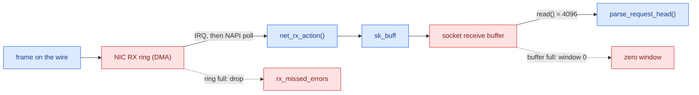
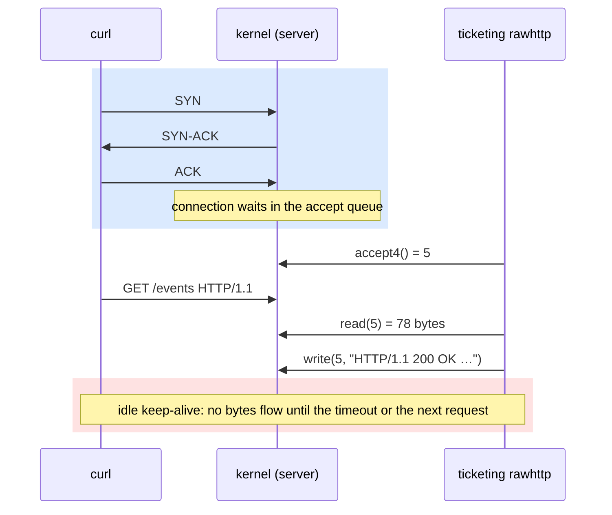
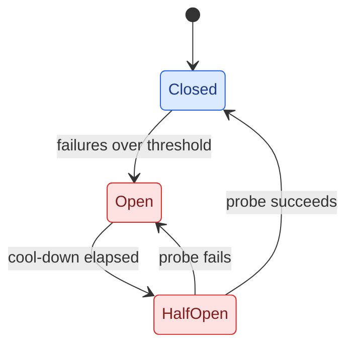
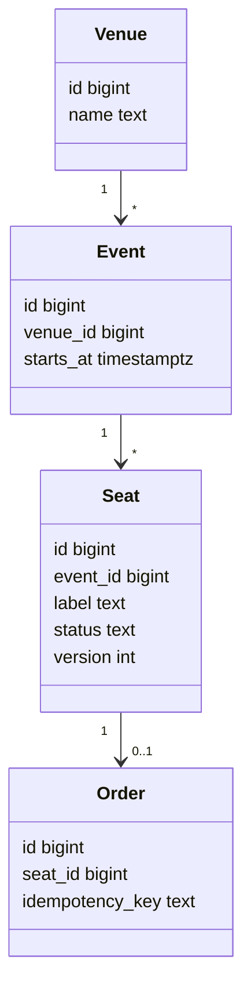

# Diagram Style

**Course Conventions**
**Ticketing Project**

---

Every lesson has at least one Mermaid diagram, and every module has a rendered hero diagram. The diagrams carry the course's question, **what makes data flow, and what makes it stop?**, so every figure uses the same two accents. CI renders every ```` ```mermaid ```` fence with `mmdc`, so a diagram that does not parse fails the build.

## Rules

1. **Pick the diagram type by what moves.**

   | Use | When | Example |
   |-----|------|---------|
   | `flowchart LR` | Pipelines: data moving through stages | NIC → ring → softirq → `sk_buff` → recv buffer → `read()` |
   | `sequenceDiagram` | Wire exchanges between parties over time | TCP handshake, TLS 1.3, OAuth code flow, gRPC call |
   | `stateDiagram-v2` | Lifecycles | TCP states, connection keep-alive, circuit breaker, saga |
   | `classDiagram` | Data models only | events, venues, seats, orders |

2. **Name real artifacts.** Nodes are things you can find in a capture, a trace or the code: `epoll_wait()`, `sk_buff`, `accept queue`, `seats.version`, `pg_locks`, `parse_request_head()`. Never "Service A", "Server" or "DB".
3. **Two accents, always.** `flow` marks where data moves; `stop` marks where it waits, is buffered, is refused or is locked. Use only these two class accents, so the question is visible in every figure.
4. **First figure in the first mechanism section**, followed by an italic caption: `*Figure 1 — What the reader should notice.*` Number figures per lesson.
5. **Label edges with what crosses them**: bytes, frames, syscalls, messages (`"SYN"`, `"read() = 4096"`, `"HEADERS + DATA"`).
6. **Hero diagrams.** Each module has `docs/NN-slug/diagrams/hero.mmd`, rendered with the `/diagram` skill into `hero.excalidraw`, `hero.svg` and `hero.png`. Once a lesson is `Done`, the overview embeds `hero.svg` under its thesis with a file-relative image link (``), and the linter requires all four files. Module 8's hero (the full-stack journey of one `POST /orders`) doubles as the README's top image.

## The Accents

Paste these two lines into any `flowchart` or `stateDiagram-v2`. The light fills with dark text read well on both GitHub themes.

```text
classDef flow fill:#dbeafe,stroke:#2563eb,color:#1e3a8a
classDef stop fill:#fee2e2,stroke:#dc2626,color:#7f1d1d
```

Apply them with `class a,b flow` or inline with `node:::stop`. `sequenceDiagram` has no classes; use `rect` blocks with the same hues: `rect rgb(219, 234, 254)` for flow phases and `rect rgb(254, 226, 226)` for stop phases.

## Snippets

### Pipeline (`flowchart LR`)



*Figure 1 — A received frame flows up through buffers; every buffer is also a place where flow stops.*

### Wire exchange (`sequenceDiagram`)



*Figure 2 — The kernel completes the handshake before the process calls accept().*

### Lifecycle (`stateDiagram-v2`)



*Figure 3 — A circuit breaker is a deliberate stop with a timer.*

### Data model (`classDiagram`)



*Figure 4 — The ticketing model; `seats.version` is the optimistic-lock column from lesson 4.2.*

## Syntax Rules That Prevent Broken Builds

| Mistake | Fix |
|---------|-----|
| `flowchartLR` | `flowchart LR` (space after the type) |
| `# comment` | `%% comment` |
| Unquoted labels with `( ) [ ] { } / : < >` | Quote them: `n["accept() (blocking)"]` |
| Spaces in node IDs | `acceptQueue` or `accept-queue`, and put the words in the label |
| A `subgraph` without `end` | Every `subgraph id["Label"]` closes with `end` |
| `%%{init: …}%%` not on the first line | Init directives must be the first line of the fence |
| `classDef` in a `sequenceDiagram` | Use `rect rgb(…)` blocks instead |

## Checking Diagrams Locally

CI extracts every fence and renders each one. To do the same locally:

```bash
python3 scripts/lint_lessons.py --extract-mermaid /tmp/mmd
for f in /tmp/mmd/*.mmd; do
  npx -y @mermaid-js/mermaid-cli@11 -i "$f" -o "/tmp/mmd/$(basename "$f" .mmd).svg" || echo "BROKEN: $f"
done
```

`mmdc` only accepts outputs ending in `.svg`, `.png`, `.pdf` or `.md`, so render to a throwaway `.svg` rather than `/dev/null`. For quick iteration, paste a fence into [mermaid.live](https://mermaid.live).
