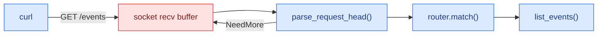

# Lesson Skeleton

**Course Conventions**
**Ticketing Project**

---

Every lesson in `docs/NN-slug/LL-TITLE.md` follows this skeleton. `scripts/lint_lessons.py` enforces the structural parts (header, Reality-check form, one See It, at least one Mermaid diagram, Python → Go → Rust order, file-relative links that resolve, Next/Previous/Module Overview present, existing Key Files). Review enforces the rest.

Copy the template below, replace every `<…>`, and delete the guidance comments.

## Template

````markdown
# <Title in Title Case>

**Lesson <N> of <M>: <Module name>**
**Ticketing Project**

---

## Table of Contents

1. [<Why section title>](#1-<why-anchor>)
2. [<Mechanism section title>](#2-<mechanism-anchor>)
3. [Code: Python](#3-code-python)
4. [Code: Go](#4-code-go)
5. [Code: Rust](#5-code-rust)
6. [See It: <what we observe>](#6-see-it-<anchor>)
7. [What People Miss](#what-people-miss)
8. [Key Files Summary](#key-files-summary)
9. [Summary](#summary)
10. [Checklist](#checklist-what-you-should-be-able-to-explain)

---

## Learning Objectives

After reading this document, you will understand:

- <What the mechanism is, in one line>
- <How it works at the level below the one most people stop at>
- <How the three runtimes expose it differently>
- <What breaks when it is misused, and how you would see it>

Key mental models to internalize:

- **<The module's flow question, answered for this lesson>**: <what makes data flow here, and what makes it stop>
- **<Second model>**: <one sentence>

Common misconceptions to avoid:

- "<The misconception, as people say it>". <What is actually true, in one sentence.>

---

## 1. <Why: the problem this mechanism exists to solve>

<Start from the problem, not the API. Build the need before the solution.>

```
TICKETING EXAMPLE: <one concrete moment in the ticketing service where this
problem shows up, with real routes, tables or bytes>
```

---

## 2. <Mechanism: how it actually works>

<Explain the mechanism from first principles. The first figure lives here.>



*Figure 1 — <What the reader should see in this figure, in one sentence>.*

```
TICKETING EXAMPLE: <the mechanism applied to the ticketing service>
```

---

## 3. Code: Python

<Demo first (`demos/<mm>/<ll>/python/main.py`), then the app change
(`apps/python/src/ticketing/<package>/<file>.py`). Python carries the
narrative: explain every line that teaches the mechanism.>

```python
<the smallest excerpt that shows the mechanism>
```

```
TICKETING EXAMPLE: <how this code serves the ticketing service>
```

---

## 4. Code: Go

<The same demo and app change in Go, with the same names. Explain only what
differs from Python: the runtime, the types, the error handling.>

```go
<excerpt>
```

```
TICKETING EXAMPLE: <the same moment, in the Go port>
```

---

## 5. Code: Rust

<The same in Rust. Explain only what differs: ownership, async runtime, types.>

```rust
<excerpt>
```

```
TICKETING EXAMPLE: <the same moment, in the Rust port>
```

---

## 6. See It: <what we observe>

<Name at least two tools. Every command is exact and copy-pasteable in the lab;
every excerpt is real output (3–10 lines) captured with the command above it.>

### 6.1 <tool> — <what it shows>

```bash
<exact command>
```

```text
<3–10 lines of real output>
```

<One paragraph: which line to look at, and why it proves the mechanism.>

### 6.2 <second tool> — <what it shows>

```bash
<exact command>
```

```text
<3–10 lines of real output>
```

<One paragraph of interpretation.>

### Reproduce

```bash
just see <mm>/<ll>
```

`demos/<mm>/<ll>/see.sh` replays both observations and passes when a line matches `EXPECT='<regex>'`.

---

## What People Miss

### <Trap, as a statement>

> [!WARNING]
> **Reality check (<kebab-slug>) —** <What goes wrong in practice, why, how you would see it with the tools above, and what the live code does about it.>

### <Second trap>

> [!WARNING]
> **Reality check (<kebab-slug>) —** <…>

---

## Key Files Summary

| File | Role | Language |
|------|------|----------|
| `demos/<mm>/<ll>/python/main.py` | <role> | Python |
| `demos/<mm>/<ll>/go/main.go` | <role> | Go |
| `demos/<mm>/<ll>/rust/main.rs` | <role> | Rust |
| `apps/python/src/ticketing/<package>/<file>.py` | <role> | Python |
| `apps/go/internal/<package>/<file>.go` | <role> | Go |
| `apps/rust/src/<package>/<file>.rs` | <role> | Rust |
| `demos/<mm>/<ll>/see.sh` | Reproducible See It | Bash |

---

## Summary

| Concept | Key Takeaway |
|---------|--------------|
| <concept> | <one sentence> |
| <concept> | <one sentence> |

---

## Checklist: What You Should Be Able to Explain

- [ ] <A mechanism, traced end to end, out loud>
- [ ] <What the See It output proves, line by line>
- [ ] <How the three runtimes differ here, and why>
- [ ] <The reality check, and how you would detect it in production>

---

**Next:** [<LL+1>-<TITLE>.md](./<LL+1>-<TITLE>.md) · **Previous:** [<LL-1>-<TITLE>.md](./<LL-1>-<TITLE>.md) · **Module Overview:** [00-OVERVIEW.md](./00-OVERVIEW.md)
````

## Rules Behind the Template

### Header (lines 1–4, linted)

Line 1 is `# Title`, line 2 is blank, line 3 is `**Lesson N of M: <Module name>**` and line 4 is `**Ticketing Project**`. N is the file's two-digit number, and M is the number of lesson files in the folder. Every lesson in a folder uses the same module name, the one in the module overview's title. Adding a lesson means updating M in every lesson of that module; the linter catches the ones you miss.

### Numbered sections

Sections are numbered `## 1.`, `## 2.` and so on, without gaps. Lessons that need more than one *why* or mechanism section add them before the code sections, so the numbers shift, but the order never changes: why → mechanism → `Code: Python` → `Code: Go` → `Code: Rust` → `See It`. The `What People Miss`, `Key Files Summary`, `Summary` and `Checklist` sections are not numbered.

### Learning Objectives

There are three lists, always in this order: what you will understand, key mental models, and common misconceptions. The first mental model is always the module's flow question, answered for this lesson (see each `00-OVERVIEW.md`, "The flow question").

### Ticketing example fences

Every numbered section before See It closes with a plain fence (no language tag) starting `TICKETING EXAMPLE:`. Use real routes (`POST /orders`), tables (`seats.version`) and bytes, not hypothetical services.

### Code sections

Each code section shows the demo first, then the app change. Python explains; Go and Rust explain only what differs. Excerpts are short (under about 40 lines) and match the files exactly. Point to the full file in Key Files Summary instead of pasting it.

### See It (linted: exactly one)

- Name at least two tools, each with an exact command that works in `just lab`.
- Each excerpt is 3–10 lines of real output, captured with the command shown. Trim with `…`, never edit values.
- Say which kernel or runtime version the capture came from when the output depends on it.
- End with a `### Reproduce` subsection pointing at `just see <mm>/<ll>`. The `see.sh` declares `EXPECT=` and must pass in the lab and in CI.
- Tool choices come from `docs/SEE-IT-TOOLBOX.md`.

### What People Miss (linted form)

Each trap is a `###` heading followed by a callout whose first two lines are exactly:

```text
> [!WARNING]
> **Reality check (kebab-slug) —** …
```

The slugs come from the design spec's module ladder. Each callout says what goes wrong, why, how to see it, and what the live code does about it. The course site converts this exact form into a `<RealityCheck>` component, so do not change the punctuation (an em dash before the closing `**`).

### Diagrams (linted: at least one)

At least one ```` ```mermaid ```` fence per lesson, in the first mechanism section, with an italic `*Figure N — …*` caption. Follow `docs/DIAGRAM-STYLE.md`: real artifact names, and the `flow` / `stop` class accents. CI renders every fence with `mmdc`.

### Key Files Summary (linted: paths exist)

The first column holds repo-root paths in backticks, such as `apps/python/src/ticketing/rawhttp/parser.py`. Backticked paths are display text, so they are resolved from the repo root. If you make a cell a link, its target is file-relative like every other link: `[parser.py](../../apps/python/src/ticketing/rawhttp/parser.py)`. Every path must exist when the lesson merges. List the demo files, the app files in all three ports and the `see.sh`.

### Links (linted)

Links are file-relative, the way GitHub renders them. From a lesson in `docs/01-http-by-hand/`:

| Target | Link |
|--------|------|
| A lesson in the same module | `[02-BODIES-CONTENT-LENGTH-AND-CHUNKED.md](./02-BODIES-CONTENT-LENGTH-AND-CHUNKED.md)` |
| Another module | `[docs/02-rest-done-properly/00-OVERVIEW.md](../02-rest-done-properly/00-OVERVIEW.md)` |
| Course-wide docs | `[docs/SEE-IT-TOOLBOX.md](../SEE-IT-TOOLBOX.md)` |
| App code or demos | `[parser.py](../../apps/python/src/ticketing/rawhttp/parser.py)` |

`scripts/lint_lessons.py` resolves every link from the file that contains it. A link that resolves only from the repo root (`docs/02-rest-done-properly/00-OVERVIEW.md` written inside `docs/`) fails, and the error names the relative path to use. Links starting with `/` fail too. The CI link check (lychee) resolves the same way, and the course site resolves each link against the lesson's source path.

### Next / Previous / Module Overview (linted: present and resolving)

- **Next**: the next lesson (`./02-….md`). The last lesson of a module links to the next module's overview (`../02-rest-done-properly/00-OVERVIEW.md`), and lesson 8.5 links to `../COURSE-OVERVIEW.md`.
- **Previous**: the previous lesson. The first lesson of a module links to the previous module's last lesson (`../00-how-bytes-move/06-HOW-RUNTIMES-WRAP-SYSCALLS.md`), and lesson 0.1 links to `../COURSE-OVERVIEW.md`.
- **Module Overview**: `./00-OVERVIEW.md`.

Because targets must exist, link the next lesson only once it exists. Until then, point Next at the module overview.

### Length

Aim for 700–1,100 lines per lesson. That is shorter than the sibling course's lessons, because each lesson carries three code sections and a See It.
